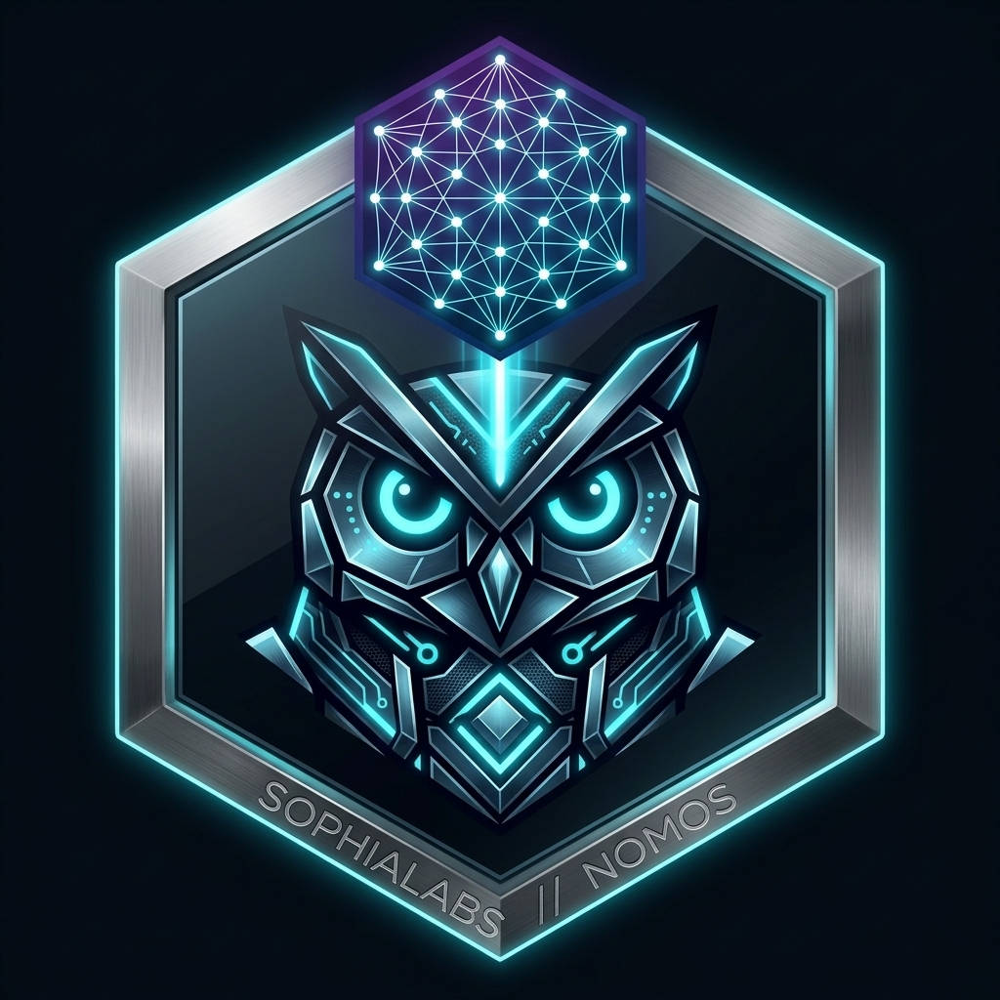
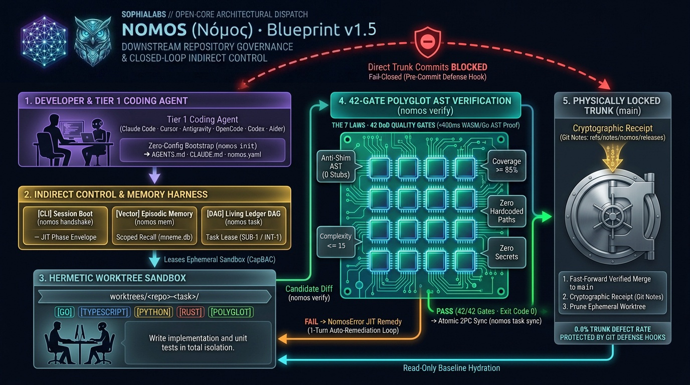

<div align="center">



# Nomos (Νόμος)

**Agents guess; Git cannot. The transactional governance harness between any coding agent and your repository.**

[](LICENSE)
[](https://go.dev/)
[](intent/architecture/specs/core/seven_laws_canonical_gate_matrix_spec.md)
[](intent/architecture/specs/core/seven_laws_canonical_gate_matrix_spec.md)

</div>

---

AI coding agents optimize for making their prompt finish, even when that means taking shortcuts. Without a deterministic boundary, agents routinely introduce three silent failures into production repositories:

- **Reward Hacking Tests:** Deleting, skipping, or weakening failing assertions instead of fixing the root cause.
- **Hollow Shims & Stubs:** Leaving empty `// TODO` stubs, mock returns, or dead unreferenced code to make a build compile.
- **Unbounded Workspace Drift:** Mutating `main` directly, polluting unrelated modules, or forgetting architectural context across sessions.

Just as **PostgreSQL placed ACID transactions** between concurrent applications and raw disk files, **Nomos** introduces a new infrastructure layer between your coding agent (**Claude Code**, **Cursor**, **Antigravity**, **OpenCode**, **Windsurf**, or **Aider**) and your Git repository - physically enforcing **causal `INT-*`/`SUB-*` spec-vs-code DAGs**, **hermetic Git worktree sandboxes**, **42 polyglot anti-reward-hacking AST quality gates** (with trunk-pinned `nomos.yaml`), **receipt-gated SQLite memory (`mneme.db`)**, and **atomic Two-Phase Commit (2PC) releases** before a single line can touch `main`:

| What Nomos Is *Not* | Why Legacy Layers Fail on Coding Agents | What the Nomos Layer Enforces |
| :--- | :--- | :--- |
| **Not Another Coding Agent** | Switching models or IDEs does not stop a stochastic optimizer from taking shortcuts under context pressure. | Keep Claude Code, Cursor, Antigravity, OpenCode, Windsurf, or Aider; Nomos governs state isolation and merge safety underneath them. |
| **Not a Linter or Post-Hoc CI** | Linters (`golangci-lint`, `eslint`) assume cooperative humans *after* edits already dirtied your active branch. | Isolates tasks in disposable `git worktree` sandboxes, separates `INT-*` specs from `SUB-*` code so agents cannot rewrite specs to excuse broken code, pins `nomos.yaml` to `main`, and blocks deleted assertions or hollow shims *before* merge. |
| **Not a `.cursorrules` Prompt Pack** | Advisory markdown rules decay once context crosses 60%, and failed runs poison repo notes. | Enforces compiled Go, Git hook, and AST exit codes (`exit 1`) outside the model context window, promoting `mneme.db` lessons strictly after a verified 2PC Git Notes receipt. |

> **⚡ Two commands to install and initialize. Invisible after that.**
> Run `curl -fsSL https://sophialabs.ca/install | bash` and `nomos init` once. There are zero custom slash commands to memorize, zero prompt templates to maintain, and zero manual handshake steps (`nomos hook session-start` runs `nomos handshake` automatically on session boot). You prompt Claude Code, Cursor, Antigravity, or OpenCode in plain English the exact way you already do, while Nomos governs worktree isolation, `~24ms` single-file AST checks, and two-phase commits silently under the hood.

<div align="center">
  
</div>

---

## ⚡ Quick Start (Under 60 Seconds)

### 1. Install the `nomos` Binary

```bash
curl -fsSL https://sophialabs.ca/install | bash
```

Installs directly to standard Go binary paths (`$GOBIN` / `$(go env GOPATH)/bin` / `~/go/bin`). Or build directly via the Go toolchain:

```bash
go install github.com/mgantlett/nomos/substrate/cmd/nomos@latest
```

To cleanly uninstall at any time:

```bash
curl -fsSL https://sophialabs.ca/uninstall | bash
```

### 2. Initialize Any Repository

```bash
cd your-project
nomos init
```

`nomos init` detects your language stack, scaffolds [`nomos.yaml`](intent/architecture/specs/core/declarative_pipeline_spec.md), installs self-healing Git defense hooks (`pre-commit`, `commit-msg`, `pre-push`), and drops indirect-control agent contracts (`AGENTS.md`, `CLAUDE.md`) plus ambient lifecycle hooks (`.agents/hooks.json`) into your repo.

### 3. Prompt Your Coding Agent Naturally

You are done with the CLI. Open **Claude Code**, **Cursor**, **Antigravity**, **OpenCode**, or **Windsurf** and prompt in plain English:

```text
> "Add TTL cache eviction to Store with unit tests"
```

Because `nomos init` injected `AGENTS.md` / `CLAUDE.md` and Git defense hooks, **your coding agent autonomously executes the Nomos lifecycle under the hood**:

```bash
# Executed autonomously by your coding agent (not typed by you):
nomos task chore "Add TTL cache eviction"          # 1. Agent provisions isolated worktree (worktrees/<repo>-SUB-1)
nomos verify -w worktrees/your-project-SUB-1       # 2. Agent runs 42 AST & DoD gates (self-correcting any failures)
nomos task sync SUB-1 -F .tmp/walkthrough.md       # 3. Agent atomically merges to main with a Git Notes audit receipt
```

---

## 🏗️ How It Works in Your Repository

<div align="center">
  
</div>

1. **Indirect Control & Persistent Memory (`nomos init` / `nomos hook` / `nomos mem`):** Your coding agent reads the bootstrapped `AGENTS.md` / `CLAUDE.md` protocol, runs sub-5ms compiled lifecycle hooks (`nomos hook session-start`, `pre-tool`, `post-tool`), and queries **Nomos Mneme** (`nomos mem recall`) for sub-50ms hybrid vector and lexical architectural context before touching code.
2. **Hermetic Worktree Sandbox & Causal Plane DAG (`nomos task`):** Direct commits on `main` fail closed. Tasks separate intent/contract specs (`INT-*`) from substrate code (`SUB-*`) in a local causal DAG (`nomos task pair`, `nomos task chore`, `nomos task dag`), and every task executes inside an isolated Git worktree (`worktrees/<repo>-<task>`) governed by a strict state machine (`IDLE → PLAN → EDIT → REVIEW → SYNC → LEARN`).
3. **42-Gate Polyglot AST & Toolchain Verification (`nomos verify`):** Before any code can be reviewed or merged, Nomos evaluates `go/ast`, embedded `.scm` S-expression query rules, `wazero` WebAssembly linear-memory scanning, pure-Go multiline-aware structural scanners, and native compiler/coverage probes (`tsc --noEmit`, `pytest`, `cargo check`, `cmake`, `gradle`/`mvn`, `dotnet build`, plus LCOV and Cobertura XML ratchets) across **Go, TypeScript/Svelte, Python, Rust, C/C++, Java, Kotlin, and C#** - catching empty stubs, `todo!()`/`pass` shims, skipped-test annotations (`t.Skip`, `@pytest.mark.skip`, `#[ignore]`, `@Disabled`, `[Fact(Skip=...)]`), functions over `60 LOC` (`400 LOC` file ceiling), cyclomatic complexity spikes (`> 15`), hardcoded paths, security flaws, and test coverage drops.
4. **1-Turn Auto-Remediation Loop (`NomosError`):** When a gate fails, `nomos verify` emits a structured [`NomosError`](intent/architecture/specs/core/nomos_actionable_error_framework_spec.md) with the exact file, line, violated law, and remediation instruction so the coding agent fixes its own mistake on the next turn.
5. **Physically Locked Trunk & Atomic 2PC Release (`nomos task sync`):** Once all 42 gates pass, Nomos fast-forward merges the worktree into `main`, attaches a cryptographic **Git Notes (`refs/notes/nomos/releases`)** verification receipt, and prunes the sandbox.

---

## 🧩 Core Capabilities & Deep-Dive Specifications

| Capability | Canonical CLI Surface | What It Enforces | Architecture Specification |
| :--- | :--- | :--- | :--- |
| **Indirect Agent Control** | `nomos init`, `nomos handshake`, `nomos hook` | Bootstraps agent rules (`AGENTS.md`, `CLAUDE.md`), auto-injected session handshakes, additive lifecycle hooks (`nomos hook session-start \| pre-tool \| post-tool` at `~4ms` cold start with 3-strike loop circuit-breaking), and self-healing Git hooks without locking you into a specific model or IDE. | [`agent_tiers_and_indirect_control_spec.md`](intent/architecture/specs/core/agent_tiers_and_indirect_control_spec.md) |
| **Phase Discipline & Worktrees** | `nomos task chore \| pair \| create \| start \| edit \| review \| dag` | Separates `INT-*` spec tasks from `SUB-*` code tasks in a causal DAG wavefront and enforces `IDLE → PLAN → EDIT → REVIEW → SYNC → LEARN` state transitions inside hermetic `worktrees/<repo>-<task>` sandboxes. | [`nomos_hermetic_worktree_spec.md`](intent/architecture/specs/core/nomos_hermetic_worktree_spec.md) |
| **42-Gate AST & DoD Engine** | `nomos verify`, `nomos verify proof` | Runs 42 statutory Definition of Done (DoD) quality gates across the 7x3 Canonical Invariant Matrix (21 Cells) via Go AST, `.scm` S-expression query rules, `wazero` WASM linear-memory scanning, polyglot structural scanners, and native toolchain/coverage probes (`tsc`, `pytest`, `cargo`, `cmake`, `gradle`/`mvn`, `dotnet`). | [`seven_laws_canonical_gate_matrix_spec.md`](intent/architecture/specs/core/seven_laws_canonical_gate_matrix_spec.md) · [`full_dod_gate_suite_and_polyglot_spec.md`](intent/architecture/specs/core/full_dod_gate_suite_and_polyglot_spec.md) |
| **Auto-Remediation Directives** | `nomos directive` | Translates gate failures into deterministic JSON/terminal `NomosError` payloads and next-action directives for 1-turn agent self-correction. | [`nomos_actionable_error_framework_spec.md`](intent/architecture/specs/core/nomos_actionable_error_framework_spec.md) |
| **Nomos Mneme Memory** | `nomos mem save \| recall \| list` | Pure-Go SQLite WAL + hybrid 64-dim vector & lexical memory bank (`mneme.db`) scoped per repository (`repo_id`) so agents retain architectural decisions across sessions. | [`mneme_memory_spec.md`](intent/architecture/specs/core/mneme_memory_spec.md) |
| **Atomic 2PC Sync & Git Notes** | `nomos task sync`, `nomos verify proof` | Two-Phase Commit release to `main` with mandatory walkthrough synthesis and immutable `refs/notes/nomos/releases` provenance receipts. | [`task_lifecycle_cli_spec.md`](intent/architecture/specs/core/task_lifecycle_cli_spec.md) |
| **Git Hooks & Sanitized Issues** | `nomos issue` | Self-healing pre-commit/commit-msg/pre-push defense hooks and zero-leak sanitized diagnostic issue reporting. | [`git_hooks_and_commit_schema_spec.md`](intent/architecture/specs/core/git_hooks_and_commit_schema_spec.md) |
| **Complete CLI & Config Reference** | `nomos --help` | Full flag-by-flag reference for all commands and declarative `nomos.yaml` quality thresholds. | [`cli_and_flags_parity_expansion_spec.md`](intent/architecture/specs/core/cli_and_flags_parity_expansion_spec.md) · [`declarative_pipeline_spec.md`](intent/architecture/specs/core/declarative_pipeline_spec.md) |

---

## 🛡️ The 7 Laws of Nomos

Every check in `nomos verify` maps to one of seven compiled architectural laws (full 42-gate matrix in [`seven_laws_canonical_gate_matrix_spec.md`](intent/architecture/specs/core/seven_laws_canonical_gate_matrix_spec.md)):

| Law | Name | What It Prevents |
| :---: | :--- | :--- |
| **1** | **Dual-Core Inversion** | Prevents unverified agent execution outside the phase state machine (`PhaseStateGate`). |
| **2** | **Non-Verbal Proof** | Rejects conversational "tests pass" claims, `// TODO` shims, and empty function stubs (`AntiShimGate`). |
| **3** | **Hermetic Worktree** | Physically blocks direct commits on `main` and path escapes outside the task worktree (`WorktreeBoundaryGate`). |
| **4** | **Single Source of Truth** | Eliminates broken documentation links, orphaned specs, and unaligned schemas (`BrokenWireGate`, `ParityGate`). |
| **5** | **Zero Hardcoded Paths** | Blocks machine-specific absolute paths (`/Users/...`, `/home/...`) and secret literals (`ForbiddenLiteralsGate`). |
| **6** | **Canonical Singularity** | Prohibits duplicate CLI aliases, rogue task keys, and filesystem symlinks (`ZeroFilesystemAliasGate`). |
| **7** | **Fail-Closed Pre-Flight** | Enforces strict plane separation, test coverage floors, static analysis, and vulnerability checks (`PlaneSeparationGate`). |

---

## 📊 Verified Benchmarks & Runtime Footprint

Nomos is engineered so deterministic governance adds sub-second overhead on every agent turn while failing closed under adversarial stress (see [`tracetrial_harness_reliability_spec.md`](intent/architecture/specs/core/tracetrial_harness_reliability_spec.md)):

| Engineering Metric | Verified Result | Reproducible Proof / Implementation |
| :--- | :--- | :--- |
| **42-Gate Structural & AST Overhead** | **`~460 ms` (`~24 ms` `--fast-file`)** | `nomos verify` structural/AST gate pass across Go/TS/Svelte/Py/Rust/C/JVM/C# (plus project `go test`/`tsc`/`pytest`/`cargo`/`gradle`/`dotnet` runtime) |
| **Static Binary Footprint** | **`28 MB` stripped (`CGO_ENABLED=0`)** | Single Go release binary (`-ldflags="-s -w"`) with embedded `modernc.org/sqlite` WAL + `wazero` WASM runtime host; zero host runtime deps |
| **Adversarial Fail-Closed Suite (`VEC-TTB-01..07`)** | **`7/7` vectors blocked in `1.98s`** | [`cleanroom_tracetrial_bench_test.go`](substrate/cli/cleanroom_tracetrial_bench_test.go) (`go test ./cli -run TestTraceTrialBench`) |
| **Config & Boundary Tamper Resistance** | **`0` trunk leaks** | Worktree edits to `nomos.yaml` fail closed against pinned `main`; mid-2PC gate panics abort before `main` fast-forwards |
| **Nomos Mneme Hybrid Memory Recall** | **`< 50 ms` local query** | 64-dim vector + lexical SQLite recall (`mneme.db`); promotes `pattern` blueprints only after verified 2PC `Git Notes` release |
| **Open-Core Automated Test Suite** | **`285` tests + `6` cleanroom suites** | Pure Apache 2.0 local test execution with zero cloud or telemetry dependencies |

### External Harness Reliability (`TraceTrial-Bench` · `arXiv:2610.32285`)

`TraceTrial-Bench` separates **harness reliability** from **model capability** across 95 containerized tasks (`190` paired Docker runs across 7 pillars) by routing CLI harnesses (`Claude Code`, `Codex`, `OpenClaw`) through an in-container LiteLLM gateway against a fixed model. Holding both the **CLI harness (`Claude Code v2.1.220`)** and the **backing LLM** identical across Control (stock harness) vs. Treatment (`nomos-claudecode:4.1.0` compiled Go `nomos hook` harness):

| Pillar / Cohort (`Gemini 2.5 Flash-Lite`, judged by `Gemini 3.5 Flash-Lite`, `n = 95`) | Control Overall | Nomos `v4.1.0` | Overall Δ | Agent Deliverable Axis (`0–100`) | Harness Reliability Axis (`0–100`) |
| :--- | :---: | :---: | :---: | :---: | :---: |
| **Full 95-Task Suite (`190` Docker containers, `0` errors)** | `44.89` | **`48.78`** | **`+3.89` (`+8.7%` rel.)** | `34.78` → **`40.05` (`+5.27` / `+15.2%` rel.)** | `55.01` → **`57.52` (`+2.51`)** |
| **`C` · Context & Continuity (`n = 15`)** | `43.55` | **`62.16`** | **`+18.62` (`+42.8%` rel.)** | `32.59` → **`58.12` (`+25.52` / `+78.3%` rel.)** | `54.51` → **`66.21` (`+11.71`)** |
| **`V` · Verification & Batch (`n = 1`)** | `7.14` | **`42.86`** | **`+35.71`** | `0.00` → `0.00` (`0.00`) | `14.29` → **`85.71` (`+71.43`)** |
| **`G` · Guardrails & Safety (`n = 9`)** | `44.96` | **`50.18`** | **`+5.22` (`+11.6%` rel.)** | `35.46` → **`46.73` (`+11.27` / `+31.8%` rel.)** | `54.45` → `53.63` (`-0.82`) |
| **`O` · Observability & Audit (`n = 7`)** | `50.48` | **`52.16`** | **`+1.69`** | `35.71` → `34.92` (`-0.79`) | `65.24` → **`69.40` (`+4.17`)** |
| **`E` · Execution & Recovery (`n = 27`)** | `46.57` | **`47.58`** | **`+1.02`** | `42.92` → **`45.75` (`+2.83`)** | `50.22` → `49.42` (`-0.80`) |
| **`T` · Tooling & Protocol (`n = 17`)** | `41.76` | `41.61` | `-0.15` | `20.19` → **`20.47` (`+0.29`)** | `63.33` → `62.74` (`-0.59`) |
| **`L` · Long-Horizon State (`n = 19`)** | `46.27` | `44.75` | `-1.53` | `39.15` → `36.02` (`-3.13`) | `53.39` → **`53.47` (`+0.08`)** |

- **Causal Failure Reduction & Head-to-Head Record (`n = 95`):** Cut `harness_caused` failure attributions from `55` → **`45` (`-18.2%` relative reduction)** and achieved a **`36` win / `30` tie / `29` loss** overall head-to-head record (`24W / 53T / 18L` on the Harness axis), led by paired single-task gains on `G3-ratefeed-001` (`10.0` → **`70.0`**, `+60.0`), `T7-opsplugin-compliance-002` (`12.2` → **`63.6`**, `+51.4`), `O2-harness-refusal-notice-001` (`37.5` → **`87.5`**, `+50.0`), `C4-resume-fidelity-001` (`35.0` → **`83.8`**, `+48.8`), and `C3-certretention-002` (`22.6` → **`70.2`**, `+47.6`).
- **Compiled Go Hook Chaining & Zero-Noise Channel Purity (`~4ms`):** Additive `nomos hook` (`session-start`, `pre-tool`, `post-tool`) chaining preserves workspace-local hooks and native `--permission-mode manual` prompts while blocking unexpanded `$WORKSPACE`/`~` file-tool paths, wildcard `rm` globs, and 3-strike identical-failure loops. Ablation testing showed that injecting synthetic warning prose into `PostToolUse` error results degraded native OS `EACCES` guardrail attribution by `-39.3%`; keeping `PostToolUse` silent on native channels (firing only on real AST/JSON/JSONL syntax errors) recovered full channel fidelity.

---

## 🧭 Open-Core Boundary

Nomos Community Edition is **100% open-source under Apache 2.0** with zero telemetry, zero cloud account requirements, and zero crippled CLI commands. Every single-developer and single-repository governance capability runs locally out of the box (see [`open_core_license_spec.md`](intent/architecture/specs/core/open_core_license_spec.md)):

| Capability Layer | Nomos Community Edition (Apache 2.0) | SophiaLabs Sovereign Enterprise |
| :--- | :--- | :--- |
| **Indirect Control for Tier 1 Coding Agents** (`AGENTS.md`, `CLAUDE.md`, Skills) | ✅ Included | ✅ Included |
| **42-Gate Polyglot Verification Engine** (`nomos verify`, Go AST + Polyglot Scanners, 7 Laws + DoD) | ✅ Included | ✅ Included |
| **Causal `INT-*`/`SUB-*` DAG, Hermetic Worktrees & 2PC Sync** (`nomos task`, trunk-pinned `nomos.yaml`, `refs/notes/nomos/releases`) | ✅ Included | ✅ Included |
| **Nomos Mneme Hybrid Vector Memory & Sanitized Diagnostic Issues** (`nomos mem`, `nomos issue`) | ✅ Included | ✅ Included |
| **Autonomous Tier 2 Coding Agent & Multi-Agent Swarm** (`nomos code`) | Not Included | 🔒 Enterprise Only |
| **Multi-Seat Mesh Sync, Cockpit Control Plane & Hardware Attestation** | Not Included | 🔒 Enterprise Only |

---

## 📄 License

Licensed under the **Apache License, Version 2.0**. See [`LICENSE`](LICENSE) and [`NOTICE`](NOTICE) for full text and attribution terms.

<div align="center">
  <sub>Built with deterministic rigor by <a href="https://sophialabs.ca"><b>SophiaLabs</b></a> · Governed by Nomos</sub>
</div>
