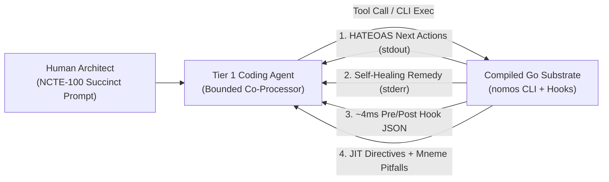

# The Agent-Steering Protocol & NCTE-100 Lexicon: Speaking Physics to Probabilistic Agents

## 1. The Third Axis: Beyond Transactional Code and Transactional Intent

Most engineering teams evaluate AI developer tooling along only one axis: **how code is edited**. Nomos began by locking down two foundational axes:

1. **Transactional Code (`substrate/`):** Protected trunk `main` is physically read-only (`Law 3`). Mutations occur inside isolated transient Git worktrees (`worktrees/<repo>-<KEY>`), pass 42 compiled Go and WebAssembly Tree-sitter AST gates (`Law 2`), and merge via atomic Two-Phase Commit (`2PC`) with cryptographic Git Notes receipts.
2. **Transactional Intent (`intent/`):** Specifications, configuration manifests, and causal `INT-<N>` / `SUB-<N>` task DAG cards are versioned, schema-validated (`Law 4`), and hemispherically separated from runtime code (`Law 7`).

Yet empirical evaluation across 190 paired containerized runs in `TraceTrial-Bench` revealed a third, orthogonal axis that governs whether a **Tier 1 coding agent** (`Claude Code`, `Antigravity`, `OpenCode`, `Cursor`) converges cleanly or spirals into context thrashing:

> **The Cybernetic Agent-Steering Protocol (`Law 1: Indirect Control`):** Every byte emitted by the `nomos` CLI on `stdout` and `stderr`, every JSON decision returned by `nomos hook`, and every imperative verb chosen by the human operator is **live control-plane compilation input** into the coding agent's attention window.

When an agent executes a CLI tool, it does not merely change state on disk. **The agent reads the output of `nomos` to decide its next thought and next tool call.** Treating CLI output and English prompts as casual human prose wastes context tokens, invites synonym drift, and forces probabilistic models to guess state transitions. Treating them as a **deterministic hypermedia and linguistic protocol** turns any off-the-shelf coding agent into a disciplined engineering co-processor - with zero custom slash commands, zero fragile prompt wrappers, and zero model fine-tuning.



---

## 2. The Five Channels of the Agent-Steering Protocol

Nomos steers Tier 1 coding agents across five deterministic, machine-verified feedback channels.

### Channel 1: HATEOAS `ActionAffordance` Hypermedia (`stdout`)

In classic web architecture, **HATEOAS** (*Hypermedia as the Engine of Application State*) means a client never hardcodes state transitions; each response embeds the exact valid next links for the current state.

Nomos applies HATEOAS directly to the terminal. Every orientation, inspection, and lifecycle command (`nomos status`, `nomos handshake`, `nomos task list`, `nomos task dag`, `nomos task show`, `nomos task start`, `nomos verify`, `nomos task sync`) computes phase-aware `ActionAffordance` vectors (`types.ActionAffordance` in `core/types/affordance.go`) and renders a `Next Actions` block at the bottom of `stdout`:

```text
  ◈ Next Actions:
    → nomos task start SUB-1623 --edit  (Provision isolated EDIT worktree for top ready task)
    → nomos task show SUB-1623          (Inspect full 3-section acceptance card before starting)
```

Why this matters for LLM cognition:
- **Zero Transition Hallucination:** In `IDLE`, the agent sees `nomos task start <KEY> --edit` or `nomos task chore "<title>"`. Inside `EDIT`, it sees `nomos verify` and `nomos task commit`. Inside `REVIEW` after `42/42` gates pass, it sees the exact `nomos task sync <KEY> -F <walkthrough-path>` command with the resolved walkthrough path pre-populated.
- **Machine Parity via `--json`:** Every state-bearing command exposes structured `--json` output carrying the same `next_actions` array for programmatic harnesses.

### Channel 2: Fail-Closed `NomosError` Self-Healing Remedies (`stderr`)

Standard CLI tools fail with opaque error strings (`invalid input` or `permission denied`), forcing an AI agent to spend 3 to 6 turns reading source code or guessing flag combinations.

Under `SPEC-ERR-001`, every fail-closed rejection in Nomos returns a typed `NomosError` (`ERR_PHASE_VIOLATION`, `ERR_VALIDATION_FAILED`, `ERR_CROSS_PLANE_MUTATION`, `ERR_CANONICAL_VIOLATION`) paired with a **executable 1-turn `Remedy:`**:

- **Unstructured Backlog Card Rejection:** If an agent runs `nomos task create "Title" -d "plain prose"` without the 3-section acceptance contract, Nomos rejects the call and prints two copy-pasteable remedies: the `--scope` / `--ac` / `--verify` synthesis command for multi-step features, and `nomos task chore "Title"` for single-step fixes.
- **Cross-Plane Mutation Rejection (`Law 7`):** If an `INT-*` worktree touches `substrate/`, `PlaneSeparationGate` fails closed and emits the exact `git checkout` + `nomos task start SUB-*` remediation sequence.

Instead of scolding the agent, `stderr` hands the agent the exact steering wheel movement required to re-enter the legal flight envelope in one turn.

### Channel 3: Sub-5ms Ambient Hook Interception & Silent-Allow Discipline (`nomos hook`)

Waiting until `git commit` to tell an agent that it edited fifteen files directly on protected trunk `main` wastes thousands of output tokens. Conversely, injecting noisy JSON banners into every successful `bash` or `grep` tool call pollutes context and masks native compiler errors.

Nomos resolves this tension through **Asymmetric Hook Discipline** (`~4ms` compiled Go execution):

1. **`nomos hook session-start`:** Auto-heals `.git/hooks` defense shims and injects a compact phase, active-task, and ready-wavefront orientation banner at session boot.
2. **`nomos hook pre-tool`:** Intercepts mutating tool calls *before* disk I/O occurs:
   - Blocks direct edits on read-only `main` and instructs the agent to run `nomos task chore "<title>"` or `nomos task start <KEY> --edit`.
   - Blocks unexpanded shell variables (`$HOME`, `~`) passed to native file tools that do not perform shell expansion.
   - Blocks direct SQLite file tampering (`ADR-0062`), `git stash`, wildcard `rm`, and `.git/hooks` tampering.
   - **3-Strike Loop Circuit-Breaker (`Law 1`):** Hashes consecutive identical failing tool invocations and trips a hard circuit breaker on the third identical strike so a confused agent cannot burn budget in an infinite retry loop.
3. **`nomos hook post-tool`:** Remains **100% silent (`0 bytes`)** on read-only and shell command channels so native OS exit codes and compiler diagnostics reach the model unadulterated, firing in-memory AST and LOC radar advisories strictly when an edited source file crosses structural thresholds.

### Channel 4: JIT Phase Directives & Mneme Pitfall/Pattern Distillation (`LEARN`)

Static `3,000`-line system prompts suffer from severe middle-context attention decay. Nomos keeps root `AGENTS.md` / `CLAUDE.md` compressed to the One-Page 7-Law Invariant Card and delivers detailed guidance **Just-In-Time (JIT)** per lifecycle phase:

- **Phase-Scoped Directives (`nomos directive`):** Entering `PLAN`, `EDIT`, `REVIEW`, or `SYNC` surfaces only the directives bound to that phase (`plan_03_nomos_controlled_technical_english.md`, `review_01_dod_gates.md`, `sync_01_atomic_2pc_and_receipts.md`).
- **Closed-Loop `Trap -> Fix` Distillation:** Whenever `nomos verify` records a gate failure inside a worktree and the task subsequently passes `42/42` gates during `nomos task sync`, Nomos automatically distills the verified **Learned Pitfall** (`gate + package -> verified fix`) and **Verified Pattern** (`files + exported symbols + AST intents + tests`) into repository-scoped SQLite `Nomos Mneme`. On the next `nomos task start`, those exact pitfalls and patterns are injected into the orientation banner so no agent repeats the same mistake twice.

### Channel 5: Self-Documenting CLI Surface Completeness (`Cell 6.2`)

Whenever an agent is uncertain about a command's contract, its natural reflex is `--help`. Under `INV-PARITY-011`, `ScanCobraSurfaceCompletenessInDir` in `ZeroAliasGate` (`Cell 6.2`) walks the Go AST of `substrate/cli` and **fails closed** if any static `&cobra.Command{}` omits a non-empty `Use`, `Short`, `Long`, or runnable `Example` block, or introduces duplicate command `Aliases` (`Law 6`).

---

## 3. Speaking Succinctly to Agents: `NCTE-100` & The 36-Term Action Lexicon

Indirect control works in **both** directions:
- **Substrate -> Agent:** Directives, error remedies, and task cards compiled by Nomos.
- **Human Architect -> Agent:** Natural-language instructions typed into the IDE or CLI prompt.

Large language models map ambiguous English onto wide probability distributions. Telling an agent *"You should ideally check the temp branch sandbox and clean up any old stuff as needed before shipping"* activates vague training priors: the model may invent ad-hoc bash scripts, run destructive `rm` commands, or skip `nomos verify`.

**Nomos Controlled Technical English (`SPEC-NCTE-100`)** eliminates linguistic entropy through five mechanical rules enforced by `substrate/src/nomos/modules/ncte` (`nomos directive --lint <file>`):

1. **Tight Sentence Bounds:** Descriptive sentences `<= 25` words; procedural instructions `<= 20` words; paragraphs `<= 6` sentences; prose table cells `<= 12` words.
2. **Imperative Mood & Active Voice:** Start procedural instructions with an active imperative verb (`Verify`, `Pair`, `Mutate`, `Sync`). Reject passive voice (`was updated`, `is handled`).
3. **Zero Ambiguous Modals:** Prohibit `should`, `would`, `could`, `might`, `ideally`, `as needed`, and `and/or`.
4. **Atomic Procedural Steps:** Express one discrete action per procedural sentence rather than chaining three imperatives with conjunctions.
5. **Canonical Term Singularity (`Law 6`):** Use **one canonical verb or noun** per architectural concept across prompts, task cards, and specs.

### 3.1 The 36-Term Succinct Action Lexicon (`nomos directive --lexicon`)

Query this compiled registry anytime from the terminal via `nomos directive --lexicon`, filter by domain via `nomos directive --lexicon --domain <domain>`, or resolve a synonym via `nomos directive --term <word>`.

#### Domain 1: Lifecycle & Tasks (`--domain lifecycle`)

| Canonical Term | POS | Succinct Meaning | Avoid (Banned Synonyms) | Canonical CLI Binding |
| :--- | :--- | :--- | :--- | :--- |
| **`Pair`** | Verb | Allocate linked `INT-<N>` and `SUB-<N>` twin tasks atomically. | bundle, couple | `nomos task pair` |
| **`Chore`** | Noun | Single-step `burden: 1` task provisioned directly into `EDIT`. | quickfix, hotfix | `nomos task chore` |
| **`Start`** | Verb | Provision an isolated task worktree and mint a CapBAC lease. | spin up, kick off | `nomos task start` |
| **`Commit`** | Verb | Record a Dual-Layer worktree snapshot on `feature/<KEY>`. | checkpoint, snapshot | `nomos task commit` |
| **`Review`** | Verb | Lock edits and evaluate all 42 Definition of Done gates. | eyeball, double-check | `nomos task review` |
| **`Sync`** | Verb | Execute atomic 2PC fast-forward merge to trunk with receipt. | ship, land, push to prod | `nomos task sync` |
| **`Abort`** | Verb | Revoke active CapBAC lease and remove unmerged worktree. | abandon, scrap | `nomos task abort` |
| **`Prune`** | Verb | Sweep orphaned worktrees and merged `feature/*` branches. | delete, clean up, wipe | `nomos task prune` |

#### Domain 2: Verification & Proofs (`--domain verification`)

| Canonical Term | POS | Succinct Meaning | Avoid (Banned Synonyms) | Canonical CLI Binding |
| :--- | :--- | :--- | :--- | :--- |
| **`Verify`** | Verb | Run automated DoD gates and assert compilation exit code `0`. | check, test, inspect | `nomos verify` |
| **`Attest`** | Verb | Prove gate mutation sensitivity (`MS`), `FPR`, and anti-vacuity. | certify, vouch | `nomos verify proof` |
| **`Reject`** | Verb | Halt execution fail-closed with a typed non-zero exit code. | drop, ignore, fail | - |
| **`Seal`** | Verb | Attach an immutable cryptographic Git Note onto release refs. | stamp, finalize, tag | - |
| **`Receipt`** | Noun | Cryptographic review or 2PC release proof in Git Notes/SQLite. | note, log, certificate | - |
| **`Gate`** | Noun | Deterministic AST or runtime invariant evaluator in `verify`. | guardrail, rule check | `nomos capabilities --type gate` |
| **`Probe`** | Noun | Uniquely addressable diagnostic sensor inside a 7x3 Law cell. | detector, sniff | `nomos capabilities` |
| **`Mutant`** | Noun | Synthetic AST defect injected to prove `100%` gate kill rate. | dummy bug, fake error | `nomos verify proof` |

#### Domain 3: Isolation & Software Physics (`--domain isolation`)

| Canonical Term | POS | Succinct Meaning | Avoid (Banned Synonyms) | Canonical CLI Binding |
| :--- | :--- | :--- | :--- | :--- |
| **`Trunk`** | Noun | Protected read-only primary Git branch (`main`). | master, root branch, upstream | - |
| **`Worktree`** | Noun | Isolated transient task directory under `worktrees/`. | sandbox, folder, temp branch | - |
| **`Plane`** | Noun | Hemispherically separated domain: `intent` or `substrate`. | layer, side, zone | - |
| **`Lease`** | Noun | Step-bounded `#CapBACLease` authorizing phase mutations. | permit, ticket, lock | `nomos task status` |
| **`Mutate`** | Verb | Modify persistent repository files or ledger state. | change, tweak, patch | - |
| **`Wavefront`** | Noun | Causal DAG tasks with zero unresolved `depends_on` blockers. | queue, ready list | `nomos task dag` |
| **`Twin`** | Noun | Bilateral counterpart linking `INT-<N>` and `SUB-<N>`. | mirror task, companion | `nomos task pair` |
| **`Hull`** | Noun | Active worktree AST symbol exports, imports, and file mass. | footprint, blast zone | `nomos physics` |

#### Domain 4: Memory & Knowledge (`--domain memory`)

| Canonical Term | POS | Succinct Meaning | Avoid (Banned Synonyms) | Canonical CLI Binding |
| :--- | :--- | :--- | :--- | :--- |
| **`Save`** | Verb | Persist a repository-scoped reflection, decision, or axiom. | stash, jot, remember | `nomos mem save` |
| **`Recall`** | Verb | Query local or cross-repo (`-A`) Mneme records by keyword. | fetch memory, lookup | `nomos mem recall` |
| **`Distill`** | Verb | Extract verified `Trap -> Fix` pitfalls during `task sync`. | summarize, condense | - |
| **`Pitfall`** | Noun | Machine-recorded gate failure paired with its verified fix. | gotcha, footgun | `nomos handshake` |
| **`Pattern`** | Noun | Verified tuple of files, symbols, AST intents, and tests. | recipe, boilerplate | `nomos handshake` |
| **`Axiom`** | Noun | Non-negotiable architectural invariant stored in Mneme. | tip, guideline | `nomos mem list` |

#### Domain 5: Cybernetic Steering (`--domain steering`)

| Canonical Term | POS | Succinct Meaning | Avoid (Banned Synonyms) | Canonical CLI Binding |
| :--- | :--- | :--- | :--- | :--- |
| **`Handshake`** | Verb | Initialize session, validate leases, and emit JIT directives. | boot, connect, login | `nomos handshake` |
| **`Affordance`** | Noun | Deterministic HATEOAS `Next Actions` command on `stdout`. | suggestion, next tip | `nomos status` |
| **`Remedy`** | Noun | Self-healing 1-turn recovery command on a `NomosError`. | workaround, hint | - |
| **`Directive`** | Noun | Phase-scoped JIT protocol injected on state transitions. | prompt, playbook | `nomos directive` |
| **`Intercept`** | Verb | Block an unsafe pre-tool call or 3-strike loop via `hook`. | catch, trap | `nomos hook` |
| **`Lexicon`** | Noun | Compiled `NCTE-100` vocabulary of singular verbs and nouns. | glossary, word list | `nomos directive --lexicon` |

---

## 4. High-Signal Operator Steering Patterns (Before vs. After)

When directing a Tier 1 coding agent in chat, using the **36-term Succinct Action Lexicon** compresses prompt length by `50-70%` while mapping 1-to-1 onto compiled `nomos` subcommands:

| What You Want | Low-Signal Conversational Prompt (Drifts) | Succinct `NCTE-100` Steering Prompt (Exact) |
| :--- | :--- | :--- |
| **Quick 1-file fix** | *"Can you quickly tweak the CLI status output on a temp branch and ship it?"* | **`"Run a substrate chore to mutate status output, verify --strict, and sync."`** |
| **New feature across spec + Go** | *"Let's bundle a doc update and Go code change together and test everything."* | **`"Pair an INT/SUB twin for X, start the SUB worktree first, verify, and sync both."`** |
| **Check what is ready next** | *"Look at the backlog queue and see what unblocked stuff we should work on."* | **`"Inspect the pending substrate wavefront via nomos task dag and start the top task."`** |
| **Parallel agent safety check** | *"Make sure two agents aren't stepping on each other's files right now."* | **`"Inspect active worktree hulls and collision threat level via nomos physics."`** |
| **Audit gate trustworthiness** | *"Make sure none of the new verification rules are fake stubs."* | **`"Attest gate mutation sensitivity and anti-vacuity via nomos verify proof."`** |
| **Preserve an engineering lesson** | *"Remember this trick for next time so we don't hit this gotcha again."* | **`"Save a repository decision in Mneme and recall existing verify pitfalls."`** |

---

## 5. Quick CLI Verification Reference

```bash
# 1. Inspect all 36 canonical steering verbs & nouns (or filter by domain)
nomos directive --lexicon
nomos directive --lexicon --domain steering

# 2. Translate a colloquial synonym to its canonical Nomos term
nomos directive --term sandbox
nomos directive --term ship

# 3. Audit an Intent Markdown specification against NCTE-100 bounds
nomos directive --lint intent/architecture/specs/core/nomos_controlled_technical_english_spec.md

# 4. Inspect active worktree physics hulls and HATEOAS next actions
nomos physics
nomos status
```
