---
authors:
    - Mark Gantlett
    - Nomos Open-Core Substrate
classification: public
date: "2026-10-03"
last_updated: "2026-11-03"
plane: intent
status: active
title: "Agent Tiers & Indirect Control: The Open-Core Charter Architectural Specification"
type: spec
version: "4.1.0"
execution_frontier:
  tasks:
    - key: "INT-279"
      plane: "intent"
      summary: "Codify Agent Tiers charter, Adoption Profiles, Foundry profile and Customer personas (ADR-0031)"
    - key: "SUB-86"
      plane: "substrate"
      summary: "Excise sovereign code from nomos binary and add open-core boundary DoD gate"
    - key: "INT-593"
      plane: "intent"
      summary: "Foundational Architecture Adversarial Red-Team Audit"
    - key: "INT-863"
      plane: "intent"
      summary: "Specify Native Compiled nomos hook Subcommands, Zero-Footprint Container Mode, and TraceTrial Guardrail Parity"
    - key: "SUB-1546"
      plane: "substrate"
      summary: "Implement Native Compiled nomos hook CLI Subcommands and Hermetic Container Hook Mode"
    - key: "INT-868"
      plane: "intent"
      summary: "Specify additive workspace hook chaining and 3-strike identical-failure loop circuit-breaker"
    - key: "SUB-1560"
      plane: "substrate"
      summary: "Implement additive workspace hook chaining and 3-strike identical-failure loop circuit-breaker"
ssot_repository: nomos
---

# Agent Tiers & Indirect Control: The Open-Core Charter Architectural Specification

**Document Key:** `SPEC-AGENT-TIERS-0031`  
**Classification:** Public Open-Core Specification  
**Version:** `4.0.0`  
**Governing Laws:** Law 1 (Dual-Core Inversion), Law 2 (Non-Verbal Proof), Law 3 (Hermetic Worktrees), Law 4 (SSoT), Law 5 (Zero-Hardcoded-Path), Law 6 (Canonical Singularity), Law 7 (Fail-Closed Pre-Flight)  
**Governing Decision:** ADR-0031 (*Agent Tiers, Indirect Control and Adoption Profiles*)  

---

## 1. Executive Summary & Problem Statement

Unbounded AI coding agents generate non-deterministic file modifications, hallucinate architectural contracts, and bypass compilation gates.
Open-core Nomos operates strictly as a deterministic control harness under Law 1.
The substrate does not generate source code and does not invoke LLMs for code synthesis.
The substrate governs external Tier 1 coding agents through machine-enforced indirect control.
This specification codifies the authoritative architectural boundary separating open-core Nomos from proprietary sovereign extensions.

---

## 2. Axiomatic Invariants of Indirect Control

Open-core Nomos enforces indirect control through six deterministic levers.

| Indirect Control Lever | Substrate Enforcement Mechanism | Fail-Closed Invariant |
| :--- | :--- | :--- |
| **Phase Discipline** | Immutable 6-phase state machine (`IDLE` $\rightarrow$ `PLAN` $\rightarrow$ `EDIT` $\rightarrow$ `REVIEW` $\rightarrow$ `SYNC` $\rightarrow$ `LEARN`) | `ERR_PHASE_VIOLATION` (Exit 1) |
| **Trunk Immutability** | Read-only trunk branch `main` enforced via filesystem permissions | `ERR_HERMETIC_BOUNDARY` (Exit 1) |
| **Worktree Sandboxing** | Ephemeral task worktrees provisioned dynamically under `config.Paths.WorktreesDir` | `ERR_WORKTREE_ESCAPE` (Exit 1) |
| **Non-Verbal Proof** | 42 Go-native Definition of Done quality gates (`nomos verify`) | `ERR_DOD_VIOLATION` (Exit 1) |
| **Cognitive Scoping** | Causal Directed Acyclic Graph (DAG) and unblocked execution wavefront | `ERR_DAG_BLOCKED` (Exit 1) |
| **Capability Leases** | Cryptographic CapBAC tokens with automatic expiration | `ERR_CAPBAC_EXPIRED` (Exit 1) |

---

## 3. Agent Tiers (Canonical Singularity Vocabulary)

The term **Tier** applies exclusively to the classification of the coding agent governed by Nomos.
The substrate prohibits the use of Tier to describe human users, customer profiles, or licensing agreements.

```mermaid
flowchart LR
    subgraph OpenCore["Open-Core Engine (nomos)"]
        Harness["Deterministic Control Harness"]
    end

    subgraph Tier1["Tier 1 Coding Agent (External)"]
        Agent["External Agent: AGY-IDE / Claude Code / Cursor / opencode"]
    end

    subgraph Sovereign["Sovereign Substrate (gsi-sov)"]
        Tier2["Tier 2 Coding Agent: nomos code"]
        Swarm["Autonomous Swarm & Multi-Seat Mesh"]
        Cockpit["Cockpit UI & Telemetry Server"]
        Critic["Argon / Grok Adversarial Critic"]
    end

    Harness -->|"Indirect Control (CapBAC + Gates)"| Agent
    Agent -->|"Diff Proposals"| Worktree["Isolated Task Worktree"]
    Sovereign -.->|"Overlays & Extensions"| OpenCore
```



- **Tier 1 Coding Agent (Indirect Control)**: An external agent selected by the operator. Nomos establishes bounds; the external agent performs cognition. Open-core distribution.
- **Tier 2 Coding Agent (Direct Control)**: Autonomous headless worker fleets and swarm dispatchers (sovereign only: `nomos code`). Sovereign distribution only.

---

## 4. Dual-Core Interface Contracts and SSoT Data Structures

The boundary enforcement gate (`Gate 19: Open-Core Boundary Invariant`) verifies module isolation using compiled Go types.

```go
package config

// BoundaryConfig declares the open-core edition boundary deny-list (Agent Tiers charter §4).
type BoundaryConfig struct {
	Enforce            bool     `yaml:"enforce" json:"enforce"`
	ProhibitedPackages []string `yaml:"prohibited_packages" json:"prohibited_packages"`
	ProhibitedCommands []string `yaml:"prohibited_commands" json:"prohibited_commands"`
}

// AgentTier specifies the canonical classification of a coding agent.
type AgentTier string

const (
	Tier1Agent AgentTier = "TIER_1_INDIRECT"
	Tier2Agent AgentTier = "TIER_2_DIRECT"
)

// AdoptionProfileSpec defines the configuration schema for downstream consumer profiles.
type AdoptionProfileSpec struct {
	ProfileName   string    `json:"profile_name"`
	AgentTier     AgentTier `json:"agent_tier"`
	StrictMode    bool      `json:"strict_mode"`
	AuditRequired bool      `json:"audit_required"`
}

// SovereignOverlayExtension defines the dynamic registration interface for sovereign capabilities.
type SovereignOverlayExtension interface {
	RegisterOverlayCommands(registry CommandRegistry) error
	RegisterOverlayGates(gatekeeper GatekeeperRegistry) error
	OverlayIdentifier() string
}

// CommandRegistry allows dynamic command injection without modifying open-core entrypoints.
type CommandRegistry interface {
	RegisterCommand(name string, handler interface{}) error
}

// GatekeeperRegistry allows dynamic gate injection into the verification pipeline.
type GatekeeperRegistry interface {
	RegisterGate(name string, gateEvaluator interface{}) error
}
```

Reflected Draft 2020-12 JSON Schema counterpart (`nomos.schema.json`):

```json
{
  "boundary": {
    "type": "object",
    "additionalProperties": false,
    "properties": {
      "enforce": { "type": "boolean", "default": true },
      "prohibited_packages": { "type": "array", "items": { "type": "string" } },
      "prohibited_commands": { "type": "array", "items": { "type": "string" } },
      "lock_dependencies": { "type": "boolean" }
    }
  }
}
```

---

## 5. Open-Core Whitelist and Sovereign Deny-List

The boundary engine enforces clean-room separation between public open-core and proprietary sovereign modules.

### Open-Core Whitelist (Public Substrate)
- Phase discipline state machine and session handshake.
- Native compiled `nomos hook` lifecycle interceptors (`session-start`, `pre-tool`, `post-tool`) with zero external shell/jq/python dependencies.
- Hermetic worktree management, `--hermetic-dir` container sandbox mode, and Git hygiene interceptors.
- Definition of Done gatekeeper (`nomos verify`) and cognitive debt profilers.
- Two-Phase Commit release synchronization (`nomos task sync`) and Git Notes receipts.
- Living Ledger task engine, causal DAG topology, and scaffold wizards.
- Intent plane parser, byte parity validator, and NCTE-100 AST linter.
- Single-session CapBAC token authority and basic vector memory (`nomos mem`).

### Native Compiled Hook Subcommands (`nomos hook`)

Tier 1 coding agents integrate with the Nomos harness through three compiled Go subcommands under `nomos hook`.
These compiled subcommands replace fragile external shell, `jq`, and Python hook scripts with deterministic binary execution.

| Subcommand | Lifecycle Event | Core Responsibility | Output Contract |
| :--- | :--- | :--- | :--- |
| `nomos hook session-start` | `SessionStart` | Executes `nomos handshake` in the target workspace and formats the orientation payload. | JSON `injectSteps` or `hookSpecificOutput` on `stdout` |
| `nomos hook pre-tool` | `PreToolUse` | Enforces Law 3 boundary isolation, quote-aware clean-`IDLE`-`main` `go install` guards, Zero-Trust MCP IFC, `CapabilityFlowGraph` taint tracking, and Law 7 command safety. | JSON `{"decision": "allow"}` or `{"decision": "deny", "reason": "..."}` |
| `nomos hook post-tool` | `PostToolUse` / `PostInvocation` | Runs zero-footprint in-memory AST, JSON, and JSONL syntax verification on mutated files. | Silent `{}` on valid edits; injects advisory context only on real syntax or radar violations |

Every `nomos hook` subcommand accepts an optional `--hermetic-dir <path>` flag for container and sandbox environments.
When `--hermetic-dir <path>` is active, `nomos hook pre-tool` confines file mutations and shell paths to the canonical realpath of `<path>` without requiring a transient `worktrees/` subdirectory.
When `--hermetic-dir` is omitted in a standard Nomos repository, `nomos hook pre-tool` enforces the Law 3 hermetic worktree boundary.
In addition, `nomos init` and `nomos hook` preserve and chain pre-existing `.claude/settings.json` hook entries, and `nomos hook pre-tool` enforces a 3-strike identical-call circuit-breaker keyed on `(tool_name, canonical_args_hash, workspace_mtime_digest)` to halt non-progressing tool loops.

### Sovereign Deny-List (Prohibited in Open-Core)

| Prohibited Capability | Denial Identifier | Architectural Justification |
| :--- | :--- | :--- |
| sovereign only: `nomos code` Worker Fleet | `CAP_TIER2_WORKER` | Direct-control autonomous execution is proprietary commercial core. |
| Swarm Orchestration Engine | `CAP_SWARM_ORCHESTRATOR` | Multi-agent swarm crawler reserved for enterprise sovereign seats. |
| Multi-Seat Mesh Telemetry | `CAP_MULTISEAT_MESH` | Distributed peer heartbeat mesh reserved for sovereign infrastructure. |
| Glass Cockpit UI & Daemon | `CAP_COCKPIT_MEMBRANE` | Membrane visual cockpit and WebSocket telemetry server are sovereign. |
| Adversarial Critic Client | `CAP_ADVERSARIAL_CRITIC` | External LLM red-team audit integration is sovereign review extension. |
| PM2 Daemon Supervisor | `CAP_PM2_DAEMON` | Infrastructure daemon lifecycle manager is proprietary operations harness. |
| Public Portal Ship Harness | `CAP_PORTAL_SHIP` | Static site synthesis and Cloudflare DNS deployment are proprietary. |

---

## 6. Fail-Closed Boundary Pre-Flight Predicates (Law 7)

The gatekeeper evaluates the open-core boundary prior to task verification and release synchronization via **Gate 19 (`BoundaryGate`)**.
Any detection of prohibited packages, commands, or unconfigured boundary policies terminates with exit code 1.

### Boundary Verification Predicates
1. **Config Existence Predicate ($P_{\text{cfg}}$)**:
   $$P_{\text{cfg}} = \neg \text{policy.Enforce} \lor (\text{len}(\text{policy.ProhibitedPackages}) > 0 \lor \text{len}(\text{policy.ProhibitedCommands}) > 0)$$
2. **AST Package Boundary Predicate ($P_{\text{pkg}}$)**:
   $$\forall p \in \text{InternalPackages}, \quad p \notin \text{policy.ProhibitedPackages}$$
3. **Command Registration Boundary Predicate ($P_{\text{cmd}}$)**:
   $$\forall c \in \text{CobraCommands}, \quad c \notin \text{policy.ProhibitedCommands}$$

### Pre-Flight Evaluation Rules
- If $P_{\text{cfg}} = \text{false}$, abort execution with error `ERR_BOUNDARY_CONFIG_MISSING`.
- If $P_{\text{pkg}} = \text{false}$, abort compilation with error `ERR_OPEN_CORE_PACKAGE_LEAK`.
- If $P_{\text{cmd}} = \text{false}$, abort verification with error `ERR_OPEN_CORE_COMMAND_LEAK`.

---

## 7. Dynamic Configuration Discovery (Law 5)

All filesystem paths resolve dynamically through workspace configuration discovery under Law 5.
Specifications reject hardcoded path literals.

| Symbolic Configuration Key | Runtime Target | Resolution Method |
| :--- | :--- | :--- |
| `config.Paths.IntentDir` | Declarative intent root | Dynamic discovery via `config.ResolveIntentRoot()` |
| `config.Paths.RulesDir` | Agent operating rules | Dynamic discovery via `config.ResolveRulesDir()` |
| `config.Paths.HooksDir` | Ambient lifecycle hooks | Dynamic discovery via `config.ResolveHooksDir()` |
| `config.Paths.WorktreesDir` | Transient task worktrees | Dynamic discovery via `config.ResolveWorktreeDir()` |
| `config.Paths.SchemasDir` | Reflected JSON Schema contracts | Dynamic discovery via `config.LocateConfigPath()` |

---

## 8. Adoption Profiles (Downstream Customer Classification)

Downstream customers configure Nomos using named Adoption Profiles.
Every profile deploys its own external Tier 1 coding agent under indirect control.

| Profile Name | Target Environment | Architectural Focus | Security & Enforcement Bounds |
| :--- | :--- | :--- | :--- |
| **Solo** | Individual developer workstation | Zero-configuration onboarding, fast phase transitions | Single-seat CapBAC, local SQLite ledger |
| **Team** | Multi-developer product teams | Shared Intent SSoT, branch protection, CI gate integration | Distributed trunk locks, CI `nomos verify` enforcement |
| **Regulated** | Compliance-bound enterprise | Cryptographic audit trail, air-gapped execution | Strict CapBAC, Git Notes release receipt verification |

The **Foundry** profile describes internal operations at SophiaLabs and is never distributed downstream.

---

## 9. Table-Driven Test Vectors

The table below defines the deterministic test vectors for the Open-Core Boundary Invariant Gate.

| Vector ID | Target Substrate Input | Evaluated Invariant | Expected Error Code | Expected Verdict |
| :--- | :--- | :--- | :--- | :--- |
| **TV-01** | Open-core module importing `substrate/src/nomos/modules/verify` | Permitted Public Package | `NONE` | **PASS (true)** |
| **TV-02** | Open-core module importing `pkg/sovereign/cockpit` | Prohibited Sovereign Package | `ERR_OPEN_CORE_PACKAGE_LEAK` | **FAIL (false)** |
| **TV-03** | Open-core CLI registering `nomos code` command | Prohibited Sovereign Command | `ERR_OPEN_CORE_COMMAND_LEAK` | **FAIL (false)** |
| **TV-04** | Missing `BoundaryConfig` definition when enabled | Fail-Closed Configuration (Law 7) | `ERR_BOUNDARY_CONFIG_MISSING` | **FAIL (false)** |
| **TV-05** | Source file containing a hardcoded host user-home directory literal | Zero-Hardcoded-Path Law (Law 5) | `ERR_FORBIDDEN_LITERAL` | **FAIL (false)** |
| **TV-06** | Task key formatted with invalid tier prefix `TIER1-01` | Canonical Term Singularity (Law 6) | `ERR_CANONICAL_VIOLATION` | **FAIL (false)** |

---

## 10. Verification Boundaries & DoD Evidence

1. **Boundary Gate (Gate 19)**: Open-core code tree is verified clean against `policy.ProhibitedPackages` and `policy.ProhibitedCommands`.
2. **Markdown Integrity (Gate 14)**: All markdown relative links resolve deterministically without broken wires.
3. **Verification Command**:
   ```bash
   nomos verify
   ```
   Must pass all 42 Definition of Done quality gates with zero regressions.
