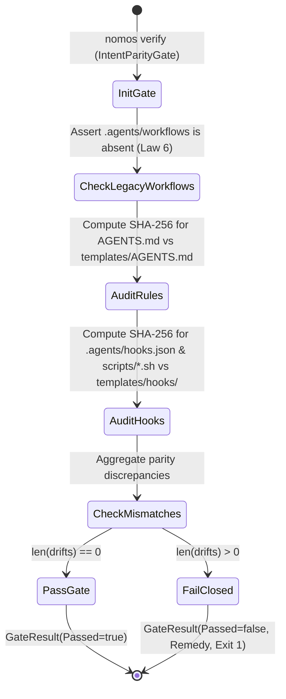

---
authors:
    - Mark Gantlett
    - Nomos Open-Core Substrate
classification: public
date: "2026-10-05"
last_updated: "2026-11-01"
plane: intent
status: active
title: "Invisible Harness Asset Embedding & Ambient Hook Parity Specification"
type: spec
version: "4.0.0"
execution_frontier:
  tasks:
    - key: "INT-819"
      plane: "intent"
      summary: "Excise legacy .agents/workflows and codify zero-ceremony Invisible Harness ambient hooks"
    - key: "SUB-1381"
      plane: "substrate"
      summary: "Remove workflow templates, scaffold ambient SessionStart/PreToolUse hooks, and enforce Law 4/Law 6 parity"
ssot_repository: nomos
---

# Invisible Harness Asset Embedding & Ambient Hook Parity Specification

## 1. Executive Summary & Architectural Mandate

Under **Radical Minimalism** and **Law 1 (The Dual-Core Inversion Law)**, a human developer using Nomos must never have to alter their natural prompting workflow, memorize custom `/nomos-*` slash commands, or navigate a wall of conversational skills regardless of which Tier 1 coding agent they choose (Antigravity, Claude Code, Cursor, OpenCode, Aider, Windsurf).

Historically, Nomos distributed markdown workflow playbooks under `.agents/workflows/` (such as `/nomos-handshake` and `/nomos-idle`). As the Go substrate achieved full deterministic phase enforcement and modern harnesses deprecated flat workflow files, conversational playbooks became redundant ceremony violating **Law 6 (The Canonical Singularity Law)**.

This specification codifies the **Zero-Ceremony Invisible Harness Asset Architecture**:
1. **Complete Excision of Workflows & Skill Walls:** `.agents/workflows/` is permanently retired, and zero conversational `.agents/skills/` are scaffolded by Nomos. Developers interact with their Tier 1 agent in natural prose with zero workflow friction.
2. **Three-Layer Ambient Indirect Control:**
   - **Universal Always-On Protocol (`AGENTS.md` & `CLAUDE.md`):** Concise invariant card read natively at repository root by every Tier 1 coding agent.
   - **Ambient IDE Lifecycle Hooks (`.agents/hooks.json` & `.agents/scripts/`):** `SessionStart` executes `nomos handshake` automatically prior to the first model turn, and `PreToolUse` guards (`worktree-guard.sh`, `nomos-build-guard.sh`) block out-of-band trunk mutations with actionable one-line CLI remedies.
   - **Git CapBAC Defense Hooks (`pre-commit`, `commit-msg`, `pre-push`):** Deterministic substrate backstop guaranteeing invariant enforcement even in agent harnesses that do not support IDE lifecycle hooks.
3. **Cryptographic Byte-Parity & Anti-Regression (`IntentParityGate`):** All scaffolded protocol files (`AGENTS.md`) and ambient hook assets (`.agents/hooks.json`, `.agents/scripts/*`) are embedded in `substrate/cli/templates/` via `//go:embed` and verified for SHA-256 byte parity on every `nomos verify` run, failing closed if drift or legacy `.agents/workflows/` directories appear.

---

## 2. Axiomatic Invariants & Laws Codified

| Law # | Law Name | Architectural Enforcement |
| :---: | :--- | :--- |
| **Law 1** | **Dual-Core Inversion** | Substrate Go core and ambient hooks govern session boot, worktree boundaries, and verification; Tier 1 agents operate under invisible indirect control with zero human slash-command ceremony. |
| **Law 2** | **Non-Verbal Proof** | Deterministic byte-parity verification and table-driven test vectors (`TC-EMBED-001` through `TC-EMBED-006`) prove scaffolded and embedded asset integrity. |
| **Law 4** | **Single Source of Truth** | Workspace governance assets (`AGENTS.md`, `.agents/hooks.json`, `.agents/scripts/*`) maintain exact SHA-256 byte parity with `substrate/cli/templates/`. |
| **Law 5** | **Zero-Hardcoded-Path** | Workspace paths and customization directories resolve dynamically via `filepath.Join` and `config` discovery helpers without hardcoded path literals. |
| **Law 6** | **Canonical Singularity** | Zero `.agents/workflows/` or duplicate skill playbooks are permitted; `IntentParityGate` fails closed if legacy workflow artifacts remain on disk. |
| **Law 7** | **Fail-Closed Pre-Flight** | Any SHA-256 mismatch between workspace governance files and embedded templates causes immediate non-zero exit in `nomos verify`. |

---

## 3. Canonical Directory Layout

 Workspace governance and ambient hook assets follow a minimal, cross-harness footprint at the repository root:

```text
nomos/
├── AGENTS.md                          # Universal Tier 1 agent protocol (AGY, Cursor, OpenCode, Aider)
├── CLAUDE.md                          # Claude Code protocol mirror (downstream scaffolding)
├── .agents/
│   ├── hooks.json                     # Ambient SessionStart & PreToolUse lifecycle manifest
│   └── scripts/
│       ├── session-start.sh           # Silent nomos handshake context injector on SessionStart
│       ├── worktree-guard.sh          # PreToolUse Law 3 hermetic worktree boundary guard
│       └── nomos-build-guard.sh       # PreToolUse Law 1/Law 4 DB & binary encapsulation guard
├── intent/
│   └── contracts/
│       └── cue/
│           └── asset_parity.cue       # Formal #AssetType & parity audit schema
└── substrate/
    ├── cli/
    │   └── templates/                 # Embedded protocol, config & hook templates (cmd_init.go)
    │       ├── AGENTS.md
    │       ├── nomos.yaml
    │       └── hooks/
    │           ├── hooks.json
    │           └── scripts/
    │               ├── session-start.sh
    │               ├── worktree-guard.sh
    │               └── nomos-build-guard.sh
    └── src/
        └── nomos/
            └── modules/
                └── handshake/
                    └── directives/    # Embedded JIT phase directives
```

---

## 4. Substrate Embedding & Parity Contracts (`//go:embed`)

### 4.1 Formal Go DTO Contracts (`workspace/parity.go`)

All parity structures bind strictly to `#AssetType`, `#EmbeddedAsset`, `#ParityMismatch`, and `#ParityAuditReport` in `intent/contracts/cue/asset_parity.cue`:

```go
// AssetType defines the category of embedded asset bound to CUE #AssetType.
type AssetType string

const (
	AssetTypeHook      AssetType = "hook"
	AssetTypeRule      AssetType = "rule"
	AssetTypeDirective AssetType = "directive"
	AssetTypeSchema    AssetType = "schema"
	AssetTypeConfig    AssetType = "config"
)

// EmbeddedAsset represents metadata for an embedded governance resource (#EmbeddedAsset).
type EmbeddedAsset struct {
	RelativePath string    `json:"relative_path"`
	AssetType    AssetType `json:"asset_type"`
	SHA256       string    `json:"sha256"`
	SizeBytes    int64     `json:"size_bytes"`
}
```

### 4.2 Downstream Upgrade Hygiene (`nomos init`)

When `nomos init` executes in a greenfield or existing downstream repository:
1. Scaffolds `nomos.yaml`, `AGENTS.md`, `CLAUDE.md`, `.agents/hooks.json`, and executable `.agents/scripts/*.sh` (`0755`).
2. Automatically prunes deprecated Nomos workflow files (`nomos-handshake.md`, `nomos-idle.md`, `nomos-review.md`) from `.agents/workflows/` and removes `.agents/workflows/` if empty, guaranteeing zero residual slash-command clutter.

---

## 5. Runtime Parity State Machine (`IntentParityGate`)



---

## 6. Table-Driven Verification Vectors

| Vector ID | Scenario | Input Target | Expected Outcome | Status |
| :--- | :--- | :--- | :--- | :--- |
| **TC-EMBED-001** | Ambient hook template lookup | `"templates/hooks/hooks.json"` | Non-empty `[]byte`, valid JSON manifest | PASS |
| **TC-EMBED-002** | Guard script permissions | `nomos init` on temp dir | `.agents/scripts/*.sh` created with `0755` mode | PASS |
| **TC-EMBED-003** | Rule asset byte parity | `AGENTS.md` vs `templates/AGENTS.md` | Identical SHA-256 digest | PASS |
| **TC-EMBED-004** | Hook asset byte parity | `.agents/hooks.json` & `scripts/*` | Identical SHA-256 digest with `templates/hooks/` | PASS |
| **TC-EMBED-005** | Legacy workflow tripwire | Residual `.agents/workflows/nomos-idle.md` | `IntentParityGate` fails closed (Law 6) | PASS |
| **TC-EMBED-006** | Downstream `nomos init` upgrade | Brownfield repo with `.agents/workflows/` | Legacy Nomos workflows pruned; hooks scaffolded | PASS |

---

## 7. Acceptance Criteria

1. **Zero Workflow or Skill Clutter:** Zero files exist under `.agents/workflows/` or `substrate/cli/templates/workflows/`, and zero custom slash-command skills are required to operate Nomos.
2. **Ambient Session Orientation:** `.agents/hooks.json` registers a `SessionStart` handler invoking `nomos handshake` silently alongside `PreToolUse` boundary guards.
3. **CUE & Go Schema Parity:** `intent/contracts/cue/asset_parity.cue` and `substrate/src/nomos/core/workspace/parity.go` bind `AssetTypeHook` (`"hook"`) cleanly with zero orphan contracts.
4. **Gate Suite Green:** `nomos verify` passes all 42 statutory Definition of Done gates with exit code 0.
