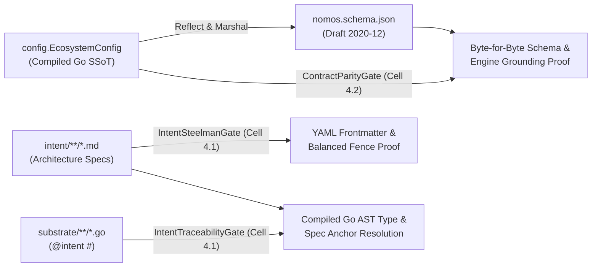

---
authors:
    - Mark Gantlett
    - Nomos Open-Core Substrate
classification: public
date: "2026-11-03"
last_updated: "2026-11-05"
plane: intent
ssot_repository: nomos
status: active
tags:
    - INT-897
    - SUB-1672
title: "Compiled Go SSoT and Reflected Draft 2020-12 JSON Schema Architecture Specification"
trigger: always_on
type: spec
version: "4.3.0"
---

# Compiled Go SSoT and Reflected Draft 2020-12 JSON Schema Architecture Specification

- **Document Key:** `SPEC-GO-SSOT-SCHEMA`.
- **Classification:** Public Open-Core Specification.
- **Version:** `4.3.0`.
- **Governing Laws:** Laws 2, 4, 6, and 7.

---

## 1. Architectural Evolution & Engineering Rationale

Across three generations of the Nomos substrate, policy and contract validation converged toward zero-duplication static compilation:

1. **Generation 3 (`OPA + CUE`):** Maintained dual Rego policies and `.cue` schemas alongside Go structs. Cross-language synchronization required continuous manual parity maintenance.
2. **Generation 4.0 (`CUE-Only Bridge`):** Retired Open Policy Agent (`OPA`) in favor of `cuelang.org/go` (`intent/contracts/cue/*.cue`). Simultaneously, all runtime validation migrated into deterministic pure-Go `Validate()` methods, `yaml.v3` strict `KnownFields(true)` decoding, SQLite `CHECK` constraints, and compiled Go/WASM AST gates.
3. **Generation 4.3 (`Compiled Go AST + Reflected JSON Schema`):** Audits prior to open-core v4 stabilization confirmed that zero runtime CLI commands (`nomos task`, `nomos session`, `nomos issue`, `nomos mem`, `nomos hook`, `nomos status`, `nomos handshake`) evaluated `.cue` files. Maintaining 24 passive `.cue` files violated **Law 4** and **Law 6** by duplicating Go types while inflating binary weight by `32.8%`.

Nomos v4.3 establishes **Compiled Go Types** as the sole runtime SSoT, paired with Go-reflected Draft 2020-12 JSON Schema (`nomos.schema.json`) for IDE validation.

---

## 2. Empirical Consolidation Receipts (`SUB-1672` / `INT-897`)

Removing `cuelang.org/go v0.17.1` and its transitive OCI registry, protobuf, decimal arithmetic, OAuth2, and TOML dependency graph produced immediate measurable improvements with `CGO_ENABLED=0`:

| Engineering Metric | Pre-Consolidation (`v4.2`) | Post-Consolidation (`v4.3`) | Measured Delta |
| :--- | :--- | :--- | :--- |
| **Static `nomos` Binary Size** | `41,604,360` bytes (`39.68 MiB`) | `27,974,300` bytes (`26.68 MiB`) | **`-13,630,060` B (`-13.00 MiB` / `-32.8%`)** |
| **`substrate/go.mod` Lines** | `51` lines (`133` `go.sum` lines) | `38` lines (`101` `go.sum` lines) | **`-13` modules pruned** |
| **Direct Runtime Dependencies** | `7` direct modules | `6` direct modules (`cobra`, `lipgloss`, `termenv`, `wazero`, `yaml.v3`, `modernc.org/sqlite`) | **Zero secondary policy VM** |
| **Duplicate Schema Files** | `24` manual `.cue` files | `1` Go-reflected `nomos.schema.json` (`281` lines) | **Zero manual dual-maintenance** |
| **Editor `nomos.yaml` UX** | Manual inspection | Instant `yaml-language-server` Draft 2020-12 hover & validation | **Universal VS Code / Neovim / JetBrains support** |

---

## 3. Law 4 Enforcement Architecture

Under **Law 4 (Single Source of Truth)**, three deterministic quality gates in `substrate/src/nomos/modules/verify/` enforce contract and specification integrity:



### 3.1 `ContractParityGate` (`Cell 4.2` - `config/schema.go` & `gates_contracts_boundary.go`)
- `config.GenerateConfigJSONSchema()` reflects `config.EcosystemConfig` together with `config.DefaultNomosConfig()` into a canonical Draft 2020-12 JSON Schema (`additionalProperties: false`, field descriptions, numeric bounds, and default values).
- `config.VerifyConfigJSONSchemaParity(schemaPath)` recomputes the schema in memory and fails closed if `nomos.schema.json` drifts by a single byte from `config.EcosystemConfig`.
- `AuditArchitecturalEngines` verifies that required architectural invariants remain grounded across `substrate/` packages and `intent/` specifications.

### 3.2 `IntentSteelmanGate` (`Cell 4.1` - `intent_schema_helpers.go`)
- Walks `intent/**/*.md` and validates YAML frontmatter (`yaml.Unmarshal`) requiring `title`, `plane: intent`, and valid `status` whenever `contracts.enabled: true` or `---` delimiters exist.
- Verifies balanced and closed Markdown code fences (` ``` ` / `~~~`) to intercept truncated specification mutations deterministically.

### 3.3 `IntentTraceabilityGate` (`Cell 4.1` - `intent_schema_helpers.go`)
- Enforces `@intent` docstring traceability across exported Go functions (`>= 50%` density on modified files).
- Resolves `@intent #<TypeName>` tokens against `substrate/` `type <TypeName>` AST declarations (`go/parser`) and `<name>_spec.md` references against `intent/` specs, rejecting dangling anchors.

---

## 4. Formal Go Schema Reflection Contract

```go
package config

// JSONSchemaNode models a deterministic JSON Schema Draft 2020-12 node
// reflected directly from compiled Go configuration structs (Law 4 SSoT).
type JSONSchemaNode struct {
	Schema               string                     `json:"$schema,omitempty"`
	ID                   string                     `json:"$id,omitempty"`
	Title                string                     `json:"title,omitempty"`
	Description          string                     `json:"description,omitempty"`
	Type                 string                     `json:"type,omitempty"`
	Properties           map[string]*JSONSchemaNode `json:"properties,omitempty"`
	Items                *JSONSchemaNode            `json:"items,omitempty"`
	AdditionalProperties *bool                      `json:"additionalProperties,omitempty"`
	Default              any                        `json:"default,omitempty"`
	Minimum              *int                       `json:"minimum,omitempty"`
	Maximum              *int                       `json:"maximum,omitempty"`
	Enum                 []string                   `json:"enum,omitempty"`
}
```

---

## 5. Table-Driven Verification Vectors

| Vector ID | Target Gate / Helper | Input Condition | Expected Verdict |
| :--- | :--- | :--- | :--- |
| `TC-SSOT-01` | `VerifyConfigJSONSchemaParity` | `EcosystemConfig` field added without regenerating `nomos.schema.json` | **FAIL** (Schema byte parity drift detected) |
| `TC-SSOT-02` | `GenerateConfigJSONSchema` | Clean `EcosystemConfig` reflection | **PASS** (Deterministic Draft 2020-12 JSON with `additionalProperties: false`) |
| `TC-SSOT-03` | `IntentSteelmanGate` | Intent Markdown spec missing `title`/`plane`/`status` or unclosed ```` ``` ```` fence | **FAIL** (Malformed Intent document rejected) |
| `TC-SSOT-04` | `IntentTraceabilityGate` | `@intent #NonExistentStruct` or `@intent missing_spec.md` in Go docstring | **FAIL** (Unresolved AST type or spec anchor rejected) |
| `TC-SSOT-05` | `LoadConfig` (`yaml.v3`) | Unknown YAML key in `nomos.yaml` | **FAIL** (`KnownFields(true)` rejects unknown configuration key) |
