---
authors:
    - Mark Gantlett
    - Nomos Open-Core Substrate
classification: public
date: "2026-10-04"
last_updated: "2026-11-01"
plane: intent
ssot_repository: "nomos"
status: active
title: "Nomos Upgrade Subsystem Specification (Cryptographic Supply Chain & Atomic Swap)"
type: spec
version: "4.0.0"
execution_frontier:
  tasks:
    - key: "INT-287"
      plane: "intent"
      summary: "Specify Nomos Upgrade Subsystem with Ed25519 supply chain verification and atomic swap"
    - key: "SUB-89"
      plane: "substrate"
      summary: "Implement nomos upgrade CLI command, Ed25519 verifier, and same-filesystem atomic swap"
---

# Nomos Upgrade Subsystem Specification (Cryptographic Supply Chain & Atomic Swap)

## 1. Executive Summary & Intent Motivation

The open-core `nomos` substrate requires an autonomous, hermetic, and verifiable mechanism for users to update their compiled binary without resorting to manual curl/bash scripts or downstream source rebuilds.

Historically, upgrade proposals suffered from critical architectural vulnerabilities:
1. **Interactive Privilege Escalation (Law 7 Violation):** Prompting for interactive `sudo` introduces non-deterministic terminal side effects and violates autonomous agent invariants.
2. **Cross-Device Link Failures (`EXDEV`):** Moving a staged binary from a system temporary directory (e.g., `/tmp`) across filesystem boundaries causes atomic `os.Rename` to fail.
3. **Unauthenticated Supply Chain Risk:** Trusting an unauthenticated SHA-256 checksum over standard GitHub HTTP endpoints leaves users vulnerable to infrastructure compromise.
4. **Hardcoded Paths (Law 5 Violation):** Hardcoding installation paths (`/usr/local/bin`) or hardcoded repository URLs breaks relocatability and air-gapped deployments.

This specification formalizes the **Nomos Upgrade Subsystem**:
- Fully dynamic path resolution via `os.Executable()` and `filepath.EvalSymlinks()`.
- Fail-closed pre-flight write permission assertions with zero interactive privilege escalation prompts.
- Same-filesystem staging to guarantee cross-device atomic swap safety (`os.Rename`).
- Cryptographic Ed25519 signature verification against a public key compiled directly into the Go SSoT.
- Cross-platform Windows file lock mitigation.
- Universal repository naming adhering to `nomos` (Open-Core Public Foundation) and `gsi-sov` (Sovereign Proprietary Extensions).

---

## 2. Axiomatic Invariants & Laws Codified

| Law # | Law Name | Architectural Enforcement |
| :---: | :--- | :--- |
| **Law 1** | **Dual-Core Inversion** | Substrate Go core executes deterministic self-update and verification; Tier 1 agents invoke upgrades via non-interactive CLI flags. |
| **Law 2** | **Non-Verbal Proof** | Supply-chain integrity is proven via Ed25519 signature verification and table-driven verification vectors (`TC-UPG-001` through `TC-UPG-006`). |
| **Law 4** | **Single Source of Truth** | Upgrade manifests and receipts bind strictly to `intent/contracts/cue/upgrade.cue` and compiled Go DTOs. |
| **Law 5** | **Zero-Hardcoded-Path** | Target binary paths resolve dynamically via `os.Executable()`; release endpoints derive from `config.LoadConfig()`. |
| **Law 6** | **Canonical Singularity** | Single canonical (phantom: `nomos upgrade`) command engine governing binary maintenance. |
| **Law 7** | **Fail-Closed Pre-Flight** | If write permissions on the binary directory are lacking, or if Ed25519 signatures fail, the command aborts immediately with exit code 77 without mutating disk state. |

---

## 3. Cryptographic Supply-Chain Security Model

To defend against upstream release tampering, (phantom: `nomos upgrade`) employs dual-layer verification:

```
Release Assets (GitHub / Mirror)
├── nomos_<version>_<os>_<arch>.tar.gz    # Compiled binary archive
├── checksums.txt                         # SHA-256 hashes of all assets
└── checksums.txt.sig                     # Detached Ed25519 signature over checksums.txt
```

### 3.1 Verification Sequence
1. Download `checksums.txt` and `checksums.txt.sig`.
2. Verify `checksums.txt.sig` against the **Compiled-In Ed25519 Public Key** embedded in the Go binary SSoT (`release.EmbeddedPublicKeyEd25519`). If signature verification fails, abort immediately with error `ErrUntrustedSignature`.
3. Download the matching target archive and compute its SHA-256 hash.
4. Verify that the computed SHA-256 hash matches the signed entry in `checksums.txt`. If mismatched, abort with `ErrChecksumMismatch`.

---

## 4. Formal Schema & Go DTO Contracts

All contracts reside in `substrate/src/nomos/modules/upgrade/` and mirror `intent/contracts/cue/upgrade.cue`:

```go
package upgrade

import (
	"context"
)

// UpgradeOptions defines runtime flags for the upgrade command.
type UpgradeOptions struct {
	Force   bool   `json:"force"`
	DryRun  bool   `json:"dry_run"`
	Channel string `json:"channel"` // "stable" | "nightly"
}

// UpgradeCheckResult captures the difference between installed and remote versions.
type UpgradeCheckResult struct {
	CurrentVersion     string `json:"current_version"`
	LatestVersion      string `json:"latest_version"`
	IsUpgradeAvailable bool   `json:"is_upgrade_available"`
	ReleaseURL         string `json:"release_url"`
	PublishedAt        string `json:"published_at"`
}

// UpgradeReceipt records the completed transaction proof.
type UpgradeReceipt struct {
	PreviousVersion  string `json:"previous_version"`
	InstalledVersion string `json:"installed_version"`
	ExecutablePath   string `json:"executable_path"`
	StagedPath       string `json:"staged_path"`
	Timestamp        string `json:"timestamp"`
	SHA256Verified   bool   `json:"sha256_verified"`
	Ed25519Verified  bool   `json:"ed25519_verified"`
	Status           string `json:"status"` // "UPGRADED" | "ALREADY_UP_TO_DATE" | "PERMISSION_DENIED_FAIL_CLOSED"
}

// Upgrader executes self-update operations deterministically.
type Upgrader interface {
	Check(ctx context.Context, opts UpgradeOptions) (*UpgradeCheckResult, error)
	Upgrade(ctx context.Context, opts UpgradeOptions) (*UpgradeReceipt, error)
}
```

---

## 5. Atomic Swap & Filesystem State Machine

To prevent cross-device (`EXDEV`) failures and corrupted executions, the upgrade state machine enforces sibling directory staging:

```mermaid
stateDiagram-v2
    [*] --> ResolveBinary: os.Executable() & filepath.EvalSymlinks()
    ResolveBinary --> CheckPermissions: Test write access on parent directory
    
    state CheckPermissions <<choice>>
    CheckPermissions --> FetchRelease: Write access granted
    CheckPermissions --> FailClosedPerm: Write access denied (Exit 77)

    FetchRelease --> VerifySignature: Download checksums & verify Ed25519 signature
    
    state VerifySignature <<choice>>
    VerifySignature --> DownloadArchive: Valid signature
    VerifySignature --> FailClosedSig: Invalid signature (Exit 1)

    DownloadArchive --> VerifyHash: Assert SHA-256 matches signed checksum
    VerifyHash --> StageSibling: Extract to <parentDir>/.nomos_update_<hash>
    StageSibling --> AtomicSwap: os.Rename(staged, executable)
    
    AtomicSwap --> VerifyNewBinary: Execute nomos version on new binary
    VerifyNewBinary --> Cleanup: Remove old executable / stage leftovers
    
    Cleanup --> [*]: UpgradeReceipt(Status=UPGRADED, Exit 0)
    FailClosedPerm --> [*]: Deterministic error message with manual instructions
    FailClosedSig --> [*]: Security alert; zero disk mutation
```



### 5.1 Same-Filesystem Staging Invariant (Anti-EXDEV)
- The downloaded binary is extracted into the **exact same directory** as the active executable:
  $$\text{StagePath} = \text{filepath.Join}(\text{filepath.Dir}(\text{activeExec}), \text{fmt.Sprintf}(".nomos_stage_%d", \text{time.Now().UnixNano()}))$$
- Because `StagePath` and `activeExec` reside on the identical filesystem mount, `os.Rename` is guaranteed to be an atomic filesystem inode pointer swap, eliminating `EXDEV` errors.

### 5.2 Windows OS-Lock Mitigation
On Windows (`GOOS == "windows"`), an active running executable cannot be overwritten. The upgrader handles this via deterministic two-step relocation:
1. Rename `nomos.exe` to `nomos.exe.old`.
2. Move the staged binary to `nomos.exe`.
3. Schedule `nomos.exe.old` for deletion upon next invocation.

---

## 6. Table-Driven Verification Vectors

The following deterministic test vectors validate the upgrade subsystem:

| Vector ID | Scenario Context | Trigger Condition | Expected Behavior | Invariant Enforced |
| :--- | :--- | :--- | :--- | :--- |
| **TC-UPG-001** | Up-to-date binary check | `current == "v3.0.0"`, `latest == "v3.0.0"` | `IsUpgradeAvailable == false`, exits with code `0` | Law 7 (Idempotency) |
| **TC-UPG-002** | Clean atomic upgrade | Valid new release, writeable directory | Downloads, verifies Ed25519, swaps atomically | Law 4 & Law 5 (Integrity) |
| **TC-UPG-003** | Permission denied pre-flight | Read-only directory (e.g. `/usr/bin`) | Fails closed with exit code `77`, prints remedy | Law 7 (Fail-closed non-interactive) |
| **TC-UPG-004** | Tampered checksum trap | Malformed SHA-256 hash in release | Rejects download; aborts before staging | Law 4 (Byte parity) |
| **TC-UPG-005** | Invalid Ed25519 signature | Signature fails verification | Rejects release immediately with `ErrUntrustedSignature` | Law 2 (Cryptographic proof) |
| **TC-UPG-006** | Cross-device mount check | Staging in target parent directory | Asserts same mount point; `os.Rename` succeeds | Anti-EXDEV safety |

---

## 7. Acceptance Criteria & Rigor Boundary

1. **Zero Interactive Prompts:** The upgrade subsystem never prompts for `sudo` or interactive user input; permission failures fail closed deterministically.
2. **Cryptographic Ed25519 Validation:** All releases verify cryptographic signatures prior to archive extraction.
3. **Same-Filesystem Atomicity:** Staging occurs strictly in the parent directory of the active binary to guarantee atomic swap.
4. **CUE Contract Parity:** Validated against `intent/contracts/cue/upgrade.cue`.
5. **Clean DoD Certification:** Verification passes all 42 quality gates (`nomos verify`) with exit code 0.
