---
authors:
    - Mark Gantlett
    - Nomos Open-Core Substrate
classification: public
date: "2026-10-04"
last_updated: "2026-11-04"
plane: intent
ssot_repository: "nomos"
status: active
title: "Open-Core License, IP Boundary, and Release Readiness Specification"
type: spec
version: "4.1.0"
execution_frontier:
  tasks:
    - key: "INT-920"
      plane: "intent"
      summary: "Harden open-core legal notices, DCO provenance, and release archive attributions"
    - key: "SUB-1741"
      plane: "substrate"
      summary: "Restore SPDX Apache-2.0 Appendix, brand asset carve-out, THIRD_PARTY_NOTICES.md, and clean AGENTS.md template"
---

# Open-Core License, IP Boundary, and Release Readiness Specification

## 1. Executive Summary & Intent Motivation

The `nomos` repository forms the public open-core foundation of the Nomos Deterministic Engineering Substrate. Community trust and enterprise procurement require unambiguous licensing, contributor provenance, and cryptographically verified release packaging.

This specification formalizes open-core licensing, attribution hygiene, contributor provenance, and automated release readiness:
1. **Permissive Open-Core Licensing:** Verbatim SPDX Apache License 2.0 governs `nomos` while preserving commercial sovereign boundaries in `gsi-sov`.
2. **Corporate Attribution & Brand Carve-Out:** Root `NOTICE` vests copyright in `Gantlett Systems Inc. (SophiaLabs)` and reserves trademarks and brand graphics.
3. **Third-Party Binary Attribution:** Static binary archives include `LICENSE`, `NOTICE`, and `THIRD_PARTY_NOTICES.md` for all compiled Go dependencies.
4. **Contributor Provenance (`DCO`):** External contributions combine Apache 2.0 Section 5 licensing with `Developer Certificate of Origin` (`Signed-off-by:`) sign-off.
5. **42 DoD Gate Enforcement (Law 4 & Law 7):** Release pre-flight requires `42/42` passing gates in `substrate/src/nomos/modules/verify/matrix.go`, including `boundary` and `ip_leak`.
6. **Universal Downstream Scaffolding:** `nomos init` stamps clean `AGENTS.md` and `CLAUDE.md` protocol blocks free of Foundry-only metadata.

---

## 2. Axiomatic Invariants & Laws Codified

| Law # | Law Name | Architectural Enforcement |
| :---: | :--- | :--- |
| **Law 1** | **Dual-Core Inversion** | Compiled Go pipelines govern packaging without manual Tier 1 release mutations. |
| **Law 2** | **Non-Verbal Proof** | Releases require exit code `0` across all `42` DoD gates (`TC-REL-001`..`TC-REL-008`). |
| **Law 4** | **Single Source of Truth** | Schemas and receipts bind to `verify.CanonicalMatrixCells` and `task.ReleaseNotePayload`. |
| **Law 5** | **Zero-Hardcoded-Path** | Release paths resolve dynamically via `config.LoadConfig()` without hardcoded literals. |
| **Law 6** | **Canonical Singularity** | One `.goreleaser.yaml` pipeline governs all multi-architecture binary archives. |
| **Law 7** | **Fail-Closed Pre-Flight** | Dirty worktrees, gate failures, or missing signatures reject packaging immediately. |

---

## 3. Legal & Governance Boundary Architecture

The open-core boundary cleanly bifurcates repositories in accordance with ADR-0031:

```text
nomos/ (Open-Core Public Foundation)
├── LICENSE                    # Verbatim SPDX Apache License 2.0 (with Appendix)
├── NOTICE                     # Gantlett Systems Inc. (SophiaLabs) trademark & logo carve-out
├── THIRD_PARTY_NOTICES.md     # Compiled Go dependency copyright and license attributions
├── CONTRIBUTING.md            # Hermetic workflow, DCO sign-off, and 42-gate DoD mandate
├── SECURITY.md                # Coordinated vulnerability disclosure protocol
├── AGENTS.md / CLAUDE.md      # Universal Tier 1 indirect-control protocol blocks
├── .goreleaser.yaml           # Multi-arch build bundling LICENSE, NOTICE, THIRD_PARTY_NOTICES.md
├── install.sh                 # Cryptographically verified bootstrap script
└── uninstall.sh               # Clean binary removal script
```

### 3.1 Quality Gate Integration

During `nomos verify`, two dedicated probes enforce repository boundary integrity:
1. **Open-Core Boundary Invariant (`boundary`):** `BoundaryGate` walks the Go AST and rejects prohibited sovereign package imports or sovereign CLI verbs.
2. **Sovereign IP Leak Probe (`ip_leak`):** `IPLeakGate` scans Go imports and rejects sovereign module paths across open-core packages.

---

## 4. Compiled Verification Gates & GoReleaser Packaging Contracts

Compiled `verify` gates (`substrate/src/nomos/modules/verify/`) and `.goreleaser.yaml` (`CGO_ENABLED=0` across `linux/darwin/windows` `amd64/arm64`) govern release readiness directly:

1. **`BoundaryGate` (`substrate/src/nomos/modules/verify/gates_architecture.go`):** Audits AST imports, prohibited commands, and locked dependency manifests against configured open-core boundaries.
2. **`IPLeakGate` (`substrate/src/nomos/modules/verify/gates_security.go`):** Scans open-core Go source files and rejects prohibited sovereign module prefixes.
3. **`EcosystemDriftGate` (`substrate/src/nomos/modules/verify/gates_architecture.go`):** Rejects dirty trunk trees (`git status --porcelain`) prior to packaging.
4. **`IntentParityGate` (`substrate/src/nomos/modules/verify/gates_intent.go`):** Verifies SHA-256 byte parity across `substrate/cli/templates/AGENTS.md`, `AGENTS.md`, and `CLAUDE.md`.
5. **`ReleaseReceiptGate` (`substrate/src/nomos/modules/verify/gates_capbac_release.go`):** Verifies cryptographic release receipts (`task.ReleaseNotePayload` in `substrate/src/nomos/modules/task/git_notes.go`) in `refs/notes/nomos/releases`.

---

## 5. Automated Release Pre-Flight State Machine

```mermaid
stateDiagram-v2
    [*] --> CheckWorktree: Trigger release build
    CheckWorktree --> CheckDirty: Inspect git status --porcelain
    
    state CheckDirty <<choice>>
    CheckDirty --> RunDoD: Worktree clean
    CheckDirty --> FailClosed: Uncommitted changes detected

    RunDoD --> EvaluateGates: Run nomos verify (all DoD gates)
    
    state EvaluateGates <<choice>>
    EvaluateGates --> BuildArtifacts: DoD Gates PASS
    EvaluateGates --> FailClosed: Any gate failed

    BuildArtifacts --> BundleNotices: Bundle LICENSE, NOTICE, THIRD_PARTY_NOTICES.md
    BundleNotices --> SignPayload: Generate SHA-256 & Ed25519 signature
    
    state SignPayload <<choice>>
    SignPayload --> PublishRelease: Cryptographic signature verified
    SignPayload --> FailClosed: Signature generation error

    PublishRelease --> [*]: Release Manifest Published (Exit 0)
    FailClosed --> [*]: Reject release; emit audit report (Exit 1)
```



---

## 6. Table-Driven Verification Vectors

The following deterministic verification vectors attest release and legal readiness:

| Vector ID | Scenario Context | Verification Condition | Expected Behavior | Invariant Enforced |
| :--- | :--- | :--- | :--- | :--- |
| **TC-REL-001** | Clean release pre-flight | Clean tree, `42/42` gates pass | Proceeds to archive packaging | Law 2 (Non-Verbal Proof) |
| **TC-REL-002** | Dirty tree rejection | Uncommitted file in worktree | Rejects build with exit code `1` | Law 7 (Fail-Closed Hygiene) |
| **TC-REL-003** | Gate regression block | Single DoD gate failure | Rejects build before binary compilation | Law 2 (Non-Verbal Proof) |
| **TC-REL-004** | IP leak trap | Sovereign import staged | `ip_leak` probe rejects build | Law 7 (IP Protection) |
| **TC-REL-005** | Archive legal notices | `.goreleaser.yaml` archive config | Includes `LICENSE`, `NOTICE`, `THIRD_PARTY_NOTICES.md` | Law 4 (Attribution Parity) |
| **TC-REL-006** | Brand asset carve-out | Root `NOTICE` inspection | Excludes `intent/assets/` logos from copyright grant | Law 7 (Brand Protection) |
| **TC-REL-007** | DCO sign-off contract | `CONTRIBUTING.md` & PR template | Requires `Signed-off-by:` DCO attestation | Law 7 (Provenance Hygiene) |
| **TC-REL-008** | Clean downstream template | `templates/AGENTS.md` parity | Zero internal YAML frontmatter or Foundry leaks | Law 4 & Law 6 (Parity) |

---

## 7. Acceptance Criteria & Rigor Boundary

1. **Verbatim SPDX Apache 2.0 & Corporate `NOTICE`:** Root `LICENSE` contains the full Apache 2.0 text and Appendix, while `NOTICE` attributes `Gantlett Systems Inc. (SophiaLabs)` and excludes `intent/assets/` brand logos.
2. **Archive Third-Party Notices:** `THIRD_PARTY_NOTICES.md` documents all compiled Go dependencies, and `.goreleaser.yaml` includes `LICENSE`, `NOTICE`, and `THIRD_PARTY_NOTICES.md` in every archive.
3. **Contributor DCO Provenance:** `CONTRIBUTING.md` and `.github/PULL_REQUEST_TEMPLATE.md` specify `Developer Certificate of Origin` (`Signed-off-by:`) sign-off under Apache 2.0 Section 5.
4. **Hermetic Pre-Flight & Gate Greenlight:** Dirty worktrees, missing signatures, or IP leaks reject execution with exit code `1`.
5. **Zero Broken Links:** All root documentation files (`CONTRIBUTING.md`, `SECURITY.md`, `README.md`) resolve without broken links.
