---
authors:
    - Mark Gantlett
    - Nomos Open-Core Substrate
classification: public
date: "2026-10-04"
last_updated: "2026-11-01"
plane: intent
ssot_repository: "nomos"
status: active
title: "Open-Core License, IP Boundary, and Release Readiness Specification"
type: spec
version: "4.0.0"
execution_frontier:
  tasks:
    - key: "INT-285"
      plane: "intent"
      summary: "Specify Open-Core Apache 2.0 license, IP boundary audit, and release readiness"
    - key: "SUB-86"
      plane: "substrate"
      summary: "Implement Release Pre-Flight Auditor, GoReleaser Pipeline, and Boundary Gates"
---

# Open-Core License, IP Boundary, and Release Readiness Specification

## 1. Executive Summary & Intent Motivation

The `nomos` repository represents the public, open-core foundation of the Nomos Deterministic Engineering Substrate. As an open-source offering, it requires a legally sound, cryptographically verifiable, and automated release pipeline to guarantee community trust and frictionless enterprise adoption.

This specification formalizes the open-core licensing model, contribution governance, and automated release readiness:
1. **Permissive Open-Core Licensing:** Apache License 2.0 applied across all public open-core assets in `nomos`, providing patent grants while preserving commercial sovereign boundaries in `gsi-sov`.
2. **42 DoD Quality Gate Enforcement (Law 4 & Law 7):** All releases require greenlight certification across the compiled 42-gate pipeline (`intent/contracts/cue/pipeline.cue`), specifically asserting the `boundary` and `ip_leak` gates.
3. **Fail-Closed Release Pre-Flight:** Pre-flight audits reject release builds on dirty git worktrees, unverified commits, missing Ed25519 signatures, or broken checksums.
4. **Universal Topology:** Replaces legacy `gsi-open` terminology with `nomos` (Open-Core Public Foundation) and `gsi-sov` (Sovereign Proprietary Extensions).

---

## 2. Axiomatic Invariants & Laws Codified

| Law # | Law Name | Architectural Enforcement |
| :---: | :--- | :--- |
| **Law 1** | **Dual-Core Inversion** | Substrate Go release pipeline automates hermetic packaging; Tier 1 agents cannot trigger release mutations. |
| **Law 2** | **Non-Verbal Proof** | Release artifacts require exit code 0 across all 42 DoD gates, verified by table-driven test vectors (`TC-REL-001` through `TC-REL-006`). |
| **Law 4** | **Single Source of Truth** | Release verification and receipt manifests bind strictly to `pipeline.cue` (`#CanonicalMatrix`) and `git_notes.cue` (`#ReleaseNotePayload`). |
| **Law 5** | **Zero-Hardcoded-Path** | Release directories and tool paths resolve dynamically via `config.LoadConfig()`, avoiding hardcoded path literals. |
| **Law 6** | **Canonical Singularity** | Single canonical release pipeline (`.goreleaser.yaml`) governing all multi-arch distributions. |
| **Law 7** | **Fail-Closed Pre-Flight** | Any uncommitted file, gate failure, or missing Ed25519 signature halts release packaging immediately with exit code 1. |

---

## 3. Legal & Governance Boundary Architecture

The open-core boundary cleanly bifurcates repositories in accordance with ADR-0031:

```
nomos/ (Open-Core Public Foundation)
├── LICENSE                    # Apache License 2.0 (Permissive with patent grant)
├── CONTRIBUTING.md            # Hermetic contribution rules & 42-gate DoD mandate
├── SECURITY.md                # Vulnerability disclosure protocol
├── .goreleaser.yaml           # Multi-architecture deterministic build definition
├── install.sh                 # Cryptographically verified bootstrap script
└── uninstall.sh               # Clean binary removal script
```

### 3.1 Quality Gate Integration (Gates 20 & 21)
During `nomos verify`, two dedicated gates enforce repository boundary integrity:
1. **Open-Core Boundary Invariant (`boundary`):** Scans the AST to ensure prohibited sovereign packages (e.g., Cockpit server, Swarm mesh, Grok critic) are not linked into the open-core binary.
2. **IP Leak Detector Gate (`ip_leak`):** Scans source code and intent documentation for proprietary keywords, internal API endpoints, or un-redacted sovereign tokens.

---

## 4. Compiled Verification Gates & GoReleaser Packaging Contracts

Release readiness is enforced directly by the compiled `verify` gate suite (`substrate/src/nomos/modules/verify/`) paired with `.goreleaser.yaml` (`CGO_ENABLED=0` across `linux/darwin/windows` `amd64/arm64`) rather than a separate runtime release daemon:

1. **`BoundaryGate` (`substrate/src/nomos/modules/verify/gates_architecture.go`):** Audits AST imports, prohibited commands, and locked dependency manifests against configured open-core boundaries.
2. **`IPLeakGate` (`substrate/src/nomos/modules/verify/gates_security.go`):** Scans open-core source and documentation for proprietary sovereign identifiers or internal hostnames.
3. **`EcosystemDriftGate` (`substrate/src/nomos/modules/verify/gates_architecture.go`):** Rejects dirty trunk trees (`git status --porcelain`) prior to packaging.
4. **`ReleaseReceiptGate` (`substrate/src/nomos/modules/verify/gates_capbac_release.go`):** Verifies cryptographic release receipts (`#ReleaseNotePayload` in `intent/contracts/cue/git_notes.cue`) in `refs/notes/nomos/releases`.

---

## 5. Automated Release Pre-Flight State Machine

```mermaid
stateDiagram-v2
    [*] --> CheckWorktree: Trigger release build
    CheckWorktree --> CheckDirty: Inspect git status --porcelain
    
    state CheckDirty <<choice>>
    CheckDirty --> RunDoD: Worktree clean
    CheckDirty --> FailClosed: Uncommitted changes detected

    RunDoD --> EvaluateGates: Run nomos verify (all DoD gates)
    
    state EvaluateGates <<choice>>
    EvaluateGates --> BuildArtifacts: DoD Gates PASS
    EvaluateGates --> FailClosed: Any gate failed

    BuildArtifacts --> SignPayload: Compile binaries & generate SHA-256
    SignPayload --> VerifySignature: Sign manifest with Ed25519
    
    state VerifySignature <<choice>>
    VerifySignature --> PublishRelease: Cryptographic signature verified
    VerifySignature --> FailClosed: Signature generation error

    PublishRelease --> [*]: Release Manifest Published (Exit 0)
    FailClosed --> [*]: Abort release; emit audit report (Exit 1)
```



---

## 6. Table-Driven Verification Vectors

The following deterministic test vectors validate release readiness:

| Vector ID | Scenario Context | Test Condition | Expected Behavior | Invariant Enforced |
| :--- | :--- | :--- | :--- | :--- |
| **TC-REL-001** | Clean release pre-flight | Clean tree, all DoD gates pass | `audit.Passed == true`, proceeds to packaging | Law 2 (DoD Greenlight) |
| **TC-REL-002** | Dirty tree rejection | Uncommitted file in worktree | Rejects with `DirtyState=true` (Exit 1) | Law 7 (Fail-closed hygiene) |
| **TC-REL-003** | Gate regression block | Single gate failure (e.g. Docstrings) | Rejects build; halts before compile | Law 2 (Non-verbal proof) |
| **TC-REL-004** | IP leak detection trap | Proprietary sovereign token staged | `ip_leak` gate fails; halts release | Law 7 (IP protection) |
| **TC-REL-005** | Checksum verification | SHA-256 matches compiled payload | Binary integrity confirmed | Law 4 (Byte parity) |
| **TC-REL-006** | Ed25519 signature test | Valid private key signature | Signature validates against embedded public key | Law 4 (Cryptographic authenticity) |

---

## 7. Acceptance Criteria & Rigor Boundary

1. **Apache 2.0 Licensing:** Root `LICENSE` exists with Apache 2.0 terms; copyright notices identify Mark Gantlett and Nomos Open-Core Substrate.
2. **DoD Quality Gates Greenlight:** Release pipeline invokes `nomos verify` and asserts all DoD gates passed before compiling.
3. **CUE Schema Parity:** Validated against `intent/contracts/cue/pipeline.cue` and `intent/contracts/cue/git_notes.cue`.
4. **Hermetic Pre-Flight:** Dirty worktrees, missing signatures, or IP leaks fail closed with exit code 1.
5. **No Broken Links:** All root documentation files (`CONTRIBUTING.md`, `SECURITY.md`) resolve without broken links.
