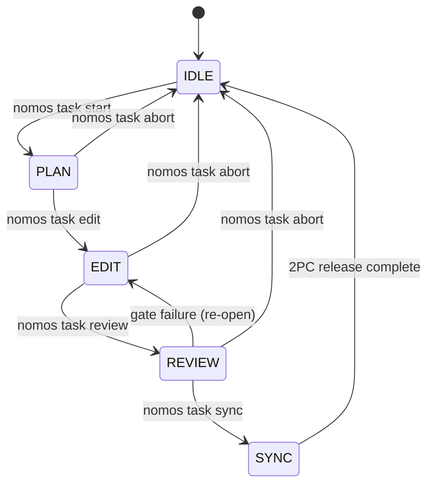

---
authors:
    - Mark Gantlett
    - Nomos Open-Core Substrate
classification: public
date: "2026-10-23"
last_updated: "2026-11-03"
plane: intent
status: active
tags:
    - INT-733
    - SUB-1210
    - INT-854
    - SUB-1510
    - INT-864
    - SUB-1549
    - INT-867
    - SUB-1558
    - INT-890
    - SUB-1623
    - INT-899
    - SUB-1680
title: Task Lifecycle CLI and Workspace State Transition Specification
trigger: always_on
type: spec
version: "4.3.0"
ssot_repository: nomos
---

# Task Lifecycle CLI and Workspace State Transition Specification

**Role:** Autonomous Open-Core Software Architect  
**Objective:** Codify authoritative contracts, finite state machine transitions, and CLI invocation semantics for the deterministic task lifecycle engine (`nomos task`, `nomos status`) backed by pure-Go SQLite persistence and CapBAC capability tokens.

---

## 1. Context & Problem Statement

In Nomos v3, task management suffered from excessive fragmentation and missing state guarantees:
1. **Command Bloat**: Over 15 disparate subcommands with overlapping responsibilities (`nomos task audit`, `nomos task repair`, `nomos task sync --drift`, etc.).
2. **In-Memory Volatility in Early v4**: In initial v4 scaffolding, task actions lacked persistent backing, and workspace phase state was decoupled from capability lease tokens.
3. **Implicit Worktree Sprawl**: Worktree provisioning and lifecycle phase transitions were loosely coordinated, risking cross-worktree contamination and trunk mutation leaks.

Nomos v4 consolidates task operations into a **canonical finite state machine** enforced through **CapBAC object capabilities** and backed by **durable pure-Go SQLite persistence** (`SQLiteTaskStore`).

---

## 2. Invariant Contracts

### `INV-TSK-001`: Procedural Phase Locking (Law 1: Dual-Core Inversion)
Workspace mutability is procedurally locked across lifecycle phases:
$$\text{IDLE} \xrightarrow{\text{start}} \text{PLAN} \xrightarrow{\text{edit}} \text{EDIT} \xrightarrow{\text{review}} \text{REVIEW} \xrightarrow{\text{sync}} \text{SYNC} \xrightarrow{\text{learn}} \text{IDLE}$$
Trunk mutations outside an active task with a valid CapBAC lease are physically rejected.

### `INV-TSK-002`: Hermetic Worktree Isolation (Law 3: Hermetic Worktree)
Calling `nomos task start <KEY>` must provision an isolated git worktree at `worktrees/nomos-<KEY>` branched from clean trunk `main`. All mutations must occur strictly within this directory boundary.

### `INV-TSK-003`: CapBAC Lease Acquisition (Law 7: Fail-Closed Pre-Flight)
Transitioning into `PLAN` or `EDIT` requires acquiring a cryptographically unique `capbac.Lease` (`core/capbac/lease.go`) with an assigned `step_budget` ($\le 500$). Actions that exhaust tokens fail closed until renewed.

### `INV-TSK-004`: Two-Phase Commit Release Verification (Law 2: Non-Verbal Proof)
`nomos task sync <KEY> -F <walkthrough>` executes an atomic 2PC release:
1. Executes `nomos verify` DoD quality gates (all 42 DoD quality gates must pass exit 0).
2. Verifies the existence of a non-empty walkthrough summary file.
3. Performs a fast-forward merge of `feature/<KEY>` into protected trunk `main`.
4. Attests the release receipt in Git Notes (`refs/notes/nomos/releases`).
5. Revokes the CapBAC lease and deletes the transient worktree.

### `INV-TSK-005`: Canonical Key Singularity (Law 6: Canonical Singularity)
All task operations strictly require canonical keys matching `^(INT|SUB)-[0-9]+(-[a-z0-9-]+)?$`. Custom prefixes (e.g. `FEAT-`, `BUG-`, `CORE-`) are strictly rejected.

### `INV-TSK-006`: Top-Level Telemetry Visibility (Law 1: Indirect Control)
`nomos status` provides a unified non-verbal proof dashboard displaying:
- Workspace active lifecycle phase (`IDLE`, `PLAN`, `EDIT`, `REVIEW`, `SYNC`, `LEARN`).
- Active task key, plane, title, and assigned Tier 1 agent seat.
- Current worktree directory location and branch.
- CapBAC token consumption vs. step budget.
- Database connection status and pending DAG wavefront candidates.

---

## 3. Finite State Machine Specification

| Source Phase | CLI Command | Target Phase | Pre-Flight Validation | State Mutation |
| :--- | :--- | :--- | :--- | :--- |
| `IDLE` | `nomos task start <KEY>` | `PLAN` | Task exists in DB; trunk clean; key valid | Mints CapBAC lease; creates worktree |
| `PLAN` | `nomos task edit <KEY>` | `EDIT` | Worktree exists; active lease valid | Sets status `EDIT`; unlocks code mutation |
| `EDIT` | `nomos task review <KEY>` | `REVIEW` | Worktree clean/staged; lease valid | Runs DoD gates; locks further edits |
| `REVIEW` | `nomos task sync -F <file>`| `IDLE` | DoD gates exit 0; walkthrough valid | Fast-forward merge; writes Git Note; prunes WT |
| Any non-IDLE | `nomos task abort <KEY>` | `IDLE` | Task active | Revokes lease; removes worktree |

---

## 4. CLI Command Taxonomy & Invocation Semantics

### 4.1 `nomos status`
* **Syntax**: `nomos status [-A|--all-projects] [--json]`
* **Semantics**: Emits formatted Lipgloss dashboard (or JSON payload) scoped by default to the active repository's `project` (or across all workstation repositories when `-A, --all-projects` is supplied), showing active phase, task card, worktree, token budget, database status, distinct `In Progress` vs `Pending` ledger counts (excluding terminal `DONE`, `ABORTED`, and `CANCELLED` rows), and repository-scoped DAG wavefront candidates.

### 4.2 `nomos task create`
* **Syntax**: `nomos task create <TITLE> --plane <intent|substrate> (--scope <TEXT> --ac <ITEM>... --verify <TEXT> | -F <PATH|-> | -d <MARKDOWN>) [--project <PROJECT>] [--depends-on <KEY>...] [--burden <1-10>] [--tier <T1|T2>] [--priority <int>] [--twin-of <KEY>]`
* **Semantics**: Fails closed unless the universal 3-section backlog card (`task.ValidateCardDescription` in `card.go`: `## Scope & Context`, `## Acceptance Criteria` with >=1 `- [ ]` item, `## Verification`) is supplied via structured synthesis flags or Markdown body; auto-derives `burden` (`2-8`) when `--burden` is omitted; auto-stamps `project` from active repository `nomos.yaml` or Git common-dir root basename (unless `--project` is supplied); allocates next sequential key (`INT-<N>` or `SUB-<N>`) and persists record in `tasks` table with status `TODO`.

### 4.3 `nomos task start`
* **Syntax**: `nomos task start <KEY> [--edit] [--force-project]`
* **Semantics**: Validates task exists; fails closed if the task's stamped `project` belongs to another repository unless `--force-project` is explicitly passed; verifies trunk is on `main`; provisions `worktrees/<repo>-<KEY>` on branch `feature/<KEY>`; mints CapBAC lease; sets phase to `PLAN` (or directly enters `EDIT` when `--edit` is passed).

### 4.4 `nomos task edit`
* **Syntax**: `nomos task edit <KEY>`
* **Semantics**: Verifies lease is active and transitions task status and workspace phase to `EDIT`.

### 4.5 `nomos task review`
* **Syntax**: `nomos task review <KEY>`
* **Semantics**: Transitions task status to `REVIEW`; runs Definition of Done gates via `verify.Pipeline`.

### 4.6 `nomos task sync`
* **Syntax**: `nomos task sync <KEY> -F <walkthrough_path>`
* **Semantics**: Validates walkthrough file; evaluates DoD gates (fails closed if any fail); merges `feature/<KEY>` into `main` via `--ff-only`; records Git Note receipt; unconditionally removes the worktree directory (including gitignored build caches such as `.svelte-kit/` or `.tmp/`) and deletes the merged `feature/<KEY>` branch; resets phase to `IDLE`.

### 4.7 `nomos task abort`
* **Syntax**: `nomos task abort <KEY>`
* **Semantics**: Revokes active CapBAC lease; unconditionally removes the git worktree directory (including gitignored artifacts) and prunes the unmerged `feature/<KEY>` branch; marks task `ABORTED`; resets phase to `IDLE`.

### 4.8 `nomos task prune`
* **Syntax**: `nomos task prune [--dry-run]`
* **Semantics**: Sweeps orphaned `worktrees/*` directories that are no longer registered in `git worktree list` and have no active `IN_PROGRESS` CapBAC lease or uncommitted source files, runs `git worktree prune --expire now`, deletes merged `feature/*` branches, and cleans stale `.tmp/walkthrough-*` artifacts. Automatically invoked in non-dry-run mode during `nomos task sync` and periodic `nomos handshake` maintenance.

### 4.9 `nomos task list`
* **Syntax**: `nomos task list [-A|--all-projects] [--status <STATUS>] [--pending] [--plane <intent|substrate>] [--tier <T1|T2>] [--project <PROJECT>] [--limit <N>] [--json]`
* **Semantics**: Queries SQLite `tasks` table scoped by default to the active repository's `project` (or across all workstation repositories when `-A, --all-projects` is supplied) with optional multi-dimensional filtering (`--status`, `--pending` excluding `DONE`/`ABORTED`/`CANCELLED`, `--plane`, `--tier`, `--project`, `--limit`); renders an adaptive Lipgloss table with HATEOAS `Next Actions` (or structured JSON). Invalid filter values fail closed with a remedial command hint.

### 4.10 `nomos task dag`
* **Syntax**: `nomos task dag [-A|--all-projects] [--plane <intent|substrate>] [--tier <T1|T2>] [--project <PROJECT>] [--limit <N>] [--json]`
* **Semantics**: Inspects task causal dependencies scoped by default to the active repository's `project` (or across all workstation repositories when `-A, --all-projects` is supplied); identifies ready unblocked tasks emitting `WavefrontCandidate` records with optional plane, tier, project, and row-limit filters plus HATEOAS `Next Actions`.

### 4.11 `nomos task pair` / `chore` / `project` / `commit` / `show` / `status`
* **`nomos task pair <TITLE>`**: Atomically allocates twinned `INT-<N>` and `SUB-<N>` task records bound in `SQLiteTaskStore`, enforcing the same fail-closed 3-section `#TaskCardInput` contract (`--scope` / `--int-scope` / `--sub-scope`, `--ac`, `--verify`, or `-F <PATH|->` / `-d <MARKDOWN>`, plus optional `--project`, `--depends-on`, and `--burden`).
* **`nomos task chore <TITLE>`**: Zero-template fast lane that provisions a single-step `SUB-<N>` (or `--plane intent` `INT-<N>`) task directly into an isolated `EDIT` worktree (`burden: 1`, auto-stamped `project` or `--project`) without requiring the 3-section backlog card.
* **`nomos task project <PROJECT> <KEY> [KEY...]`**: Updates `project` on one or more existing Living Ledger tasks through `SQLiteTaskStore` without direct database file mutation (ADR-0062).
* **`nomos task commit [KEY] -m <MSG>`**: Stages and commits worktree changes as a Golden Conventional Commit (`[<KEY>] <type>(<scope>): 
`) with flowing rationale prose, `___` visual divider, and `Task:` / `Twin:` Git trailers.
* **`nomos task show <KEY> [--json]`**: Displays the detailed Living Ledger task inspection card, twin linkage, HATEOAS `Next Actions`, or structured JSON.
* **`nomos task status [--json]`**: Displays active workspace phase state, CapBAC step budget consumption, and HATEOAS `Next Actions` (or structured `#PhaseState` JSON).

---

## 5. Table-Driven Protocol Compliance Vectors

| Compliance Vector | Invariant | CLI Invocation | Expected Behavior |
| :--- | :--- | :--- | :--- |
| `TC-TSK-01` | Law 6 (Canonical Key) | `nomos task start FEAT-101` | Rejects key (`ERR_CANONICAL_VIOLATION`); exit 1 |
| `TC-TSK-02` | Law 3 (Hermetic Worktree) | `nomos task start SUB-1210` | Creates `worktrees/nomos-SUB-1210`; branch `feature/SUB-1210` |
| `TC-TSK-03` | Law 1 (Phase Discipline) | Direct edit on `main` in IDLE | Pre-commit hook rejects modification (`ERR_PHASE_VIOLATION`) |
| `TC-TSK-04` | Law 7 (CapBAC Lease) | `nomos task edit SUB-1210` (no lease) | Fails closed (`ERR_CAPBAC_VIOLATION`); exit 1 |
| `TC-TSK-05` | Law 2 (2PC Non-Verbal Proof)| `nomos task sync SUB-1210 -F missing.md` | Rejects sync (missing walkthrough file); exit 1 |
| `TC-TSK-06` | Law 2 (DoD Gate Failure) | `nomos task sync SUB-1210` (gate failure)| Blocks merge; remains in REVIEW; exit 1 |
| `TC-TSK-07` | Law 3 (Release Pruning) | Successful `nomos task sync` | Merges to `main`; deletes `worktrees/nomos-SUB-1210` including gitignored subdirectories and `feature/SUB-1210` |
| `TC-TSK-08` | Law 4 (DAG Wavefront) | `nomos task dag --json` | Emits JSON array of `#WavefrontCandidate` |
| `TC-TSK-09` | Law 3 (Orphan Worktree GC) | `nomos task prune` | Sweeps orphan `worktrees/*` folders & merged `feature/*` branches; preserves active `IN_PROGRESS` worktrees |
| `TC-TSK-10` | Law 7 (Fail-Closed Card) | `nomos task create "Title" -d "plain paragraph"` | Rejects unstructured prose (`ERR_VALIDATION_FAILED`) with 3-line HATEOAS remedy; exit 1 |
| `TC-TSK-11` | Law 4 (Card Synthesis) | `nomos task create "Title" --scope "..." --ac "..." --verify "..."` | Synthesizes canonical 3-section Markdown card and derives non-zero `burden`; exit 0 |
| `TC-TSK-12` | Law 1 (Fast-Lane Chore) | `nomos task chore "Quick fix"` | Provisions `EDIT` worktree in 1 turn with zero template requirement; exit 0 |
| `TC-TSK-13` | Law 4 (Filtered Ledger Query) | `nomos task list --pending --plane substrate --limit 10 --json` | Emits active/pending substrate tasks for active repo capped to 10 records; exit 0 |
| `TC-TSK-14` | Law 7 (Fail-Closed Filter) | `nomos task list --status BOGUS` | Rejects unknown status (`ERR_VALIDATION_FAILED`) with remedial command; exit 1 |
| `TC-TSK-15` | Law 4 (Multi-Repo Ledger Isolation) | `nomos task list` vs `nomos task list -A` | Default scopes strictly to active repo `project`; `-A` opts into global workstation view; exit 0 |
| `TC-TSK-16` | Law 7 (Cross-Project Start Guard) | `nomos task start SUB-99` (foreign `project`) | Rejects foreign-repo task (`ERR_VALIDATION_FAILED`) unless `--force-project` is passed; exit 1 |

