---
authors:
    - Mark Gantlett
    - Nomos Open-Core Substrate
    - Nomos Open-Core Substrate
classification: public
date: "2026-10-03"
last_updated: "2026-11-01"
plane: intent
ssot_repository: "nomos"
status: active
title: "Tier 1 Agent Adapter Contract & Projection Registry Specification"
type: spec
version: "4.0.0"
execution_frontier:
    tasks:
        - key: "INT-283"
          plane: "intent"
          summary: "Specify Tier 1 agent adapter contract for indirect control (opencode, Claude Code, AGY, Cursor, Aider)"
        - key: "SUB-88"
          plane: "substrate"
          summary: "Implement Tier 1 Agent Adapter Registry and Managed-Block Projection Engine"
---

# Tier 1 Agent Adapter Contract & Projection Registry Specification

## 1. Executive Summary & Intent Motivation

Open-core Nomos does not act as a direct conversational coding agent. Under the **Dual-Core Inversion Law (Law 1)**, Nomos operates strictly as an autonomous, deterministic **control harness** that governs **Tier 1 Coding Agents** (e.g., Antigravity IDE, Cursor, Claude Code, opencode, Aider) via **Indirect Control**.

To bind non-deterministic cognitive agents to deterministic substrate invariants, Nomos transduces its compiled Single Source of Truth (SSoT)—including active lifecycle phase envelopes, CapBAC session tokens, and ambient defense hooks—into agent-specific configuration footprints with zero conversational slash-command ceremony.

This specification formalizes the **Adapter Registry** and the declarative, non-destructive projection engine. It establishes:
1. Strongly-typed Go adapter interfaces and CUE projection contracts (`intent/contracts/cue/agent_adapter.cue`).
2. A fail-closed managed block injection mechanism (`<!-- NOMOS_MANAGED_START -->`) that prevents corruption of user-defined agent configurations.
3. Strict alignment with `#HandshakeEvent` (`handshake.cue`) and `#GateSpec` (`pipeline.cue`).
4. Universal repository naming adhering strictly to `nomos` (Open-Core Public Foundation) and `gsi-sov` (Sovereign Proprietary Extensions).

---

## 2. Axiomatic Invariants & Laws Codified

| Law # | Law Name | Architectural Enforcement |
| :---: | :--- | :--- |
| **Law 1** | **Dual-Core Inversion** | Nomos governs state and enforces invariants via Go substrate gates. Tier 1 agents execute bounded cognitive tasks under indirect control. |
| **Law 2** | **Non-Verbal Proof** | Deterministic projection is proven by byte-level AST validation and table-driven verification vectors (`TC-ADAPT-001` through `TC-ADAPT-006`). |
| **Law 4** | **Single Source of Truth** | All projection payloads bind strictly to compiled Go structs and `#AdapterProjectionPayload` in `agent_adapter.cue`. |
| **Law 5** | **Zero-Hardcoded-Path** | Target projection paths resolve dynamically through `config.LoadConfig()` and `adapter.ResolveTargetPath()`, eliminating hardcoded path literals. |
| **Law 6** | **Canonical Singularity** | Exactly one compiled Adapter Registry (`package adapters`) maps Nomos invariants to Tier 1 agent footprints. |
| **Law 7** | **Fail-Closed Pre-Flight** | Any corrupted block marker, missing end delimiter, or unauthorized block tampering halts projection immediately with exit code 1. |

---

## 3. Tier 1 Agent Projection Matrix

When `nomos init` or `nomos handshake` executes, the substrate transduces `#HandshakeEvent` telemetry into the active agent's configuration:

| Agent Identity | Primary Footprint Target | Injection Strategy | Lifecycle Trigger |
| :--- | :--- | :--- | :--- |
| **Antigravity (AGY)** | `AGENTS.md`, `.agents/hooks.json` | Full File / Managed Block + `SessionStart` Hook | Automatic Session Boot (`SessionStart`) |
| **opencode** | `CONVENTIONS.md`, `.opencode/` | Managed Block (`<!-- NOMOS_MANAGED_START -->`) | `nomos init`, Task Switch |
| **Claude Code** | `CLAUDE.md`, `.claude/` | Managed Block (`<nomos-instructions>`) | Phase Envelope Transition |
| **Cursor** | `.cursorrules`, `.cursor/rules/` | Managed Block | JIT Handshake |
| **Aider** | `.aider.conf.yml`, `CONVENTIONS.md` | Managed Block | Workspace Init |

---

## 4. Formal Go Interfaces & DTO Contracts

All contracts reside in `substrate/src/nomos/modules/adapters/` and mirror `agent_adapter.cue`:

```go
package adapters

import (
	"context"
	"github.com/mgantlett/nomos/substrate/src/nomos/core/config"
)

// AgentIdentity identifies supported Tier 1 coding agents.
type AgentIdentity string

const (
	AgentAntigravity AgentIdentity = "antigravity"
	AgentOpenCode    AgentIdentity = "opencode"
	AgentClaudeCode  AgentIdentity = "claude-code"
	AgentCursor      AgentIdentity = "cursor"
	AgentAider       AgentIdentity = "aider"
)

// Adapter defines the contract for a Tier 1 agent integration.
type Adapter interface {
	Identity() AgentIdentity
	ResolveTargetPath(workspaceRoot string) string
	Project(ctx context.Context, payload ProjectionPayload) (*ProjectionReceipt, error)
	ValidateManagedBlock(content []byte) error
}

// ProjectionPayload mirrors #AdapterProjectionPayload from agent_adapter.cue.
type ProjectionPayload struct {
	Handshake    config.HandshakeEvent `json:"handshake"`
	ActiveRules  []string              `json:"active_rules"`
	ActiveHooks  []string              `json:"active_hooks"`
	DynamicPaths map[string]string     `json:"dynamic_paths"`
}

// ProjectionReceipt records the outcome of a projection operation.
type ProjectionReceipt struct {
	Agent          AgentIdentity `json:"agent"`
	TargetFile     string        `json:"target_file"`
	SHA256         string        `json:"sha256"`
	Timestamp      string        `json:"timestamp"`
	BlocksReplaced int           `json:"blocks_replaced"`
	Status         string        `json:"status"` // "SUCCESS" | "DRIFT_REJECTED" | "CORRUPT_MARKER_FAIL_CLOSED"
}

// AdapterRegistry manages registration and resolution of active adapters.
type AdapterRegistry interface {
	Register(adapter Adapter) error
	Get(identity AgentIdentity) (Adapter, error)
	List() []AgentIdentity
	ProjectAll(ctx context.Context, payload ProjectionPayload) ([]ProjectionReceipt, error)
}
```

---

## 5. Non-Destructive Managed Block State Machine

To protect user customization, projections use deterministic managed markers:

```mermaid
stateDiagram-v2
    [*] --> ReadFile: Read target agent configuration
    ReadFile --> CheckMarkers: Scan for NOMOS_MANAGED_START
    
    state CheckMarkers <<choice>>
    CheckMarkers --> ScanEndMarker: Start marker exists
    CheckMarkers --> AppendBlock: No markers exist (Append to EOF)
    
    state ScanEndMarker <<choice>>
    ScanEndMarker --> ReplaceContent: Valid NOMOS_MANAGED_END found
    ScanEndMarker --> CorruptedState: End marker missing / malformed

    ReplaceContent --> AtomicWrite: Stage temp file & atomic rename
    AppendBlock --> AtomicWrite: Stage temp file & atomic rename
    CorruptedState --> FailClosed: Error: ErrCorruptMarker (Exit 1)
    
    AtomicWrite --> [*]: Return ProjectionReceipt (Status=SUCCESS)
    FailClosed --> [*]: Abort mutation; preserve user file intact
```

- **Start Marker:** `<!-- NOMOS_MANAGED_START: DO NOT EDIT BELOW THIS LINE -->`
- **End Marker:** `<!-- NOMOS_MANAGED_END -->`



### 5.1 Fail-Closed Invariants (Law 7)
1. **Unbalanced Delimiters:** If `NOMOS_MANAGED_START` exists without a matching `NOMOS_MANAGED_END`, the operation fails closed immediately with error `ErrCorruptMarker`. No file write occurs.
2. **Atomic Swap:** Writes occur via a hidden temporary file in the target directory (`.tmp_projection_<hash>`) and commit via `os.Rename`, preventing partial writes.
3. **Marker Preservation:** Text outside the managed block is preserved byte-for-byte.

---

## 6. Table-Driven Verification Vectors

The following deterministic test vectors certify the Adapter Registry:

| Vector ID | Target Agent | File State Prior to Projection | Projected Mutation | Expected Outcome | Invariant Enforced |
| :--- | :--- | :--- | :--- | :--- | :--- |
| **TC-ADAPT-001** | `claude-code` | Non-existent `CLAUDE.md` | Scaffolds managed block | File created with valid markers (Exit 0) | Law 1 (Clean init) |
| **TC-ADAPT-002** | `cursor` | Existing `.cursorrules` with user text | Updates existing managed block | User text intact; block replaced | Law 7 (Non-destructive) |
| **TC-ADAPT-003** | `opencode` | Malformed marker (Start without End) | Projection attempted | Rejects with `ErrCorruptMarker` (Exit 1) | Law 7 (Fail-closed) |
| **TC-ADAPT-004** | `antigravity` | `AGENTS.md` | Handshake phase sync | Byte parity with embedded rules | Law 4 (SSoT Parity) |
| **TC-ADAPT-005** | `custom` | Unregistered agent identifier | Unknown agent requested | Rejects with `ErrUnknownAdapter` (Exit 1) | Law 6 (Singularity) |
| **TC-ADAPT-006** | `aider` | Read-only target directory | Projection attempted | Rejects with permission error cleanly | Law 7 (Fail-closed IO) |

---

## 7. Acceptance Criteria & Rigor Boundary

1. **Adapter Registry Singularity:** Single canonical `AdapterRegistry` implementation governing all Tier 1 agent projections.
2. **Schema Compliance:** All payloads validate cleanly against `intent/contracts/cue/agent_adapter.cue`.
3. **Fail-Closed Delimiters:** Corrupted or unclosed managed markers trigger immediate non-zero exits with zero disk corruption.
4. **42-Gate DoD Verification:** Verification passes all 42 quality gates (`nomos verify`) with exit code 0.
5. **No Hardcoded Literals:** Paths resolve dynamically via configuration and adapter metadata.
