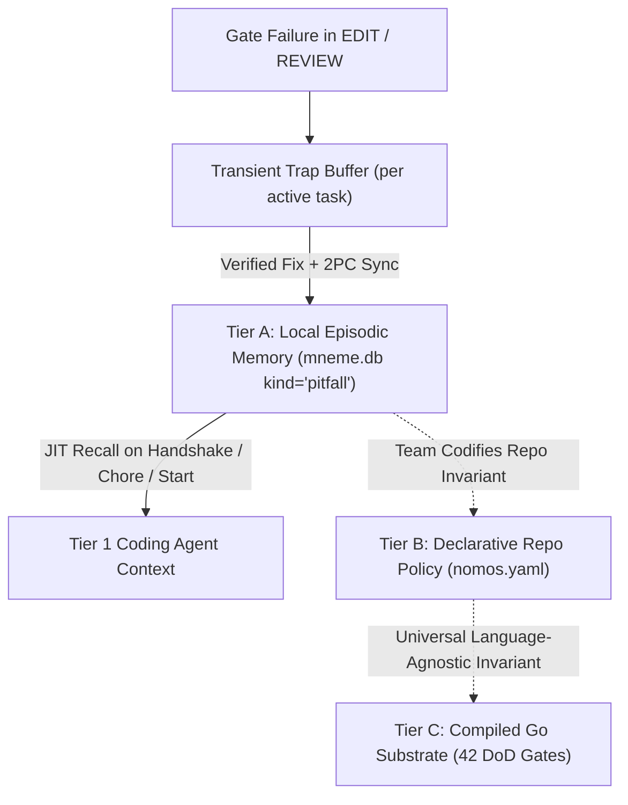

---
authors:
    - Mark Gantlett
    - Nomos Open-Core Substrate
classification: public
date: "2026-10-30"
last_updated: "2026-11-05"
plane: intent
status: active
title: "Tier 1 Indirect-Control Multipliers & Nomos Learn: Episodic Trap Distillation Specification"
type: spec
version: "4.5.0"
execution_frontier:
  tasks:
    - key: "INT-821"
      plane: "intent"
      summary: "Codify 6-Mark Tier 1 Indirect-Control Multipliers & Nomos Learn Distillation Contracts"
    - key: "INT-855"
      plane: "intent"
      summary: "Codify Positive-Path Verified Pattern Distillation, Statutory Provenance Guard, and Tier B Graduation Surfacing"
    - key: "INT-899"
      plane: "intent"
      summary: "Codify Read-Only IDLE Recall, Failing-File Trap Attribution, Pitfall-Only Graduation, and Mneme Dismiss"
    - key: "INT-929"
      plane: "intent"
      summary: "Codify Verified Host Tool-Health Snapshot in PostToolUse Hooks and Graceful Receipt-Trace Parity"
    - key: "INT-930"
      plane: "intent"
      summary: "Codify Configurable Model-Profile Advisory Thresholds on nomos hook"
ssot_repository: nomos
---

# Tier 1 Indirect-Control Multipliers & Nomos Learn: Episodic Trap Distillation Specification

**Document Key:** `SPEC-TIER1-LEARN-0821`  
**Classification:** Public Open-Core Specification  
**Version:** `4.0.0`  
**Governing Laws:** Law 1 (Dual-Core Inversion), Law 2 (Non-Verbal Proof), Law 3 (Hermetic Worktrees), Law 4 (SSoT), Law 5 (Zero-Hardcoded-Path), Law 6 (Canonical Singularity), Law 7 (Fail-Closed Pre-Flight)  
**Governing Decision:** ADR-0031 (*Agent Tiers, Indirect Control and Adoption Profiles*), ADR-0062 (*Database Encapsulation*)  

---

## 1. Executive Summary & Architectural Premise

Developers adopting open-core Nomos bring their own **Tier 1 coding agent** (AGY-IDE, Claude Code, Cursor, opencode) and expect radical minimalism: zero custom slash commands, zero workflow playbooks, and zero bloated prompt walls.
When Tier 1 coding agents fail inside downstream repositories, they typically fail along six predictable dimensions: friction entering isolated worktrees, discovering AST complexity breaches too late, skipping non-Go test runners, editing shared contracts blind to reverse importers, repeating identical repository-specific quality gate traps across sessions, and leaking modern SaaS/AI tokens or unapproved dependency mutations.

This specification codifies the **Six Tier 1 Indirect-Control Multipliers** and the **`Nomos Learn` 3-Tier Graduation Architecture**.
All repository-specific traps and verified resolutions remain strictly encapsulated inside the local repository database (`mneme.db`) and never pollute or hardcode downstream facts into the compiled `nomos` binary.

---

## 2. The Six Tier 1 Indirect-Control Multipliers

| Mark | Capability | Substrate Mechanism | Governing Invariant |
| :---: | :--- | :--- | :--- |
| **Mark 1** | **1-Turn Atomic Task Inception** | `nomos task chore [title] [--plane intent\|substrate]` & `nomos task start <key> [--edit]` | Law 3 (Hermetic Worktrees) |
| **Mark 2** | **Sub-15ms Incremental `PostToolUse` AST Radar** | `nomos verify --fast-file <path>` invoked via ambient `PostToolUse` hook | Law 2 (Non-Verbal Proof) |
| **Mark 3** | **Polyglot Toolchain & Test Auto-Discovery** | `GoToolchainGate` polyglot extension (`polyglot_toolchains: true`) | Law 2 (Non-Verbal Proof) |
| **Mark 4** | **1-Hop AST Blast-Radius & Impact Map** | `ComputeWorkspaceImpact` surfaced in `HandshakeEvent.impact_summary` & `nomos verify --impact` | Law 4 (Single Source of Truth) |
| **Mark 5** | **`Nomos Learn` Dual-Sided Distillation** | Negative-path `GateTrap -> Verified Fix` (`kind: "pitfall"`) + positive-path verified structural blueprints (`kind: "pattern"`) distilled into `mneme.db` on `nomos task sync` | Law 1 & ADR-0062 |
| **Mark 6** | **Modern Secret & Dependency Lockfile Shield** | Upgraded `SecretGate` (AI/cloud/SaaS tokens + `.env` guard) & `BoundaryConfig.lock_dependencies` | Law 6 & Law 7 |

---

## 3. `Nomos Learn`: The 3-Tier Graduation Architecture

Repository learnings must never be hardcoded into the `nomos` engine, nor dumped into static markdown skill files that rot over time.
`Nomos Learn` organizes operational intelligence into a strict 3-tier graduation ladder:



1. **Tier A — Local Episodic & Structural Distillation (`mneme.db`, Automatic, Per-Repo)**:
   - **Negative-Path Pitfalls (`kind: "pitfall"`):** When `nomos verify` or `nomos task review` rejects a task worktree, the harness records failing gate probes and derives the exact failing file's directory scope from the gate diagnostic message (`mem.DeriveTrapScope`, falling back to touched files when no path is present) in a transient task trap buffer. Upon 2PC release (`nomos task sync`), `finalizeSync` distills `Gate Failure -> Verified Fix` into `mneme.db`, superseding stale duplicate traps on the same gate+scope.
   - **Positive-Path Verified Patterns (`kind: "pattern"`):** On every 42/42 DoD-verified 2PC release (`nomos task sync`), even when zero gate failures occurred, `finalizeSync` extracts a compact structural blueprint from modified worktree source files (directory scope, exported AST symbol signatures, `@intent` Go AST/spec anchors, and paired `_test` vectors) and persists it as `kind: "pattern"`, superseding older pattern blueprints on the same directory scope.
   - **Statutory Write Provenance:** Manual CLI `nomos mem save` calls reject statutory kinds (`pitfall`, `pattern`, `release`, `task`, `commit`, `review`) fail-closed so unverified sessions can never forge 2PC-backed memories.
   - **Signal-Disciplined Recall & Pitfall Graduation Surfacing:** Passive `IDLE` trunk orientation (`nomos handshake`, `nomos status`, `nomos task status`) recalls `learned_pitfalls` and `verified_patterns` read-only (`RecallRepoPitfallsReadOnly`, `RecallRepoPatternsReadOnly`) without inflating `access_count`. Active task execution (`nomos task start`, `nomos task chore`, and non-`IDLE` worktree `nomos handshake`) reinforces `access_count`, surfacing recurring `kind: "pitfall"` guardrails (`access_count >= 3`) via `HandshakeEvent.graduation_candidates`.
2. **Tier B — Declarative Repository Policy (`nomos.yaml`, Explicit Team Promotion & Dismissal)**:
   - When a repository team sees a recurring `graduation_candidates` pitfall warrant deterministic fail-closed blocking across every developer seat and CI runner, they promote it into version-controlled `nomos.yaml` (`forbidden_literals`, `forbidden_shims`, `prohibited_packages`, `lock_dependencies`, `thresholds`) and retire the Tier A candidate via `nomos mem dismiss <id>`.
3. **Tier C — Core Substrate Engine (Universal Go Gates)**:
   - Only universal, repository-agnostic engineering laws graduate into the compiled `nomos` Go binary. Zero repository-specific strings, paths, or heuristics ever enter Tier C.

---

## 4. Compiled Go SSoT & JSON Schema Contract Extensions

### 4.1 Handshake Telemetry (`handshake.HandshakeEvent`)
`substrate/src/nomos/modules/handshake/handshake.go` extends `HandshakeEvent` with four optional slices:
- `learned_pitfalls` — Top repository-scoped distilled pitfalls recalled from `mneme.db`.
- `verified_patterns` — Top repository-scoped positive structural blueprints distilled from 2PC-verified releases in `mneme.db`.
- `graduation_candidates` — High-reinforcement `kind="pitfall"` memories (`access_count >= 3`) eligible for Tier B codification into `nomos.yaml`.
- `impact_summary` — Deterministic 1-hop blast-radius descriptors (reverse package/module importers, paired `_test` coverage status, and `@intent` Go AST/spec bindings) for modified worktree files.

### 4.2 Mneme Memory Taxonomy (`mem.Memory`)
`substrate/src/nomos/modules/mem/memory.go` extends `Memory.Kind` with `"pitfall"` and `"pattern"` to classify 2PC-verified negative gate-trap resolutions and positive structural blueprints distinctly from advisory `"reflection"` or `"decision"` records while preserving canonical lifecycle states (`"active"`, `"superseded"`, `"tombstoned"`).

### 4.3 Ecosystem Governance (`config.EcosystemConfig` & `nomos.schema.json`)
`substrate/src/nomos/core/config/config.go` (`nomos.schema.json`) extends:
- `BoundaryConfig.LockDependencies` (`lock_dependencies: false` default) — When `true`, blocks unapproved mutations to dependency manifests and lockfiles (`go.mod`, `go.sum`, `package.json`, `package-lock.json`, `pnpm-lock.yaml`, `yarn.lock`, `Cargo.toml`, `Cargo.lock`, `pyproject.toml`, `poetry.lock`, `uv.lock`, `requirements.txt`).
- `QualityGatesConfig.PolyglotToolchains` (`polyglot_toolchains: true` default) — Enables deterministic local toolchain checks for Python (`py_compile` / `pytest`), TypeScript (`tsc --noEmit`), and Rust (`cargo check`) when matching ecosystems exist in the workspace.

---

## 5. Sub-15ms Incremental Radar & Modern Secret Shield

### 5.1 Incremental Single-File AST Radar (`nomos verify --fast-file`)
Invoked automatically by the ambient `PostToolUse` hook whenever a Tier 1 agent mutates a file inside an isolated task worktree:
- Evaluates file LOC, function LOC, cyclomatic complexity, and cognitive debt score against configured `nomos.yaml` thresholds.
- Emits non-blocking early-warning telemetry to `stderr` when a file reaches $\ge 80\%$ of any structural budget (warning) or $> 100\%$ (breach alert), plus immediate warnings on forbidden literals or secret patterns.
- Completes in $< 15\text{ms}$ per file without spawning full-workspace compilation.

### 5.2 Upgraded `SecretGate` (Law 6 Canonical Singularity)
Rather than proliferating duplicate security gates, the canonical `SecretGate` (`secret`, Cell 7.1) enforces:
- Detection of PEM private keys, AWS access keys (`AKIA...`), OpenAI project/service keys (`sk-proj-...`), Anthropic keys (`sk-ant-...`), Google API keys (`AIzaSy...`), GitHub tokens (`ghp_`, `github_pat_`, `gho_`), GitLab tokens (`glpat-`), Stripe live keys (`sk_live_`, `rk_live_`), Slack tokens (`xoxb-`), HuggingFace tokens (`hf_`), and xAI keys (`xai-`).
- Rejection of tracked or unignored `.env` credential files (`.env`, `.env.local`, `.env.production`, `.env.staging`) while permitting sanitized templates (`.env.example`, `.env.sample`, `.env.template`, `.env.test`).

### 5.3 Verified Host & Tool-Health Snapshot (`nomos hook post-tool`)
To eliminate operational blindness without adding chatter to healthy tool calls (`arXiv:2611.05391`):
- `PostToolUse` (`AfterTool`) remains 100% silent (`{}`) on clean `Bash`, `Read`, and `MCP` tool executions.
- When `tool_response` carries a verified environmental fault (DNS/egress unreachable, archived Debian `apt` repository 404, read-only filesystem `EROFS`, disk/memory exhaustion `ENOSPC`/OOM, or missing shell executable `exit 127`), `nomos hook post-tool` records the fault class in the session budget/health state file and emits a single deduplicated 1-line `[Nomos Verified Host State]` advisory so the Tier 1 agent pivots immediately instead of repeating blind retries into the 3-strike loop breaker.

### 5.4 Configurable Model-Profile Advisory Thresholds (`nomos hook`)
Because fixed advisory scaffolding interacts non-uniformly across LLM families while hard safety invariants must never drift (`arXiv:2611.06116`, `arXiv:2611.06254`):
- All statutory CapBAC, Law 3 boundary, and Law 7 command/binary/hang `deny` gates remain strictly invariant and cannot be weakened via CLI flags.
- `nomos hook` exposes bounded advisory tuning flags (with matching environment fallbacks `NOMOS_BUDGET_WARN_PCT`, `NOMOS_BUDGET_CRIT_PCT`, `NOMOS_LOOP_STRIKES`, and `NOMOS_ADVISORY_STYLE`):
  - `--budget-warn-pct <int>` (default `75`, clamped to `[25, 90]`) and `--budget-crit-pct <int>` (default `90`, clamped to `[max(warn+5, 50), 99]`) for wall-clock session budget checkpoints.
  - `--loop-strikes <int>` (default `3`, clamped to `[2, 10]`) for identical-failure non-polling circuit-breaker threshold (polling commands retain their elevated threshold).
  - `--advisory-style <standard|terse>` (default `standard`), where `terse` emits compact single-clause advisories to minimize context dilution on terse-sensitive models.

---

## 6. Table-Driven Verification Vectors (`CDV-LEARN-SHIELD`)

| Vector ID | Cleanroom Scenario | Evaluated Invariant | Expected Outcome |
| :--- | :--- | :--- | :--- |
| **TV-LRN-01** | `nomos task chore "Fix parser"` on trunk | 1-turn worktree + `EDIT` transition | **PASS** (Worktree provisioned in `EDIT`) |
| **TV-LRN-02** | `nomos verify --fast-file` on file at $85\%$ LOC budget | Sub-15ms incremental AST radar | **PASS** (Emits $\ge 80\%$ budget warning) |
| **TV-LRN-03** | Broken Python syntax in polyglot repo during `nomos verify` | Polyglot toolchain auto-discovery | **FAIL** (`toolchain` gate rejects syntax error) |
| **TV-LRN-04** | Gate failure followed by fix and `nomos task sync` | `Nomos Learn` episodic distillation | **PASS** (`kind="pitfall"` saved in `mneme.db` & recalled on `handshake`) |
| **TV-LRN-05** | Source file containing `sk-proj-...` or tracked `.env` | Modern `SecretGate` token & `.env` shield | **FAIL** (`secret` gate blocks leak) |
| **TV-LRN-06** | `package.json` modified when `lock_dependencies: true` | Dependency manifest boundary lock | **FAIL** (`boundary` gate blocks lockfile mutation) |
| **TV-LRN-07** | Clean 42/42 verified `nomos task sync` with zero gate traps | Positive-path pattern distillation | **PASS** (`kind="pattern"` saved in `mneme.db` & recalled via `verified_patterns`) |
| **TV-LRN-08** | `nomos mem save "spoofed" --kind pattern` or `--kind pitfall` | Statutory write provenance guard | **FAIL** (`ERR_VALIDATION_FAILED` blocks manual statutory minting) |
| **TV-LRN-09** | Statutory `pitfall` recalled $\ge 3$ times across active tasks (`pattern` excluded) | Tier A $\to$ Tier B graduation surfacing | **PASS** (Surfaced in `HandshakeEvent.graduation_candidates`) |
| **TV-LRN-10** | Repeated `IDLE` `nomos handshake` followed by `nomos mem dismiss <id>` | Read-only passive `IDLE` recall & lifecycle dismissal | **PASS** (`IDLE` preserves `access_count`; `dismiss` transitions to `tombstoned`) |
| **TV-LRN-11** | `PostToolUse` observes verified DNS/egress, archived `apt`, `EROFS`, or missing-binary fault | Deduplicated Verified Host State snapshot | **PASS** (Emits once on first fault; silent `{}` on repeat and clean calls) |
| **TV-LRN-12** | `nomos hook` invoked with `--budget-warn-pct 65 --budget-crit-pct 85 --loop-strikes 4 --advisory-style terse` | Bounded model-profile advisory parameterization | **PASS** (Honors bounded thresholds & terse formatting; hard `deny` gates unchanged) |

---

## 7. Verification Command

```bash
nomos verify
```
Must pass all 42 Definition of Done quality gates and all Cleanroom Downstream Vector (`CDV`) suites with zero regressions.
