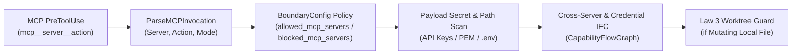

---
authors:
    - Mark Gantlett
    - Nomos Open-Core Substrate
classification: public
date: "2026-11-03"
last_updated: "2026-11-03"
plane: intent
ssot_repository: nomos
status: active
tags:
    - INT-857
    - SUB-1526
title: "Zero-Trust MCP Boundary Interceptor and Information Flow Control Specification"
trigger: always_on
type: spec
version: "4.3.0"
---

# Zero-Trust MCP Boundary Interceptor and Information Flow Control Specification

**Document Key:** `SPEC-CAPBAC-MCP-IFC-0857`  
**Classification:** Public Open-Core Specification  
**Version:** `4.3.0`  
**Governing Laws:** Law 1 (Dual-Core Inversion), Law 3 (Hermetic Worktree), Law 4 (Single Source of Truth), Law 7 (Fail-Closed Pre-Flight)

---

## 1. Context & Multi-Server MCP Threat Model

Model Context Protocol (`MCP`) tools expand agent capabilities across third-party servers (`mcp__<server>__<action>` and `mcp_<server>_<action>`). Implicitly trusting MCP tool invocations introduces four concrete cross-boundary failure modes (`arXiv:2604.27819`):

1. **Mutating Local File Bypass:** Treating mutating MCP filesystem tools (`mcp__filesystem__write_file`) as read-only bypasses **Law 3** worktree isolation.
2. **Direct Credential Boundary Leak:** Passing raw API keys, private keys, or `.env` paths inside MCP tool parameters leaks secrets to external servers.
3. **Credential-to-MCP Egress Exfiltration:** Reading local credentials (`.env`, `.aws/credentials`) and invoking an external MCP egress action exfiltrates sensitive state.
4. **Cross-Server Untrusted Escalation:** Ingesting untrusted content from MCP server `S1` (`mcp__fetch__fetch`) and invoking privileged remote mutations on server `S2` (`mcp__github__merge_pull_request`) enables prompt-injected lateral escalation.

---

## 2. Zero-Trust MCP IFC Architecture (`core/capbac`)

### 2.1 Canonical MCP Coordinate Parsing (`capbac.MCPInvocation`)
- Normalizes both `mcp__<server>__<action>` (Claude Code) and `mcp_<server>_<action>` (Cursor / Antigravity) into `(Server, Action, AccessMode)`.
- Classifies `AccessMode` into:
  - `MCPModeRead`: Pure inspection actions (`get`, `list`, `read`, `search`, `find`, `inspect`, `describe`, `fetch`, `SELECT`-only `query`).
  - `MCPModeMutate`: State-changing or outbound actions (`write`, `edit`, `create`, `update`, `delete`, `post`, `send`, `push`, `publish`, `merge`, `exec`, `run`, `upload`, mutating SQL).
  - `MCPModePrivileged`: High-impact remote mutations (`merge`, `push`, `publish`, `delete`, `drop`, `alter`, `truncate`, `deploy`, `exec`).

### 2.2 Declarative Server Policy (`config.BoundaryConfig` & `nomos.schema.json`)
`BoundaryConfig` in `core/config/config.go` exposes two optional lists reflected into `nomos.schema.json`:
- `allowed_mcp_servers`: When non-empty, permits only explicitly listed MCP server identifiers.
- `blocked_mcp_servers`: Unconditionally denies listed MCP server identifiers.

### 2.3 Information Flow Control Rules (`EvaluateMCPBoundary`)
1. **Policy Gate:** Rejects invocations targeting `blocked_mcp_servers` or servers absent from a non-empty `allowed_mcp_servers` allowlist.
2. **Credential Payload Gate:** Scans serialized MCP arguments for canonical secret tokens (`sk-proj-`, `sk-ant-`, `AKIA`, `ghp_`, `github_pat_`, `glpat-`, `xoxb-`, `hf_`, `xai-`, PEM private keys) and sensitive credential paths (`.env`, `.ssh/id_`, `.aws/credentials`).
3. **Credential Taint Egress Gate:** Rejects `MCPModeMutate` and `MCPModePrivileged` MCP calls when `CapabilityFlowGraph` holds `credential_source` taint.
4. **Cross-Server Escalation Gate:** Records untrusted ingress server `mcp_untrusted:<S1>` on external fetch/browser MCP servers and rejects `MCPModePrivileged` calls on any distinct server `S2 != S1` until `nomos verify` sanitizes the session.
5. **Hermetic Worktree Enforcement:** Routes mutating MCP tools with file path targets through `evaluateFileMutationGuard` (**Law 3**).

---

## 3. Table-Driven Verification Vectors

| Vector ID | Invariant | MCP Invocation / Trajectory | Expected Outcome |
| :--- | :--- | :--- | :--- |
| `TC-MCP-01` | Law 3 (Worktree Jail) | `mcp__filesystem__write_file` targeting trunk `main.go` | Denies trunk mutation outside `/worktrees/`. |
| `TC-MCP-02` | Law 7 (Secret Leak) | `mcp__slack__post_message` containing `sk-proj-...` token | Denies secret propagation across MCP boundary. |
| `TC-MCP-03` | Law 7 (Server Policy) | `mcp__untrusted__query` with `blocked_mcp_servers: ["untrusted"]` | Denies blocked MCP server fail-closed. |
| `TC-MCP-04` | Law 7 (Cred Exfil) | `Read(".env")` -> `mcp__github__create_issue` | Denies mutating MCP egress under `credential_source` taint. |
| `TC-MCP-05` | Law 1 (Cross-Server IFC) | `mcp__fetch__fetch` -> `mcp__github__merge_pull_request` | Denies cross-server privileged escalation before `nomos verify`. |
| `TC-MCP-06` | Law 1 (Benign Dev Flow) | `mcp__linear__get_issue` -> `Write` inside `/worktrees/` | Permits normal ticket read and isolated worktree edit. |
