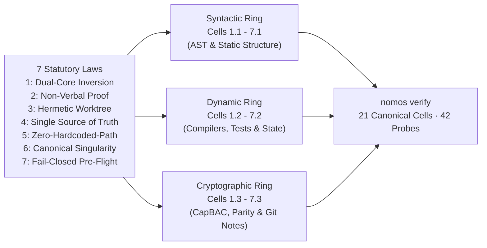

---
authors:
  - Mark Gantlett
  - Nomos Open-Core Substrate
classification: public
date: "2026-10-24"
last_updated: "2026-11-08"
lineage:
  - INT-737
  - INT-862
  - INT-1913
  - INT-1915
  - SUB-1215
  - SUB-1543
plane: intent
ssot_repository: nomos
status: active
title: "Full 42 DoD Gate Suite and Polyglot Verification Architecture Specification"
type: spec
version: "4.3.0"
---

# Full 42 DoD Gate Suite and Polyglot Verification Architecture Specification

---

## 1. Executive Summary & Problem Statement

In Nomos v3, the Definition of Done (DoD) pipeline grew organically across sequential sensor probes. However, legacy execution suffered from three architectural liabilities:
1. **CGO Compilation Bottlenecks**: Polyglot AST parsing depended on `smacker/go-tree-sitter` with 10 compiled C grammars, preventing pure-Go `CGO_ENABLED=0` static binary builds.
2. **False Positives & Fragile Discards**: Several gates matched keywords inside comments or relied on unchecked error discards (`_ = ...`), violating Law 7.
3. **Parity Confusion**: Early v4 transitions staged 16, 19, and 21 anchor probes before unifying all 42 statutory sensor probes across the 7x3 Canonical Matrix.

This specification codifies all 42 statutory sensor probes across the 7x3 Canonical Matrix (`7` Laws x `3` Defense Rings = `21` Invariant Cells). Execution preserves pure-Go (`CGO_ENABLED=0`) polyglot verification, `MaxFuncLOC <= 60`, and sub-second verification latency.

---

## 2. Axiomatic Invariants & Governing Laws

| Law # | Law Name | Architectural Invariant | 7x3 Matrix Coordinates |
| :---: | :--- | :--- | :--- |
| **1** | **The Dual-Core Inversion Law** | Substrate Go core governs phase transitions, cognitive budgets, and capability leases. | `Cell 1.1` (`syntactic`), `Cell 1.2` (`dynamic`), `Cell 1.3` (`cryptographic`) |
| **2** | **The Non-Verbal Proof Law** | Code correctness requires AST veracity, polyglot test execution, and gate mutation integrity. | `Cell 2.1` (`syntactic`), `Cell 2.2` (`dynamic`), `Cell 2.3` (`cryptographic`) |
| **3** | **The Hermetic Worktree Law** | Mutations execute strictly inside isolated task worktrees with attested 2PC release notes. | `Cell 3.1` (`syntactic`), `Cell 3.2` (`dynamic`), `Cell 3.3` (`cryptographic`) |
| **4** | **The Single Source of Truth Law** | Contracts, schemas, and links bind to compiled Go SSoT types. | `Cell 4.1` (`syntactic`), `Cell 4.2` (`dynamic`), `Cell 4.3` (`cryptographic`) |
| **5** | **The Zero-Hardcoded-Path Law** | Source code forbids workstation path literals, IP leaks, and hardcoded ingress assumptions. | `Cell 5.1` (`syntactic`), `Cell 5.2` (`dynamic`), `Cell 5.3` (`cryptographic`) |
| **6** | **The Canonical Singularity Law** | Commits, CLI flags, filesystem trees, and task keys enforce zero-alias canonical singularity. | `Cell 6.1` (`syntactic`), `Cell 6.2` (`dynamic`), `Cell 6.3` (`cryptographic`) |
| **7** | **The Fail-Closed Pre-Flight Law** | Secret scans, plane separation, unchecked error guards, and threshold locks fail closed. | `Cell 7.1` (`syntactic`), `Cell 7.2` (`dynamic`), `Cell 7.3` (`cryptographic`) |



---

## 3. The Complete 42-Sensor Probe Taxonomy

The Nomos DoD verification engine binds 42 statutory sensor probes across the 7 Laws and 3 Defense Rings:

### 3.1 Detailed Sensor Probe Allocation

#### Law 1: Dual-Core Inversion (Governance & Control)
- **Cell 1.1 (Syntactic)**:
  - `complexity`: AST cyclomatic complexity per function ($\le 15$) across all 11 supported languages (`Go, TypeScript/JS/TSX/JSX, Svelte, Python, Ruby, Rust, C/C++, Java, Kotlin, C#`).
  - `max_file_loc`: Maximum lines of code per file ($\le 400$).
  - `cognitive_debt`: Cognitive Debt Score (CDS) calculated from control flow nests, structural clones, parameter arity, and decomposition blueprints ($\le 45$).
  - `boundary`: Enforces repository-local package and import boundaries (`import`, `from`, `require`, `use`, `#include`, `using`) across all 11 supported languages.
  - `ui_anti_mask`: Detects UI shims masking unfinished functionality.
- **Cell 1.2 (Dynamic)**:
  - `phase_discipline`: Enforces valid state machine phase transitions (`IDLE` $\to$ `PLAN` $\to$ `EDIT` $\to$ `REVIEW` $\to$ `SYNC` $\to$ `LEARN`).
- **Cell 1.3 (Cryptographic)**:
  - `capbac_lease`: Validates active cryptographic CapBAC capability lease token for active worktrees.

#### Law 2: Non-Verbal Proof (Epistemology & Verification)
- **Cell 2.1 (Syntactic)**:
  - `tdd`: Validates that implementation modules across all 11 supported languages possess paired verification suites (`*_test.go`, `test_*.py`, `*.test.ts`, `*_test.rb`, `#[cfg(test)]`, `*Test.java`, `*Tests.cs`).
  - `anti_shim`: AST-level inspection rejecting trivial functions returning literal `Passed: true`, empty bodies, or skipped suite annotations.
  - `docstrings`: Validates exported function docstring density ($\ge 10\%$).
  - `dead_code`: Detects unreachable CLI commands, unexecuted gates, and orphan unimported internal Go and polyglot modules.
  - `uasset_dependency`: Audits binary asset links and schema dependencies.
- **Cell 2.2 (Dynamic)**:
  - `go_toolchain`: Executes polyglot compilation and suite verification (`go test`, `pytest`/`unittest`, `node --check`/`tsc`, `minitest`, `cargo test`, `cmake`/`ctest`, `gradle`/`mvn`, `dotnet test`).
  - `coverage`: Enforces statement coverage gating ($\ge 55\%$) across Go `coverprofile`, `lcov.info`, Cobertura XML, SimpleCov JSON, and Python `trace` ratchets.
  - `visual_regression`: Verifies UI components against baseline visual renders.
- **Cell 2.3 (Cryptographic)**:
  - `review_receipt`: Cryptographically verifies human/agent review attestation before merge.
  - `gate_integrity_proof`: Verifies that all active DoD gates contain non-trivial algorithmic verification logic.

#### Law 3: Hermetic Worktree (State & Isolation)
- **Cell 3.1 (Syntactic)**:
  - `staged_boundaries`: Restricts staged files to the active task's designated plane and `.tmp/` scratch boundary.
- **Cell 3.2 (Dynamic)**:
  - `hermetic_worktree`: Verifies execution occurs strictly within transient worktrees (`worktrees/nomos-<KEY>`), and protected trunk `main` is physically read-only.
  - `git_hygiene`: Enforces canonical Git command hygiene and prevents unstaged mutations.
  - `ecosystem_drift`: Detects cross-repository drift against the canonical trunk ecosystem baseline.
- **Cell 3.3 (Cryptographic)**:
  - `release_receipt`: Verifies Git Notes release receipt under `refs/notes/nomos/releases`.

#### Law 4: Single Source of Truth (Contracts & Schemas)
- **Cell 4.1 (Syntactic)**:
  - `broken_wire`: Validates all relative file links and documentation references across Intent markdown specs.
  - `intent_traceability`: Validates that implementation symbols include bidirectional `@intent` traceability annotations resolving to Go AST types and Intent specs ($\ge 50\%$).
  - `intent_steelman`: Validates Intent Markdown YAML frontmatter (`title`, `plane`, `status`) and balanced fenced code blocks.
- **Cell 4.2 (Dynamic)**:
  - `contract_parity`: Enforces byte-for-byte Draft 2020-12 JSON Schema parity (`nomos.schema.json` vs `config.EcosystemConfig`) and architectural engine grounding.
- **Cell 4.3 (Cryptographic)**:
  - `intent_parity`: SHA-256 byte parity audit across canonical Intent-Substrate protocol, hook, and directive assets.

#### Law 5: Zero-Hardcoded-Path (Portability & Environment)
- **Cell 5.1 (Syntactic)**:
  - `forbidden_literals`: AST-level token search rejecting hardcoded absolute paths (`/home/`, `/tmp/`, `/Users/`) in source code.
  - `ip_leak`: Scans source code for leaked internal IP markers, proprietary URLs, and confidential credentials.
  - `magic_strings`: Detects inline raw string literals requiring constant extraction.
  - `magic_string_duplication`: Detects string literals repeated $> 2$ times without constant extraction.
- **Cell 5.2 (Dynamic)**:
  - `infra_ingress`: Verifies dynamic port binding and zero hardcoded port assumptions.
- **Cell 5.3 (Cryptographic)**:
  - `topology_parity`: Cryptographically validates repository directory topology against `#NomosConfig` contract.

#### Law 6: Canonical Singularity (Action Space & Surface)
- **Cell 6.1 (Syntactic)**:
  - `commit_schema`: Enforces Golden Conventional Commits (`[<KEY>] <type>(<scope>): <summary>`), flowing rationale prose, zero diff dumps, and `Task:` Git trailers.
- **Cell 6.2 (Dynamic)**:
  - `zero_alias`: Validates that CLI commands and API endpoints possess zero hidden aliases, duplicates, or convenience wrappers.
  - `zero_filesystem_alias`: Rejects all filesystem symlinks in repository source.
- **Cell 6.3 (Cryptographic)**:
  - `canonical_singularity`: Validates task key singularity (`INT-<N>` or `SUB-<N>`).

#### Law 7: Fail-Closed Pre-Flight (Safety & Budgets)
- **Cell 7.1 (Syntactic)**:
  - `secret`: Scans code for private keys, AWS tokens, API secrets, and unmasked credentials.
  - `config_immutability`: Machine-enforces immutability of sealed system configuration files.
  - `plane_separation`: Enforces that `SUB-*` tasks never mutate `intent/` and `INT-*` tasks never mutate `substrate/`.
- **Cell 7.2 (Dynamic)**:
  - `unchecked_errors`: Rejects silent error discards across Go (`_ = call()`), Python (bare/silent `except: pass`), TS/JS/Svelte/JVM/C#/C++ (empty `catch {}`), Rust (`let _ = call()`), and Ruby (`rescue nil` / empty `rescue`).
- **Cell 7.3 (Cryptographic)**:
  - `threshold_integrity`: Cryptographically prevents `nomos.yaml` (`config.ThresholdsConfig`) threshold relaxation without explicit debt-task authorization.

---

## 4. Pure-Go Polyglot AST Engine & Compiled Go SSoT Contracts

In Nomos v4, polyglot verification executes natively in pure Go without external C toolchains:
1. **Go Source Analysis**: Standard library `go/parser`, `go/ast`, and `go/token`. Fast, zero dependencies, memory safe.
2. **Polyglot Tree-sitter WASM & Lexical Analysis**: Embeds `wazero` linear-memory line and delimiter bytecode alongside `.scm` query bindings across all 11 languages (`substrate/src/nomos/modules/verify/treesitter/`). Scanners strip comments, docstrings, and string literals before branch evaluation, and mask nested function spans to prevent double-counting.
3. **Anti-Shim, Unchecked-Error & Skip-Guard Detection**: Evaluates `.scm` captures to reject stubbed functions (`todo!()`, `pass`, `NotImplementedError`) and skipped suite annotations (`it.skip`, `pytest.mark.skip`, `#[ignore]`, `@Disabled`). Scanners also reject silent error discards (`_ = call()`, bare `except: pass`, empty `catch {}`, `let _ = call()`, `rescue nil`).
4. **Full Polyglot Toolchain & Coverage Parity**: Executes syntax compilation and verification suites across Go, Python, JS/TS, Ruby, Rust, C/C++, JVM, and C#. `CoverageGate` evaluates `coverprofile`, `lcov.info`, Cobertura XML, SimpleCov JSON, and Python `trace` coverage under unified ratchets.
5. **Polyglot Blueprints, Blast-Radius Maps & Post-Tool Radar**: Enforces parameter arity (`> 8`) and syntax-aware seam extraction across brace (`{}`), indentation (`Python`), and `end`-block (`Ruby`) languages. `ImpactMap` resolves 1-hop dependents (`import`, `from`, `require`, `use`, `#include`, `using`) and paired suites, while `FastFileRadar` honors brownfield baseline ratchets.
6. **Markdown & Schema Analysis**: Lexical stream scanner for Markdown relative links, YAML frontmatter, and balanced fences, paired with Go-reflected Draft 2020-12 JSON Schema parity (`nomos.schema.json`).
7. **Configuration & Script Analysis**: Standard library decoders (`yaml.v3` with `KnownFields(true)`, `encoding/json`) and shell analyzers.

### 4.1 Compiled Go Gate & Threshold SSoT Contracts

The compiled Go Single Source of Truth resides in `substrate/src/nomos/modules/verify/gate.go`, `substrate/src/nomos/modules/verify/pipeline.go`, and `substrate/src/nomos/core/config/config.go`:

```go
package verify

// GateResult represents the outcome of an individual quality gate evaluation.
type GateResult struct {
	GateName       string `json:"gate_name"`
	ProbeID        string `json:"probe_id,omitempty"`
	Law            int    `json:"law,omitempty"`
	Ring           string `json:"ring,omitempty"`
	Passed         bool   `json:"passed"`
	Skipped        bool   `json:"skipped,omitempty"`
	Message        string `json:"message"`
	Remedy         string `json:"remedy,omitempty"`
	DurationMicros int64  `json:"duration_micros,omitempty"`
	DebtFlagged    bool   `json:"debt_flagged,omitempty"`
}

// Gate defines the interface for an invariant evaluation step.
type Gate interface {
	Name() string
	Evaluate(ctx *VerifyContext) (*GateResult, error)
}

// PipelineReport encapsulates the complete verification results across all gates, cells, and laws.
type PipelineReport struct {
	Passed         bool          `json:"passed"`
	DurationMicros int64         `json:"duration_micros"`
	GatesTotal     int           `json:"gates_total"`
	GatesPassed    int           `json:"gates_passed"`
	GateResults    []*GateResult `json:"gate_results"`
	LawReports     []*LawReport  `json:"law_reports"`
	CellReports    []*CellReport `json:"cell_reports"`
}
```

---

## 5. Thresholds and Mathematical Guarantees

`config.ThresholdsConfig` (`substrate/src/nomos/core/config/config.go` and `nomos.schema.json`) unifies all statutory verification thresholds:

| Metric | Threshold | Enforcement Probe |
| :--- | :--- | :--- |
| **Max Function LOC** | $\le 60$ LOC | `complexity` / `gates_standard.go` |
| **Max File LOC** | $\le 400$ LOC | `max_file_loc` |
| **Max Cyclomatic Complexity** | $\le 15$ | `complexity` |
| **Max Cognitive Debt Score (CDS)** | $\le 45$ | `cognitive_debt` |
| **Min Test Statement Coverage** | $\ge 55\%$ | `coverage` |
| **Min Docstring Density** | $\ge 10\%$ | `docstrings` |
| **Min Intent Traceability Density** | $\ge 50\%$ | `intent_traceability` |
| **Max Magic String Duplications** | $\le 2$ repetitions | `magic_string_duplication` |
| **Symlink Tolerance** | $0$ (strictly forbidden) | `zero_filesystem_alias` |
| **Unchecked Error Discard Tolerance** | $0$ (strictly forbidden) | `unchecked_errors` |

### 5.1 Monotonic Baseline Delta Ratchet in Brownfield Mode (`INT-1913`)

When `nomos.yaml` sets `strict_mode: false`, `nomos verify` enforces a monotonic baseline ratchet against `default_branch`:
- Empty Git worktrees in brownfield mode evaluate zero untouched legacy files and return exit code 0.
- Pre-existing files compare AST metrics against `default_branch` via `max(threshold, baseline)` for function complexity, function LOC, and file CDS.
- Pre-existing files above `max_file_loc` allow bounded modular helper extraction up to `baseline_loc + max_func_loc` while rejecting `CDS` regressions.
- Newly added files and newly added functions enforce statutory thresholds (`<= 400` file LOC, `<= 60` function LOC, `<= 15` complexity, `<= 45` CDS).
- `anti_shim`, `unchecked_errors`, `docstrings`, and `coverage` reject newly introduced regressions while tolerating untouched baseline debt.
- `tdd` and polyglot toolchains scope execution to modified packages and relevant suites inside active brownfield worktrees.

---

## 6. Table-Driven Verification Vectors

| Vector ID | Sensor / Cell | Input Condition | Expected Verdict |
| :--- | :--- | :--- | :--- |
| `TC-DOD-01` | `Cell 1.1 (complexity)` | Function cyclomatic complexity `> 15` or LOC `> 60` | `FAIL` (Exit 1, threshold breach) |
| `TC-DOD-02` | `Cell 2.1 (anti_shim)` / `Cell 2.1 (docstrings)` | Trivial constant-return shim or modified file docstring density `< 10%` | `FAIL` (Exit 1, AST proof violation) |
| `TC-DOD-03` | `Cell 6.2 (zero_filesystem_alias)` | Symbolic link committed inside repository tree | `FAIL` (`ERR_SYMLINK_FORBIDDEN`) |
| `TC-DOD-04` | `Cell 7.1 (plane_separation)` / `Cell 7.1 (secret)` | Cross-plane `INT-*`/`SUB-*` edit or inline credential literal | `FAIL` (Fail-closed pre-flight block) |
| `TC-DOD-05` | Full 7x3 Matrix (`42` probes) | Clean Go + WASM Tree-sitter polyglot workspace | `PASS` (Exit 0, `42/42` satisfied) |
| `TC-DOD-06` | `Cell 1.1` (`strict_mode: false`) | Clean helper fix in legacy `1200`-LOC file with untouched `V(G)=28` | `PASS` (Exit 0, `dV(G) <= 0`) |
| `TC-DOD-07` | `Cell 1.1` (`strict_mode: false`) | Legacy `V(G)=28` function grows to `V(G)=30` in worktree | `FAIL` (Exit 1, ratchet breach) |
| `TC-DOD-08` | `Cell 2.2 (go_toolchain)` | Pure JS repo without `tsconfig.json` or Python repo with stdlib `unittest` only | `PASS` / `FAIL` via `node --check` + JS test runner and `python -m unittest` |
| `TC-DOD-09` | `Cell 2.2 (coverage)` / `Cell 2.1 (tdd)` | Non-Go workspace with LCOV/Cobertura/Python coverage or brand-new untested polyglot module | Enforces `MinCoverage` (or brownfield ratchet) and rejects untested modules |
| `TC-DOD-10` | `Cell 1.1 (complexity)` | Python docstring containing `"if x and y or z"` or nested `def inner():` | Zero docstring branch inflation; zero nested double-counting |
| `TC-DOD-11` | `Cell 7.2 (unchecked_errors)` / `Cell 1.1 (boundary)` | Silent `except: pass`, empty `catch {}`, `let _ = call()`, or prohibited polyglot import | `FAIL` (Exit 1, net-new violation rejected) |
| `TC-DOD-12` | `FastFileRadar` (`strict_mode: false`) | Post-tool edit on legacy `1200`-LOC file with `dLOC <= 0` and `dCDS <= 0` | Zero false statutory breach; emits baseline delta context |

---

## 7. Cross-Plane Traceability & DoD Verification

- **Intent Lineage**: `INT-737`, `INT-862`.
- **Substrate SSoT**: `SUB-1215`, `SUB-1543` (`substrate/src/nomos/modules/verify/matrix.go`, `substrate/src/nomos/modules/verify/gate.go`, `substrate/src/nomos/modules/verify/pipeline.go`, `substrate/src/nomos/modules/verify/pipeline_loader.go`, `substrate/src/nomos/modules/verify/treesitter/`, `substrate/src/nomos/core/config/config.go`).
- **Canonical 7x3 Matrix Coverage**: Enforces all `21` Invariant Cells (`Cell 1.1` through `Cell 7.3`) across all `42` registered probes in `CanonicalGateOrder`.
- **Deterministic Verification**:
  1. All 42 statutory probes compile in pure Go (`CGO_ENABLED=0`) within modular packages satisfying `<= 400` file LOC and `<= 60` function LOC.
  2. `nomos verify` evaluates the complete 42-probe statutory suite with exit code `0` and zero external C dependencies.
