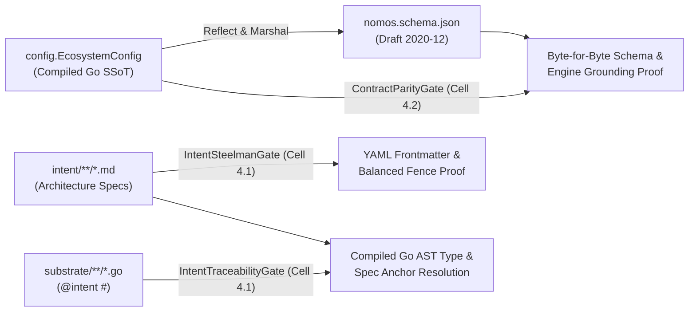

---
authors:
  - Mark Gantlett
  - Nomos Open-Core Substrate
classification: public
date: "2026-11-03"
last_updated: "2026-11-11"
lineage:
  - INT-897
  - SUB-1672
  - INT-1944
  - SUB-2157
  - INT-1976
  - SUB-2241
  - INT-1986
  - SUB-2281
plane: intent
ssot_repository: nomos
status: active
title: "Compiled Go SSoT and Reflected Draft 2020-12 JSON Schema Architecture Specification"
type: spec
version: "4.4.0"
---

# Compiled Go SSoT and Reflected Draft 2020-12 JSON Schema Architecture Specification

---

## 1. Executive Summary & Problem Statement

Across three generations of the Nomos substrate, policy and contract validation converged toward zero-duplication static compilation:

1. **Generation 3 (`OPA + CUE`):** Maintained dual Rego policies and `.cue` schemas alongside Go structs. Cross-language synchronization required continuous manual parity maintenance.
2. **Generation 4.0 (`CUE-Only Bridge`):** Retired Open Policy Agent (`OPA`) in favor of `cuelang.org/go` (`intent/contracts/cue/*.cue`). Simultaneously, all runtime validation migrated into deterministic pure-Go `Validate()` methods, `yaml.v3` strict `KnownFields(true)` decoding, SQLite `CHECK` constraints, and compiled Go/WASM AST gates.
3. **Generation 4.3 (`Compiled Go AST + Reflected JSON Schema`):** Audits prior to open-core v4 stabilization confirmed that zero runtime CLI commands (`nomos task`, `nomos session`, `nomos issue`, `nomos mem`, `nomos hook`, `nomos status`, `nomos handshake`) evaluated `.cue` files. Maintaining 24 passive `.cue` files violated **Law 4** and **Law 6** by duplicating Go types while inflating binary weight by `32.8%`.

Nomos v4.3 establishes **Compiled Go Types** as the sole runtime SSoT, paired with Go-reflected Draft 2020-12 JSON Schema (`nomos.schema.json`) for IDE validation.

---

## 2. Axiomatic Invariants & Governing Laws

| Law # | Law Name | Architectural Invariant | Machine Enforcement Mechanism |
| :---: | :--- | :--- | :--- |
| **2** | **The Non-Verbal Proof Law** | Schema parity and bidirectional AST anchor resolution execute deterministically. | `Cell 4.1 (intent_traceability)`, `Cell 4.2 (contract_parity)` |
| **4** | **The Single Source of Truth Law** | `config.EcosystemConfig` owns schema definition; `nomos.schema.json` reflects with zero byte drift. | `VerifyConfigJSONSchemaParity` (`config/schema.go`) |
| **6** | **The Canonical Singularity Law** | Eliminates parallel policy VMs (`OPA`, `CUE`) for one compiled Go representation. | Zero secondary schema engines in `substrate/go.mod` |
| **7** | **The Fail-Closed Pre-Flight Law** | Unknown YAML keys, schema drift, or malformed Intent specs fail closed. | `yaml.v3` `KnownFields(true)`, `Cell 4.1 (intent_steelman)` |

---

## 3. Empirical Consolidation Receipts (`SUB-1672` / `INT-897`)

Removing `cuelang.org/go v0.17.1` and its transitive OCI registry, protobuf, decimal arithmetic, OAuth2, and TOML dependency graph produced immediate measurable improvements with `CGO_ENABLED=0`:

| Engineering Metric | Pre-Consolidation (`v4.2`) | Post-Consolidation (`v4.3`) | Measured Delta |
| :--- | :--- | :--- | :--- |
| **Static `nomos` Binary Size** | `41,604,360` bytes (`39.68 MiB`) | `27,974,300` bytes (`26.68 MiB`) | **`-13,630,060` B (`-13.00 MiB` / `-32.8%`)** |
| **`substrate/go.mod` Lines** | `51` lines (`133` `go.sum` lines) | `38` lines (`101` `go.sum` lines) | **`-13` modules pruned** |
| **Direct Runtime Dependencies** | `7` direct modules | `6` direct modules (`cobra`, `lipgloss`, `termenv`, `wazero`, `yaml.v3`, `modernc.org/sqlite`) | **Zero secondary policy VM** |
| **Duplicate Schema Files** | `24` manual `.cue` files | `1` Go-reflected `nomos.schema.json` (`281` lines) | **Zero manual dual-maintenance** |
| **Editor `nomos.yaml` UX** | Manual inspection | Instant `yaml-language-server` Draft 2020-12 hover & validation | **Universal VS Code / Neovim / JetBrains support** |

---

## 4. Law 4 Enforcement Architecture

Under **Law 4 (Single Source of Truth)**, three deterministic quality gates in `substrate/src/nomos/modules/verify/` enforce contract and specification integrity:



### 4.1 `ContractParityGate` (`Cell 4.2 (contract_parity)` - `config/schema.go` & `gates_contracts_boundary.go`)
- `config.GenerateConfigJSONSchema()` reflects `config.EcosystemConfig` together with `config.DefaultNomosConfig()` into a canonical Draft 2020-12 JSON Schema (`additionalProperties: false`, field descriptions, numeric bounds, and default values).
- `config.VerifyConfigJSONSchemaParity(schemaPath)` recomputes the schema in memory and fails closed if `nomos.schema.json` drifts by a single byte from `config.EcosystemConfig`.
- `AuditArchitecturalEngines` verifies that required architectural invariants remain grounded across `substrate/` packages and `intent/` specifications.

### 4.2 `IntentSteelmanGate` (`Cell 4.1 (intent_steelman)` - `intent_steelman.go`)
- Walks `intent/**/*.md` and validates YAML frontmatter (`yaml.Unmarshal`) requiring `title`, `plane: intent`, and valid `status` whenever `contracts.enabled: true` or `---` delimiters exist.
- Verifies balanced and closed Markdown code fences (` ``` ` / `~~~`) to intercept truncated specification mutations deterministically.

### 4.3 `IntentTraceabilityGate` (`Cell 4.1 (intent_traceability)` - `intent_schema_helpers.go`)
- Enforces `@intent` docstring traceability across exported Go functions (`>= 50%` density on modified files).
- Resolves `@intent #<TypeName>` tokens against `substrate/` `type <TypeName>` AST declarations (`go/parser`) and `<name>_spec.md` references against `intent/` specs, rejecting dangling anchors.

---

## 5. Formal Go Schema Reflection & Core Type Contracts

Packages `substrate/src/nomos/core/config/` and `substrate/src/nomos/core/types/` define the compiled configuration, JSON Schema reflection, actionable error, HATEOAS affordance, and polyglot source-root contracts:

```go
package config

// EcosystemConfig defines the top-level nomos.yaml schema (#EcosystemConfig).
type EcosystemConfig struct {
	Project       string           `yaml:"project" json:"project"`
	DefaultBranch string           `yaml:"default_branch" json:"default_branch"`
	Governance    GovernanceConfig `yaml:"governance" json:"governance"`
}

// GovernanceConfig groups boundary and quality gate policies (#GovernanceConfig).
type GovernanceConfig struct {
	Boundary     BoundaryConfig     `yaml:"boundary" json:"boundary"`
	QualityGates QualityGatesConfig `yaml:"quality_gates" json:"quality_gates"`
}

// QualityGatesConfig configures deterministic AST, TDD, coverage, and contract gates (#QualityGatesConfig).
type QualityGatesConfig struct {
	ForbiddenLiterals            []string                   `yaml:"forbidden_literals,omitempty" json:"forbidden_literals,omitempty"`
	HasForbiddenLiteralsOverride bool                       `yaml:"-" json:"-"`
	ForbiddenShims               []string                   `yaml:"forbidden_shims,omitempty" json:"forbidden_shims,omitempty"`
	StrictMode                   bool                       `yaml:"strict_mode" json:"strict_mode"`
	VerifyScope                  string                     `yaml:"verify_scope,omitempty" json:"verify_scope,omitempty"`
	IntentTwinMode               string                     `yaml:"intent_twin_mode,omitempty" json:"intent_twin_mode,omitempty"`
	TDDMode                      string                     `yaml:"tdd_mode,omitempty" json:"tdd_mode,omitempty"`
	TDDExclude                   []string                   `yaml:"tdd_exclude,omitempty" json:"tdd_exclude,omitempty"`
	CoverageMode                 string                     `yaml:"coverage_mode,omitempty" json:"coverage_mode,omitempty"`
	PolyglotToolchains           *bool                      `yaml:"polyglot_toolchains,omitempty" json:"polyglot_toolchains,omitempty"`
	Exclude                      []string                   `yaml:"exclude,omitempty" json:"exclude,omitempty"`
	IntentSourceRoots            []string                   `yaml:"intent_source_roots,omitempty" json:"intent_source_roots,omitempty"`
	SubstrateSourceRoots         []string                   `yaml:"substrate_source_roots,omitempty" json:"substrate_source_roots,omitempty"`
	ArchitectureBoundaries       []ArchitectureBoundaryRule `yaml:"architecture_boundaries,omitempty" json:"architecture_boundaries,omitempty"`
	Contracts                    *ContractsBoundaryConfig   `yaml:"contracts,omitempty" json:"contracts,omitempty"`
	Thresholds                   ThresholdsConfig           `yaml:"thresholds" json:"thresholds"`
}

// ContractsBoundaryConfig defines cross-plane contract and infrastructure verification boundaries (#ContractsBoundaryConfig).
type ContractsBoundaryConfig struct {
	Contracts   ContractsConfig `yaml:"contracts" json:"contracts"`
	Membrane    *MembraneConfig `yaml:"membrane,omitempty" json:"membrane,omitempty"`
	Infra       InfraConfig     `yaml:"infra" json:"infra"`
	AutoPromote bool            `yaml:"auto_promote,omitempty" json:"auto_promote,omitempty"`
}

// ThresholdsConfig captures numerical AST and test hygiene quality bounds (#ThresholdsConfig).
type ThresholdsConfig struct {
	MaxCognitiveDebtScore     int `yaml:"max_cognitive_debt_score" json:"max_cognitive_debt_score"`
	MaxCyclomaticComplexity   int `yaml:"max_cyclomatic_complexity" json:"max_cyclomatic_complexity"`
	MaxFileLOC                int `yaml:"max_file_loc" json:"max_file_loc"`
	MaxFuncLOC                int `yaml:"max_func_loc" json:"max_func_loc"`
	MinCommentDensityPct      int `yaml:"min_comment_density_pct" json:"min_comment_density_pct"`
	MinTestCoveragePct        int `yaml:"min_test_coverage_pct" json:"min_test_coverage_pct"`
	MinCloneLines             int `yaml:"min_clone_lines,omitempty" json:"min_clone_lines,omitempty"`
	MaxFuncParams             int `yaml:"max_func_params,omitempty" json:"max_func_params,omitempty"`
	MaxMagicStringDuplication int `yaml:"max_magic_string_duplication,omitempty" json:"max_magic_string_duplication,omitempty"`
	MaxPackageFiles           int `yaml:"max_package_files,omitempty" json:"max_package_files,omitempty"`
}

// JSONSchemaNode models a deterministic JSON Schema Draft 2020-12 node (#JSONSchemaNode).
type JSONSchemaNode struct {
	Schema               string                     `json:"$schema,omitempty"`
	ID                   string                     `json:"$id,omitempty"`
	Title                string                     `json:"title,omitempty"`
	Description          string                     `json:"description,omitempty"`
	Type                 string                     `json:"type,omitempty"`
	Enum                 []string                   `json:"enum,omitempty"`
	Default              any                        `json:"default,omitempty"`
	Minimum              *int                       `json:"minimum,omitempty"`
	Maximum              *int                       `json:"maximum,omitempty"`
	Items                *JSONSchemaNode            `json:"items,omitempty"`
	Properties           map[string]*JSONSchemaNode `json:"properties,omitempty"`
	AdditionalProperties *bool                      `json:"additionalProperties,omitempty"`
}
```

```go
package types

import (
	"context"
	"time"
)

// NomosError encapsulates structured agent-focused context for invariant failures (#NomosError).
type NomosError struct {
	Code              string   `json:"code"`
	Description       string   `json:"description"`
	Remedy            string   `json:"remedy,omitempty"`
	ExplainCommand    string   `json:"explain_command,omitempty"`
	ContextFiles      []string `json:"context_files,omitempty"`
	Fatal             bool     `json:"fatal"`
	TriageHash        string   `json:"triage_hash,omitempty"`
	InteractivePrompt string   `json:"interactive_prompt,omitempty"`
}

// ActionAffordance defines a deterministic HATEOAS next-step hypermedia command (#ActionAffordance).
type ActionAffordance struct {
	Command string `json:"command"`
	Summary string `json:"summary"`
	Phase   Phase  `json:"phase"`
}

// PhaseState captures the active workspace lifecycle phase and CapBAC budget (#PhaseState).
type PhaseState struct {
	Phase       Phase              `json:"phase"`
	TaskID      string             `json:"task_id,omitempty"`
	Assignee    string             `json:"assignee"`
	Token       string             `json:"token,omitempty"`
	StepBudget  int                `json:"step_budget"`
	TokensUsed  int                `json:"tokens_used"`
	NextActions []ActionAffordance `json:"next_actions,omitempty"`
	UpdatedAt   time.Time          `json:"updated_at,omitempty"`
}

// SupportedLanguage defines languages supported by polyglot AST verification (#SupportedLanguage).
type SupportedLanguage string

// SourceRootConfig binds a directory path to a polyglot language scanner (#SourceRootConfig).
type SourceRootConfig struct {
	Path            string            `json:"path"`
	Language        SupportedLanguage `json:"language"`
	ExcludePatterns []string          `json:"exclude_patterns,omitempty"`
}

// PolyglotWorkspaceManifest declares workspace source roots and polyglot enforcement rules (#PolyglotWorkspaceManifest).
type PolyglotWorkspaceManifest struct {
	SourceRoots    []SourceRootConfig `json:"source_roots"`
	StrictPolyglot bool               `json:"strict_polyglot"`
}

// ResolvedFileContext binds a discovered file to its AST parser strategy (#ResolvedFileContext).
type ResolvedFileContext struct {
	RelativePath string
	MatchedRoot  SourceRootConfig
	Language     SupportedLanguage
	IsExcluded   bool
}

// SourceRootResolver defines the contract for dynamic root resolution (#SourceRootResolver).
type SourceRootResolver interface {
	Resolve(ctx context.Context, relPath string) (*ResolvedFileContext, error)
	ValidateManifest(ctx context.Context, roots []SourceRootConfig) error
}
```

---

## 6. Table-Driven Verification Vectors

| Vector ID | Target Gate / Helper | Input Condition | Expected Verdict |
| :--- | :--- | :--- | :--- |
| `TC-SSOT-01` | `VerifyConfigJSONSchemaParity` | `EcosystemConfig` field added without regenerating `nomos.schema.json` | **FAIL** (`nomos.schema.json` byte parity drift detected) |
| `TC-SSOT-02` | `GenerateConfigJSONSchema` | Clean `EcosystemConfig` reflection | **PASS** (Draft 2020-12 JSON with `additionalProperties: false`) |
| `TC-SSOT-03` | `IntentSteelmanGate` | Intent Markdown spec missing `title`/`plane`/`status` or unclosed ```` ``` ```` fence | **FAIL** (Malformed Intent document rejected) |
| `TC-SSOT-04` | `IntentTraceabilityGate` | `@intent #NonExistentStruct` or `@intent missing_spec.md` in Go docstring | **FAIL** (Unresolved AST type or spec anchor rejected) |
| `TC-SSOT-05` | `LoadConfig` (`yaml.v3`) | Unknown YAML key in `nomos.yaml` | **FAIL** (`KnownFields(true)` rejects unknown configuration key) |
| `TC-SSOT-06` | `GenerateConfigJSONSchema` | `ThresholdsConfig.MaxPackageFiles` reflection | **PASS** (Emits `max_package_files` default `40` with minimum `1`) |
| `TC-ERR-001` | `NewNomosError` | Error constructed with canonical `ERR_*` code and `WithRemedy` | **PASS** (`Validate()` passes and renders remedial CLI hint) |
| `TC-ERR-002` | `NomosError.Validate` | Error constructed without canonical `ERR_*` code prefix | **FAIL** (`Validate()` rejects unregistered error code) |
| `TC-ERR-003` | `WithExplainCommand` | Error enriched with `nomos task --help` inspection command | **PASS** (Preserves `ExplainCommand` in structured output) |
| `TC-ERR-004` | `WithContextFiles` | Error enriched with workspace-relative context file paths | **PASS** (Attaches affected file coordinates for triage) |
| `TC-HAT-01` | `BuildPhaseNextActions` | Workspace in `IDLE` phase with unblocked wavefront candidate | **PASS** (Emits `nomos task start` and `nomos task chore` affordances) |
| `TC-HAT-02` | `BuildPhaseNextActions` | Workspace in `EDIT` phase inside isolated worktree | **PASS** (Emits `nomos verify` and `nomos task commit` affordances) |
| `TC-HAT-03` | `BuildPhaseNextActions` | Workspace in `REVIEW` phase after verification | **PASS** (Emits `nomos task sync -F` 2PC release affordance) |
| `TC-HAT-04` | `PhaseState.Validate` | Default `PhaseState` initialized at session boot | **PASS** (`Validate()` confirms valid phase and step budget bounds) |
| `TC-ROOT-01` | `SourceRootResolver.Resolve` | File path `substrate/cli/root.go` under configured Go root | **PASS** (Resolves `LanguageGo` and `IsExcluded == false`) |
| `TC-ROOT-02` | `SourceRootResolver.Resolve` | File path matching `ExcludePatterns` (`vendor/**`) | **PASS** (Resolves `IsExcluded == true` for excluded tree) |
| `TC-ROOT-03` | `SourceRootConfig.Validate` | Source root configured with unsupported language identifier | **FAIL** (`Validate()` rejects unknown `SupportedLanguage`) |
| `TC-ROOT-04` | `PolyglotWorkspaceManifest` | Manifest with duplicate or escaping `../` root paths | **FAIL** (`Validate()` rejects path traversal and duplicate roots) |

---

## 7. Cross-Plane Traceability & DoD Verification

- **Intent Lineage**: `INT-897`.
- **Substrate SSoT**: `SUB-1672` (`substrate/src/nomos/core/config/config.go`, `substrate/src/nomos/core/config/schema.go`, `substrate/src/nomos/modules/verify/gates_contracts_boundary.go`, `substrate/src/nomos/modules/verify/intent_steelman.go`, `substrate/src/nomos/modules/verify/intent_schema_helpers.go`, `nomos.schema.json`).
- **Canonical 7x3 Matrix Coordinates**: `Cell 4.1 (broken_wire)`, `Cell 4.1 (intent_traceability)`, `Cell 4.1 (intent_steelman)`, `Cell 4.2 (contract_parity)`, `Cell 4.3 (intent_parity)`.
- **Deterministic Verification**: `nomos verify` enforces byte-for-byte `nomos.schema.json` parity, strict YAML frontmatter validation, and bidirectional Go AST traceability with exit code `0`.
