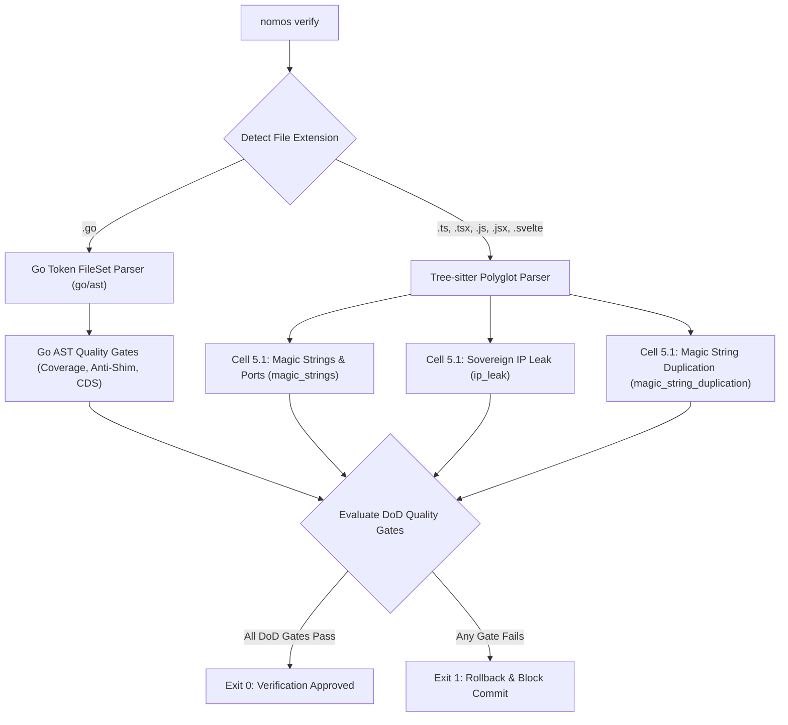

---
authors:
  - Mark Gantlett
  - Nomos Open-Core Substrate
classification: public
date: "2026-10-04"
last_updated: "2026-11-06"
lineage:
  - INT-321
  - INT-862
  - INT-942
  - SUB-110
  - SUB-1543
plane: intent
ssot_repository: nomos
status: active
title: "Polyglot AST Validation & Language-Agnostic Gating Architecture"
type: spec
version: "4.2.0"
---

# Polyglot AST Validation & Language-Agnostic Gating Architecture

---

## 1. Executive Summary & Problem Statement

The Nomos Substrate enforces mathematical Definition of Done (DoD) quality gates via Go-native Abstract Syntax Trees (`go/ast`). Nomos also orchestrates Tier 1 agentic frameworks, SvelteKit/TypeScript UIs, and polyglot workspaces. Consequently, the Substrate audits polyglot assets with identical deterministic AST rigor.

This specification formalizes the **Polyglot AST Validation Engine**:
1. **Dynamic Dialect Dispatching:** Routes Go source files to `go/ast` (zero CGO overhead, 100% type-aware) and TypeScript, JavaScript, and Svelte assets to `wazero` Tree-sitter WASI scanners.
2. **DoD Matrix Integration:** Enforces `Cell 5.1 (ip_leak)`, `Cell 5.1 (magic_strings)`, and `Cell 5.1 (magic_string_duplication)` alongside `Cell 1.1` and `Cell 2.1` AST probes across all polyglot files.
3. **Go SSoT & JSON Schema Parity:** Validates findings and `source_roots` against `config.SourceRoot` (`nomos.schema.json`) and compiled Go DTOs.
4. **Universal Topology:** References strictly adhere to `nomos` (Open-Core Public Foundation) and `gsi-sov` (Sovereign Proprietary Extensions).

---

## 2. Axiomatic Invariants & Governing Laws

| Law # | Law Name | Architectural Enforcement |
| :---: | :--- | :--- |
| **Law 1** | **Dual-Core Inversion** | Go core executes deterministic AST parsing across all polyglot files. |
| **Law 2** | **Non-Verbal Proof** | AST node evaluation replaces regex heuristics across vectors `TC-POLY-001` through `TC-POLY-006`. |
| **Law 4** | **Single Source of Truth** | Scanners bind findings strictly to `substrate/src/nomos/modules/verify/` DTOs and `nomos.schema.json`. |
| **Law 5** | **Zero-Hardcoded-Path** | Scanned roots and exclusions resolve dynamically via `nomos.yaml` (`quality_gates.substrate_source_roots`). |
| **Law 6** | **Canonical Singularity** | Single canonical scanner (`substrate/src/nomos/modules/verify/gates_architecture.go`) audits frontend and service syntaxes. |
| **Law 7** | **Fail-Closed Pre-Flight** | Unparseable AST nodes or Tree-sitter errors abort verification (exit code 1). |

---

## 3. DoD Pipeline Routing Architecture



### 3.1 Gated Invariants Across Polyglot Files
1. **Zero Hardcoded Ports & Endpoints (Law 5):** Rejects raw port literals (e.g., `":8089"`, `port: 5173`) and `localhost` URLs inside Svelte/TS source files. Service ports must derive from `nomos.yaml` topology.
2. **Zero Hardcoded Repository Maps:** Rejects inline dictionaries mapping bare workspace slugs.
3. **Zero Sovereign IP Bleed:** Rejects strings containing banned Sovereign prefixes (e.g. `github.com/mgantlett/gsi-sov`) from public open-core code.
4. **Wazero WASI Scanner & `0700` Cache Isolation (`INT-862` / `SUB-1543` / `INT-871` / `SUB-1577`):** Pure-Go `wazero` binds `wazero.CompilationCache` inside a private `0700` directory (`os.UserCacheDir()/nomos/wazero`). It verifies paths via `os.Lstat` to reject symlinks and avoids world-writable `/tmp`. Every `ParseAndEvaluate` pass executes Wasm linear-memory scanning (`scan_source_bytes(ptr, len) -> line_count`) and `verify_probe` under `CGO_ENABLED=0`.
5. **Supply-Chain & Runtime Boundary Hardening (`INT-871` / `SUB-1577`):**
   - `install.sh` enforces `set -euo pipefail` and extracts inside an isolated `mktemp -d` directory with `trap` cleanup. It verifies the archive SHA-256 digest against `checksums.txt` (`sha256sum` / `shasum -a 256`) before binary installation.
   - `nomos hook` loop circuit-breaker state files reside in a user-private `0700` directory (`os.UserCacheDir()/nomos/hooks`) verified via `os.Lstat` (`ModeSymlink == 0`).
   - `discoverPlugins` rejects symlinked or world-writable (`mode.Perm()&0002 != 0`) plugin binaries, and `openBrowser` validates `https://github.com/` URL prefixes before invoking the OS browser opener.
6. **Embedded `.scm` S-Expression Query Binding:** `ParseSCMQuery` compiles embedded `.scm` query files (`go.scm`, `typescript.scm`, `svelte.scm`, `python.scm`, `ruby.scm`, `rust.scm`, `c.scm`, `cpp.scm`, `java.scm`, `kotlin.scm`, `csharp.scm`, `html.scm`, `css.scm`). Queries extract functions, Ruby singleton/endless methods, and branch nodes. They also detect anti-shim stubs (`todo!()`, `unimplemented!()`, `pass`, `raise NotImplementedError`, `throw new UnsupportedOperationException`, `throw new NotImplementedException`). Finally, queries reject skipped tests (`it.skip`, `test.skip`, `describe.skip`, `pytest.mark.skip`, `@unittest.skip`, `xit`, `xdescribe`, `skip`, `#[ignore]`, `@Disabled`, `[Fact(Skip=`).
7. **Literal, Heredoc & Multiline Template Stripping:** The lexer strips template literals (`` `...` ``), raw strings (`r#"..."#`, `"""..."""`, `'''...'''`, `@"..."`), Ruby heredocs, `=begin`/`=end` blocks, and comments first. Consequently, keywords inside strings, SQL heredocs, or comments never trigger false-positive brace, `end`, or branch matches.
8. **Per-`source_root` Polyglot Toolchain & Coverage Parity:** `gates_polyglot_toolchain.go` audits TypeScript (`tsc --noEmit`), Python (`python3 -m py_compile`, `pytest`), Ruby (`ruby -c`), and Rust (`cargo check`). It also audits C/C++ (`cmake`, `clang -fsyntax-only`), Java/Kotlin (`gradle check`, `mvn test-compile`), C# (`dotnet build`), and `lcov.info` or `cobertura.xml` against `min_coverage`.

---

## 4. Formal Schema & Go Contracts

The authoritative Go SSoT contracts reside in `substrate/src/nomos/modules/verify/`:

```go
package verify

// ComplexityFinding represents an AST violation in a polyglot source file.
type ComplexityFinding struct {
	File    string `json:"File"`
	Line    int    `json:"Line"`
	Func    string `json:"Func"`
	Value   int    `json:"-"`
	IsError bool   `json:"-"`
}

// PolyglotScanner defines the interface for polyglot AST inspection.
type PolyglotScanner interface {
	ScanFile(absPath, relPath string) ([]ComplexityFinding, error)
	EvaluateGate(ctx *VerifyContext) (*GateResult, error)
}
```

---

## 5. Table-Driven Verification Vectors

The following deterministic verification vectors validate polyglot AST evaluation:

| Vector ID | Target File | Evaluated Content | Expected Scanner Output | Invariant Enforced |
| :--- | :--- | :--- | :--- | :--- |
| **TC-POLY-001** | `src/routes/app.svelte` | `fetch("http://localhost:8089/api")` | REJECT: Hardcoded localhost URL (`magic_strings`) | Law 5 (Zero-hardcoded-path) |
| **TC-POLY-002** | `src/lib/client.ts` | `const port = 5173;` | REJECT: Numeric port assignment (`magic_strings`) | Law 5 (Port abstraction) |
| **TC-POLY-003** | `vite.config.ts` | `server: { port: 5173 }` | PASS: Build config file exempt | Config exemption |
| **TC-POLY-004** | `src/lib/auth.ts` | `import "github.com/mgantlett/gsi-sov"` | REJECT: Sovereign IP leak (`ip_leak`) | Law 7 (IP boundary) |
| **TC-POLY-005** | `src/lib/util.ts` | Clean code using dynamic config | PASS: Zero findings | Clean-room pass |
| **TC-POLY-006** | `src/corrupt.ts` | Unclosed template string / syntax error | REJECT: Tree-sitter parse error | Law 7 (Fail-closed parser) |
| **TC-POLY-007** | `app/models/order.rb` | Empty `def process; end`, `raise NotImplementedError`, or `xit` / `skip` | REJECT: Ruby anti-shim / skipped-test gate (`ruby.scm`) | Law 2 (Non-Verbal Proof) |

---

## 6. Cross-Plane Traceability & DoD Verification

1. **Compiled Go SSoT Paths:**
   - `substrate/src/nomos/modules/verify/gates_architecture.go` (`MagicStringsGate`, `MagicStringDuplicationGate`).
   - `substrate/src/nomos/modules/verify/gates_security.go` (`IPLeakGate`).
   - `substrate/src/nomos/modules/verify/gates_polyglot_toolchain.go` (Wazero Tree-sitter WASI runtime, `.scm` evaluators, and polyglot toolchain probes).
2. **7x3 Invariant Matrix Coordinates:**
   - `Cell 5.1 (ip_leak, magic_strings, magic_string_duplication)` enforces port, literal, and IP hygiene across polyglot files.
   - `Cell 1.1 (complexity, max_file_loc, cognitive_debt)` and `Cell 2.1 (anti_shim, tdd, dead_code)` enforce polyglot AST structural veracity.
   - `Cell 2.2 (go_toolchain, coverage)` and `Cell 4.2 (contract_parity)` enforce polyglot toolchain compilation, coverage floors, and `nomos.schema.json` parity.
3. **42-Gate DoD Verification:**
   - Execute `nomos verify` across all 42 quality gates and assert exit code `0`.
