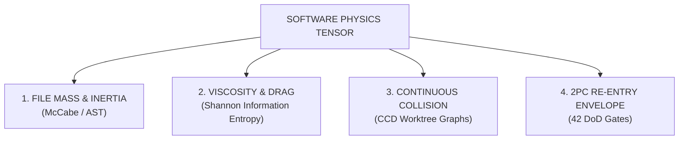
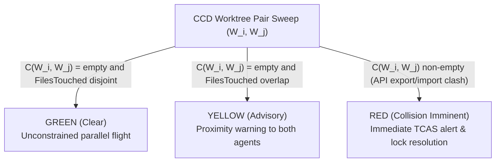

---
authors:
  - Mark Gantlett
  - Nomos Open-Core Substrate
classification: public
date: "2026-10-13"
last_updated: "2026-11-10"
lineage:
  - INT-1944
  - SUB-2157
  - INT-1954
plane: intent
ssot_repository: nomos
status: active
title: "Nomos Software Physics Engine - Kinematics, Continuous Collision Detection & Phase Ballistics Specification"
type: spec
version: "4.1.0"
---

# Nomos Software Physics Engine: Kinematics, Continuous Collision Detection & Phase Ballistics Specification

---

## 1. Executive Summary & Problem Statement

### 1.1 The Category Error: Code Is Machinery, Not Paint
*The Physics of Software: Why Code is Not Paint* grounds software engineering in computational physics rather than subjective canvas curation.

When autonomous coding agents operate under generative friction approaching zero, the cognitive cost of unverified code approaches infinity:

$$\lim_{\text{Friction}(\text{Generation}) \to 0} \text{CognitiveDebt}(\text{Verification}) = \infty$$

Without continuous physical constraints, agents drift into un-indexed loops, semantic signature collisions, and state-space combinatorial explosions. Post-hoc merge verification arrives too late - detecting catastrophic defects only after dissipating massive cognitive energy.

### 1.2 Separation of Substrate Physics from Ergonomic Telemetry
To maintain uncompromising realism and avoid metaphor degradation:
1. **The Software Physics Engine (Open-Core Substrate):** Pure Go telemetry structs calculate AST graph metrics, Shannon entropy, call-graph reachability, and capability leases.
2. **The Air Traffic Control Interface (HMI Projection):** `nomos physics` visualizes AST mass, worktree hulls, and collision threat levels for human architects. The visualization never replaces the math; it renders telemetry at human-perceptual speed.

---

## 2. Axiomatic Invariants & Governing Laws

| Law # | Law Name | Physical Counterpart | Substrate Mechanical Invariant |
| :---: | :--- | :--- | :--- |
| **1** | **The Dual-Core Inversion Law** | Aerodynamic Airframe vs. Pilot | Substrate Go core enforces flight laws over bounded Tier 1 agents. |
| **2** | **The Non-Verbal Proof Law** | Conservation of Mass & Momentum | AST and git invariants calculate mass, entropy, and collision vectors directly. |
| **3** | **The Hermetic Worktree Law** | Isolated Flight Corridors | Mutations occur strictly inside transient isolated worktrees; trunk `main` remains immutable. |
| **4** | **The Single Source of Truth Law** | Unified Spacetime Metric | All physics telemetry binds strictly to compiled Go structs in `substrate/cli/physics.go`. |
| **5** | **The Zero-Hardcoded-Path Law** | Relativistic Reference Frames | Symbol coordinates and paths resolve dynamically relative to transient worktree roots. |
| **6** | **The Canonical Singularity Law** | Conservation of Energy | One canonical tensor governs mass, drag, and collision without shadow state. |
| **7** | **The Fail-Closed Pre-Flight Law** | Atmospheric Re-entry Envelope | DoD gate defects trigger immediate wave-offs (`git checkout -- <file>`). |

---

## 3. Mathematical Formulations



### 3.1 Kinematics, File Mass & Inertia
Source files and packages acquire **Inertia** from AST cardinality, decision branching, and topological coupling rather than disk bytes.

#### Mass Metric:
For any source file $f \in \mathcal{F}$, the engine defines physical mass $M(f)$ as:

$$M(f) = \alpha \cdot \text{LOC}(f) + \beta \cdot v(G)_f + \gamma \cdot |\text{AST}_f| + \delta \cdot \left( \text{FanIn}(f) + \text{FanOut}(f) \right)$$

Where:
- $\text{LOC}(f) \in \mathbb{N}_0$: Physical non-blank lines of code.
- $v(G)_f \in \mathbb{N}_1$: Total McCabe Cyclomatic Complexity of all functions in $f$.
- $|\text{AST}_f| \in \mathbb{N}_0$: Total node cardinality in the Tree-sitter abstract syntax tree.
- $\text{FanIn}(f), \text{FanOut}(f) \in \mathbb{N}_0$: Number of external callers and external module dependencies.
- Standard default weighting coefficients: $\alpha = 0.1, \beta = 2.0, \gamma = 0.05, \delta = 1.5$.

#### Mutation Momentum & Kinetic Energy:
Let $v_{\text{edit}} = \frac{\Delta \text{AST}}{\Delta t}$ represent the editing velocity (AST mutations per second).
- **Momentum:** $p(f) = M(f) \cdot v_{\text{edit}}$
- **Kinetic Energy:** $E_k(f) = \frac{1}{2} M(f) \cdot v_{\text{edit}}^2$

High-mass files moving at high velocity carry high cognitive inertia; mutating them without braking controls risks structural defects.

### 3.2 Cognitive Drag, Viscosity & Shannon Information Entropy
When source code exhibits high disorder, scattered naming, or structural redundancy, it creates cognitive drag that degrades comprehension and attention allocation.

#### Shannon Token Entropy $H(X)$:
For a set of lexical tokens $T = \{t_1, t_2, \dots, t_n\}$ in file $f$:

$$H(f) = -\sum_{i=1}^n P(t_i) \log_2 P(t_i)$$

Where $P(t_i) = \frac{\text{count}(t_i)}{\sum_j \text{count}(t_j)}$ denotes the empirical probability of token $t_i$.

#### Structural Viscosity $\mu(f)$:
Code viscosity combines information entropy with sliding-window structural duplication:

$$\mu(f) = \frac{H(f)}{H_{\text{max}}} \cdot \left( 1 + \text{DuplicationRatio}(f) \right)$$

Rolling Rabin-Karp hashes over sliding token windows of size $w = 10$ compute $\text{DuplicationRatio}(f) \in [0.0, 1.0]$.

#### Aerodynamic Drag Force $F_{\text{drag}}$:
The drag force opposing clean cognitive traversal through the codebase equals:

$$F_{\text{drag}}(f) = \frac{1}{2} \cdot C_d \cdot \mu(f) \cdot v_{\text{edit}}^2$$

Files with $F_{\text{drag}} > \tau_{\text{drag}}$ trigger immediate refactoring advisories prior to task release.

### 3.3 Continuous Collision Detection (CCD) in Multi-Agent Topologies
Standard version control (Git) relies on **discrete, post-hoc line collision detection** at merge time. If two agents modify distinct files, Git reports zero conflicts even when Agent A alters a public API required by Agent B.

In game physics, **Continuous Collision Detection (CCD)** eliminates the tunneling problem by sweeping bounding volumes through time. In software physics, Nomos executes Continuous Collision Detection across concurrent agent worktrees.

#### The Worktree Mutation Hull:
For any active transient worktree $W_k$ executing task $T_k$, the engine maintains an active **Mutation Hull** $\mathcal{H}(W_k)$:

$$\mathcal{H}(W_k) = \left\langle \text{ExportsMutated}(W_k), \text{ImportsReferenced}(W_k), \text{FilesTouched}(W_k) \right\rangle$$

#### The Real-Time Collision Tensor $C(W_i, W_j)$:
Between any two concurrent worktrees $W_i$ and $W_j$:

$$C(W_i, W_j) = \left( \text{ExportsMutated}(W_i) \cap \text{ImportsReferenced}(W_j) \right) \cup \left( \text{ExportsMutated}(W_j) \cap \text{ImportsReferenced}(W_i) \right)$$

#### Collision Threat Levels:


When CCD detects a RED collision during active editing, the substrate alerts the orchestrator before either agent commits.

### 3.4 The 60Hz Telemetry Loop & Nyquist-Shannon Sampling
Under the Nyquist-Shannon sampling theorem, feedback loops must sample above twice the maximum disturbance frequency to prevent aliasing:

$$f_{\text{feedback}} > 2 \cdot f_{\text{mutation}}$$

When an agent streams AST mutations at 2Hz, the substrate evaluates AST, type, and boundary invariants at sub-second intervals. Sampling at $f \ge 4\text{Hz}$ (targeting 60Hz telemetry frames) maintains deterministic feedback within the **Controllable Basin of Attraction**.

### 3.5 Two-Phase Commit (2PC) Atmospheric Re-entry
Trunk branch `main` represents the pristine surface of production reality. The engine models transient worktree merges as an **atmospheric re-entry maneuver**:

1. **Pre-Flight Entry Vector:** Phase transitions from `EDIT` to `REVIEW`. CapBAC leases freeze further file mutations.
2. **The DoD Thermal Shield:** `nomos verify` runs all Definition of Done quality gates against the worktree AST.
3. **Aerodynamic Wave-Off (Revert Invariant):** Any gate defect ($exit \ne 0$) aborts the landing immediately. The worktree executes:
   ```bash
   git checkout -- <file>
   ```
   Zero damaged state touches `main`.
4. **Touchdown & Release Receipt:** Passing all DoD gates triggers atomic 2PC merge to `main` and records a receipt in `refs/notes/nomos/releases`.

---

## 4. Compiled Go SSoT Contracts & CLI Surface (`nomos physics`)

### 4.1 Compiled Go SSoT Telemetry Contracts (`substrate/cli/physics.go`)
`substrate/cli/physics.go` defines the authoritative kinematics and continuous collision structs:

```go
package cli

// ThreatLevel categorizes continuous collision proximity between concurrent worktrees (#ThreatLevel).
type ThreatLevel string

const (
	ThreatGreen  ThreatLevel = "GREEN"
	ThreatYellow ThreatLevel = "YELLOW"
	ThreatRed    ThreatLevel = "RED"
)

// FileMass asserts the structural mass and inertia of a source file (#FileMass).
type FileMass struct {
	Path                 string  `json:"path"`
	LOC                  int     `json:"loc"`
	CyclomaticComplexity int     `json:"cyclomatic_complexity"`
	ASTNodes             int     `json:"ast_nodes"`
	FanIn                int     `json:"fan_in"`
	FanOut               int     `json:"fan_out"`
	TotalMass            float64 `json:"total_mass"`
}

// CollisionVector defines real-time AST symbol or file intersection between two worktrees (#CollisionVector).
type CollisionVector struct {
	WorktreeA          string      `json:"worktree_a"`
	WorktreeB          string      `json:"worktree_b"`
	IntersectedSymbols []string    `json:"intersected_symbols"`
	IntersectedFiles   []string    `json:"intersected_files"`
	ThreatLevel        ThreatLevel `json:"threat_level"`
	TimestampEpochMs   int64       `json:"timestamp_epoch_ms"`
}

// WorktreeHull defines the bounding envelope and mutation surface of a worktree (#WorktreeHull).
type WorktreeHull struct {
	TaskKey           string   `json:"task_key"`
	WorktreePath      string   `json:"worktree_path"`
	Seat              string   `json:"seat,omitempty"`
	Phase             string   `json:"phase"`
	MutatedExports    []string `json:"mutated_exports"`
	ReferencedImports []string `json:"referenced_imports"`
	TouchedFiles      []string `json:"touched_files"`
	TotalMass         float64  `json:"total_mass"`
	MeanEntropy       float64  `json:"mean_entropy"`
}

// DetectCollision evaluates two worktree hulls for mutated file and symbol collisions.
func DetectCollision(a, b *WorktreeHull) *CollisionVector
```

### 4.2 Session Trajectory, Sentinel PRM & Capability Telemetry Contracts (`modules/session`, `modules/telemetry`)

```go
package session

import "time"

// AgentSession captures the live state, telemetry, and coordinates of an agent conversation arc (#AgentSession).
type AgentSession struct {
	ID            string    `json:"id"`
	Name          string    `json:"name,omitempty"`
	AgentType     string    `json:"agent_type"`
	TaskKey       string    `json:"task_key,omitempty"`
	TaskTitle     string    `json:"task_title,omitempty"`
	WorktreePath  string    `json:"worktree_path,omitempty"`
	Repo          string    `json:"repo,omitempty"`
	Phase         string    `json:"phase"`
	TurnCount     int       `json:"turn_count"`
	ToolCallCount int       `json:"tool_call_count"`
	LastActiveAt  time.Time `json:"last_active_at"`
	Status        string    `json:"status"`
	RecentSummary string    `json:"recent_summary,omitempty"`
}

// SessionVisualGraph represents the topological view of active agent sessions (#SessionVisualGraph).
type SessionVisualGraph struct {
	Mermaid  string         `json:"mermaid"`
	Sessions []AgentSession `json:"sessions"`
}

// TrajectoryStage models an individual causal milestone stage in an agent trajectory (#TrajectoryStage).
type TrajectoryStage struct {
	ID       string `json:"id"`
	Label    string `json:"label"`
	Status   string `json:"status"`
	Evidence string `json:"evidence"`
}

// SessionTrajectory models the complete 7-stage causal arc of a Tier 1 conversation session (#SessionTrajectory).
type SessionTrajectory struct {
	CurrentStage   string            `json:"current_stage"`
	CompletedCount int               `json:"completed_count"`
	TotalCount     int               `json:"total_count"`
	Stages         []TrajectoryStage `json:"stages"`
}

// SentinelScorecard summarizes process reward model integrity checks (#SentinelScorecard).
type SentinelScorecard struct {
	IntegrityStatus string            `json:"integrity_status"`
	OverallScore    int               `json:"overall_score"`
	Violations      []string          `json:"violations"`
	Invariants      []InvariantResult `json:"invariants"`
}

// DeliberationMetrics quantifies reasoning verbosity, read streaks, and deliberation-to-mutation ratios (#DeliberationMetrics).
type DeliberationMetrics struct {
	ThinkingBytes               int     `json:"thinking_bytes"`
	ThinkingStepCount           int     `json:"thinking_step_count"`
	MaxReadStreak               int     `json:"max_read_streak"`
	MutationCallCount           int     `json:"mutation_call_count"`
	DeliberationToMutationRatio float64 `json:"deliberation_to_mutation_ratio"`
}

// SessionDetail captures the deep causal inspection telemetry of an agent session (#SessionDetail).
type SessionDetail struct {
	AgentSession
	ToolsSummary  map[string]int       `json:"tools_summary"`
	Events        []SessionEvent       `json:"events"`
	RecentPrompts []string             `json:"recent_prompts,omitempty"`
	Sentinel      *SentinelScorecard   `json:"sentinel,omitempty"`
	Trajectory    *SessionTrajectory   `json:"trajectory,omitempty"`
	Deliberation  *DeliberationMetrics `json:"deliberation,omitempty"`
	Persona       string               `json:"persona,omitempty"`
}

// SessionDatasetRecord joins session telemetry, Sentinel PRM scores, Git Note receipts, and Mneme learnings (#SessionDatasetRecord).
type SessionDatasetRecord struct {
	Session        AgentSession         `json:"session"`
	Sentinel       *SentinelScorecard   `json:"sentinel,omitempty"`
	Trajectory     *SessionTrajectory   `json:"trajectory,omitempty"`
	Deliberation   *DeliberationMetrics `json:"deliberation,omitempty"`
	ToolsSummary   map[string]int       `json:"tools_summary,omitempty"`
	ReleaseCommit  string               `json:"release_commit,omitempty"`
	DoDGatesPassed int                  `json:"dod_gates_passed,omitempty"`
	SHA256Receipt  string               `json:"sha256_receipt,omitempty"`
	PitfallsFixed  []string             `json:"pitfalls_fixed,omitempty"`
	PatternsMinted []string             `json:"patterns_minted,omitempty"`
}
```

```go
package telemetry

// CapabilityMetrics represents the persisted invocation metrics for a capability (#CapabilityMetrics).
type CapabilityMetrics struct {
	ID              string `json:"id"`
	Name            string `json:"name"`
	Plane           string `json:"plane"`
	Type            string `json:"type"`
	Enabled         bool   `json:"enabled"`
	InvocationCount int    `json:"invocation_count"`
	LastAccessedAt  string `json:"last_accessed_at"`
}
```

### 4.3 Cross-Plane Transduction Matrix (`nomos physics`, `nomos session`, `nomos capabilities`)
The Open-Core Software Physics Engine exposes real-time worktree AST mass, inertia, and continuous collision detection through `nomos physics [--json]` under the `quality` CLI group.

| Intent Physical Vector | Substrate Engine Package | CLI & Telemetry Projection |
| :--- | :--- | :--- |
| **AST Mass & Inertia (`#FileMass`)** | `substrate/cli/physics.go`, `substrate/cli/cmd_physics.go` | `nomos physics [--json]` worktree mass & file breakdown |
| **Worktree Mutation Hull (`#WorktreeHull`)** | `substrate/cli/physics.go`, `substrate/cli/cmd_physics.go` | Active `worktrees/*` AST export/import & touched-file hulls |
| **Continuous Collision (`#CollisionVector`)** | `substrate/cli/physics.go` (`DetectCollision`) | `GREEN` / `YELLOW` / `RED` pairwise collision alerts in `nomos physics` |
| **High-Frequency Phase Loop** | `substrate/src/nomos/modules/telemetry` | Structured JSON telemetry snapshots |
| **2PC Re-entry Touchdown** | `substrate/src/nomos/modules/task/git_notes.go` | Cryptographic release receipt in Git Notes (`refs/notes/nomos/releases`) |

---

## 5. Table-Driven Verification Vectors

| Vector ID | Physical Invariant | Input Workspace State | Expected Verdict |
| :--- | :--- | :--- | :--- |
| `TC-PHY-01` | AST Mass & Complexity | File LOC `> 400` or function cyclomatic complexity `> 15` | `FAIL` (Mass budget exceeded) |
| `TC-PHY-02` | Continuous Collision (CCD) | Disjoint file sets across parallel worktrees ($C(W_i, W_j) = \emptyset$) | `PASS` (`GREEN` clear parallel flight) |
| `TC-PHY-03` | Continuous Collision (CCD) | Overlapping symbol/file mutation ($C(W_i, W_j) \ne \emptyset$) | `WARN/BLOCK` (`RED` collision alert) |
| `TC-PHY-04` | 2PC Atmospheric Re-entry | Any of the 42 DoD gates exits non-zero during `nomos task sync` | `FAIL` (Wave-off; trunk `main` untouched) |
| `TC-SES-01` | Multi-Agent Session Discovery | `nomos session list` across active workstation seats | `PASS` (Enumerates `AgentSession` records and worktree bindings) |
| `TC-SES-02` | 7-Stage Causal Trajectory | `InferTrajectory` over transcript tool invocations (`SessionTrajectory`) | `PASS` (Resolves `BOOT` through `RELEASE` milestone stages) |
| `TC-SES-03` | Sentinel PRM Integrity Audit | `SentinelScorecard` evaluation over session transcript | `PASS` (Scores process invariant compliance in $[0, 100]$) |
| `TC-SES-04` | Deep Session Detail Inspection | `nomos session show <id>` (`SessionDetail`) | `PASS` (Surfaces tool summary, events, and Sentinel scorecard) |
| `TC-SES-05` | Topological Session Graph | `SessionVisualGraph` Mermaid synthesis | `PASS` (Emits valid Mermaid graph of active agent sessions) |
| `TC-SES-06` | JSONL Trajectory Dataset Export | `nomos session export` (`SessionDatasetRecord`) | `PASS` (Joins session, Sentinel PRM, 2PC receipt, and Mneme learnings) |
| `TC-SES-07` | Deliberation Verbosity Telemetry | `DeliberationMetrics` over full session transcript | `PASS` (Measures thinking bytes, read streaks, and mutation ratios) |
| `TC-LAUNCH-001` | Capability Invocation Telemetry | `RecordInvocationWithDetails` on CLI execution (`CapabilityMetrics`) | `PASS` (Increments `InvocationCount` and updates `LastAccessedAt`) |
| `TC-LAUNCH-002` | Fail-Safe Telemetry Recording | `RecordInvocationSafe` with unavailable database path | `PASS` (Degrades silently with zero panic or CLI disruption) |
| `TC-LAUNCH-003` | Capability Matrix Inspection | `nomos capabilities --json` | `PASS` (Emits structured capability and 7x3 gate registry JSON) |
| `TC-LAUNCH-004` | Single-Capability Deep Dive | `nomos capabilities <probe_id>` | `PASS` (Renders law, ring, threshold, and remedy contract) |

---

## 6. Cross-Plane Traceability & DoD Verification

1. **Compiled Physics SSoT**: `substrate/cli/physics.go` and `substrate/cli/cmd_physics.go` enforce `WorktreeHull`, `CollisionVector`, `FileMass`, and `DetectCollision`.
2. **Enforcing 7x3 Matrix Cells**: Verified continuously by `Cell 1.1 (complexity / max_file_loc / cognitive_debt)`, `Cell 3.2 (hermetic_worktree)`, `Cell 3.3 (release_receipt)`, and `Cell 4.2 (contract_parity)`.
3. **Deterministic Gate Execution**: Run `nomos verify` to pass all 42 Definition of Done quality gates with exit code `0`.
