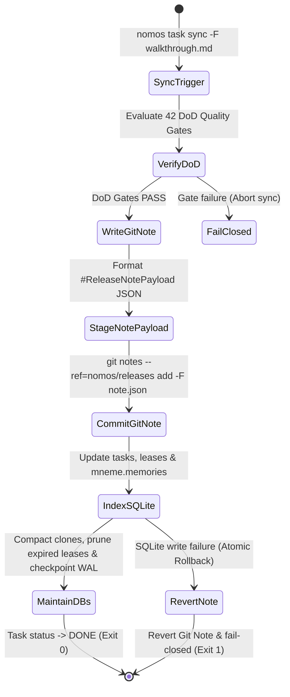

---
authors:
    - Mark Gantlett
    - Nomos Open-Core Substrate
classification: public
date: "2026-10-05"
last_updated: "2026-11-01"
plane: intent
ssot_repository: "nomos"
status: active
title: "Unified Database & Git Notes Topology Contract"
type: spec
version: "4.0.0"
execution_frontier:
  tasks:
    - key: "INT-318"
      plane: "intent"
      summary: "Specify Unified Database & Git Notes Topology with Dual-Write 2PC Pipeline"
    - key: "INT-836"
      plane: "intent"
      summary: "Align v4 SQLite DDL, RFC3339 defaults, composite indexes, and Go SSoT contracts"
---

# Unified Database & Git Notes Topology Contract

## 1. Executive Summary & Intent Motivation

The Nomos v4 architecture establishes a strict separation of concerns across persistence layers:
1. **The Immutable Distributed SSoT (Git Notes):** Git commits and cryptographic Git Notes (`refs/notes/nomos/releases`) serve as the distributed, append-only Source of Truth for verified releases.
2. **The Ephemeral Semantic Projection (`mneme.db`):** A pure-Go SQLite WAL database providing hybrid 64-dim vector and lexical memory recall (`nomos mem save`, `nomos mem recall`, `nomos mem list`), distilled gate-trap pitfalls (`Nomos Learn`), and idempotent write-time deduplication. Immutable release provenance remains anchored in Git commit history and Git Notes (`refs/notes/nomos/releases`).
3. **The Local Runtime Coordinator (`nomos_global.db`):** The node-local operational SQLite WAL database managing Living Ledger task DAG wavefronts (`tasks`), CapBAC object-capability leases (`leases`), and local CLI capability invocation metrics (`telemetry_capabilities`).

This contract formalizes:
- Full DDL and RFC3339 timestamp alignment between `nomos_global.db`, `mneme.db`, and compiled Go SSoT structs (`task.TaskRecord`, `storage.LeaseRecord`, `mem.Memory`, `telemetry.CapabilityMetrics`, `task.ReleaseNotePayload`).
- Automatic rolling compaction (`Store.Maintain`, `storage.MaintainRuntimeStorage`) capping expired leases, dropping retired legacy tables, reclaiming SQLite freelist pages via conditional `VACUUM`, and checkpointing WAL files (`PRAGMA wal_checkpoint(TRUNCATE)`).
- The atomic 2PC dual-write synchronization pipeline and fail-closed reconstruction state machine.

---

## 2. Axiomatic Invariants & Laws Codified

| Law # | Law Name | Architectural Enforcement |
| :---: | :--- | :--- |
| **Law 1** | **Dual-Core Inversion** | Substrate Go core orchestrates Git Notes emission and SQLite projections; Tier 1 agents access state strictly via canonical CLI commands (`nomos mem`, `nomos task`). |
| **Law 2** | **Non-Verbal Proof** | Reconstructed databases match Git Notes receipts with zero missing records, proven by table-driven test vectors (`TC-DBNOTE-001` through `TC-DBNOTE-006`). |
| **Law 4** | **Single Source of Truth** | SQLite schemas match compiled Go SSoT structs (`TaskRecord`, `LeaseRecord`, `Memory`, `ReleaseNotePayload`) with strict field and RFC3339 timestamp parity. |
| **Law 5** | **Zero-Hardcoded-Path** | Database paths resolve dynamically via `config.ResolveGlobalDBPath()` and `config.ResolveMnemeDBPath()`. |
| **Law 6** | **Canonical Singularity** | Single canonical release note namespace (`refs/notes/nomos/releases`) capturing walkthrough journals and DoD proof. Legacy `refs/notes/agent` is excised. |
| **Law 7** | **Fail-Closed Pre-Flight** | Direct SQLite file queries via raw `sqlite3` CLI are blocked (`ADR-0062`), and unparseable Git Notes halt reconstruction with non-zero exit code. |

---

## 3. Persistence Layers & State Taxonomy

```
┌────────────────────────────────────────────────────────────────────────┐
│                   IMMUTABLE DISTRIBUTED SSoT (GIT)                     │
│               Git Tree + refs/notes/nomos/releases                     │
└────────────────────────────────────┬───────────────────────────────────┘
                                     │
                 Dual-Write 2PC Sync │ Git Notes Audit Trail
                                     ▼
┌──────────────────────────────────────────────┬─────────────────────────┐
│     SEMANTIC PROJECTION (mneme.db)           │   RUNTIME COORDINATOR   │
│  - memories (reflections, pitfalls, axioms)  │    (nomos_global.db)    │
│  - 64-dim unit vectors + repo_id isolation   │  - tasks (DAG wavefront)│
│  - Write-time dedup + 30d inactive purge     │  - leases (CapBAC)      │
│                                              │  - telemetry_capabilities│
└──────────────────────────────────────────────┴─────────────────────────┘
```

### 3.1 Git Notes Namespaces
1. **`refs/notes/nomos/releases`**: Written atomically during `nomos task sync`. Contains `#ReleaseNotePayload`:
   - Task key and commit SHA.
   - Verification proofs (42 DoD quality gate results).
   - CapBAC session token identifier.
   - Complete raw markdown of the release journal (`walkthrough.md`).
2. **`refs/notes/agent` (DEPRECATED)**: Formally excised.

---

## 4. Formal SQL DDL & Compiled Go SSoT Alignment

### 4.1 `mneme.db` (`substrate/src/nomos/modules/mem/memory.go`)
Aligned with `mem.Memory`:

```sql
CREATE TABLE IF NOT EXISTS memories (
    id INTEGER PRIMARY KEY AUTOINCREMENT,
    repo_id TEXT DEFAULT '',
    kind TEXT NOT NULL,
    topic TEXT NOT NULL,
    content TEXT NOT NULL,
    task_id TEXT NOT NULL,
    embedding BLOB,
    created_at DATETIME NOT NULL,
    status TEXT NOT NULL DEFAULT 'active',
    superseded_by INTEGER DEFAULT 0,
    access_count INTEGER NOT NULL DEFAULT 0
);
CREATE INDEX IF NOT EXISTS idx_memories_topic ON memories(topic);
CREATE INDEX IF NOT EXISTS idx_memories_status ON memories(status);
CREATE INDEX IF NOT EXISTS idx_memories_repo ON memories(repo_id);
CREATE INDEX IF NOT EXISTS idx_memories_kind ON memories(kind);
CREATE INDEX IF NOT EXISTS idx_memories_repo_kind_status ON memories(repo_id, kind, status);
```

### 4.2 `nomos_global.db` (`substrate/src/nomos/core/storage/db.go`)
Aligned with `task.TaskRecord`, `storage.LeaseRecord`, and `telemetry.CapabilityMetrics`:

```sql
CREATE TABLE IF NOT EXISTS tasks (
    id             INTEGER PRIMARY KEY AUTOINCREMENT,
    key            TEXT NOT NULL UNIQUE,
    plane          TEXT NOT NULL CHECK(plane IN ('intent', 'substrate')),
    project        TEXT NOT NULL DEFAULT '',
    schema_type    TEXT NOT NULL DEFAULT 'substrate',
    title          TEXT NOT NULL,
    description    TEXT NOT NULL DEFAULT '',
    status         TEXT NOT NULL DEFAULT 'BACKLOG',
    tier           TEXT NOT NULL DEFAULT 'T1',
    priority       INTEGER NOT NULL DEFAULT 50,
    created_at     TEXT NOT NULL DEFAULT (strftime('%Y-%m-%dT%H:%M:%SZ', 'now')),
    updated_at     TEXT NOT NULL DEFAULT (strftime('%Y-%m-%dT%H:%M:%SZ', 'now')),
    completed_at   TEXT,
    dependencies   TEXT NOT NULL DEFAULT '[]',
    twin_key       TEXT DEFAULT '',
    arc_id         TEXT DEFAULT '',
    intent_delta   TEXT DEFAULT 'none',
    burden         INTEGER NOT NULL DEFAULT 0,
    context_burden INTEGER NOT NULL DEFAULT 0,
    arch_layer     INTEGER NOT NULL DEFAULT 0
);
CREATE INDEX IF NOT EXISTS idx_tasks_key ON tasks(key);
CREATE INDEX IF NOT EXISTS idx_tasks_status ON tasks(status);
CREATE INDEX IF NOT EXISTS idx_tasks_plane ON tasks(plane);
CREATE INDEX IF NOT EXISTS idx_tasks_project ON tasks(project);

CREATE TABLE IF NOT EXISTS leases (
    lease_id    TEXT PRIMARY KEY,
    task_key    TEXT NOT NULL,
    phase       TEXT NOT NULL DEFAULT 'IDLE',
    step_budget INTEGER NOT NULL DEFAULT 50,
    tokens_used INTEGER NOT NULL DEFAULT 0,
    issued_at   TEXT NOT NULL DEFAULT (strftime('%Y-%m-%dT%H:%M:%SZ', 'now')),
    valid       INTEGER NOT NULL DEFAULT 1,
    FOREIGN KEY(task_key) REFERENCES tasks(key) ON DELETE CASCADE
);
CREATE INDEX IF NOT EXISTS idx_leases_task_key ON leases(task_key);
CREATE INDEX IF NOT EXISTS idx_leases_valid ON leases(valid);

CREATE TABLE IF NOT EXISTS telemetry_capabilities (
    id               TEXT PRIMARY KEY,
    name             TEXT NOT NULL,
    plane            TEXT NOT NULL DEFAULT 'substrate',
    type             TEXT NOT NULL DEFAULT 'cli_command',
    enabled          INTEGER NOT NULL DEFAULT 1,
    invocation_count INTEGER NOT NULL DEFAULT 0,
    last_accessed_at TEXT
);
CREATE INDEX IF NOT EXISTS idx_telemetry_capabilities_plane ON telemetry_capabilities(plane);
CREATE INDEX IF NOT EXISTS idx_telemetry_capabilities_type ON telemetry_capabilities(type);
```

---

## 5. Dual-Write 2PC & Automatic Rolling Compaction



### 5.1 Provenance & Hygiene Guarantees
1. **Git Notes Provenance (`refs/notes/nomos/releases`):** Every `nomos task sync` atomically records a `ReleaseNotePayload` Git Note (`substrate/src/nomos/modules/task/git_notes.go`) and distills structural patterns into `mneme.db`.
2. **Automatic Compaction (`Store.Maintain` & `storage.MaintainRuntimeStorage`):** Runs automatically on `nomos handshake` (throttled once per 24h) and `nomos task sync` — deduplicating active clones, purging inactive memories older than 30 days, capping expired `leases`, dropping retired legacy tables, running `VACUUM` when SQLite freelist exceeds 2 MiB, and executing `PRAGMA wal_checkpoint(TRUNCATE); PRAGMA optimize;`.

---

## 6. Table-Driven Verification Vectors

| Vector ID | Scenario Context | Input Trigger | Expected Behavior | Invariant Enforced |
| :--- | :--- | :--- | :--- | :--- |
| **TC-DBNOTE-001** | Release Note Dual-Write | `nomos task sync SUB-1452 -F walkthrough.md` | Writes Note to `refs/notes/nomos/releases`, indexes patterns into `mneme.db` | Law 4 & Law 6 |
| **TC-DBNOTE-002** | Legacy Note Rejection | Note staged on `refs/notes/agent` | Rejects: Deprecated namespace | Law 6 (Singularity) |
| **TC-DBNOTE-003** | Release Receipt Verification | `ReleaseReceiptGate` audit on release commit | Verifies signed JSON note in `refs/notes/nomos/releases` | Law 2 & Law 3 |
| **TC-DBNOTE-004** | Corrupted Note Payload | Malformed JSON in Git Note | Rejects record during indexing; fails closed | Law 7 (Fail-closed pre-flight) |
| **TC-DBNOTE-005** | Schema Parity Audit | Compiled Go structs vs SQLite DDL | Zero column or RFC3339 format mismatches | Law 4 (Schema Parity) |
| **TC-DBNOTE-006** | Atomic Rollback | SQLite write failure during sync | Git note removed; task remains in REVIEW | Law 7 (Atomic 2PC) |

---

## 7. Acceptance Criteria & Rigor Boundary

1. **Git Notes Authoritative SSoT:** Releases and walkthroughs persist immutably to `refs/notes/nomos/releases`.
2. **Ephemeral Brain Reconstructibility:** `mneme.db` release history can be reconstructed from Git Notes with zero data loss.
3. **Go SSoT & SQL Schema Parity:** SQLite tables match compiled Go structs (`TaskRecord`, `LeaseRecord`, `Memory`, `CapabilityMetrics`) with RFC3339 defaults and composite indexes.
4. **42-Gate DoD Verification:** Verification passes all 42 quality gates (`nomos verify`) with exit code 0.
5. **Clean Markdown Graph:** Zero broken links across documentation.
