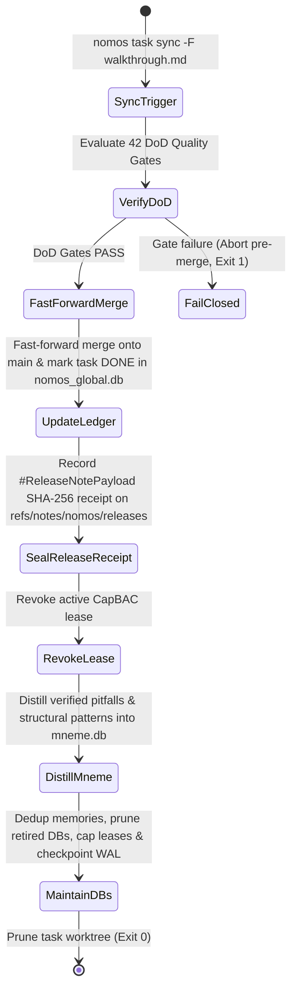

---
authors:
    - Mark Gantlett
    - Nomos Open-Core Substrate
classification: public
date: "2026-10-05"
last_updated: "2026-11-03"
plane: intent
ssot_repository: "nomos"
status: active
title: "Unified Database & Git Notes Topology Contract"
type: spec
version: "4.4.1"
execution_frontier:
  tasks:
    - key: "INT-318"
      plane: "intent"
      summary: "Specify Unified Database & Git Notes Topology with Dual-Write 2PC Pipeline"
    - key: "INT-836"
      plane: "intent"
      summary: "Align v4 SQLite DDL, RFC3339 defaults, composite indexes, and Go SSoT contracts"
    - key: "INT-911"
      plane: "intent"
      summary: "Decouple Nomos Mneme memory contract from Git Notes release receipts"
---

# Unified Database & Git Notes Topology Contract

## 1. Executive Summary & Intent Motivation

The Nomos v4 architecture establishes a strict separation of concerns across three orthogonal persistence stores:
1. **The Immutable Release Provenance Ref (`refs/notes/nomos/releases`):** Git commits and SHA-256 Git Notes receipts (`task.ReleaseNotePayload`) serve strictly as non-repudiable Two-Phase Commit (`2PC`) release proofs. Git Notes never store or reconstruct episodic agent memory.
2. **The Episodic & Semantic Memory Store (`mneme.db`):** A standalone pure-Go SQLite WAL database powering **Nomos Mneme** (`nomos mem save`, `nomos mem recall`, `nomos mem list`, `nomos mem dismiss`), post-sync `Nomos Learn` distillation (`pitfall` and `pattern` records), and idempotent write-time deduplication.
3. **The Local Runtime Coordinator (`nomos_global.db`):** The node-local operational SQLite WAL database managing Living Ledger task DAG wavefronts (`tasks`), CapBAC object-capability leases (`leases`), and local CLI capability invocation metrics (`telemetry_capabilities`).

This contract formalizes:
- Full DDL and RFC3339 timestamp alignment between `nomos_global.db`, `mneme.db`, and compiled Go SSoT structs (`task.TaskRecord`, `storage.LeaseRecord`, `mem.Memory`, `telemetry.CapabilityMetrics`, `task.ReleaseNotePayload`).
- Automatic rolling compaction (`Store.Maintain`, `storage.MaintainRuntimeStorage`) capping expired leases, pruning retired legacy database artifacts (`gitgudbrain.db`), reclaiming SQLite freelist pages via conditional `VACUUM`, and checkpointing WAL files (`PRAGMA wal_checkpoint(TRUNCATE)`).
- The `nomos task sync` 2PC release pipeline separating trunk merge attestation (`refs/notes/nomos/releases`) from `Nomos Mneme` (`mneme.db`) distillation.

---

## 2. Axiomatic Invariants & Laws Codified

| Law # | Law Name | Architectural Enforcement |
| :---: | :--- | :--- |
| **Law 1** | **Dual-Core Inversion** | Substrate Go core orchestrates release receipts and SQLite stores; Tier 1 agents access state strictly via canonical CLI commands (`nomos mem`, `nomos task`). |
| **Law 2** | **Non-Verbal Proof** | `ReleaseReceiptGate` (`Cell 3.3`) verifies SHA-256 release receipts in `refs/notes/nomos/releases`, proven by vectors `TC-DBNOTE-001` through `TC-DBNOTE-006`. |
| **Law 4** | **Single Source of Truth** | SQLite schemas match compiled Go SSoT structs (`TaskRecord`, `LeaseRecord`, `Memory`, `ReleaseNotePayload`) with strict field and RFC3339 timestamp parity. |
| **Law 5** | **Zero-Hardcoded-Path** | Database paths resolve dynamically via `config.ResolveGlobalDBPath()` and `config.ResolveMnemeDBPath()`. |
| **Law 6** | **Canonical Singularity** | Single canonical release receipt namespace (`refs/notes/nomos/releases`) and single memory store (`mneme.db`). Legacy `refs/notes/agent` and `gitgudbrain.db` are retired. |
| **Law 7** | **Fail-Closed Pre-Flight** | Direct SQLite file queries via raw `sqlite3` CLI are blocked (`ADR-0062`), and corrupted release receipts on `HEAD` fail closed in `nomos verify`. |

---

## 3. Persistence Layers & State Taxonomy

```
                         ┌──────────────────────────────┐
                         │  2PC SYNC (nomos task sync)  │
                         └──────────────┬───────────────┘
          ┌─────────────────────────────┼─────────────────────────────┐
          ▼                             ▼                             ▼
┌─────────────────────────┐ ┌───────────────────────────┐ ┌─────────────────────────┐
│ RELEASE PROVENANCE (GIT)│ │   NOMOS MNEME (mneme.db)  │ │   RUNTIME COORDINATOR   │
│ - Protected main tree   │ │ - Standalone memory SSoT  │ │    (nomos_global.db)    │
│ - refs/notes/nomos/     │ │ - Advisory & statutory    │ │ - tasks (DAG wavefront) │
│   releases (SHA-256     │ │   memories (64-dim + lex) │ │ - leases (CapBAC)       │
│   ReleaseNotePayload)   │ │ - Repo-scoped dedup & GC  │ │ - telemetry_capabilities│
└─────────────────────────┘ └───────────────────────────┘ └─────────────────────────┘
```

### 3.1 Git Notes Namespaces
1. **`refs/notes/nomos/releases`**: Written during `nomos task sync` strictly for release provenance. Contains `#ReleaseNotePayload`:
   - Task key and 40-char commit SHA.
   - Verification gate count (`dod_gates_passed >= 42`) and SHA-256 receipt digest (`sha256_receipt`).
   - CapBAC session token identifier.
   - Raw markdown of the release walkthrough (`walkthrough.md`).
2. **`refs/notes/agent` (RETIRED)**: Excised under Law 6; episodic memory resides exclusively in `mneme.db`.

---

## 4. Formal SQL DDL & Compiled Go SSoT Alignment

### 4.1 `mneme.db` (`substrate/src/nomos/modules/mem/memory.go`)
Aligned with `mem.Memory`:

```sql
CREATE TABLE IF NOT EXISTS memories (
    id INTEGER PRIMARY KEY AUTOINCREMENT,
    repo_id TEXT DEFAULT '',
    kind TEXT NOT NULL,
    topic TEXT NOT NULL,
    content TEXT NOT NULL,
    task_id TEXT NOT NULL,
    embedding BLOB,
    created_at DATETIME NOT NULL,
    status TEXT NOT NULL DEFAULT 'active',
    superseded_by INTEGER DEFAULT 0,
    access_count INTEGER NOT NULL DEFAULT 0
);
CREATE INDEX IF NOT EXISTS idx_memories_topic ON memories(topic);
CREATE INDEX IF NOT EXISTS idx_memories_status ON memories(status);
CREATE INDEX IF NOT EXISTS idx_memories_repo ON memories(repo_id);
CREATE INDEX IF NOT EXISTS idx_memories_kind ON memories(kind);
CREATE INDEX IF NOT EXISTS idx_memories_repo_kind_status ON memories(repo_id, kind, status);
```

### 4.2 `nomos_global.db` (`substrate/src/nomos/core/storage/db.go`)
Aligned with `task.TaskRecord`, `storage.LeaseRecord`, and `telemetry.CapabilityMetrics`:

```sql
CREATE TABLE IF NOT EXISTS tasks (
    id             INTEGER PRIMARY KEY AUTOINCREMENT,
    key            TEXT NOT NULL UNIQUE,
    plane          TEXT NOT NULL CHECK(plane IN ('intent', 'substrate')),
    project        TEXT NOT NULL DEFAULT '',
    schema_type    TEXT NOT NULL DEFAULT 'substrate',
    title          TEXT NOT NULL,
    description    TEXT NOT NULL DEFAULT '',
    status         TEXT NOT NULL DEFAULT 'BACKLOG',
    tier           TEXT NOT NULL DEFAULT 'T1',
    priority       INTEGER NOT NULL DEFAULT 50,
    created_at     TEXT NOT NULL DEFAULT (strftime('%Y-%m-%dT%H:%M:%SZ', 'now')),
    updated_at     TEXT NOT NULL DEFAULT (strftime('%Y-%m-%dT%H:%M:%SZ', 'now')),
    completed_at   TEXT,
    dependencies   TEXT NOT NULL DEFAULT '[]',
    twin_key       TEXT DEFAULT '',
    arc_id         TEXT DEFAULT '',
    intent_delta   TEXT DEFAULT 'none',
    burden         INTEGER NOT NULL DEFAULT 0,
    context_burden INTEGER NOT NULL DEFAULT 0,
    arch_layer     INTEGER NOT NULL DEFAULT 0
);
CREATE INDEX IF NOT EXISTS idx_tasks_key ON tasks(key);
CREATE INDEX IF NOT EXISTS idx_tasks_status ON tasks(status);
CREATE INDEX IF NOT EXISTS idx_tasks_plane ON tasks(plane);
CREATE INDEX IF NOT EXISTS idx_tasks_project ON tasks(project);

CREATE TABLE IF NOT EXISTS leases (
    lease_id    TEXT PRIMARY KEY,
    task_key    TEXT NOT NULL,
    phase       TEXT NOT NULL DEFAULT 'IDLE',
    step_budget INTEGER NOT NULL DEFAULT 50,
    tokens_used INTEGER NOT NULL DEFAULT 0,
    issued_at   TEXT NOT NULL DEFAULT (strftime('%Y-%m-%dT%H:%M:%SZ', 'now')),
    valid       INTEGER NOT NULL DEFAULT 1,
    FOREIGN KEY(task_key) REFERENCES tasks(key) ON DELETE CASCADE
);
CREATE INDEX IF NOT EXISTS idx_leases_task_key ON leases(task_key);
CREATE INDEX IF NOT EXISTS idx_leases_valid ON leases(valid);

CREATE TABLE IF NOT EXISTS telemetry_capabilities (
    id               TEXT PRIMARY KEY,
    name             TEXT NOT NULL,
    plane            TEXT NOT NULL DEFAULT 'substrate',
    type             TEXT NOT NULL DEFAULT 'cli_command',
    enabled          INTEGER NOT NULL DEFAULT 1,
    invocation_count INTEGER NOT NULL DEFAULT 0,
    last_accessed_at TEXT
);
CREATE INDEX IF NOT EXISTS idx_telemetry_capabilities_plane ON telemetry_capabilities(plane);
CREATE INDEX IF NOT EXISTS idx_telemetry_capabilities_type ON telemetry_capabilities(type);
```

---

## 5. 2PC Release Sync, Mneme Distillation & Rolling Compaction



### 5.1 Provenance & Hygiene Guarantees
1. **Orthogonal Release Receipt & Mneme Distillation:** Every `nomos task sync` seals a SHA-256 `ReleaseNotePayload` receipt in Git Notes (`refs/notes/nomos/releases` via `substrate/src/nomos/modules/task/git_notes.go`) and separately distills resolved `pitfall` traps and `pattern` blueprints into `mneme.db` (`Nomos Learn`).
2. **Automatic Compaction (`Store.Maintain` & `storage.MaintainRuntimeStorage`):** Runs automatically on `nomos handshake` (throttled once per 24h) and `nomos task sync` - deduplicating active clones, purging inactive memories older than 30 days, capping expired `leases`, pruning retired database files (`gitgudbrain.db`), running `VACUUM` when SQLite freelist exceeds 2 MiB, and executing `PRAGMA wal_checkpoint(TRUNCATE); PRAGMA optimize;`.

---

## 6. Table-Driven Verification Vectors

| Vector ID | Scenario Context | Input Trigger | Expected Behavior | Invariant Enforced |
| :--- | :--- | :--- | :--- | :--- |
| **TC-DBNOTE-001** | 2PC Sync & Mneme Distillation | `nomos task sync SUB-1452 -F walkthrough.md` | Seals receipt on `refs/notes/nomos/releases`; distills patterns into `mneme.db` | Law 4 & Law 6 |
| **TC-DBNOTE-002** | Retired Memory DB Pruning | `storage.MaintainRuntimeStorage` run | Removes legacy `gitgudbrain.db` artifacts cleanly | Law 6 (Singularity) |
| **TC-DBNOTE-003** | Release Receipt Verification | `ReleaseReceiptGate` (`Cell 3.3`) on `HEAD` | Verifies SHA-256 `ReleaseNotePayload` JSON in `refs/notes/nomos/releases` | Law 2 & Law 3 |
| **TC-DBNOTE-004** | Corrupted Release Receipt | Malformed JSON or digest on `HEAD` | `ReleaseReceiptGate` rejects receipt; `nomos verify` exits non-zero | Law 7 (Fail-closed pre-flight) |
| **TC-DBNOTE-005** | Schema Parity Audit | Compiled Go structs vs SQLite DDL | Zero column or RFC3339 format mismatches | Law 4 (Schema Parity) |
| **TC-DBNOTE-006** | Pre-Merge Gate Abort | DoD gate failure during `nomos task sync` | Trunk `main` unchanged; zero `refs/notes/nomos/releases` receipts written | Law 7 (Atomic 2PC) |

---

## 7. Acceptance Criteria & Rigor Boundary

1. **Git Notes Strictly for Release Provenance:** Release receipts and walkthroughs persist immutably to `refs/notes/nomos/releases` (`Cell 3.3`).
2. **Standalone Nomos Mneme SSoT:** `mneme.db` persists advisory (`reflection`, `axiom`, `decision`) and statutory (`pitfall`, `pattern`) memories independently of Git Notes, with retired `gitgudbrain.db` files automatically pruned.
3. **Go SSoT & SQL Schema Parity:** SQLite tables match compiled Go structs (`TaskRecord`, `LeaseRecord`, `Memory`, `CapabilityMetrics`) with RFC3339 defaults and composite indexes.
4. **42-Gate DoD Verification:** Verification passes all 42 quality gates (`nomos verify`) with exit code 0.
5. **Clean Markdown Graph:** Zero broken links across documentation.
