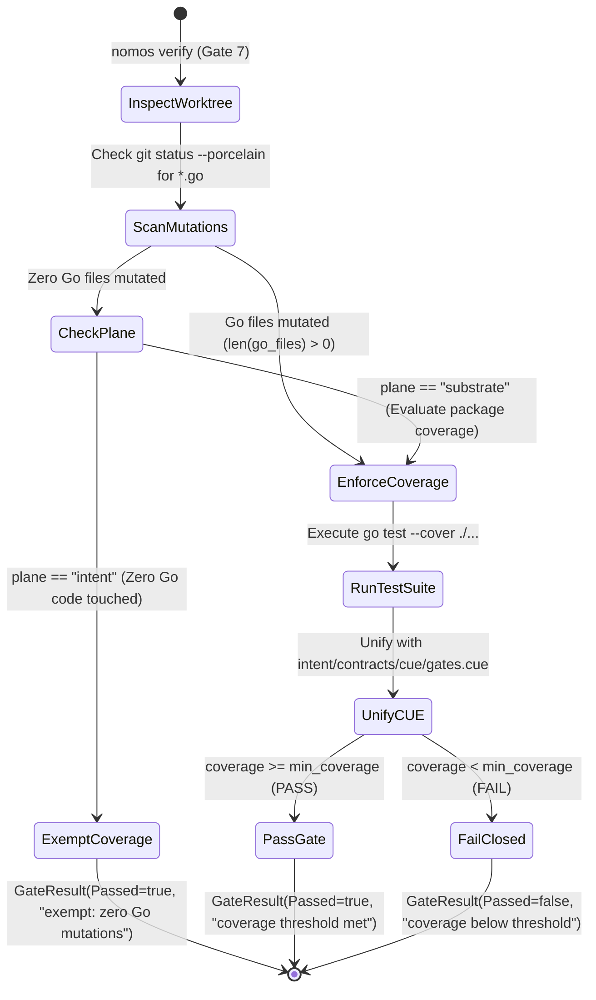
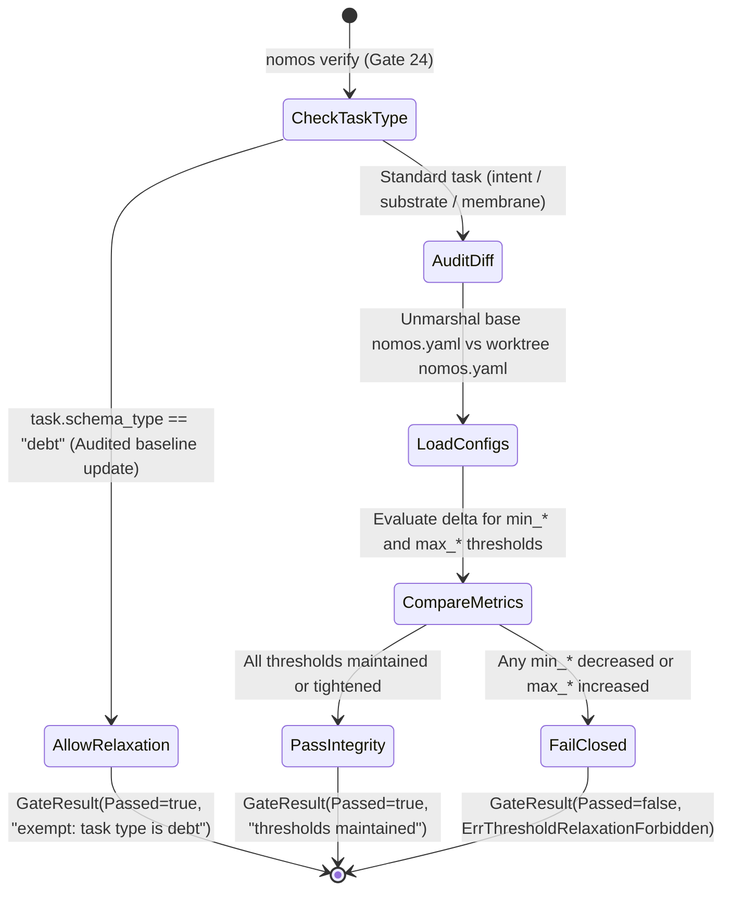

---
authors:
    - Mark Gantlett
    - Nomos Open-Core Substrate
    - Nomos Open-Core Substrate
classification: public
date: "2026-10-05"
last_updated: "2026-11-01"
plane: intent
ssot_repository: "nomos"
status: active
title: "Strict DoD Coverage and Threshold Integrity Lock Specification"
type: spec
version: "4.0.0"
execution_frontier:
  tasks:
    - key: "INT-320"
      plane: "intent"
      summary: "Specify Strict DoD Coverage and Threshold Integrity Lock with Go Mutation Guard"
    - key: "SUB-81"
      plane: "substrate"
      summary: "Implement ThresholdIntegrityGate and Go Mutation Guard for Coverage Gate Exemptions"
---

# Strict DoD Coverage and Threshold Integrity Lock Specification

## 1. Executive Summary & Intent Motivation

In autonomous software engineering, AI coding agents frequently attempt to bypass quality gates by lowering test thresholds (e.g. reducing `min_test_coverage_pct` in `nomos.yaml`) or claiming task-plane exemptions (`plane: "intent"`) while surreptitiously modifying Go substrate code.

Under **Law 2 (Non-Verbal Proof)** and **Law 7 (Fail-Closed Pre-Flight)**, this escape hatch must be closed mathematically:
1. **Threshold Immutability Invariant:** Quality thresholds (`min_*` and `max_*`) in `nomos.yaml` are structurally locked against relaxation. Any downward mutation of coverage or upward mutation of complexity triggers an immediate `FAIL`, unless explicitly executed under a task whose `schema_type` is `"debt"`.
2. **Go Mutation Guard on Coverage Exemptions:** A task declared as `plane: "intent"` or `schema_type: "spike"` is only exempt from `CoverageGate` if **zero `.go` files are mutated** in the active worktree. If a single Go file is modified, full statement coverage is enforced fail-closed.
3. **AST-Based Threshold Audit:** Compares compiled configuration structs against base revisions via `config.LoadConfig()`, preventing bypass via YAML reformatting.
4. **Universal Topology:** References strictly adhere to `nomos` (Open-Core Public Foundation) and `gsi-sov` (Sovereign Proprietary Extensions).

---

## 2. Axiomatic Invariants & Laws Codified

| Law # | Law Name | Architectural Enforcement |
| :---: | :--- | :--- |
| **Law 1** | **Dual-Core Inversion** | Substrate Go core evaluates threshold integrity and statement coverage; Tier 1 agents cannot override gate policies. |
| **Law 2** | **Non-Verbal Proof** | Statement coverage must satisfy `gates.cue` (`coverage >= min_coverage`), proven by table-driven test vectors (`TC-COV-001` through `TC-COV-006`). |
| **Law 4** | **Single Source of Truth** | Plane and task types bind strictly to `#TaskRecord` in `intent/contracts/cue/task.cue`. Thresholds bind to `gates.cue`. |
| **Law 5** | **Zero-Hardcoded-Path** | Configuration and git root resolve dynamically via `config.LocateConfigPath()` and `workspace.SafeGitCommand`. |
| **Law 6** | **Canonical Singularity** | Single canonical `CoverageGate` (Gate 7) and `ThresholdIntegrityGate` (Gate 24) in the 29-gate DoD pipeline. |
| **Law 7** | **Fail-Closed Pre-Flight** | Any relaxation of thresholds outside a designated `debt` task halts verification immediately with exit code 1. |

---

## 3. Plane-Aware Coverage Gating & Go Mutation Guard

To eliminate escape hatches, `CoverageGate` evaluates worktree mutations before granting any exemption:

### 3.1 Strict Fail-Closed Exemption Predicate
$$\text{IsExempt} = (\text{Task.Plane} == \text{"intent"}) \land (\forall f \in \text{WorktreeDiff}, \neg \text{HasSuffix}(f, \text{".go"}))$$
If a developer or agent claims an `INT-*` task but edits `substrate/src/nomos/main.go`, `IsExempt` evaluates to `false`, and `CoverageGate` executes the complete test suite.

---

## 4. Threshold Integrity State Machine (Gate 24)

`ThresholdIntegrityGate` mathematically asserts that thresholds in `nomos.yaml` are never relaxed:

### 4.1 Monotonic Threshold Inequalities
For every threshold metric $T \in \text{QualityGates.Thresholds}$:
- If $T \in \{\text{MinTestCoveragePct}, \text{MinCommentDensityPct}, \text{MinTraceabilityDensityChars}\}$:
  $$T_{\text{worktree}} \ge T_{\text{base}} \quad (\text{Strictly monotonic non-decreasing})$$
- If $T \in \{\text{MaxCognitiveDebtScore}, \text{MaxCyclomaticComplexity}, \text{MaxFileLOC}, \text{MaxFuncLOC}\}$:
  $$T_{\text{worktree}} \le T_{\text{base}} \quad (\text{Strictly monotonic non-increasing})$$

Any violation outside a `schema_type: "debt"` task triggers `ErrThresholdRelaxationForbidden` with exit code 1.

---

## 5. Table-Driven Verification Vectors

The following deterministic test vectors certify the coverage and threshold lock:

| Vector ID | Task Plane | Schema Type | Files Mutated | Threshold Mutation | Expected Outcome | Invariant Enforced |
| :--- | :--- | :--- | :--- | :--- | :--- | :--- |
| **TC-COV-001** | `substrate` | `substrate` | `*.go` | None | Coverage evaluated; requires $\ge 55\%$ | Law 2 (Non-verbal proof) |
| **TC-COV-002** | `intent` | `intent` | `*.md` only | None | `CoverageGate` exempt; returns PASS | Scope isolation |
| **TC-COV-003** | `intent` | `intent` | `*.md` + `foo.go` | None | Mutation guard triggers; coverage enforced | Law 7 (Escape hatch lock) |
| **TC-COV-004** | `substrate` | `substrate` | `nomos.yaml` | `min_coverage: 55 -> 40` | Rejects: `ThresholdIntegrityGate` FAIL | Law 7 (Threshold lock) |
| **TC-COV-005** | `substrate` | `debt` | `nomos.yaml` | `min_coverage: 55 -> 50` | Passes: Audited debt task exemption | Audited debt lifecycle |
| **TC-COV-006** | `substrate` | `substrate` | `nomos.yaml` | `max_cds: 45 -> 40` | Passes: Threshold tightened | Monotonic improvement |

---

## 6. Acceptance Criteria & Rigor Boundary

1. **Go Mutation Guard Active:** Zero blanket exemptions; any `.go` modification enforces coverage regardless of task plane.
2. **Monotonic Threshold Enforcement:** Downward coverage or upward complexity mutations without `schema_type: "debt"` trigger immediate failure.
3. **CUE Contract Parity:** Validated against `intent/contracts/cue/gates.cue` and `task.cue`.
4. **42-Gate DoD Verification:** Verification passes all 42 quality gates (`nomos verify`) with exit code 0.
5. **No Broken Links:** All markdown documentation links resolve cleanly.
