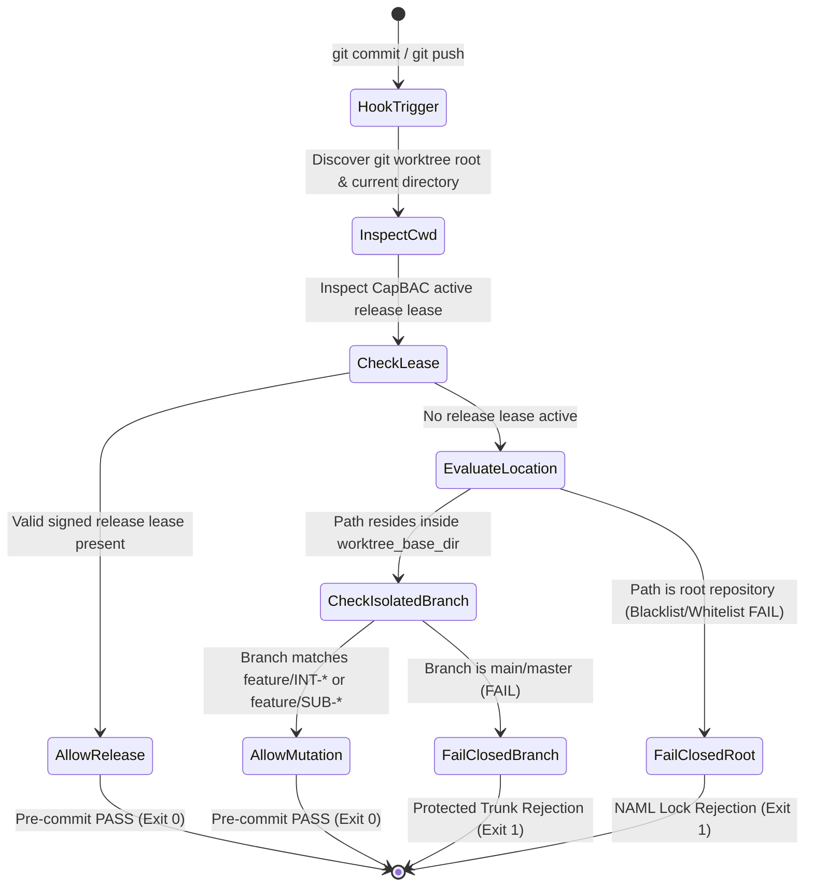

---
authors:
    - Mark Gantlett
    - Nomos Open-Core Substrate
    - Nomos Open-Core Substrate
classification: public
date: "2026-10-06"
last_updated: "2026-11-01"
plane: intent
ssot_repository: "nomos"
status: active
title: "Nomos Trunk Lockout & Hermetic Worktree Enforcement Specification"
trigger: pre_commit, pre_push
type: spec
version: "4.0.0"
execution_frontier:
  tasks:
    - key: "INT-348"
      plane: "intent"
      summary: "Specify Nomos Trunk Lockout and Fail-Closed Whitelist Worktree Boundary Enforcement"
    - key: "SUB-213"
      plane: "substrate"
      summary: "Implement ValidateWorktreeBoundary, Pre-Commit Whitelist Gating, and CapBAC Release Leases"
---

# Nomos Trunk Lockout & Hermetic Worktree Enforcement Specification

## 1. Executive Summary & Intent Motivation

Direct mutations on repository trunk branches (e.g., `main`, `master`) violate the **Hermetic Worktree Law (Law 3)**. Root trunk mutations bypass structured CapBAC authorization leases, degrade deterministic replayability, and cause cross-workspace drift between open-core and sovereign repositories.

Historically, boundary checks relied on blacklist heuristics (e.g. checking whether `branch == "main"`), which failed open on detached HEAD states, arbitrary feature branches checked out in the root worktree, or commands executed from deep subdirectories.

This specification formalizes the **Nomos Absolute Mutability Lock (NAML)**:
1. **Fail-Closed Whitelist Architecture (Law 7):** Code mutations are prohibited everywhere by default. Mutations are permitted strictly if:
   - The execution occurs inside a verified transient task worktree (`worktrees/<repo>-<key>`).
   - Or the operation holds a cryptographically signed CapBAC release lease during atomic Two-Phase Commit (`nomos task sync`).
2. **Zero-Hardcoded Topology (Law 5):** Worktree base directories and protected branches resolve dynamically via `config.LoadConfig()`.
3. **Dual Quality Gate Binding:** Enforced by `hermetic_worktree` and `staged_boundaries` in the compiled 42-gate DoD pipeline (`substrate/src/nomos/modules/verify/matrix.go`).
4. **Universal Topology:** References strictly adhere to `nomos` (Open-Core Public Foundation) and `gsi-sov` (Sovereign Proprietary Extensions).

---

## 2. Axiomatic Invariants & Laws Codified

| Law # | Law Name | Architectural Enforcement |
| :---: | :--- | :--- |
| **Law 1** | **Dual-Core Inversion** | Substrate Go core enforces physical pre-commit and pre-push hooks; Tier 1 agents cannot disable hook interception. |
| **Law 2** | **Non-Verbal Proof** | Boundary assertions are proven by process exit code 1 on prohibited paths, validated by test vectors (`TC-TRK-001` through `TC-TRK-006`). |
| **Law 3** | **Hermetic Worktree** | Protected trunks are physically read-only; all mutations execute strictly inside isolated task worktrees. |
| **Law 4** | **Single Source of Truth** | Worktree boundaries bind strictly to compiled Go structs in `substrate/src/nomos/core/workspace/` and `nomos.schema.json`. |
| **Law 5** | **Zero-Hardcoded-Path** | Base directories (`worktree_base_dir`) and default branches derive dynamically from `nomos.yaml`. |
| **Law 6** | **Canonical Singularity** | Single canonical boundary validation engine (`workspace.ValidateWorktreeBoundary`) called across hooks and CLI. |
| **Law 7** | **Fail-Closed Pre-Flight** | Whitelist evaluation: any unverified worktree context or expired lease rejects mutations immediately with exit code 1. |

---

## 3. Whitelist Boundary State Machine (NAML)



---

## 4. Formal Go Interfaces & DTO Contracts

The authoritative Go SSoT contracts reside in `substrate/src/nomos/core/workspace/`:

```go
package workspace

import (
	"context"
)

// BoundaryCheckResult captures the evaluation outcome of a worktree audit.
type BoundaryCheckResult struct {
	IsPermitted       bool   `json:"is_permitted"`
	IsRootRepository  bool   `json:"is_root_repository"`
	IsIsolatedTree    bool   `json:"is_isolated_tree"`
	ActiveBranch      string `json:"active_branch"`
	TaskKey           string `json:"task_key,omitempty"`
	LeaseTokenID      string `json:"lease_token_id,omitempty"`
	RejectionReason   string `json:"rejection_reason,omitempty"`
}

// ReleaseLeaseToken represents a signed CapBAC token authorizing trunk merge.
type ReleaseLeaseToken struct {
	TokenID     string `json:"token_id"`
	TaskKey     string `json:"task_key"`
	Phase       string `json:"phase"` // "SYNC"
	IssuedAt    string `json:"issued_at"`
	ExpiresAt   string `json:"expires_at"`
	Signature   string `json:"signature"`
}

// WorktreeBoundaryValidator defines the contract for pre-commit boundary enforcement.
type WorktreeBoundaryValidator interface {
	ValidateWorktreeBoundary(ctx context.Context, cwd string) (*BoundaryCheckResult, error)
	VerifyReleaseLease(token ReleaseLeaseToken) (bool, error)
}
```

---

## 5. Fail-Closed Whitelist Evaluation Rules

1. **Root Immutability (Law 3):** If `filepath.Clean(cwd)` matches the root repository path or any non-worktree subdirectory, mutations are blocked unconditionally unless a valid `ReleaseLeaseToken` is active.
2. **Worktree Directory Confinement:** Worktrees must reside strictly inside the configured `worktree_base_dir` (default: `worktrees/`).
3. **Detached HEAD Safety:** Running with a detached HEAD in the root repository triggers an immediate `FAIL`, closing the historical detached HEAD bypass.
4. **Boundary Staging Sensor (Gate 3):** Pre-commit scans staged files using `git diff --cached --name-only`. If any staged file resolves outside the active worktree boundary, the commit is rejected.

---

## 6. Table-Driven Verification Vectors

The following deterministic test vectors validate boundary enforcement:

| Vector ID | Execution Directory | Active Branch | Active Lease | Expected Outcome | Invariant Enforced |
| :--- | :--- | :--- | :--- | :--- | :--- |
| **TC-TRK-001** | Repository Root | `main` | None | REJECT: NAML Lock (Exit 1) | Law 3 (Root lock) |
| **TC-TRK-002** | Repository Root | Detached HEAD | None | REJECT: Fail-closed whitelist | Law 7 (Detached HEAD guard) |
| **TC-TRK-003** | Subdirectory of Root | `feature/SUB-213` | None | REJECT: Root worktree is read-only | Law 3 (Hermetic tree) |
| **TC-TRK-004** | `worktrees/nomos-SUB-213` | `feature/SUB-213` | None | PASS: Verified isolated worktree | Law 3 (Hermetic mutation) |
| **TC-TRK-005** | Repository Root | `main` | Valid `SYNC` Lease | PASS: Authorized 2PC release | Law 1 (CapBAC 2PC) |
| **TC-TRK-006** | Repository Root | `main` | Expired Lease | REJECT: Lease expired (Exit 1) | Law 7 (Fail-closed token) |

---

## 7. Acceptance Criteria & Rigor Boundary

1. **Whitelist Enforcement Active:** Direct mutations on root repositories fail closed with exit code 1 and a deterministic NAML error message.
2. **Dynamic Configuration:** Protected branches and worktree directories resolve through `config.LoadConfig()`.
3. **Go SSoT & JSON Schema Parity:** Validated against `nomos.schema.json` and `workspace.ValidateWorktreeBoundary`.
4. **42-Gate DoD Verification:** Verification passes all 42 quality gates (`nomos verify`) with exit code 0.
5. **No Broken Links:** All markdown documentation links resolve cleanly.
