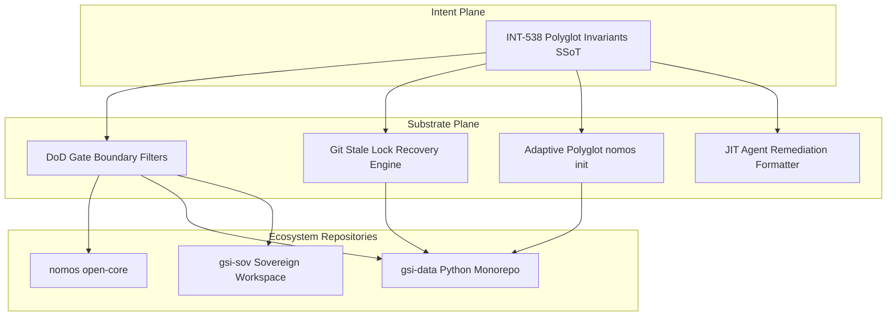

---
authors:
    - Mark Gantlett
    - Nomos Open-Core Substrate
classification: public
date: "2026-10-13"
last_updated: "2026-11-01"
plane: intent
status: active
title: "Nomos Polyglot Workspace Ergonomics, Dynamic Lock Hygiene, and Agent Remediation Invariants"
type: spec
version: "4.0.0"
execution_frontier:
  tasks:
    - key: "INT-538"
      plane: "intent"
      summary: "Codify polyglot workspace ergonomics, dynamic git lock recovery, and agent remediation invariants"
    - key: "SUB-666"
      plane: "substrate"
      summary: "Implement polyglot ignore boundaries and stale lock recovery engine in substrate"
ssot_repository: nomos
---

# Nomos Polyglot Workspace Ergonomics, Dynamic Lock Hygiene, and Agent Remediation Invariants

> [!IMPORTANT]
> This specification anchors **Task INT-538** and establishes the single source of truth (SSoT) for polyglot language support, automated git lock recovery, and Tier 1 agent error remediation in the Nomos open-core substrate.

---

## 1. Problem Statement & Motivation

Downstream production testing of Nomos inside non-Go workspaces—specifically `gsi-data` (a Python monorepo managed under `uv`) and polyglot tooling environments—revealed four critical friction points:

1. **False-Positive Gate Rejections**:
   - `SecretGate` scanned compiled native binaries (`.so`, `.dylib`, `.dll`) and python virtual environments (`.venv/`), flagging benign strings or binary entropy as leaked secrets.
   - `StagedBoundariesGate` rejected git deletions (`D`), interpreting normal code removal as an out-of-boundary violation and requiring manual workaround commits.
2. **Fragile Git Lock Concurrency**:
   - Interrupted task startups or crashed CLI commands can leave stale lock files in `.git/refs/heads/*.lock` or `.git/index.lock`. Subsequent `nomos task start` commands abort with `ERR_MODULES / Permission denied`, locking the agent in an unrecoverable loop without human intervention.
3. **Monolithic Tooling Assumptions**:
   - `nomos init` historically defaulted to Go project assumptions (`go.mod`), failing to automatically detect Python (`pyproject.toml`, `uv.lock`), Node (`package.json`), or Rust (`Cargo.toml`) environments.
4. **Cognitive Agent Iteration Churn**:
   - When a DoD gate fails during automated agent cycles, the error string often describes the mathematical failure without giving a deterministic, machine-actionable remediation command, causing the Tier 1 agent to guess or attempt unstructured fixes.

---

## 2. Axiomatic Invariants & Architectural Laws

### Invariant 1: Zero-False-Positive DoD Gates (Law 2 & Law 5)
Quality gates must never reject valid development workflows:
- All AST, secret, and file-scanning gates must automatically inherit and respect universal polyglot ignore boundaries:
  - **Python**: `.venv/`, `__pycache__/`, `*.pyc`, `*.egg-info/`, `.pytest_cache/`, `.ruff_cache/`
  - **Node/Web**: `node_modules/`, `.svelte-kit/`, `.next/`, `dist/`, `.turbo/`
  - **Rust/Compiled**: `target/`, `*.so`, `*.dylib`, `*.dll`, `*.a`
- `StagedBoundariesGate` must explicitly permit git deletions (`D`) inside the allowed boundary roots, distinguishing between valid file excision and unauthorized modifications.

### Invariant 2: Idempotent Worktree & Stale Lock Recovery (Law 3 & Law 7)
Worktree provisioning and trunk synchronization must be self-healing:
- Before executing git branch mutations, `nomos task start` and workspace lifecycle engines inspect `.git/*.lock` and `.git/refs/heads/*.lock` (resolving linked worktree paths via `gitdir:` pointers).
- A lock is evaluated using `RecoverStaleGitLocks`:
  1. File modification timestamp is compared against `DefaultLockTTL = 30 * time.Second`.
  2. If the lock age exceeds 30 seconds, the substrate verifies that no active `git` or `nomos` process holds an open file descriptor on the lock.
  3. If confirmed stale, the lock is safely unlinked (`os.Remove`) and recorded in `cli_audit_events` with an audit note appended to `task_journal`.
- Locks held by active processes or within the 30-second TTL remain untouched (`LockActive`), preserving concurrency safety during long-running operations.

### Invariant 3: Adaptive Polyglot Initialization (Law 4)
`nomos init` automatically inspects the workspace root and scaffolds the correct project profile:
- Detection precedence matrix:
  - `pyproject.toml` or `requirements.txt` $\rightarrow$ Python profile (`pytest`, `ruff`, `.venv/` ignore)
  - `package.json` $\rightarrow$ Node/TypeScript profile (`npm test` / `vitest`, `node_modules/` ignore)
  - `Cargo.toml` $\rightarrow$ Rust profile (`cargo test`, `target/` ignore)
  - `go.mod` $\rightarrow$ Go profile (`go test`, static binary harness)
- Scaffolds a language-aware `.gitignore` and minimal `nomos.yaml` in $< 2$ seconds.

### Invariant 4: JIT Machine-Actionable Remediation (Law 1 & Law 2)
Every Definition of Done gate failure must render an explicit `Remedy` field containing:
- The exact canonical CLI command to run (e.g., `nomos mem save`, `nomos task abort <KEY>`, `nomos task sync -F <file>`).
- Contextual guidance formatted specifically for Tier 1 cognitive agents to eliminate trial-and-error iterations.

---

## 3. Substrate Interface Contracts & Go DTO Structs

The Substrate implements lock hygiene and recovery in `substrate/src/nomos/core/workspace/trunk_lock.go`:

```go
package workspace

import "time"

// LockRecoveryDecision indicates the resolution outcome of an inspect lock operation.
type LockRecoveryDecision int

const (
	// LockActive indicates a lock is still within its valid operational TTL.
	LockActive LockRecoveryDecision = iota
	// LockStaleReclaimed indicates a stale lock was detected and safely removed.
	LockStaleReclaimed
	// LockPermissionDenied indicates a lock could not be removed due to filesystem permissions.
	LockPermissionDenied
)

// DefaultLockTTL is the default staleness threshold for git lock files (30 seconds).
const DefaultLockTTL = 30 * time.Second

// LockRecoveryReport encapsulates the outcome of a lock sweep.
type LockRecoveryReport struct {
	ReclaimedLocks []string             `json:"reclaimed_locks"`
	Decision       LockRecoveryDecision `json:"decision"`
	ScannedAt      time.Time            `json:"scanned_at"`
}
```

Declarative CUE schema counterpart:

```cue
package schemas

// LockRecoveryReport captures the outcome of an automated git lock hygiene sweep.
#LockRecoveryReport: close({
	reclaimed_locks: [...string]
	decision:        "LockActive" | "LockStaleReclaimed" | "LockPermissionDenied"
	scanned_at:      string
})
```

---

## 4. Cross-Plane Transduction Matrix



1. **Intent Plane (`INT-538`)**: Authors specification, establishes lock duration bounds, and codifies universal polyglot ignore taxonomy.
2. **Substrate Plane (`SUB-666`)**: Implements ignore lists in `substrate/src/nomos/modules/verify/`, integrates lock recovery in `substrate/src/nomos/core/workspace/trunk_lock.go`, and updates `substrate/cli/`.
3. **Downstream Adoption**: Unblocks seamless multi-language agent workflows across Python, Rust, and Node repositories without false-positive failures.

---

## 5. Table-Driven Test Matrix & Vectors

| Test Case ID | Target Component | Input Vector | Expected State / Output | Invariant Verified |
| :--- | :--- | :--- | :--- | :--- |
| `TC-POLY-001` | `StagedBoundariesGate` | Staged file deletion (`git rm path/to/file.go`) within worktree boundary | Returns `Passed: true` with zero boundary violations | Invariant 1 (Zero-False-Positive Gates) |
| `TC-POLY-002` | `RecoverStaleGitLocks` | `.git/index.lock` with mtime $> 30$s and no active process | Returns `LockStaleReclaimed`, lock file is deleted, logged to `cli_audit_events` | Invariant 2 (Idempotent Lock Recovery) |
| `TC-POLY-003` | `RecoverStaleGitLocks` | `.git/index.lock` with mtime $< 10$s | Returns `LockActive`, lock file is preserved | Law 7 (Fail-Closed Safety) |
| `TC-POLY-004` | `SecretGate` | Source tree containing `.venv/` and `.so` binary artifacts | Ignores `.venv/` and `.so` files, zero false-positive secret detections | Invariant 1 & Law 5 |

---

## 6. Verification Boundaries & DoD Evidence

1. **Gate Invariant**: `nomos verify` must pass cleanly without rejecting Python `.venv/` or git file deletions.
2. **Markdown Integrity**: All markdown relative links resolve deterministically via Gate 14 (`BrokenWireGate`).
3. **Verification Command**:
   ```bash
   nomos verify
   ```
   Must pass all 29 Definition of Done quality gates with zero regressions.
