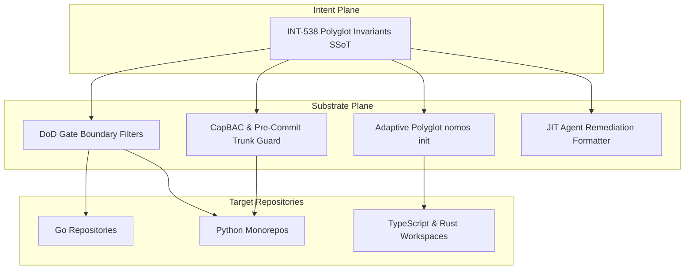

---
authors:
    - Mark Gantlett
    - Nomos Open-Core Substrate
classification: public
date: "2026-10-13"
last_updated: "2026-11-05"
plane: intent
ssot_repository: nomos
status: active
title: "Nomos Polyglot Workspace Ergonomics, Dynamic Lock Hygiene, and Agent Remediation Invariants"
type: spec
version: "4.0.0"
execution_frontier:
  tasks:
    - key: "INT-538"
      plane: "intent"
      summary: "Codify polyglot workspace ergonomics, dynamic git lock recovery, and agent remediation invariants"
    - key: "SUB-666"
      plane: "substrate"
      summary: "Implement polyglot ignore boundaries and stale lock recovery engine in substrate"
---

# Nomos Polyglot Workspace Ergonomics, Dynamic Lock Hygiene, and Agent Remediation Invariants

> [!IMPORTANT]
> This specification anchors **Task INT-538**. It establishes the SSoT for polyglot language support, stale Git `.lock` recovery, and Tier 1 agent remediation.

---

## 1. Problem Statement & Motivation

Downstream production evaluation of Nomos inside non-Go workspaces - specifically `gsi-data` (a Python monorepo under `uv`) and polyglot environments - revealed four friction points:

1. **False-Positive Gate Rejections**:
   - `SecretGate` scanned compiled native binaries (`.so`, `.dylib`, `.dll`) and python virtual environments (`.venv/`), flagging benign strings or binary entropy as leaked secrets.
   - `StagedBoundariesGate` rejected Git deletions (`D`), treating valid file removal as an out-of-boundary violation requiring manual commits.
2. **Fragile Git `.lock` Concurrency**:
   - Interrupted startups or crashed CLI commands leave stale `.git/refs/heads/*.lock` or `.git/index.lock` files. Subsequent `nomos task start` commands abort with `ERR_MODULES / Permission denied`, stalling the agent without human intervention.
3. **Monolithic Tooling Assumptions**:
   - `nomos init` historically defaulted to Go project assumptions (`go.mod`), missing automatic detection for Python (`pyproject.toml`, `uv.lock`), Node (`package.json`), or Rust (`Cargo.toml`) environments.
4. **Cognitive Agent Iteration Churn**:
   - When a DoD gate rejects a worktree, raw mathematical errors lack machine-actionable remediation commands. Consequently, the Tier 1 agent guesses unstructured repairs.

---

## 2. Axiomatic Invariants & Architectural Laws

### Invariant 1: Zero-False-Positive DoD Gates (Law 2 & Law 5)
Quality gates must never reject valid development workflows:
- All AST, secret, and file-scanning gates automatically inherit universal polyglot exclusion boundaries:
  - **Python**: `.venv/`, `__pycache__/`, `*.pyc`, `*.egg-info/`, `.pytest_cache/`, `.ruff_cache/`
  - **Node/Web**: `node_modules/`, `.svelte-kit/`, `.next/`, `dist/`, `.turbo/`
  - **Rust/Compiled**: `target/`, `*.so`, `*.dylib`, `*.dll`, `*.a`
- `StagedBoundariesGate` explicitly accepts Git deletions (`D`) inside configured boundary roots, distinguishing valid file excision from unauthorized modifications.

### Invariant 2: Hermetic Trunk Protection Without OS `chmod` Mutations (Law 3 & Law 7)
Worktree provisioning and trunk synchronization enforce boundary isolation via CapBAC leases and Git hooks rather than filesystem permission hacks:
- `LockTrunk` and `UnlockTrunk` in `substrate/src/nomos/core/workspace/trunk_lock.go` verify repository accessibility while delegating trunk mutation blocking to CapBAC leases and self-healing `pre-commit` / `PreToolUse` defense hooks.
- `nomos task prune` deterministically collects orphaned worktrees and merged `feature/*` branches while preserving active `IN_PROGRESS` worktrees with uncommitted state.

### Invariant 3: Adaptive Polyglot Initialization (Law 4)
`nomos init` automatically scans the workspace root and scaffolds the matching project profile:
- Detection precedence matrix:
  - `pyproject.toml` or `requirements.txt` $\rightarrow$ Python profile (`pytest`, `ruff`, `.venv/` exclusion)
  - `package.json` $\rightarrow$ Node/TypeScript profile (`npm test` / `vitest`, `node_modules/` exclusion)
  - `Cargo.toml` $\rightarrow$ Rust profile (`cargo test`, `target/` exclusion)
  - `go.mod` $\rightarrow$ Go profile (`go test`, static binary harness)
- Scaffolds a language-aware `.gitignore` and minimal `nomos.yaml` in $< 2$ seconds.

### Invariant 4: JIT Machine-Actionable Remediation (Law 1 & Law 2)
Every Definition of Done gate failure must render an explicit `Remedy` field containing:
- The exact canonical CLI command to run (e.g., `nomos mem save`, `nomos task abort <KEY>`, `nomos task sync -F <file>`).
- Contextual guidance formatted specifically for Tier 1 cognitive agents to eliminate trial-and-error iterations.

---

## 3. Substrate Interface Contracts (`substrate/src/nomos/core/workspace/trunk_lock.go`)

```go
package workspace

// LockTrunk attests trunk isolation under Law 3. Trunk boundary protection is
// enforced via CapBAC object capabilities and Git pre-commit defense hooks without OS chmod mutations.
func LockTrunk(repoRoot string) error

// UnlockTrunk verifies 2PC atomic release preconditions.
func UnlockTrunk(repoRoot string) error
```

---

## 4. Cross-Plane Transduction Matrix



1. **Intent Plane (`INT-538`)**: Authors specification and codifies the universal polyglot exclusion taxonomy.
2. **Substrate Plane (`SUB-666`)**: Implements exclusion lists in `substrate/src/nomos/modules/verify/`, trunk isolation in `substrate/src/nomos/core/workspace/trunk_lock.go`, and adaptive scaffolding in `substrate/cli/cmd_init.go`.
3. **Downstream Adoption**: Unblocks multi-language agent workflows across Python, Rust, TypeScript, and Go repositories without false-positive gate rejections.

---

## 5. Table-Driven Test Matrix & Vectors

| Vector ID | Target Component | Input Vector | Expected State / Output | Invariant Verified |
| :--- | :--- | :--- | :--- | :--- |
| `TC-POLY-001` | `StagedBoundariesGate` | Staged deletion (`git rm path/to/file.go`) inside worktree | Returns `Passed: true` with zero boundary violations | Invariant 1 (Zero-False-Positive Gates) |
| `TC-POLY-002` | `LockTrunk` / Pre-Commit Hook | Direct commit attempt on protected `main` branch | Rejects commit with `nomos task chore` remedy | Invariant 2 (Hermetic Trunk Protection) |
| `TC-POLY-003` | `nomos task prune` | Orphaned `worktrees/*` directory without active lease | Sweeps orphan while preserving active `IN_PROGRESS` worktrees | Law 3 & Law 7 |
| `TC-POLY-004` | `SecretGate` | Source tree containing `.venv/` and `.so` artifacts | Skips `.venv/` and `.so` files cleanly | Invariant 1 & Law 5 |

---

## 6. Verification Boundaries & DoD Evidence

1. **Gate Invariant**: `nomos verify` passes cleanly without rejecting Python `.venv/` or Git file deletions.
2. **Markdown Integrity**: All markdown relative links resolve deterministically via `BrokenWireGate` (`Cell 4.1`).
3. **Verification Command**:
   ```bash
   nomos verify
   ```
   Passes all 42 Definition of Done quality gates with zero regressions.
