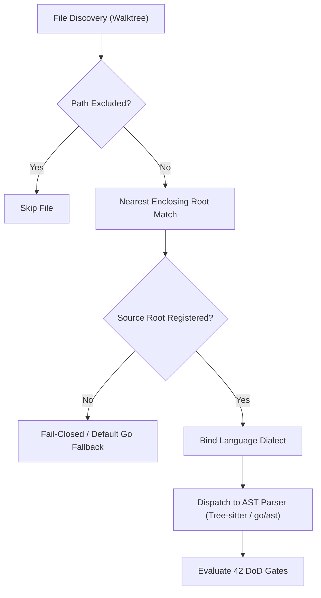
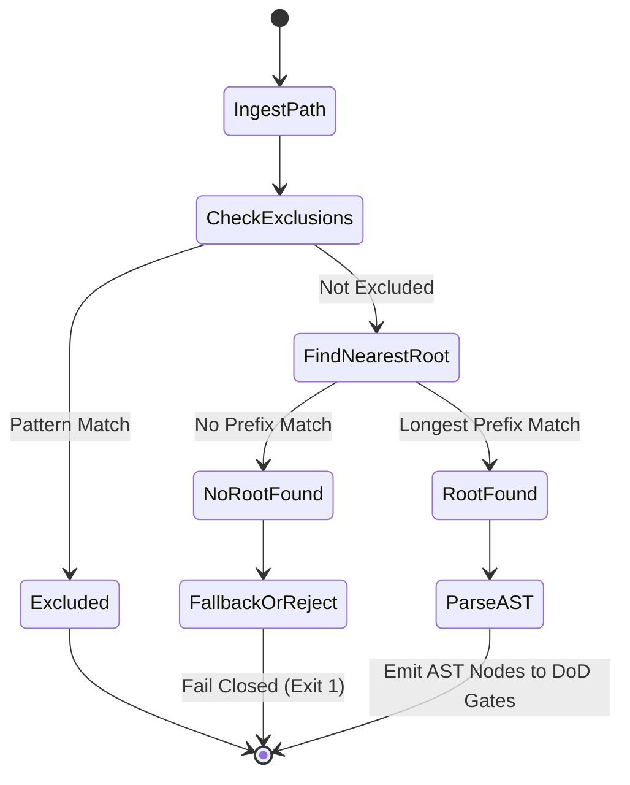

---
authors:
    - Mark Gantlett
    - Nomos Open-Core Substrate
classification: public
date: "2026-10-05"
last_updated: "2026-11-01"
plane: intent
status: active
title: "Polyglot Source Roots Config Expansion"
type: spec
version: "4.0.0"
ssot_repository: nomos
---

# Polyglot Source Roots Config Expansion

## 1. Executive Summary & Problem Statement
The Substrate AST parsing engine historically assumed a mono-language Go repository topology, anchoring its evaluation roots strictly to directories containing `go.mod`. As the Nomos ecosystem incorporates web membranes (SvelteKit, TypeScript), polyglot microservices, and tooling pipelines (Python, CUE, Markdown), the Definition of Done (DoD) verification engine (`nomos verify`) must audit multi-language codebases without hardcoded filesystem assumptions.

This specification formalizes the **Polyglot Source Roots Engine**, which enables dynamic discovery, boundary mapping, and parser dispatching across arbitrary language roots defined declaratively in `nomos.yaml`. By binding source roots to formal CUE schemas (`intent/contracts/cue/polyglot.cue`), Nomos enforces multi-language AST gating, secret detection, and docstring verification without violating the Zero-Hardcoded-Path Law.



---

## 2. Axiomatic Invariants & Laws Codified

| Law # | Law Name | Architectural Invariant Enforced in Polyglot Roots |
| :---: | :--- | :--- |
| **Law 2** | **The Non-Verbal Proof Law** | AST parsing replaces brittle regex heuristics. Verification requires AST proof generated by native Tree-sitter or Go toolchain AST extractors. |
| **Law 4** | **The Single Source of Truth Law** | `nomos.yaml` `source_roots` configuration is strictly validated against `intent/contracts/cue/polyglot.cue` (`#SourceRootConfig`). Zero ad-hoc or split-brain schema definitions tolerated. |
| **Law 5** | **The Zero-Hardcoded-Path Law** | Source roots are specified as relative paths from the workspace root. Hardcoded filesystem paths, absolute paths (`/`), and parent directory traversals (`..`) are strictly prohibited and rejected at parse time. |
| **Law 6** | **The Canonical Singularity Law** | Exactly one canonical language identifier is bound to each source root. Zero redundant aliases (`ts` vs `typescript`) or conflicting overlapping root assignments. |
| **Law 7** | **The Fail-Closed Pre-Flight Law** | Files residing in declared source roots that fail AST parsing or contain unknown language bindings trigger immediate verification failure (Exit Code 1). |

---

## 3. Architectural Decisions & State Machine

### 3.1 Declarative Source Root Specification
`nomos.yaml` declares workspace source roots under the `source_roots` array. Each entry is validated by the CUE singularity engine against `#SourceRootConfig`:

```yaml
source_roots:
  - path: "substrate/src/nomos"
    language: "go"
    exclude_patterns:
      - "**/testdata/**"
  - path: "substrate/membrane/cockpit"
    language: "svelte"
    exclude_patterns:
      - "**/node_modules/**"
      - "**/.svelte-kit/**"
      - "**/build/**"
  - path: "intent"
    language: "markdown"
    exclude_patterns:
      - "**/.tmp/**"
```

### 3.2 Nearest-Enclosing Root Resolution
When traversing the workspace during `nomos verify` or test suite execution:
1. **Normalization:** The relative path of the file from the workspace root is normalized (clean slashes, no symlink escapes).
2. **Exclusion Check:** The relative path is matched against the `exclude_patterns` of all candidate roots. If matched, the file is immediately skipped.
3. **Hierarchy Traversal:** The file path's directory tree is traversed upward from parent to parent until the longest prefix matching a declared `source_roots[].path` is identified.
4. **Binding:** The file is bound to the resolved root's `language`. If no matching root is found, root resolution falls back to default Go parsing for backwards compatibility, or fails closed if `strict_polyglot: true` is configured.



---

## 4. Formal Go Contracts & CUE Schema Binding

### 4.1 CUE Schema Definition (`intent/contracts/cue/polyglot.cue`)
```cue
package schemas

// Supported AST language dialects (Law 6)
#SupportedLanguage: "go" | "typescript" | "javascript" | "svelte" | "markdown" | "yaml" | "python" | "rust" | "c" | "cpp" | "html" | "css"

// Declarative source root specification (Law 4 & Law 5)
#SourceRootConfig: close({
	path:             string & !~"^/" & !~"\\.\\."
	language:         #SupportedLanguage
	exclude_patterns: [...string]
})

// Workspace-wide polyglot root manifest
#PolyglotWorkspaceManifest: close({
	source_roots:     [...#SourceRootConfig]
	strict_polyglot:  bool | *false
})
```

### 4.2 Substrate Go DTO Contracts
```go
package polyglot

import (
	"context"
	"fmt"
	"path/filepath"
	"strings"
)

// SupportedLanguage identifies canonical language parsers.
type SupportedLanguage string

const (
	LangGo         SupportedLanguage = "go"
	LangTypeScript SupportedLanguage = "typescript"
	LangJavaScript SupportedLanguage = "javascript"
	LangSvelte     SupportedLanguage = "svelte"
	LangMarkdown   SupportedLanguage = "markdown"
	LangYAML       SupportedLanguage = "yaml"
)

// SourceRootConfig represents a verified source root declaration.
type SourceRootConfig struct {
	Path            string            `json:"path"`
	Language        SupportedLanguage `json:"language"`
	ExcludePatterns []string          `json:"exclude_patterns"`
}

// ResolvedFileContext binds a discovered file to its AST parser strategy.
type ResolvedFileContext struct {
	RelativePath string
	MatchedRoot  SourceRootConfig
	Language     SupportedLanguage
	IsExcluded   bool
}

// SourceRootResolver defines the contract for dynamic root resolution.
type SourceRootResolver interface {
	Resolve(ctx context.Context, relPath string) (*ResolvedFileContext, error)
	ValidateManifest(ctx context.Context, roots []SourceRootConfig) error
}
```

---

## 5. Definition of Done (DoD) & Quality Gates Compliance

Verification of this specification is governed deterministically by `nomos verify` across all automated DoD quality gates:

1. **Gate 9 (Forbidden Literals / Law 5):** Source root paths are strictly relative. Zero absolute paths (`/usr/...`) or hardcoded repository root paths tolerated in code or configuration.
2. **Gate 10 (Anti-Shim AST / Law 2):** Concrete Tree-sitter and Go AST parser dispatch logic; zero stub functions or unhandled error blocks.
3. **Gate 14 (Broken Wire & Link / Law 4):** All document links and schema references (`intent/contracts/cue/polyglot.cue`) resolve with byte parity.
4. **Gate 21 (Magic Strings Polyglot / Law 5):** Polyglot scanners audit JavaScript, Svelte, and Go sources without raw regex or hardcoded ports.
5. **Gate 26 (Intent Substrate Parity Gate):** CUE schema in `intent/contracts/cue/polyglot.cue` matches compiled Go structs in Substrate with cryptographic parity.

---

## 6. Table-Driven Test Vectors

The following table-driven test vectors validate the dynamic source root resolution engine:

| Vector ID | Target Relative Path | Configured Source Roots | Expected Root Path | Expected Language | Expected Outcome | Failure Invariant |
| :---: | :--- | :--- | :--- | :--- | :--- | :--- |
| **VEC-ROOT-01** | `substrate/src/nomos/main.go` | `[{"path": "substrate/src/nomos", "language": "go"}]` | `substrate/src/nomos` | `go` | `PASS` | Correct longest prefix match |
| **VEC-ROOT-02** | `substrate/membrane/cockpit/src/App.svelte` | `[{"path": "substrate/membrane/cockpit", "language": "svelte"}]` | `substrate/membrane/cockpit` | `svelte` | `PASS` | Svelte membrane root binding |
| **VEC-ROOT-03** | `substrate/membrane/cockpit/node_modules/pkg/index.js` | `[{"path": "substrate/membrane/cockpit", "language": "svelte", "exclude_patterns": ["**/node_modules/**"]}]` | `substrate/membrane/cockpit` | `svelte` | `SKIP` | Exclude pattern match |
| **VEC-ROOT-04** | `/etc/shadow` | `[{"path": "substrate", "language": "go"}]` | `""` | `""` | `FAIL` | Law 5: Leading `/` absolute path rejected |
| **VEC-ROOT-05** | `../../outside.go` | `[{"path": "substrate", "language": "go"}]` | `""` | `""` | `FAIL` | Law 5: `..` path traversal rejected |
| **VEC-ROOT-06** | `scripts/tool.py` | `[{"path": "substrate", "language": "go"}]` | `""` | `""` | `FAIL` | Law 7: Unmapped source root fails closed under strict mode |
| **VEC-ROOT-07** | `substrate/membrane/nested/file.ts` | `[{"path": "substrate", "language": "go"}, {"path": "substrate/membrane", "language": "typescript"}]` | `substrate/membrane` | `typescript` | `PASS` | Longest prefix match wins over parent |
| **VEC-ROOT-08** | `intent/architecture/spec.md` | `[{"path": "intent", "language": "markdown"}]` | `intent` | `markdown` | `PASS` | Intent plane markdown AST parsing |


