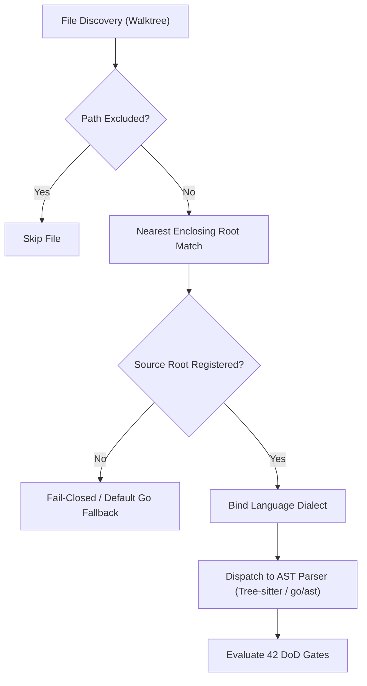
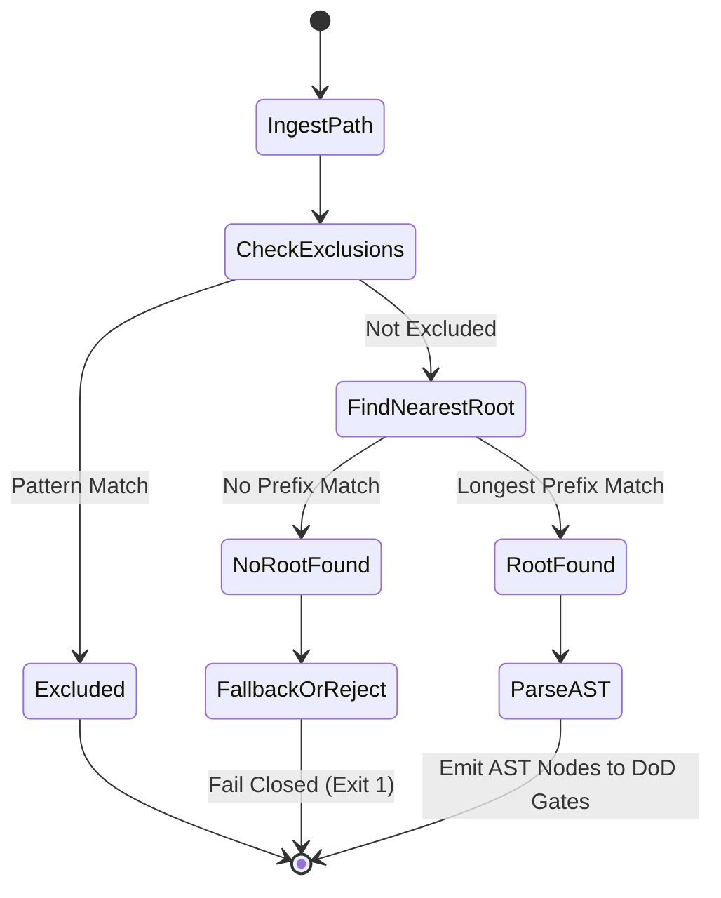

---
authors:
    - Mark Gantlett
    - Nomos Open-Core Substrate
classification: public
date: "2026-10-05"
last_updated: "2026-11-05"
plane: intent
ssot_repository: nomos
status: active
title: "Polyglot Source Roots Config Expansion"
type: spec
version: "4.0.0"
---

# Polyglot Source Roots Config Expansion

## 1. Executive Summary & Problem Statement
The Substrate AST parsing engine historically assumed a mono-language Go topology anchored strictly to `go.mod` directories. Modern Nomos workspaces incorporate SvelteKit, TypeScript, Python, Rust, and Markdown components. Consequently, `nomos verify` audits multi-language codebases without hardcoded filesystem assumptions.

This specification formalizes the **Polyglot Source Roots Engine** for dynamic discovery, boundary mapping, and parser dispatch across declarative `nomos.yaml` roots. Source roots bind to `config.SourceRoot` and `types.SourceRootConfig`, reflected directly into `nomos.schema.json`. Nomos thus enforces multi-language AST gating, secret detection, and docstring verification under Law 5.



---

## 2. Axiomatic Invariants & Laws Codified

| Law # | Law Name | Architectural Invariant Enforced in Polyglot Roots |
| :---: | :--- | :--- |
| **Law 2** | **The Non-Verbal Proof Law** | Native Tree-sitter and Go AST extractors replace brittle regex heuristics. |
| **Law 4** | **The Single Source of Truth Law** | Validates `source_roots` against `config.SourceRoot` (`nomos.schema.json`) and `types.SourceRootConfig`. |
| **Law 5** | **The Zero-Hardcoded-Path Law** | Rejects absolute paths (`/`) and parent traversals (`..`) at parse time. |
| **Law 6** | **The Canonical Singularity Law** | Binds one canonical language identifier per root without overlapping aliases. |
| **Law 7** | **The Fail-Closed Pre-Flight Law** | AST parse errors or unknown language bindings abort verification (exit 1). |

---

## 3. Architectural Decisions & State Machine

### 3.1 Declarative Source Root Specification
`nomos.yaml` declares workspace source roots under `governance.quality_gates.source_roots`, and the substrate validates each entry against `config.SourceRoot` (`nomos.schema.json`):

```yaml
source_roots:
  - path: "substrate/src/nomos"
    language: "go"
    exclude_patterns:
      - "**/testdata/**"
  - path: "substrate/membrane/cockpit"
    language: "svelte"
    exclude_patterns:
      - "**/node_modules/**"
      - "**/.svelte-kit/**"
      - "**/build/**"
  - path: "intent"
    language: "markdown"
    exclude_patterns:
      - "**/.tmp/**"
```

### 3.2 Nearest-Enclosing Root Resolution
When traversing the workspace during `nomos verify` or verification suite execution:
1. **Normalization:** The resolver normalizes the workspace-relative file path with clean slashes and rejects symlink escapes.
2. **Exclusion Filter:** The resolver matches the relative path against candidate `exclude_patterns` and skips matching files immediately.
3. **Hierarchy Traversal:** The resolver walks parent directories upward until matching the longest declared `source_roots[].path` prefix.
4. **Binding:** The resolver binds the file to the matched root `language`. Unmatched files fall back to Go parsing or abort when `strict_polyglot: true` applies.



---

## 4. Formal Go Contracts & Reflected JSON Schema Binding

### 4.1 Reflected JSON Schema Definition (`nomos.schema.json`)
```json
{
  "source_roots": {
    "type": "array",
    "items": {
      "type": "object",
      "additionalProperties": false,
      "properties": {
        "path": { "type": "string" },
        "language": { "type": "string" },
        "exclude_patterns": {
          "type": "array",
          "items": { "type": "string" }
        }
      }
    }
  }
}
```

### 4.2 Substrate Go DTO Contracts
```go
package polyglot

import (
	"context"
	"fmt"
	"path/filepath"
	"strings"
)

// SupportedLanguage identifies canonical language parsers.
type SupportedLanguage string

const (
	LangGo         SupportedLanguage = "go"
	LangTypeScript SupportedLanguage = "typescript"
	LangJavaScript SupportedLanguage = "javascript"
	LangSvelte     SupportedLanguage = "svelte"
	LangMarkdown   SupportedLanguage = "markdown"
	LangYAML       SupportedLanguage = "yaml"
)

// SourceRootConfig represents a verified source root declaration.
type SourceRootConfig struct {
	Path            string            `json:"path"`
	Language        SupportedLanguage `json:"language"`
	ExcludePatterns []string          `json:"exclude_patterns"`
}

// ResolvedFileContext binds a discovered file to its AST parser strategy.
type ResolvedFileContext struct {
	RelativePath string
	MatchedRoot  SourceRootConfig
	Language     SupportedLanguage
	IsExcluded   bool
}

// SourceRootResolver defines the contract for dynamic root resolution.
type SourceRootResolver interface {
	Resolve(ctx context.Context, relPath string) (*ResolvedFileContext, error)
	ValidateManifest(ctx context.Context, roots []SourceRootConfig) error
}
```

---

## 5. Definition of Done (DoD) & Quality Gates Compliance

The `nomos verify` engine governs verification deterministically across all automated DoD quality gates:

1. **Gate 9 (Forbidden Literals / Law 5):** Source root paths remain strictly relative with zero absolute paths (`/usr/...`) or hardcoded repository roots.
2. **Gate 10 (Anti-Shim AST / Law 2):** Concrete Tree-sitter and Go AST parser dispatch logic; zero stub functions or unhandled error blocks.
3. **Gate 14 (Broken Wire & Link / Law 4):** All document links and specification references resolve cleanly.
4. **Gate 21 (Magic Strings Polyglot / Law 5):** Polyglot scanners audit JavaScript, Svelte, and Go sources without raw regex or hardcoded ports.
5. **Contract Parity Gate (`Cell 4.2`):** `nomos.schema.json` matches compiled Go structs in `core/config/` with byte-for-byte parity.

---

## 6. Table-Driven Test Vectors

The following table-driven verification vectors validate the dynamic source root resolution engine:

| Vector ID | Target Relative Path | Configured Source Roots | Expected Root Path | Expected Language | Expected Outcome | Failure Invariant |
| :---: | :--- | :--- | :--- | :--- | :--- | :--- |
| **VEC-ROOT-01** | `substrate/src/nomos/main.go` | `[{"path": "substrate/src/nomos", "language": "go"}]` | `substrate/src/nomos` | `go` | `PASS` | Correct longest prefix match |
| **VEC-ROOT-02** | `substrate/membrane/cockpit/src/App.svelte` | `[{"path": "substrate/membrane/cockpit", "language": "svelte"}]` | `substrate/membrane/cockpit` | `svelte` | `PASS` | Svelte membrane root binding |
| **VEC-ROOT-03** | `substrate/membrane/cockpit/node_modules/pkg/index.js` | `[{"path": "substrate/membrane/cockpit", "language": "svelte", "exclude_patterns": ["**/node_modules/**"]}]` | `substrate/membrane/cockpit` | `svelte` | `SKIP` | Exclude pattern match |
| **VEC-ROOT-04** | `/etc/shadow` | `[{"path": "substrate", "language": "go"}]` | `""` | `""` | `FAIL` | Law 5: Leading `/` absolute path rejected |
| **VEC-ROOT-05** | `../../outside.go` | `[{"path": "substrate", "language": "go"}]` | `""` | `""` | `FAIL` | Law 5: `..` path traversal rejected |
| **VEC-ROOT-06** | `scripts/tool.py` | `[{"path": "substrate", "language": "go"}]` | `""` | `""` | `FAIL` | Law 7: Unmapped source root fails closed under strict mode |
| **VEC-ROOT-07** | `substrate/membrane/nested/file.ts` | `[{"path": "substrate", "language": "go"}, {"path": "substrate/membrane", "language": "typescript"}]` | `substrate/membrane` | `typescript` | `PASS` | Longest prefix match wins over parent |
| **VEC-ROOT-08** | `intent/architecture/spec.md` | `[{"path": "intent", "language": "markdown"}]` | `intent` | `markdown` | `PASS` | Intent plane markdown AST parsing |


