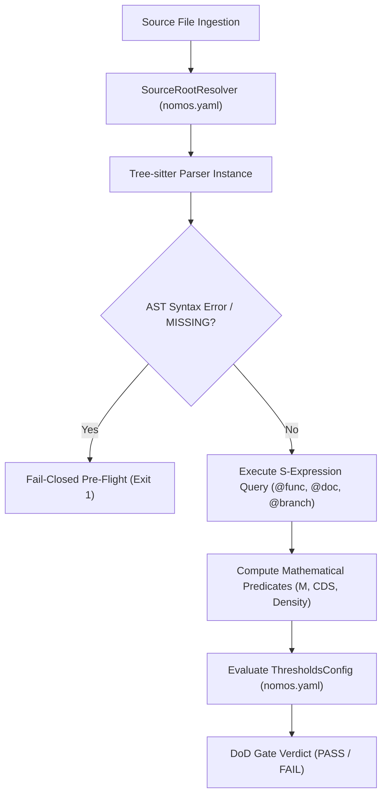

---
authors:
    - Mark Gantlett
    - Nomos Open-Core Substrate
classification: public
date: "2026-10-05"
last_updated: "2026-11-01"
plane: intent
status: active
title: "Tree-sitter AST Gate Engine to Replace Legacy Gen 2 Regex Gates"
type: spec
version: "4.0.0"
ssot_repository: nomos
---

# Tree-sitter AST Gate Engine

## 1. Executive Summary & Problem Statement
In Gen 2, the Nomos Definition of Done (DoD) quality gates relied upon line-scanning regex heuristics to validate codebase hygiene (e.g., cyclomatic complexity, docstring density, forbidden literal scanning). This approach was inherently brittle: it failed on polyglot workspaces, was susceptible to false positives inside comments or multiline strings, and could not parse deeply nested syntactic structures.

In strict compliance with **Law 2 (The Non-Verbal Proof Law)**, this specification formalizes the **Tree-sitter AST Gate Engine**. The engine integrates Tree-sitter parser bindings across Go, TypeScript, Svelte, Python, and Markdown, replacing regex line-matching with deterministic concrete syntax trees (CST/AST). Under Nomos v4, the engine executes polyglot Tree-sitter parsers hermetically in pure Go via the `wazero` WebAssembly runtime (`github.com/tetratelabs/wazero`), strictly avoiding CGo and external process spawns. The engine binds to `treesitter.TreeSitterWasmConfig` (`substrate/src/nomos/modules/verify/treesitter/types.go`) and evaluates AST metric extractions directly against `config.ThresholdsConfig` (`nomos.yaml` / `nomos.schema.json`) to enforce all automated DoD quality gates.



---

## 2. Axiomatic Invariants & Laws Codified

| Law # | Law Name | Architectural Invariant Enforced in Tree-sitter Engine |
| :---: | :--- | :--- |
| **Law 2** | **The Non-Verbal Proof Law** | Code correctness and architectural hygiene require deterministic AST proof. Regex matching on source code is strictly prohibited for DoD gates. |
| **Law 4** | **The Single Source of Truth Law** | AST query definitions are compiled directly into the Substrate Go binary via `//go:embed` as an immutable SSoT. Extraction outputs map 1:1 to compiled Go metric structs (`FunctionMetric`, `FileMetric`) and `config.ThresholdsConfig`. |
| **Law 5** | **The Zero-Hardcoded-Path Law** | Source roots and target files are resolved dynamically via configuration discovery (`#SourceRootConfig`). Zero hardcoded absolute paths or filesystem literals tolerated. |
| **Law 6** | **The Canonical Singularity Law** | Exactly one canonical AST gatekeeper pipeline evaluates all supported languages through a unified `TreeSitterGateEngine` interface. |
| **Law 7** | **The Fail-Closed Pre-Flight Law** | Unparseable syntax trees, malformed S-expressions, or Tree-sitter `ERROR`/`MISSING` syntax nodes trigger immediate pre-flight abort (Exit Code 1). |

---

## 3. Architectural Decisions & Mathematical Predicates

### 3.1 S-Expression Query Specifications Across Languages
Tree-sitter queries are compiled into the Substrate via `//go:embed queries/*` to extract function boundaries, comments, and decision branches:

#### 1. Go Query (`queries/go.scm`)
```scheme
;; Function and Method declarations with preceding comments
((comment)* @func.doc
 .
 [(function_declaration name: (identifier) @func.name body: (block) @func.body)
  (method_declaration name: (field_identifier) @func.name body: (block) @func.body)])

;; Complexity decision branch nodes
[(if_statement)
 (for_statement)
 (expression_case_clause)
 (type_case_clause)
 (communication_case_clause)
 (binary_expression operator: "&&")
 (binary_expression operator: "||")] @branch
```

#### 2. TypeScript / JavaScript Query (`queries/typescript.scm`)
```scheme
;; Function declarations, methods, and arrow functions
((comment)* @func.doc
 .
 [(function_declaration name: (identifier) @func.name body: (statement_block) @func.body)
  (method_definition name: (property_identifier) @func.name body: (statement_block) @func.body)
  (lexical_declaration (variable_declarator name: (identifier) @func.name value: (arrow_function body: (statement_block) @func.body)))])

;; Complexity decision branch nodes
[(if_statement)
 (for_statement)
 (for_in_statement)
 (while_statement)
 (switch_case)
 (catch_clause)
 (ternary_expression)
 (binary_expression operator: "&&")
 (binary_expression operator: "||")
 (binary_expression operator: "??")] @branch
```

#### 3. Python Query (`queries/python.scm`)
```scheme
;; Function and method definitions
((comment)* @func.doc
 .
 (function_definition name: (identifier) @func.name body: (block) @func.body))

;; Complexity decision branch nodes
[(if_statement)
 (for_statement)
 (while_statement)
 (except_clause)
 (boolean_operator)] @branch
```

### 3.2 Concrete Mathematical Predicates

#### 1. Cyclomatic Complexity ($M$)
For any function node $F$, cyclomatic complexity is calculated as:
$$M(F) = 1 + \sum_{b \in F} \mathbb{I}(b \text{ is branch node})$$
Where branch nodes are captured by the language-specific `@branch` S-expression query. The function passes if $M(F) \le \text{thresholds.max\_complexity}$ (default: 15).

#### 2. Docstring Adjacency & Density
A function possesses a valid docstring if a comment node precedes the declaration node with vertical line distance $\Delta \text{line} \le 1$.
$$\text{Docstring Density} = \left( \frac{\text{documented functions}}{\text{total functions}} \right) \times 100$$
The workspace passes Gate 12 if $\text{Docstring Density} \ge \text{thresholds.min\_docstring\_density}$ (default: 10%).

#### 3. Cognitive Debt Score ($CDS$)
For any source file $S$ containing functions $F_1, \dots, F_k$:
$$CDS(S) = \sum_{i=1}^k \left( \max(0, M(F_i) - 10) \times 2.0 + \max(0, \text{LOC}(F_i) - 30) \times 0.5 \right) + \max(0, 100 - \text{Density}) \times 0.2$$
The file passes Gate 17 if $CDS(S) \le \text{thresholds.max\_cds}$ (default: 45).

---

## 4. Formal Go Contracts & Thresholds Binding

### 4.1 Thresholds Configuration (`config.ThresholdsConfig` / `nomos.schema.json`)
Extracted AST metrics are evaluated deterministically against `config.ThresholdsConfig`:

```json
{
  "max_cognitive_debt_score": 45,
  "max_cyclomatic_complexity": 15,
  "max_file_loc": 400,
  "max_func_loc": 60,
  "min_comment_density_pct": 10,
  "min_test_coverage_pct": 55
}
```

### 4.2 Substrate Go Engine Interface
```go
package astgate

import (
	"context"
	"embed"
	"fmt"
)

//go:embed queries/*
var QueryFS embed.FS

// FunctionMetric captures per-function AST complexity and LOC metrics.
type FunctionMetric struct {
	File       string `json:"file"`
	Line       int    `json:"line"`
	Name       string `json:"name"`
	Complexity int    `json:"complexity"`
	LOC        int    `json:"loc"`
	Documented bool   `json:"documented"`
}

// FileMetric captures per-file LOC and Cognitive Debt Score metrics.
type FileMetric struct {
	Name string `json:"name"`
	LOC  int    `json:"loc"`
	CDS  int    `json:"cds"`
}

// GateEvaluationReport aggregates polyglot AST verification findings.
type GateEvaluationReport struct {
	Functions  []FunctionMetric `json:"functions"`
	Files      []FileMetric     `json:"files"`
	Documented int              `json:"documented"`
	Total      int              `json:"total"`
	Density    int              `json:"density"`
	Passed     bool             `json:"pass"`
}

// TreeSitterGateEngine executes AST gating across polyglot source trees.
type TreeSitterGateEngine interface {
	ParseAndEvaluate(ctx context.Context, filePath string, content []byte) (*GateEvaluationReport, error)
}
```

---

## 5. Definition of Done (DoD) & 42 Quality Gates Compliance

The Tree-sitter AST Gate Engine directly underpins the automated verification of the following DoD quality gates:

1. **Gate 10 (Anti-Shim AST Invariant):** Detects empty AST blocks, stub bodies, or no-op returns (`return nil`, `{}`) via query `@empty_block`.
2. **Gate 12 (Docstring Density Invariant):** Evaluates docstring adjacency across all exported functions via `@func.doc`.
3. **Gate 13 (Cognitive Complexity Invariant):** Computes $M(F)$ for every function using compiled `@branch` queries.
4. **Gate 16 (Max File LOC Invariant):** Computes exact AST statement counts and line extents excluding trailing blanks.
5. **Gate 17 (Cognitive Debt Score Invariant):** Enforces $CDS \le 45$ on all parsed source files.
6. **Gate 21 (Magic Strings Polyglot Invariant):** Scans string literal AST nodes across Go, TypeScript, and Svelte for unconfigured localhost ports or URLs.

---

## 6. Table-Driven Test Vectors

The following table-driven test vectors validate the Tree-sitter AST Gate Engine:

| Vector ID | Source Language | Input Code Snippet | Expected AST Extraction | Metric Calculations | Gate Verdict | Failure Invariant |
| :---: | :--- | :--- | :--- | :--- | :--- | :--- |
| **VEC-TS-01** | `go` | `// Exec runs task\nfunc Exec() error { if err := step(); err != nil { return err }; return nil }` | `func: Exec`, `doc: true`, `branches: 1` | $M = 2$, $\text{LOC} = 2$, $\text{doc} = 100\%$ | `PASS` | Clean Go function with valid docstring |
| **VEC-TS-02** | `go` | `func Incomplete() { ERROR_SYNTAX }` | `tree-sitter ERROR node detected` | N/A | `FAIL` | Law 7: Syntax error triggers fail-closed pre-flight abort |
| **VEC-TS-03** | `typescript` | `export const handle = (req: Req) => { if (a && b || c) { return d; } };` | `func: handle`, `doc: false`, `branches: 3` | $M = 4$, $\text{LOC} = 1$, $\text{doc} = 0\%$ | `PASS` | TS arrow function with boolean short-circuit branches |
| **VEC-TS-04** | `python` | `def dispatch(event):\n    if event:\n        for item in event: pass` | `func: dispatch`, `doc: false`, `branches: 2` | $M = 3$, $\text{LOC} = 3$, $\text{doc} = 0\%$ | `PASS` | Python function with if and for branches |
| **VEC-TS-05** | `go` | `func Complex() { /* 16 nested if statements */ }` | `func: Complex`, `branches: 16` | $M = 17 > 15$ | `FAIL` | Gate 13: Cyclomatic complexity threshold exceeded |
| **VEC-TS-06** | `typescript` | `/** Valid JSDoc */\nfunction calc(): void {}` | `func: calc`, `doc: true`, `branches: 0` | $M = 1$, $\text{doc} = 100\%$ | `PASS` | TS JSDoc comment adjacency recognized |
| **VEC-TS-07** | `go` | `func Shim() {}` | `empty_block detected` | $\text{LOC} = 1$ | `FAIL` | Gate 10: Anti-Shim AST invariant violation |
| **VEC-TS-08** | `markdown` | `# Section\n## Sub\nParagraph` | `heading levels: [1, 2]` | Structural outline verified | `PASS` | Intent plane markdown structural AST parsing |
| **VEC-TS-09** | `svelte` | `<script lang="ts">\n  let count = 0;\n  function increment() {\n    if (count < 10) count++;\n  }\n</script>\n\n<button on:click={increment}>{count}</button>` | `<script>` block extracted, `func: increment`, `branches: 1` | $M = 2$, $\text{LOC} = 3$, line offset mapped | `PASS` | Svelte embedded script AST extraction and metric calculation |
| **VEC-TS-10** | `wasm` | Pure Go embedded bytecode `TreeSitterWasmBytecode` | `wazero.Runtime` compilation & module instantiation | Zero CGo, execution exit code 0 | `PASS` | Pure-Go hermetic WebAssembly execution verified (`wazero`) |

