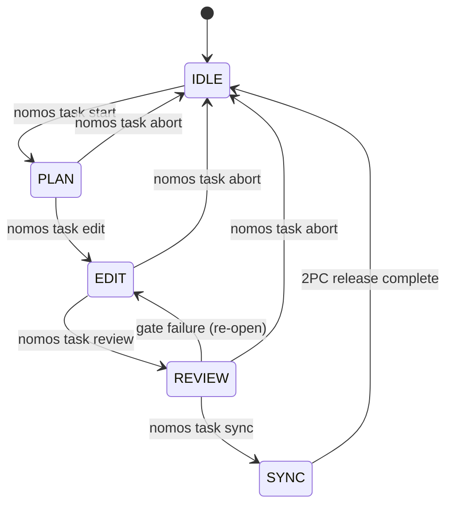

---
authors:
  - Mark Gantlett
  - Nomos Open-Core Substrate
classification: public
date: "2026-10-23"
plane: intent
ssot_repository: nomos
status: active
title: "Task Lifecycle CLI and Workspace State Transition Specification"
type: spec
---

# Task Lifecycle CLI and Workspace State Transition Specification

---

## 1. Executive Summary & Problem Statement

In Nomos v3, task management suffered from excessive fragmentation and missing state guarantees:
1. **Command Bloat**: Over 15 disparate subcommands with overlapping responsibilities (`nomos task audit`, `nomos task repair`, `nomos task sync --drift`, etc.).
2. **In-Memory Volatility in Early v4**: Early v4 scaffolding lacked persistent task storage and decoupled workspace phases from CapBAC lease tokens.
3. **Implicit Worktree Sprawl**: Loose coordination between worktree provisioning and phase transitions risked cross-worktree contamination and trunk mutation leaks.

Nomos v4 consolidates task operations into a **canonical finite state machine** with **CapBAC object capabilities** and **pure-Go SQLite persistence** (`SQLiteTaskStore`).

---

## 2. Axiomatic Invariants & Governing Laws

### `INV-TSK-001`: Procedural Phase Locking (Law 1: Dual-Core Inversion)
Procedural phase gates govern workspace mutability across lifecycle phases.

$$\text{IDLE} \xrightarrow{\text{start}} \text{PLAN} \xrightarrow{\text{edit}} \text{EDIT} \xrightarrow{\text{review}} \text{REVIEW} \xrightarrow{\text{sync}} \text{SYNC} \xrightarrow{\text{learn}} \text{IDLE}$$

The substrate rejects trunk mutations outside an active task holding a valid CapBAC lease.

### `INV-TSK-002`: Hermetic Worktree Isolation (Law 3: Hermetic Worktree)
Calling `nomos task start <KEY>` must provision an isolated git worktree at `worktrees/nomos-<KEY>` branched from clean trunk `main`. All mutations must occur strictly within this directory boundary.

### `INV-TSK-003`: CapBAC Lease Acquisition (Law 7: Fail-Closed Pre-Flight)
Transitioning into `PLAN` or `EDIT` requires acquiring a cryptographically unique `capbac.Lease` (`core/capbac/lease.go`) with an assigned `step_budget` ($\le 500$). Actions that exhaust tokens reject execution until lease renewal.

### `INV-TSK-004`: Two-Phase Commit Release Verification (Law 2: Non-Verbal Proof)
`nomos task sync <KEY> (-F <walkthrough> | -m <summary>)` executes an atomic 2PC release:
1. Executes `nomos verify` DoD quality gates (all 42 DoD quality gates must pass exit 0).
2. Verifies a non-empty walkthrough summary via `-F <walkthrough>` or inline `-m <summary>` (mutually exclusive).
3. Performs a fast-forward merge of `feature/<KEY>` into protected trunk `main`.
4. Attests the release receipt in Git Notes (`refs/notes/nomos/releases`).
5. Revokes the CapBAC lease and removes the transient worktree.

### `INV-TSK-005`: Canonical Key Singularity (Law 6: Canonical Singularity)
All task operations require canonical keys matching `^(INT|SUB)-[0-9]+(-[a-z0-9-]+)?$`. The validator rejects custom prefixes (`FEAT-`, `BUG-`, `CORE-`).

### `INV-TSK-006`: Top-Level Telemetry Visibility (Law 1: Indirect Control)
`nomos status` provides a unified non-verbal proof dashboard displaying:
- Workspace active lifecycle phase (`IDLE`, `PLAN`, `EDIT`, `REVIEW`, `SYNC`, `LEARN`).
- Active task key, plane, title, and assigned Tier 1 agent seat.
- Current worktree directory location and branch.
- CapBAC token consumption vs. step budget.
- Database connection status and pending DAG wavefront candidates.
- `RenderXrayTerminal` appends a multi-language contract and compliance affordance only when `FilesScanned >= 50` across at least two languages.
- `Execute` enriches unknown root command errors with a `NomosError` remedy referencing `nomos-plugin-<name>` installation when absent from `PATH`.

---

## 3. Finite State Machine & Compiled Go SSoT Contracts



| Source Phase | CLI Command | Target Phase | Pre-Flight Validation | State Mutation |
| :--- | :--- | :--- | :--- | :--- |
| `IDLE` | `nomos task start <KEY>` | `PLAN` | Task exists in DB; trunk clean; key valid | Mints CapBAC lease; creates worktree |
| `PLAN` | `nomos task edit <KEY>` | `EDIT` | Worktree exists; active lease valid | Sets status `EDIT`; unlocks code mutation |
| `EDIT` | `nomos task review <KEY>` | `REVIEW` | Worktree clean/staged; lease valid | Runs DoD gates; locks further edits |
| `REVIEW` | `nomos task sync -F <file>`| `IDLE` | DoD gates exit 0; walkthrough valid | Fast-forward merge; writes Git Note; prunes WT |
| Any non-IDLE | `nomos task abort <KEY>` | `IDLE` | Task active | Revokes lease; removes worktree |

### 3.1 Compiled Go SSoT Task, Storage & Issue Contracts (`modules/task`, `core/storage`, `cli`)
`substrate/src/nomos/modules/task/`, `substrate/src/nomos/core/storage/`, and `substrate/cli/` enforce the Living Ledger schema, 3-section task cards, 2PC Git Notes receipts, SQLite WAL maintenance, and scrubbed diagnostic issue reports:

```go
package task

// Status represents the formal lifecycle state of a task.
type Status string

// SchemaType defines the plane-tailored task classification (#SchemaType).
type SchemaType string

const (
	StatusBacklog    Status = "BACKLOG"
	StatusTodo       Status = "TODO"
	StatusReady      Status = "READY"
	StatusPlan       Status = "PLAN"
	StatusEdit       Status = "EDIT"
	StatusInProgress Status = "IN_PROGRESS"
	StatusReview     Status = "REVIEW"
	StatusSync       Status = "SYNC"
	StatusDone       Status = "DONE"
	StatusBlocked    Status = "BLOCKED"
	StatusAborted    Status = "ABORTED"
)

// TaskRecord defines the formal specification for Living Ledger task records (#TaskRecord).
type TaskRecord struct {
	ID                 int        `json:"id,omitempty"`
	Key                string     `json:"key"`
	Plane              string     `json:"plane"`
	Project            string     `json:"project,omitempty"`
	SchemaType         SchemaType `json:"schema_type"`
	Title              string     `json:"title"`
	Description        string     `json:"description,omitempty"`
	ScopePaths         []string   `json:"scope_paths,omitempty"`
	LockTests          bool       `json:"lock_tests,omitempty"`
	Obligations        []string   `json:"obligations,omitempty"`
	AcceptanceCriteria []string   `json:"acceptance_criteria,omitempty"`
	VerifyCmd          string     `json:"verify_cmd,omitempty"`
	Status             Status     `json:"status"`
	Tier               Tier       `json:"tier"`
	Priority           int        `json:"priority"`
	CreatedAt          string     `json:"created_at"`
	UpdatedAt          string     `json:"updated_at"`
	CompletedAt        *string    `json:"completed_at,omitempty"`
	Dependencies       []string   `json:"dependencies,omitempty"`
	TwinKey            string     `json:"twin_key,omitempty"`
	Assignee           string     `json:"assignee,omitempty"`
	ArcID              string     `json:"arc_id,omitempty"`
	IntentDelta        string     `json:"intent_delta,omitempty"`
	Burden             int        `json:"burden,omitempty"`
	ContextBurden      int        `json:"context_burden,omitempty"`
	ArchLayer          int        `json:"arch_layer,omitempty"`
}

// TaskCardInput models the fail-closed Agent-to-Agent backlog card contract (#TaskCardInput).
type TaskCardInput struct {
	Scope              string   `json:"scope"`
	ScopePaths         []string `json:"scope_paths,omitempty"`
	Obligations        []string `json:"obligations,omitempty"`
	AcceptanceCriteria []string `json:"acceptance_criteria"`
	Verification       string   `json:"verification"`
	Burden             int      `json:"burden,omitempty"`
}

// TaskBatchNode declares one node inside an atomic Agent-to-Agent DAG subgraph (#TaskBatchNode).
type TaskBatchNode struct {
	Ref                string   `json:"ref,omitempty"`
	Key                string   `json:"key,omitempty"`
	Plane              string   `json:"plane"`
	Title              string   `json:"title"`
	Scope              string   `json:"scope"`
	ScopePaths         []string `json:"scope_paths,omitempty"`
	Obligations        []string `json:"obligations,omitempty"`
	AcceptanceCriteria []string `json:"acceptance_criteria"`
	VerifyCmd          string   `json:"verify_cmd"`
	DependsOn          []string `json:"depends_on,omitempty"`
	TwinOf             string   `json:"twin_of,omitempty"`
	Tier               string   `json:"tier,omitempty"`
	Priority           int      `json:"priority,omitempty"`
	Burden             int      `json:"burden,omitempty"`
}

// TaskBatchManifest encapsulates a multi-node DAG subgraph submitted via nomos task batch (#TaskBatchManifest).
type TaskBatchManifest struct {
	Project string          `json:"project,omitempty"`
	Tasks   []TaskBatchNode `json:"tasks"`
}

// TaskBatchResult reports allocated canonical keys and resolved symbolic refs from nomos task batch (#TaskBatchResult).
type TaskBatchResult struct {
	Project      string            `json:"project"`
	CreatedKeys  []string          `json:"created_keys"`
	ResolvedRefs map[string]string `json:"resolved_refs,omitempty"`
	Tasks        []TaskRecord      `json:"tasks"`
}

// WavefrontCandidate represents an unblocked DAG candidate task (#WavefrontCandidate).
type WavefrontCandidate struct {
	Key            string     `json:"key"`
	Title          string     `json:"title"`
	Plane          string     `json:"plane"`
	Project        string     `json:"project,omitempty"`
	SchemaType     SchemaType `json:"schema_type"`
	Status         Status     `json:"status"`
	Tier           Tier       `json:"tier"`
	TwinKey        string     `json:"twin_key,omitempty"`
	ScopePaths     []string   `json:"scope_paths,omitempty"`
	Obligations    []string   `json:"obligations,omitempty"`
	OverlapsActive []string   `json:"overlaps_active,omitempty"`
	IsUnblocked    bool       `json:"is_unblocked"`
}

// ReleaseHookTrace summarizes verified worktree tool and shell activity sealed at 2PC release (#ReleaseHookTrace).
type ReleaseHookTrace struct {
	ToolCallsCount      int      `json:"tool_calls_count"`
	ShellCommandsCount  int      `json:"shell_commands_count"`
	TestCommandsCount   int      `json:"test_commands_count"`
	DeniedInterceptions int      `json:"denied_interceptions"`
	MutatedFiles        []string `json:"mutated_files,omitempty"`
}

// ReleaseNotePayload encapsulates the non-repudiation release receipt in Git Notes (#ReleaseNotePayload).
type ReleaseNotePayload struct {
	TaskKey             string            `json:"task_key"`
	CommitSHA           string            `json:"commit_sha"`
	Timestamp           string            `json:"timestamp"`
	Phase               string            `json:"phase"`
	DoDGatesPassed      int               `json:"dod_gates_passed"`
	SensorSummary       map[string]int    `json:"sensor_summary,omitempty"`
	UnindexedExtensions []string          `json:"unindexed_extensions,omitempty"`
	CapBACTokenID       string            `json:"capbac_token_id"`
	SessionID           string            `json:"session_id,omitempty"`
	HookTrace           *ReleaseHookTrace `json:"hook_trace,omitempty"`
	SpecDigests         map[string]string `json:"spec_digests,omitempty"`
	WalkthroughContent  string            `json:"walkthrough_content"`
	SHA256Receipt       string            `json:"sha256_receipt"`
}

func ValidateTaskKey(key string) error
func ValidateTaskRecord(r *TaskRecord) error
func RenderTaskCardBody(in TaskCardInput) (string, error)
```

```go
package storage

// RuntimeMaintainReport summarizes bounded retention and log rotation actions (#RuntimeMaintainReport).
type RuntimeMaintainReport struct {
	ExpiredLeasesPruned int  `json:"expired_leases_pruned"`
	LegacyDBFilesPurged int  `json:"legacy_db_files_purged"`
	LogsRotated         int  `json:"logs_rotated"`
	LegacyLogDirsPurged int  `json:"legacy_log_dirs_purged"`
	Vacuumed            bool `json:"vacuumed"`
	WALCheckpointed     bool `json:"wal_checkpointed"`
}
```

```go
package cli

// SubstrateAnomalyEvent records a scrubbed, local-only substrate anomaly or gate thrash event (#SubstrateAnomalyEvent).
type SubstrateAnomalyEvent struct {
	Timestamp      string `json:"timestamp"`
	NomosVersion   string `json:"nomos_version"`
	TaskKey        string `json:"task_key,omitempty"`
	Command        string `json:"command"`
	Kind           string `json:"kind"`
	Component      string `json:"component"`
	Summary        string `json:"summary"`
	Occurrences    int    `json:"occurrences"`
	DurationMillis int64  `json:"duration_ms,omitempty"`
	Surfaced       bool   `json:"surfaced,omitempty"`
}

// IssueReport holds the collected and sanitized diagnostic report (#IssueReport).
type IssueReport struct {
	Title           string                  `json:"title"`
	Description     string                  `json:"description"`
	NomosVersion    string                  `json:"nomos_version"`
	GoVersion       string                  `json:"go_version"`
	Platform        string                  `json:"platform"`
	GitVersion      string                  `json:"git_version"`
	ActivePhase     string                  `json:"active_phase"`
	BranchTopology  string                  `json:"branch_topology"`
	IsWorktree      bool                    `json:"is_worktree"`
	DatabaseStatus  string                  `json:"database_status"`
	RecentAnomalies []SubstrateAnomalyEvent `json:"recent_anomalies,omitempty"`
}

// UpdateReport summarizes binary update evaluation, provenance guard, and workspace contract sync (#UpdateReport).
type UpdateReport struct {
	CurrentVersion        string   `json:"current_version"`
	TargetVersion         string   `json:"target_version"`
	UpdateAvailable       bool     `json:"update_available"`
	Updated               bool     `json:"updated"`
	CheckOnly             bool     `json:"check_only,omitempty"`
	InstallMethod         string   `json:"install_method"`
	BinaryPath            string   `json:"binary_path"`
	UpgradeCommand        string   `json:"upgrade_command,omitempty"`
	ChecksumSHA256        string   `json:"checksum_sha256,omitempty"`
	WorkspaceDrift        bool     `json:"workspace_drift"`
	WorkspaceDriftFiles   []string `json:"workspace_drift_files,omitempty"`
	WorkspaceSynchronized bool     `json:"workspace_synchronized,omitempty"`
}

// UpdateCheckCache persists bounded 24-hour release version discovery state (#UpdateCheckCache).
type UpdateCheckCache struct {
	CheckedAt     string `json:"checked_at"`
	LatestVersion string `json:"latest_version,omitempty"`
}
```

---

## 4. CLI Command Taxonomy & Invocation Semantics

### 4.1 `nomos status`
* **Syntax**: `nomos status [-A|--all-projects] [--json]`
* **Semantics**: Emits a mode-aware Lipgloss dashboard or JSON payload scoped to the active `project` (or all projects with `-A, --all-projects`). Under `worktree` isolation, reports phase, task card, worktree, token budget, DB status, task counts, and DAG wavefront candidates. Under `branch` isolation, renders the Branch Guard card with mode, active branch, hook health, and the Shield Scorecard. The Branch Guard card also displays a 4-rung Graduation Ladder (`Stealth` -> `Branch Guard` -> `CI` -> `Strict/Worktrees`). Readiness nudges suggest `--ci` after `>= 3` verified commits and `--strict` when `HangoverScore == 0` or Grade A.

### 4.2 `nomos task create` & `nomos task batch`
* **Syntax**: `nomos task create <TITLE> --plane <intent|substrate> (--scope <TEXT> --ac <ITEM>... --verify <TEXT> | -F|--file <PATH|-> | -d|--desc <MARKDOWN>) [--paths <GLOB>...] [--obligations <TC-ID>...] [--key <KEY>] [--project <PROJECT>] [--depends-on <KEY>...] [--burden <1-10>] [--tier <T1|T2>] [--priority <int>] [--twin-of <KEY>] [--json]`
* **Semantics**: Persists typed Agent-to-Agent IR fields (`scope_paths`, `obligations`, `acceptance_criteria`, `verify_cmd`) alongside the derived Markdown `description`. Auto-derives `burden` (`2-8`) when `--burden` is absent, stamps `project` from `nomos.yaml` or `--project`, and persists `INT-<N>` or `SUB-<N>` as `TODO`.
* **Batch Subgraph Compiler**: `nomos task batch -F|--file <PATH|-> [--project <PROJECT>] [--json]` validates a `TaskBatchManifest` JSON subgraph and rejects DAG cycles. It resolves `$ref` keys across `depends_on` and `twin_of` and commits all nodes in one SQLite transaction.

### 4.3 `nomos task start`
* **Syntax**: `nomos task start <KEY> [--edit] [--force-project] [--json]`
* **Semantics**: Validates `<KEY>` and rejects foreign `project` tasks without `--force-project`. Verifies `main` trunk, creates `worktrees/<repo>-<KEY>` on `feature/<KEY>`, mints a CapBAC lease, and enters `PLAN` (or `EDIT` with `--edit`). Emits a Turn-0 execution brief binding `scope_paths`, `obligations`, `verify_cmd`, and scoped `mneme.db` pitfalls.

### 4.4 `nomos task edit`
* **Syntax**: `nomos task edit <KEY>`
* **Semantics**: Verifies lease remains active and transitions task status and workspace phase to `EDIT`.

### 4.5 `nomos task review`
* **Syntax**: `nomos task review <KEY>`
* **Semantics**: Transitions task status to `REVIEW`; runs Definition of Done gates via `verify.Pipeline`.

### 4.6 `nomos task sync`
* **Syntax**: `nomos task sync <KEY> (-F|--file <walkthrough_path> | -m|--message <walkthrough_summary>)`
* **Semantics**: Accepts either `-F <walkthrough_path>` or inline `-m <walkthrough_summary>` and rejects empty or simultaneous flags (`ERR_VALIDATION_FAILED`). Auto-commits dirty worktree changes using the inline `-m` rationale or `-F` file before rebasing diverged `feature/<KEY>` branches onto trunk. Normalizes workspace `file://` links, scrubs workstation paths and credentials, and rejects prohibited boundary literals inside the walkthrough text before merge. Validates walkthrough **Receipt-Trace Parity** (`arXiv:2611.06116`) against `touchedFiles` and any `nomos hook` trace, degrading gracefully without traces. Rejects false no-mutation, single-file, or runner claims. Evaluates DoD gates once on the post-rebase tree and reuses fresh (`TTL <= 5m`) clean `HEAD^{tree}` + trunk SHA receipts. Invalidates cached receipts fail-closed on `--no-verify` commits, dirty files, or trunk SHA drift. Merges `feature/<KEY>` via `--ff-only`, writes the scrubbed receipt to `refs/notes/nomos/releases`, prunes the worktree and branch, and enters `IDLE`.

### 4.7 `nomos task abort`
* **Syntax**: `nomos task abort <KEY>`
* **Semantics**: Revokes the CapBAC lease, removes the worktree directory and unmerged `feature/<KEY>` branch, marks `<KEY>` `ABORTED`, and enters `IDLE`.

### 4.8 `nomos task prune`
* **Syntax**: `nomos task prune [--dry-run]`
* **Semantics**: Sweeps orphan `worktrees/*` directories lacking active `IN_PROGRESS` leases or uncommitted edits. Runs `git worktree prune --expire now`, removes merged `feature/*` branches, and cleans `.tmp/walkthrough-*` files during `sync` and `handshake`.

### 4.9 `nomos task list`
* **Syntax**: `nomos task list [-A|--all-projects] [--status <STATUS>] [--pending] [--plane <intent|substrate>] [--tier <T1|T2>] [--project <PROJECT>] [--limit <N>] [--json]`
* **Semantics**: Queries `tasks` scoped to the active `project` (or globally with `-A, --all-projects`) using `--status`, `--pending`, `--plane`, `--tier`, `--project`, and `--limit`. Renders a Lipgloss table with HATEOAS `Next Actions` or JSON, rejecting invalid filter values with a remedial directive.

### 4.10 `nomos task dag`
* **Syntax**: `nomos task dag [-A|--all-projects] [--plane <intent|substrate>] [--tier <T1|T2>] [--project <PROJECT>] [--limit <N>] [--json]`
* **Semantics**: Evaluates causal dependencies for the active `project` (or all projects with `-A, --all-projects`). Emits unblocked `WavefrontCandidate` records including `scope_paths`, `obligations`, and `overlaps_active` MTPO collision flags against active `PLAN` or `EDIT` tasks.

### 4.11 `nomos task pair` / `chore` / `project` / `commit` / `show` & `nomos status`
* **`nomos task pair <TITLE>`**: Atomically allocates twinned `INT-<N>` and `SUB-<N>` rows in `SQLiteTaskStore`, enforcing `#TaskCardInput` (`--scope` / `--int-scope` / `--sub-scope`, `--paths`, `--obligations`, `--ac`, `--verify`, `--json`, or `-F` / `-d`).
* **`nomos task chore <TITLE>`**: Provisions a 1-step `SUB-<N>` (or `--plane intent` `INT-<N>`) task directly into an `EDIT` worktree (`burden: 1`) with optional `--paths`, `--obligations`, and `--json`.
* **`nomos task project <PROJECT> <KEY> [KEY...]`**: Updates `project` on one or more existing Living Ledger tasks through `SQLiteTaskStore` under the Database Encapsulation Invariant.
* **`nomos task commit [KEY] (-m|--message <MSG>) [--rationale <TEXT>] [--mechanics <TEXT>] [-F|--file <PATH>]`**: Stages and commits worktree changes under `NOMOS_COMMIT_IN_PROGRESS=1` as a Golden Conventional Commit (`[<KEY>] <type>(<scope>): <summary>`) with rationale prose, `___` visual divider, and `Task:` / `Twin:` Git trailers.
* **`nomos issue [TITLE] [--body <TEXT>] [--output <PATH>] [--clear] [--yes] [--web] [--json]`**: Collects scrubbed `IssueReport` diagnostics (`PRAGMA journal_mode`, `PRAGMA busy_timeout`, `PRAGMA wal_checkpoint`, `PRAGMA optimize` DB health) or clears cached anomalies.
* **`nomos task show <KEY> [--json]`**: Displays the detailed Living Ledger task inspection card, twin linkage, HATEOAS `Next Actions`, or structured JSON, steering `EDIT` tasks directly to `nomos verify` and `nomos task sync <KEY> -m`.
* **`nomos status [-A|--all-projects] [--json]`**: Displays unified workspace phase state, bound task key, CapBAC step budget consumption, Living Ledger wavefront, and HATEOAS `Next Actions` under Law 6.

### 4.12 `nomos update`
* **Syntax**: `nomos update [--check] [--version <TAG>] [--sync-workspace] [--dir <PATH>] [--json]`
* **Semantics**: Evaluates binary install provenance (`standalone`, `homebrew`, `aur`, `nix`, or `system`) and resolves release tags via HTTP redirect or API fallback. Verifies `checksums.txt` SHA-256 digests and atomically replaces standalone binaries, staging `.old` aside on Windows. Rejects in-place overwrites of package-manager binaries with platform-accurate upgrade remedies. Detects contract drift across `AGENTS.md`, `CLAUDE.md`, `nomos.yaml` schema tags, and present agent hook adapters (`.agents`, `.claude`, `.cursor`, `.gemini`, `.opencode`). Refreshes only present repo adapters and preserves `.git/info/exclude` stealth blocks under `--sync-workspace`. Caches release checks for 24 hours under `NOMOS_HOME` for `handshake` and `version` notices (`NOMOS_NO_UPDATE_CHECK=1` opts out).

### 4.13 Pre-Tag GoReleaser, Semver Parity & Changelog Airlock
* **Gate Coordinate**: `Cell 3.3 (release_receipt)` (`ReleaseReceiptGate`) and 2PC release readiness checks.
* **GoReleaser Template & Secret Validation**: Parses `.goreleaser.yaml` Go `text/template` fields and rejects non-canonical secret expressions on `repository.token` and `private_key` (`{{ .Env.<VAR> }}` required).
* **Statutory Semver Pin Parity**: Asserts matching release version pins across `substrate/cli/root.go` (`RootCmdVersion`), top `CHANGELOG.md` heading (`## [vX.Y.Z]`), and `packaging/aur/PKGBUILD` (`pkgver=X.Y.Z`).
* **Changelog Airlock**: Rejects workstation home prefixes, `forbidden_literals`, `prohibited_packages`, raw credentials, and Unicode em-dash or en-dash drift inside `CHANGELOG.md` before tagging.

### 4.14 Working-Tree Verification Receipt Cache
* **Unstaged Tree Hashing**: Computes deterministic working-tree OIDs via a temporary Git index (`GIT_INDEX_FILE` and `git write-tree`) during unstaged `nomos verify` runs.
* **Cross-Phase Receipt Reuse**: Reuses valid `42/42` receipts (`TTL <= 5m`, matching working-tree OID and trunk `HEAD` SHA) across `nomos verify`, `pre-commit`, `nomos task review`, and `nomos task sync`.
* **Fail-Closed Invalidation**: Purges or bypasses cached receipts on any file byte mutation, untracked file addition, trunk `HEAD` advance, `--all` scan, or `NOMOS_NO_VERIFY_CACHE=1`.

### 4.15 Day-0 Progressive Onboarding (`nomos init`, Modes & `--help-agent`)
* **Default Branch Guard & Compact Config (`nomos init [--dir <PATH>]`)**: Scaffolds `isolation_mode: "branch"` with compact `templates/nomos_branch.yaml`, merges `templates/AGENTS_BRANCH.md`, skips `worktrees/`, and avoids trunk commits. Prints a plain-English protection summary covering ratchet rules, grandfathered hotspots, auto-locked boundaries, and branch-aware next steps.
* **Ratchet-by-Default & Idempotent Strict Promotion (`--baseline`, `--strict`)**: Plain `nomos init` initializes `strict_mode: false` across brownfield and clean repositories. It writes `nomos.baseline.json` when `HangoverScore > 0` or `--baseline` applies. Passing `--strict` enables `strict_mode: true` on fresh init and upgrades existing `nomos.yaml` files while keeping `nomos.baseline.json` intact.
* **Stealth Local Trial (`--local`)**: Skips `.gitignore` edits and registers untracked governance files inside `.git/info/exclude` (`# Nomos Local Stealth Trial`) so `git status` stays clean. Running `nomos init` without `--local` removes that exclude block cleanly.
* **Smart Agent Detection & Zero-Dump Fallback (`--agents`)**: Auto-detects present agent signals in order: repository directories, `$PATH` binaries, and `$HOME` config directories (`~/.claude`, `~/.cursor`, `~/.config/opencode`, `~/.gemini`, `~/.agents`). When zero targets match, `nomos init` writes `AGENTS.md` and Git hooks only and prints a `--agents` Remedy. Passing `--agents <csv|all>` filters hook manifests strictly to named targets and emits `CLAUDE.md` only when `claude` is active or pre-existing.
* **Hermetic Worktree Graduation (`--worktrees`)**: Scaffolds `isolation_mode: "worktree"` using full `templates/nomos.yaml`, provisions `worktrees/`, merges full `templates/AGENTS.md`, seeds `mneme.db`, and stages governance commits when `--local` is false.
* **Two-Tier Root Help (`--help-agent`)**: Default `nomos --help` displays core developer commands under `Cognitive Memory Commands:` and prints a `--help-agent` footer. External plugin discovery omits entries listed in `boundary.prohibited_commands`. Passing `nomos --help-agent` or `nomos help --help-agent` unhides internal agent RPCs under `Agent Boot & Cognitive Memory Commands:` with zero Cobra aliases.
* **Thin Binary Bootstrapper Manifests (`skills/nomos/SKILL.md`, `.claude-plugin/`, `packaging/npm/`, `packaging/pypi/`)**: Root skill, plugin, npm (`@mgantlett/nomos`), and PyPI (`nomos-cli`) launchers verify SHA-256 digests and carry zero prompt-pack rules. Ongoing enforcement delegates strictly to compiled Go hooks. `ScanLockedDependencyMutations` permits zero-dependency `packaging/*/pyproject.toml` manifests declaring `dependencies = []`.
* **Polyglot Ecosystem Manifests (`.pre-commit-hooks.yaml`, `flake.nix`, `Dockerfile`, `scoops`, `winget`)**: Root `.pre-commit-hooks.yaml` exposes `nomos-verify` and `nomos-xray` hooks (`pass_filenames: false`). Root `flake.nix` builds the static Go substrate binary cleanly under Nix flakes (`nix run github:mgantlett/nomos`). Root `Dockerfile` and `.goreleaser.yaml` (`dockers_v2`) publish scratch multi-arch `ghcr.io/mgantlett/nomos` OCI images (`linux/amd64`, `linux/arm64`). `.goreleaser.yaml` (`scoops`, `winget`) also generates Windows Scoop and Winget manifests, and `action.yml` declares GitHub Marketplace `branding`.

### 4.16 Zero-Init Brownfield X-Ray & Baseline Lock (`nomos xray` & `nomos init --baseline`)
* **`nomos xray [dir] [--diff <ref>] [--json] [--markdown] [--sarif] [--badge] [--badge-svg] [--top <N>]`**: Scans a directory across 11 languages without writing files or mutating SQLite stores. Passing `--diff <ref>` restricts scanning to files added or modified since `<ref>` plus untracked files. Passing `--badge` emits a shareable Shields.io Markdown badge, and `--badge-svg` renders a deterministic standalone SVG badge.
* **`nomos init --baseline [--dir <PATH>]`**: Captures Day-0 `XrayReport` bounds before scaffolding and sets `strict_mode: false` on indebted repositories. Writes `nomos.baseline.json` (`XrayBaselineManifest`) on disk alongside governance contracts.

### 4.17 Branch Guard Post-Commit Hook (`nomos hook post-commit`)
* **`nomos hook post-commit`**: Executes automatically from `.git/hooks/post-commit` when `BoundaryConfig.IsolationMode` resolves to `branch`. On feature branches, it distills resolved `BRANCH-*` traps into `mneme.db`, logs a `verified_commit` shield event, and clears the branch trace. It prints one Shield Receipt line on the first verified commit, after branch catches, or after lesson distillation. Subsequent quiet clean commits emit zero output. Under `branch` mode, `vscope.IsWorktreeContext` treats feature branches as diff-scoped verification targets. `CommitSchemaGate` also accepts standard commit subjects without worktree trailers.

### 4.18 Zero-Phone-Home CI Scaffolding & OASIS SARIF 2.1.0 (`nomos init --ci` & `--sarif`)
* **`nomos init --ci [--dir <PATH>]`**: Generates deterministic `.github/workflows/nomos-verify.yml` and `.gitlab-ci.yml` `nomos-verify` workflows executing `nomos verify` and SARIF upload with zero network phone-home, printing a Markdown verification badge snippet. Rejects combining `--ci` with `--local` (`ERR_VALIDATION_FAILED`). Extends `nomos init` under Law 6 Canonical Singularity instead of adding a duplicate top-level command.
* **`nomos xray [dir] --sarif` and `nomos verify [path] --sarif`**: Emits valid OASIS SARIF 2.1.0 JSON (`version: "2.1.0"`, `$schema: "https://json.schemastore.org/sarif-2.1.0.json"`, `#SarifLog`) ingestible by GitHub Code Scanning. Rejects combining `--sarif` with `--json`, `--markdown`, or `--pr` (`ERR_VALIDATION_FAILED`).

### 4.19 Zero-Dependency MCP Stdio Server (`nomos mcp`)
* **`nomos mcp`**: Hidden agent command serving MCP JSON-RPC 2.0 (`#MCPRequest`, `#MCPResponse`) across `2026-07-28`, `2025-11-25`, `2025-06-18`, `2025-03-26`, and `2024-11-05`, including `server/discover` and `-32022` `_meta` validation.
* **Read-Only Tool, Resource, and Directive Boundaries**: Exposes seven read-only tools, `resources/*`, and `prompts/*` while rejecting mutations. Each tool declares `title`, sibling-boundary disambiguation, `outputSchema`, and `structuredContent`.

### 4.20 Held-Out Verification Oracle Guard & Hard Scope Write Fence (`--lock-tests`, `immutable_test_paths`, `--scope`)
* **`nomos task start <KEY> --lock-tests` & `nomos task pair --lock-tests`**: Persists `LockTests` on `TaskRecord`. Pre-tool hooks and `nomos verify` reject edits to pre-existing committed verification suites while allowing net-new verification files.
* **`governance.quality_gates.immutable_test_paths`**: Declares workspace-relative verification globs that remain write-protected across every `SUB-*` task in both pre-tool hooks and `nomos verify`.
* **Hard `--scope` Write Fence**: Whenever a task declares non-empty `scope_paths`, pre-tool hooks and `nomos verify` reject mutations outside those globs. Paired unit verification suites for scoped targets remain permitted, and unscoped tasks remain unrestricted.

### 4.21 Machine-Actionable Repair Recipes & Safe Auto-Fix (`nomos verify --fixes` & `--fix`)
* **`nomos verify --fixes [--json]`**: Extracts deterministic `#VerifyFixPlan` repair recipes from failed DoD gates (`gate_name`, `probe_id`, `file`, `line`, `action_kind`, `safe_auto_fix`, `command`, `patch_hint`).
* **`nomos verify --fix`**: Applies lossless mechanical repairs inside active worktrees (`gofmt` on modified Go files and canonical `nomos.schema.json` sync). It then re-runs `nomos verify` and rejects `--baseline` (`ERR_BOUNDARY`).

---

## 5. Table-Driven Verification Vectors

| Compliance Vector | Invariant | CLI Invocation | Expected Behavior |
| :--- | :--- | :--- | :--- |
| `TC-TSK-01` | Law 6 (Canonical Key) | `nomos task start FEAT-101` | Rejects key (`ERR_CANONICAL_VIOLATION`); exit 1 |
| `TC-TSK-02` | Law 3 (Hermetic Worktree) | `nomos task start SUB-1210` | Creates `worktrees/nomos-SUB-1210`; branch `feature/SUB-1210` |
| `TC-TSK-03` | Law 1 (Phase Discipline) | Direct edit on `main` in IDLE | Pre-commit hook rejects modification (`ERR_PHASE_VIOLATION`) |
| `TC-TSK-04` | Law 7 (CapBAC Lease) | `nomos task edit SUB-1210` (no lease) | Rejects edit (`ERR_CAPBAC_VIOLATION`); exit 1 |
| `TC-TSK-05` | Law 2 (2PC Non-Verbal Proof)| `nomos task sync SUB-1210 -F missing.md` | Rejects sync (missing walkthrough file); exit 1 |
| `TC-TSK-06` | Law 2 (DoD Gate Failure) | `nomos task sync SUB-1210` (gate defect)| Blocks merge; remains in REVIEW; exit 1 |
| `TC-TSK-07` | Law 3 (Release Pruning) | Successful `nomos task sync` | Merges to `main` and removes `worktrees/nomos-SUB-1210` plus `feature/SUB-1210` |
| `TC-TSK-08` | Law 4 (DAG Wavefront) | `nomos task dag --json` | Emits JSON array of `#WavefrontCandidate` |
| `TC-TSK-09` | Law 3 (Orphan Worktree GC) | `nomos task prune` | Sweeps orphan `worktrees/*` directories and `feature/*` branches; preserves `IN_PROGRESS` worktrees |
| `TC-TSK-10` | Law 7 (Fail-Closed Card) | `nomos task create "Title" -d "plain paragraph"` | Rejects unstructured prose (`ERR_VALIDATION_FAILED`) with HATEOAS remedy; exit 1 |
| `TC-TSK-11` | Law 4 (Card Synthesis) | `nomos task create "Title" --scope "..." --ac "..." --verify "..."` | Synthesizes canonical 3-section card and non-zero `burden`; exit 0 |
| `TC-TSK-12` | Law 1 (Fast-Lane Chore) | `nomos task chore "Quick fix"` | Provisions `EDIT` worktree in 1 turn; exit 0 |
| `TC-TSK-13` | Law 4 (Filtered Ledger Query) | `nomos task list --pending --plane substrate --limit 10 --json` | Emits up to 10 pending substrate tasks; exit 0 |
| `TC-TSK-14` | Law 7 (Fail-Closed Filter) | `nomos task list --status BOGUS` | Rejects unknown status (`ERR_VALIDATION_FAILED`) with remedy; exit 1 |
| `TC-TSK-15` | Law 4 (Multi-Repo Ledger Isolation) | `nomos task list` vs `nomos task list -A` | Scopes to active `project` unless `-A` passed; exit 0 |
| `TC-TSK-16` | Law 7 (Cross-Project Start Guard) | `nomos task start SUB-99` (foreign `project`) | Rejects foreign task (`ERR_VALIDATION_FAILED`) without `--force-project`; exit 1 |
| `TC-TSK-17` | Law 2 (Receipt-Trace Parity) | `nomos task sync SUB-99 -F walkthrough.md` (contradicts diff or hook trace) | Rejects walkthrough diff contradiction; degrades gracefully without hook trace |
| `TC-TSK-18` | Law 4 (Structured IR Round-Trip) | `nomos task create "Title" --paths "substrate/cli/**" --obligations "TC-TSK-18" --scope "..." --ac "..." --verify "nomos verify" --json` | Persists typed IR fields and renders derived Markdown card |
| `TC-TSK-19` | Law 6 & Law 7 (Atomic Subgraph Batch) | `nomos task batch -F - --json` with `$ref` edges vs cyclic `$ref` graph | Commits acyclic DAG subgraph atomically; rejects cycles (`ERR_VALIDATION_FAILED`) |
| `TC-TSK-20` | Law 3 (Pre-Flight MTPO Overlap) | `nomos task dag --json` while active `EDIT` task shares `scope_paths` | Populates `overlaps_active` on colliding wavefront candidates |
| `TC-TSK-21` | Law 1 (Turn-0 Handoff Brief) | `nomos task start SUB-99 --edit` on task with `scope_paths` and `obligations` | Emits Turn-0 execution brief with target paths and `TC-*` obligations |
| `TC-TSK-22` | Law 2 & Law 7 (Hard Obligation Sync Gate) | `nomos task sync SUB-99 -m "..."` missing `@verifies` for task `obligations` | Rejects sync (`ERR_VALIDATION_FAILED`) naming unbound `TC-*` vector |
| `TC-TSK-23` | Law 2 & Law 7 (Held-Out Verification Oracle) | `SUB-*` with `--lock-tests` or `immutable_test_paths` edits existing suite | Pre-tool hook and verify reject existing suite edit; permit new suites |
| `TC-TSK-24` | Law 3 & Law 7 (Hard Scope Write Fence) | `SUB-*` with `scope_paths` edits out-of-scope file vs paired suite | Pre-tool hook and verify reject out-of-scope edit; permit paired suite |
| `TC-SYNC-020` | Law 2 (Pre-Verify Rebase & Receipt Cache) | `nomos task commit` -> `nomos task sync` | Rebases before verify; reuses clean tree+trunk receipts; invalidates on drift |
| `TC-SYNC-021` | Law 5 & Law 7 (Walkthrough Airlock) | `nomos task sync` with `file://` home path or prohibited package literal | Scrubs workspace/home paths; rejects prohibited boundary literals before merge |
| `TC-SYNC-022` | Law 4 & Law 7 (GoReleaser, Semver & Action Parity) | `nomos verify` on malformed `.goreleaser.yaml`, drifted `PKGBUILD` `pkgver`, or drifted root `action.yml` `go-version` | `ReleaseReceiptGate` rejects template syntax, semver pin, or Go toolchain pin drift |
| `TC-SYNC-023` | Law 5 & Law 7 (Changelog Airlock) | `nomos verify` on `CHANGELOG.md` containing home path or prohibited package | `ReleaseReceiptGate` rejects unsanitized `CHANGELOG.md` literal before release tag |
| `TC-SYNC-024` | Law 2 (Working-Tree Verify Receipt Cache) | Unstaged `nomos verify` -> `nomos task commit` -> `nomos task sync` | Computes temp-index tree SHA once; reuses fresh receipt across `pre-commit` and `sync` |
| `TC-SYNC-025` | Law 1 & Law 2 (Inline 1-Turn Sync) | `nomos task sync SUB-99 -m "<summary>"` vs `-m` + `-F` | Merges and seals receipt in 1 call; rejects `-m` with `-F` |
| `TC-SCH-01` | Law 4 (Intent Schema Type) | `TaskRecord{Key: "INT-101", Plane: "intent", SchemaType: "intent"}` | Validates intent plane schema binding cleanly |
| `TC-SCH-02` | Law 4 (Substrate Schema Type) | `TaskRecord{Key: "SUB-101", Plane: "substrate", SchemaType: "substrate"}` | Validates substrate plane schema binding cleanly |
| `TC-SCH-03` | Law 7 (Plane-Key Mismatch) | `TaskRecord{Key: "INT-101", Plane: "substrate"}` | Rejects cross-plane key/plane mismatch (`ERR_VALIDATION_FAILED`) |
| `TC-SCH-04` | Law 4 (3-Section Card Render) | `RenderTaskCardBody(TaskCardInput{Scope: "...", AcceptanceCriteria: [...], Verification: "..."})` | Emits canonical 3-section Markdown card body |
| `TC-DBNOTE-001` | Law 3 (2PC Receipt Seal) | `ReleaseNotePayload` with `DoDGatesPassed: 42` and `SHA256Receipt` | Serializes non-repudiation Git Notes JSON payload |
| `TC-DBNOTE-002` | Law 2 (Hook Trace Attestation) | `ReleaseHookTrace{ToolCallsCount: 4, TestCommandsCount: 1}` | Embeds verified hook trace inside `ReleaseNotePayload` |
| `TC-DBNOTE-003` | Law 4 (Spec Digest Stamping) | `ReleaseNotePayload.SpecDigests` populated at `SUB-*` sync | Stamps 64-hex SHA-256 digests per referenced spec |
| `TC-DBNOTE-004` | Law 7 (Tampered Receipt Detection) | Mismatched `SHA256Receipt` in `refs/notes/nomos/releases` | `ReleaseReceiptGate` rejects tampered release receipt |
| `TC-DBNOTE-005` | Law 2 & Law 4 (Sensor Summary Receipt & SARIF Scope) | `ReleaseNotePayload` and `sarif.FromVerifyReport` hydrated from `PipelineReport` | Preserves `SensorSummary`, `UnindexedExtensions`, and SARIF `executionScope` properties |
| `TC-SQL-01` | Law 4 (Pure-Go SQLite WAL) | `storage.OpenDB(dbPath)` (`modernc.org/sqlite`) | Initializes `tasks`, `leases`, and `telemetry_capabilities` with WAL mode |
| `TC-SQL-02` | Law 7 (Foreign Key Integrity) | `InitSchema(db)` applies `PRAGMA foreign_keys = ON` | Enforces cascading foreign-key constraints on `leases` |
| `TC-SQL-03` | Law 1 (Runtime Storage Maintenance) | `MaintainRuntimeStorage(true)` | Prunes expired leases, checkpoints WAL, and rotates oversized logs |
| `TC-SQL-04` | Law 2 (Freelist Vacuum Threshold) | `VacuumIfFragmented(db, minReclaimBytes)` | Executes SQLite `VACUUM` when reclaimable pages exceed threshold |
| `TC-ISS-01` | Law 5 (Diagnostic Path Scrubbing) | `nomos issue "Gate defect"` (`IssueReport`) | Scrubs workstation home paths and environment secrets |
| `TC-ISS-02` | Law 2 (Anomaly Ring Buffer) | `SubstrateAnomalyEvent` recorded on gate thrash or slow probe | Surfaces recent scrubbed anomaly events in `IssueReport` |
| `TC-ISS-03` | Law 4 (Structured JSON Export) | `nomos issue "Report" --json` | Emits deterministic `IssueReport` JSON payload |
| `TC-ISS-04` | Law 7 (Non-Interactive Web Guard) | `nomos issue "Report" --web` in non-interactive session | Rejects browser launch or degrades safely with URL output |
| `TC-ISS-05` | Law 7 (Browser URL Scheme Guard) | `openBrowser` invoked with non-HTTPS scheme | Rejects unsafe URL scheme before subprocess execution |
| `TC-ISS-06` | Law 1 (Offline Diagnostic Bundle) | `nomos issue "Report"` without network connectivity | Writes local scrubbed Markdown report without external egress |
| `TC-UPD-001` | Law 6 (Canonical Update Verb) | `nomos update --check --json` | Emits `UpdateReport` JSON without duplicate `upgrade` aliases |
| `TC-UPD-002` | Law 7 (Package-Manager Guard) | `nomos update` on Homebrew or AUR binary path | Rejects binary overwrite (`ERR_BOUNDARY_VIOLATION`) with package-manager remedy |
| `TC-UPD-003` | Law 2 (SHA-256 Archive Proof) | `nomos update` with mismatched `checksums.txt` digest | Rejects tampered archive (`ERR_VALIDATION_FAILED`) before binary swap |
| `TC-UPD-004` | Law 1 (24h Cached Update Notice) | `nomos handshake` / `nomos version` cached check | Emits 24h cached update notice; honors `NOMOS_NO_UPDATE_CHECK=1` |
| `TC-UPD-005` | Law 4 (Workspace Contract Refresh) | `nomos update --sync-workspace` on drifted workspace | Detects managed template drift and refreshes contracts idempotently |
| `TC-UPD-006` | Law 5 & Law 7 (Windows Swap & Linux Provenance) | `AtomicReplaceBinary` over active binary and non-Arch `/usr/bin/nomos` | Stages `.old` backup cleanly on Windows and classifies non-Arch `/usr/bin` as `system` |
| `TC-UPD-007` | Law 3 & Law 6 (Selective Adapter & Stealth Sync) | `nomos update --check` and `--sync-workspace` on `--agents` or `--local` repo | Detects and refreshes present adapters; preserves `.git/info/exclude` stealth blocks |
| `TC-INIT-01` | Law 4 & Law 7 (Day-0 Boundary & Mneme Seed) | `nomos init` on layered brownfield repo | Scaffolds zero-violation `architecture_boundaries` and seeds `mneme.db` idempotently |
| `TC-INIT-02` | Law 1 (Cold-Start Recall & Lean Steering) | `nomos handshake` with `intent_twin_mode: off` and zero `pattern` records | Recalls Day-0 `architecture` memory and steers `IDLE` to `chore` |
| `TC-INIT-03` | Law 4 & Law 7 (Auto-Calibrated Baseline Lock) | `nomos init --baseline` on legacy repository with pre-existing debt | Writes `nomos.baseline.json`, sets `strict_mode: false`, and freezes observed `BaselineEnvelope` |
| `TC-INIT-04` | Law 3 & Law 7 (Default Branch Guard Init) | `nomos init` on brownfield repository | Scaffolds `isolation_mode: "branch"`, auto-baselines debt, skips `worktrees/`, avoids silent `main` commits |
| `TC-INIT-05` | Law 3 (Stealth Local Trial & Promotion) | `nomos init --local` then `nomos init` | Uses `.git/info/exclude` with clean `git status`; non-local `init` cleans block |
| `TC-INIT-06` | Law 6 (Agent Adapter Filtering) | `nomos init --agents claude` | Scaffolds selected agent hooks and compact `AGENTS_BRANCH.md` |
| `TC-INIT-07` | Law 3 & Law 7 (Worktree & Strict Overrides) | `nomos init --worktrees` and `nomos init --strict` | `--worktrees` sets `isolation_mode: "worktree"`; `--strict` preserves or promotes `strict_mode: true` |
| `TC-INIT-08` | Law 4 & Law 7 (Ratchet-by-Default & Compact Branch Config) | `nomos init` on clean/empty scratch repo | Scaffolds compact `nomos.yaml` (`<= 40` lines) with `strict_mode: false` and `$schema` pin |
| `TC-INIT-09` | Law 6 (Smart Agent Detection & Zero-Dump Fallback) | `nomos init` with `$HOME/.cursor` vs zero agent signals | Wires `~/.cursor` without `$PATH` binary; zero matches scaffolds `AGENTS.md` + Git hooks only |
| `TC-INIT-10` | Law 7 (Idempotent Strict Promotion) | `nomos init` followed by `nomos init --strict` | Flips existing `nomos.yaml` to `strict_mode: true` while preserving historical `nomos.baseline.json` |
| `TC-STATUS-BG-01` | Law 4 & Law 6 (Branch-Guard Status & Shield Scorecard) | `nomos status [--json]` under `isolation_mode: "branch"` | Renders Shield Scorecard, hooks, and 4-rung graduation ladder cleanly |
| `TC-STATUS-BG-02` | Law 1 & Law 2 (Post-Commit Shield Receipt Quietness) | `nomos hook post-commit` across first, catch, and clean commits | Prints receipt on first, catch, or distill commit; silent otherwise |
| `TC-HELP-01` | Law 6 (Two-Tier Root Help) | `nomos --help` vs `nomos --help-agent` | Default help hides agent RPCs; `--help-agent` prints full catalog without aliases |
| `TC-CI-01` | Law 5 & Law 6 (Offline CI & Action) | `nomos init --ci`, `--ci --local`, and root `action.yml` | Writes CI configs, rejects `--ci --local`, and bootstraps static binary + baseline PR proofs |
| `TC-SARIF-01` | Law 2 & Law 4 (OASIS SARIF 2.1.0 Output) | `nomos xray --sarif` and `nomos verify --sarif` | Emits valid SARIF 2.1.0 JSON with driver rules and locations |
| `TC-MCP-01` | Law 1 & Law 6 (Read-Only MCP Server) | `nomos mcp` JSON-RPC 2.0 stdio | Serves `initialize`, `tools/list`, read tools; rejects mutating calls |
| `TC-MCP-02` | Law 4 & Law 6 (MCP Discovery & `prompts/*`) | `nomos mcp` `2026-07-28` `server/discover`, `resources/*`, and `prompts/*` | Negotiates `2026-07-28`, `server/discover`, `-32022` `_meta` checks, resources, `prompts/*`, and capabilities |
| `TC-XRAY-03` | Law 2 & Law 3 (Read-Only CLI X-Ray) | `nomos xray --json` and `nomos xray --markdown` on uninitialized directory | Emits structured `XrayReport` and Markdown card with zero filesystem or ledger writes |
| `TC-BG-07` | Law 1 & Law 2 (Post-Commit Mneme Distill) | `nomos hook post-commit` after `nomos verify` trap fix on `feat/auth` | Distills `BRANCH-*` trap-to-fix pitfall into `mneme.db` and clears branch trace |
| `TC-REL-001` | Law 4 (SPDX Apache-2.0 License) | `LICENSE` audit in `legal_release_contract_test.go` | Verifies verbatim SPDX Apache-2.0 text and appendix |
| `TC-REL-005` | Law 4 (Third-Party Notice Parity) | `THIRD_PARTY_NOTICES.md` and `.goreleaser.yaml` archive audit | Covers direct `go.mod` dependencies and bundles notices |
| `TC-REL-006` | Law 6 (Trademark & Logo Carve-Out) | `NOTICE` corporate attribution audit | Preserves trademark shield and logo carve-out cleanly |
| `TC-REL-007` | Law 7 (DCO Contribution Provenance) | `CONTRIBUTING.md` and PR template audit | Requires Developer Certificate of Origin sign-off |
| `TC-REL-009` | Law 2 (Verify-Before-Release CI) | `.github/workflows` unified pipeline audit | Executes unit suites and 42 DoD gates before GoReleaser |
| `TC-REL-010` | Law 5 (POSIX Uninstall Script) | `uninstall.sh` static shell audit | Purges canonical `NOMOS_HOME` under POSIX `sh` |
| `TC-REL-011` | Law 6 (Open-Core Issue Template) | `.github/ISSUE_TEMPLATE` bug report audit | Excludes sovereign plugins and lists Tier 1 environments |
| `TC-REL-012` | Law 4 (Open-Core README Provenance) | `README.md` open-core architecture audit | Links `arXiv:2610.32285` and receipt-gated memory cleanly |
| `TC-REL-013` | Law 6 (Pure Open-Core Commit Scope) | `commit_scope` purity audit | Contains zero sovereign UI directory special cases |
| `TC-REL-014` | Law 4 (GoReleaser AUR Target) | `.goreleaser.yaml` AUR `nomos-bin` audit | Publishes static binary AUR package definition |
| `TC-REL-015` | Law 4 (Arch PKGBUILD Contract) | `packaging/aur/PKGBUILD` static binary audit | Verifies Arch and Omarchy `PKGBUILD` target integrity |
| `TC-REL-016` | Law 4 & Law 6 (Polyglot Distribution) | `.pre-commit-hooks.yaml`, `flake.nix`, `Dockerfile`, `.goreleaser.yaml`, and `action.yml` audit | Verifies `pre-commit`, Nix flake, multi-arch `ghcr.io` image, and Marketplace branding |

---

## 6. Cross-Plane Traceability & DoD Verification

| Intent Lifecycle Contract | Compiled Go SSoT Path | Enforcing 7x3 Matrix Cell |
| :--- | :--- | :--- |
| Domain models, 2-plane key validation & batch IR (`TaskRecord`, `TaskBatchManifest`) | `substrate/src/nomos/modules/task/task.go`, `card.go`, `batch.go` | `Cell 6.3 (canonical_singularity)` |
| Pure-Go SQLite ledger store (`SQLiteTaskStore`) | `substrate/src/nomos/modules/task/sqlite_store.go`, `project.go` | `Cell 1.2 (phase_discipline)`, `Cell 7.2 (unchecked_errors)` |
| CapBAC task lease enforcement (`capbac.Lease`) | `substrate/src/nomos/core/capbac/lease.go` | `Cell 1.3 (capbac_lease)` |
| Worktree lifecycle, 2PC sync & Git Notes receipts | `substrate/cli/cmd_task.go`, `substrate/cli/cmd_task_sync.go`, `substrate/src/nomos/modules/task/git_notes.go` | `Cell 3.2 (hermetic_worktree)`, `Cell 3.3 (release_receipt)` |
| Ambient provider lifecycle hooks (`nomos hook`) | `substrate/cli/hookcmd/` | `Cell 1.2 (phase_discipline)`, `Cell 3.2 (hermetic_worktree)` |
| OASIS SARIF 2.1.0 & offline CI workflow scaffolding (`#SarifLog`) | `substrate/src/nomos/modules/verify/sarif/sarif.go`, `substrate/cli/selfupdate/cmd_init_ci.go` | `Cell 2.1 (non_verbal_proof)`, `Cell 6.3 (canonical_singularity)` |
| Zero-dependency read-only MCP stdio server (`#MCPRequest`, `#MCPResponse`) | `substrate/cli/mcpcmd/mcp.go`, `substrate/cli/mcpcmd/mcp_tools.go` | `Cell 1.3 (capbac_lease)`, `Cell 6.3 (canonical_singularity)` |

Run `nomos verify` to execute all 42 Definition of Done quality gates and confirm exit code `0`.
