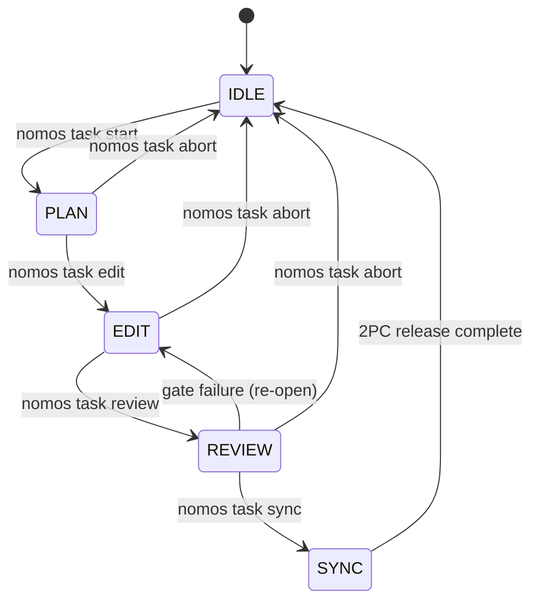

---
authors:
  - Mark Gantlett
  - Nomos Open-Core Substrate
classification: public
date: "2026-10-23"
last_updated: "2026-11-12"
lineage:
  - INT-733
  - INT-854
  - INT-864
  - INT-867
  - INT-890
  - INT-899
  - INT-929
  - SUB-1210
  - SUB-1510
  - SUB-1549
  - SUB-1558
  - SUB-1623
  - SUB-1680
  - SUB-1776
  - INT-1944
  - SUB-2157
  - INT-1961
  - SUB-2210
  - INT-1966
  - SUB-2219
  - INT-1976
  - SUB-2241
  - INT-1987
  - SUB-2283
  - INT-1989
  - SUB-2292
  - INT-1997
  - SUB-2339
plane: intent
ssot_repository: nomos
status: active
title: "Task Lifecycle CLI and Workspace State Transition Specification"
type: spec
version: "4.9.0"
---

# Task Lifecycle CLI and Workspace State Transition Specification

---

## 1. Executive Summary & Problem Statement

In Nomos v3, task management suffered from excessive fragmentation and missing state guarantees:
1. **Command Bloat**: Over 15 disparate subcommands with overlapping responsibilities (`nomos task audit`, `nomos task repair`, `nomos task sync --drift`, etc.).
2. **In-Memory Volatility in Early v4**: Early v4 scaffolding lacked persistent task storage and decoupled workspace phases from CapBAC lease tokens.
3. **Implicit Worktree Sprawl**: Loose coordination between worktree provisioning and phase transitions risked cross-worktree contamination and trunk mutation leaks.

Nomos v4 consolidates task operations into a **canonical finite state machine** with **CapBAC object capabilities** and **pure-Go SQLite persistence** (`SQLiteTaskStore`).

---

## 2. Axiomatic Invariants & Governing Laws

### `INV-TSK-001`: Procedural Phase Locking (Law 1: Dual-Core Inversion)
Procedural phase gates govern workspace mutability across lifecycle phases.

$$\text{IDLE} \xrightarrow{\text{start}} \text{PLAN} \xrightarrow{\text{edit}} \text{EDIT} \xrightarrow{\text{review}} \text{REVIEW} \xrightarrow{\text{sync}} \text{SYNC} \xrightarrow{\text{learn}} \text{IDLE}$$

The substrate rejects trunk mutations outside an active task holding a valid CapBAC lease.

### `INV-TSK-002`: Hermetic Worktree Isolation (Law 3: Hermetic Worktree)
Calling `nomos task start <KEY>` must provision an isolated git worktree at `worktrees/nomos-<KEY>` branched from clean trunk `main`. All mutations must occur strictly within this directory boundary.

### `INV-TSK-003`: CapBAC Lease Acquisition (Law 7: Fail-Closed Pre-Flight)
Transitioning into `PLAN` or `EDIT` requires acquiring a cryptographically unique `capbac.Lease` (`core/capbac/lease.go`) with an assigned `step_budget` ($\le 500$). Actions that exhaust tokens reject execution until lease renewal.

### `INV-TSK-004`: Two-Phase Commit Release Verification (Law 2: Non-Verbal Proof)
`nomos task sync <KEY> (-F <walkthrough> | -m <summary>)` executes an atomic 2PC release:
1. Executes `nomos verify` DoD quality gates (all 42 DoD quality gates must pass exit 0).
2. Verifies a non-empty walkthrough summary via `-F <walkthrough>` or inline `-m <summary>` (mutually exclusive).
3. Performs a fast-forward merge of `feature/<KEY>` into protected trunk `main`.
4. Attests the release receipt in Git Notes (`refs/notes/nomos/releases`).
5. Revokes the CapBAC lease and removes the transient worktree.

### `INV-TSK-005`: Canonical Key Singularity (Law 6: Canonical Singularity)
All task operations require canonical keys matching `^(INT|SUB)-[0-9]+(-[a-z0-9-]+)?$`. The validator rejects custom prefixes (`FEAT-`, `BUG-`, `CORE-`).

### `INV-TSK-006`: Top-Level Telemetry Visibility (Law 1: Indirect Control)
`nomos status` provides a unified non-verbal proof dashboard displaying:
- Workspace active lifecycle phase (`IDLE`, `PLAN`, `EDIT`, `REVIEW`, `SYNC`, `LEARN`).
- Active task key, plane, title, and assigned Tier 1 agent seat.
- Current worktree directory location and branch.
- CapBAC token consumption vs. step budget.
- Database connection status and pending DAG wavefront candidates.

---

## 3. Finite State Machine & Compiled Go SSoT Contracts



| Source Phase | CLI Command | Target Phase | Pre-Flight Validation | State Mutation |
| :--- | :--- | :--- | :--- | :--- |
| `IDLE` | `nomos task start <KEY>` | `PLAN` | Task exists in DB; trunk clean; key valid | Mints CapBAC lease; creates worktree |
| `PLAN` | `nomos task edit <KEY>` | `EDIT` | Worktree exists; active lease valid | Sets status `EDIT`; unlocks code mutation |
| `EDIT` | `nomos task review <KEY>` | `REVIEW` | Worktree clean/staged; lease valid | Runs DoD gates; locks further edits |
| `REVIEW` | `nomos task sync -F <file>`| `IDLE` | DoD gates exit 0; walkthrough valid | Fast-forward merge; writes Git Note; prunes WT |
| Any non-IDLE | `nomos task abort <KEY>` | `IDLE` | Task active | Revokes lease; removes worktree |

### 3.1 Compiled Go SSoT Task, Storage & Issue Contracts (`modules/task`, `core/storage`, `cli`)
`substrate/src/nomos/modules/task/`, `substrate/src/nomos/core/storage/`, and `substrate/cli/` enforce the Living Ledger schema, 3-section task cards, 2PC Git Notes receipts, SQLite WAL maintenance, and scrubbed diagnostic issue reports:

```go
package task

// Status represents the formal lifecycle state of a task.
type Status string

// SchemaType defines the plane-tailored task classification (#SchemaType).
type SchemaType string

const (
	StatusBacklog    Status = "BACKLOG"
	StatusTodo       Status = "TODO"
	StatusReady      Status = "READY"
	StatusPlan       Status = "PLAN"
	StatusEdit       Status = "EDIT"
	StatusInProgress Status = "IN_PROGRESS"
	StatusReview     Status = "REVIEW"
	StatusSync       Status = "SYNC"
	StatusDone       Status = "DONE"
	StatusBlocked    Status = "BLOCKED"
	StatusAborted    Status = "ABORTED"
)

// TaskRecord defines the formal specification for Living Ledger task records (#TaskRecord).
type TaskRecord struct {
	ID            int        `json:"id,omitempty"`
	Key           string     `json:"key"`
	Plane         string     `json:"plane"`
	Project       string     `json:"project,omitempty"`
	SchemaType    SchemaType `json:"schema_type"`
	Title         string     `json:"title"`
	Description   string     `json:"description,omitempty"`
	Status        Status     `json:"status"`
	Tier          Tier       `json:"tier"`
	Priority      int        `json:"priority"`
	CreatedAt     string     `json:"created_at"`
	UpdatedAt     string     `json:"updated_at"`
	CompletedAt   *string    `json:"completed_at,omitempty"`
	Dependencies  []string   `json:"dependencies,omitempty"`
	TwinKey       string     `json:"twin_key,omitempty"`
	Assignee      string     `json:"assignee,omitempty"`
	ArcID         string     `json:"arc_id,omitempty"`
	IntentDelta   string     `json:"intent_delta,omitempty"`
	Burden        int        `json:"burden,omitempty"`
	ContextBurden int        `json:"context_burden,omitempty"`
	ArchLayer     int        `json:"arch_layer,omitempty"`
}

// TaskCardInput models the fail-closed 3-section backlog card contract (#TaskCardInput).
type TaskCardInput struct {
	Scope              string   `json:"scope"`
	AcceptanceCriteria []string `json:"acceptance_criteria"`
	Verification       string   `json:"verification"`
	Burden             int      `json:"burden,omitempty"`
}

// WavefrontCandidate represents an unblocked DAG candidate task (#WavefrontCandidate).
type WavefrontCandidate struct {
	Key         string     `json:"key"`
	Title       string     `json:"title"`
	Plane       string     `json:"plane"`
	Project     string     `json:"project,omitempty"`
	SchemaType  SchemaType `json:"schema_type"`
	Status      Status     `json:"status"`
	Tier        Tier       `json:"tier"`
	TwinKey     string     `json:"twin_key,omitempty"`
	IsUnblocked bool       `json:"is_unblocked"`
}

// ReleaseHookTrace summarizes verified worktree tool and shell activity sealed at 2PC release (#ReleaseHookTrace).
type ReleaseHookTrace struct {
	ToolCallsCount      int      `json:"tool_calls_count"`
	ShellCommandsCount  int      `json:"shell_commands_count"`
	TestCommandsCount   int      `json:"test_commands_count"`
	DeniedInterceptions int      `json:"denied_interceptions"`
	MutatedFiles        []string `json:"mutated_files,omitempty"`
}

// ReleaseNotePayload encapsulates the non-repudiation release receipt in Git Notes (#ReleaseNotePayload).
type ReleaseNotePayload struct {
	TaskKey            string            `json:"task_key"`
	CommitSHA          string            `json:"commit_sha"`
	Timestamp          string            `json:"timestamp"`
	Phase              string            `json:"phase"`
	DoDGatesPassed     int               `json:"dod_gates_passed"`
	CapBACTokenID      string            `json:"capbac_token_id"`
	SessionID          string            `json:"session_id,omitempty"`
	HookTrace          *ReleaseHookTrace `json:"hook_trace,omitempty"`
	SpecDigests        map[string]string `json:"spec_digests,omitempty"`
	WalkthroughContent string            `json:"walkthrough_content"`
	SHA256Receipt      string            `json:"sha256_receipt"`
}

func ValidateTaskKey(key string) error
func ValidateTaskRecord(r *TaskRecord) error
func RenderTaskCardBody(in TaskCardInput) (string, error)
```

```go
package storage

// RuntimeMaintainReport summarizes bounded retention and log rotation actions (#RuntimeMaintainReport).
type RuntimeMaintainReport struct {
	ExpiredLeasesPruned int  `json:"expired_leases_pruned"`
	LegacyDBFilesPurged int  `json:"legacy_db_files_purged"`
	LogsRotated         int  `json:"logs_rotated"`
	LegacyLogDirsPurged int  `json:"legacy_log_dirs_purged"`
	Vacuumed            bool `json:"vacuumed"`
	WALCheckpointed     bool `json:"wal_checkpointed"`
}
```

```go
package cli

// SubstrateAnomalyEvent records a scrubbed, local-only substrate anomaly or gate thrash event (#SubstrateAnomalyEvent).
type SubstrateAnomalyEvent struct {
	Timestamp      string `json:"timestamp"`
	NomosVersion   string `json:"nomos_version"`
	TaskKey        string `json:"task_key,omitempty"`
	Command        string `json:"command"`
	Kind           string `json:"kind"`
	Component      string `json:"component"`
	Summary        string `json:"summary"`
	Occurrences    int    `json:"occurrences"`
	DurationMillis int64  `json:"duration_ms,omitempty"`
	Surfaced       bool   `json:"surfaced,omitempty"`
}

// IssueReport holds the collected and sanitized diagnostic report (#IssueReport).
type IssueReport struct {
	Title           string                  `json:"title"`
	Description     string                  `json:"description"`
	NomosVersion    string                  `json:"nomos_version"`
	GoVersion       string                  `json:"go_version"`
	Platform        string                  `json:"platform"`
	GitVersion      string                  `json:"git_version"`
	ActivePhase     string                  `json:"active_phase"`
	BranchTopology  string                  `json:"branch_topology"`
	IsWorktree      bool                    `json:"is_worktree"`
	DatabaseStatus  string                  `json:"database_status"`
	RecentAnomalies []SubstrateAnomalyEvent `json:"recent_anomalies,omitempty"`
}

// UpdateReport summarizes binary update evaluation, provenance guard, and workspace contract sync (#UpdateReport).
type UpdateReport struct {
	CurrentVersion        string   `json:"current_version"`
	TargetVersion         string   `json:"target_version"`
	UpdateAvailable       bool     `json:"update_available"`
	Updated               bool     `json:"updated"`
	CheckOnly             bool     `json:"check_only,omitempty"`
	InstallMethod         string   `json:"install_method"`
	BinaryPath            string   `json:"binary_path"`
	UpgradeCommand        string   `json:"upgrade_command,omitempty"`
	ChecksumSHA256        string   `json:"checksum_sha256,omitempty"`
	WorkspaceDrift        bool     `json:"workspace_drift"`
	WorkspaceDriftFiles   []string `json:"workspace_drift_files,omitempty"`
	WorkspaceSynchronized bool     `json:"workspace_synchronized,omitempty"`
}

// UpdateCheckCache persists bounded 24-hour release version discovery state (#UpdateCheckCache).
type UpdateCheckCache struct {
	CheckedAt     string `json:"checked_at"`
	LatestVersion string `json:"latest_version,omitempty"`
}
```

---

## 4. CLI Command Taxonomy & Invocation Semantics

### 4.1 `nomos status`
* **Syntax**: `nomos status [-A|--all-projects] [--json]`
* **Semantics**: Emits a Lipgloss dashboard or JSON payload scoped to the active `project` (or all projects with `-A, --all-projects`). Reports phase, task card, worktree, token budget, DB status, `In Progress` vs `Pending` counts, and DAG wavefront candidates.

### 4.2 `nomos task create`
* **Syntax**: `nomos task create <TITLE> --plane <intent|substrate> (--scope <TEXT> --ac <ITEM>... --verify <TEXT> | -F <PATH|-> | -d <MARKDOWN>) [--project <PROJECT>] [--depends-on <KEY>...] [--burden <1-10>] [--tier <T1|T2>] [--priority <int>] [--twin-of <KEY>]`
* **Semantics**: Validates the 3-section backlog card (`task.ValidateCardDescription` in `card.go`) via `--scope`/`--ac`/`--verify` or Markdown body. Auto-derives `burden` (`2-8`) when `--burden` is absent, stamps `project` from `nomos.yaml` or `--project`, and persists `INT-<N>` / `SUB-<N>` as `TODO`.

### 4.3 `nomos task start`
* **Syntax**: `nomos task start <KEY> [--edit] [--force-project]`
* **Semantics**: Validates `<KEY>` and rejects foreign `project` tasks without `--force-project`. Verifies `main` trunk, creates `worktrees/<repo>-<KEY>` on `feature/<KEY>`, mints a CapBAC lease, and enters `PLAN` (or `EDIT` with `--edit`).

### 4.4 `nomos task edit`
* **Syntax**: `nomos task edit <KEY>`
* **Semantics**: Verifies lease remains active and transitions task status and workspace phase to `EDIT`.

### 4.5 `nomos task review`
* **Syntax**: `nomos task review <KEY>`
* **Semantics**: Transitions task status to `REVIEW`; runs Definition of Done gates via `verify.Pipeline`.

### 4.6 `nomos task sync`
* **Syntax**: `nomos task sync <KEY> (-F <walkthrough_path> | -m <walkthrough_summary>)`
* **Semantics**: Accepts either `-F <walkthrough_path>` or inline `-m <walkthrough_summary>` and rejects empty or simultaneous flags (`ERR_VALIDATION_FAILED`). Auto-commits dirty worktree changes using the inline `-m` rationale or `-F` file before rebasing diverged `feature/<KEY>` branches onto trunk. Normalizes workspace `file://` links, scrubs workstation paths and credentials, and rejects prohibited boundary literals inside the walkthrough text before merge. Validates walkthrough **Receipt-Trace Parity** (`arXiv:2611.06116`) against `touchedFiles` and any `nomos hook` trace, degrading gracefully without traces. Rejects false no-mutation, single-file, or runner claims. Evaluates DoD gates once on the post-rebase tree and reuses fresh (`TTL <= 5m`) clean `HEAD^{tree}` + trunk SHA receipts. Invalidates cached receipts fail-closed on `--no-verify` commits, dirty files, or trunk SHA drift. Merges `feature/<KEY>` via `--ff-only`, writes the scrubbed receipt to `refs/notes/nomos/releases`, prunes the worktree and branch, and enters `IDLE`.

### 4.7 `nomos task abort`
* **Syntax**: `nomos task abort <KEY>`
* **Semantics**: Revokes the CapBAC lease, removes the worktree directory and unmerged `feature/<KEY>` branch, marks `<KEY>` `ABORTED`, and enters `IDLE`.

### 4.8 `nomos task prune`
* **Syntax**: `nomos task prune [--dry-run]`
* **Semantics**: Sweeps orphan `worktrees/*` directories lacking active `IN_PROGRESS` leases or uncommitted edits. Runs `git worktree prune --expire now`, removes merged `feature/*` branches, and cleans `.tmp/walkthrough-*` files during `sync` and `handshake`.

### 4.9 `nomos task list`
* **Syntax**: `nomos task list [-A|--all-projects] [--status <STATUS>] [--pending] [--plane <intent|substrate>] [--tier <T1|T2>] [--project <PROJECT>] [--limit <N>] [--json]`
* **Semantics**: Queries `tasks` scoped to the active `project` (or globally with `-A, --all-projects`) using `--status`, `--pending`, `--plane`, `--tier`, `--project`, and `--limit`. Renders a Lipgloss table with HATEOAS `Next Actions` or JSON, rejecting invalid filter values with a remedial directive.

### 4.10 `nomos task dag`
* **Syntax**: `nomos task dag [-A|--all-projects] [--plane <intent|substrate>] [--tier <T1|T2>] [--project <PROJECT>] [--limit <N>] [--json]`
* **Semantics**: Evaluates causal dependencies for the active `project` (or all projects with `-A, --all-projects`). Emits unblocked `WavefrontCandidate` records with plane, tier, project, and row-limit filters plus HATEOAS `Next Actions`.

### 4.11 `nomos task pair` / `chore` / `project` / `commit` / `show` / `status`
* **`nomos task pair <TITLE>`**: Atomically allocates twinned `INT-<N>` and `SUB-<N>` rows in `SQLiteTaskStore`, enforcing `#TaskCardInput` (`--scope` / `--int-scope` / `--sub-scope`, `--ac`, `--verify`, or `-F` / `-d`).
* **`nomos task chore <TITLE>`**: Provisions a 1-step `SUB-<N>` (or `--plane intent` `INT-<N>`) task directly into an `EDIT` worktree (`burden: 1`) without card templates.
* **`nomos task project <PROJECT> <KEY> [KEY...]`**: Updates `project` on one or more existing Living Ledger tasks through `SQLiteTaskStore` under the Database Encapsulation Invariant.
* **`nomos task commit [KEY] -m <MSG>`**: Stages and commits worktree changes as a Golden Conventional Commit (`[<KEY>] <type>(<scope>): <summary>`) with flowing rationale prose, `___` visual divider, and `Task:` / `Twin:` Git trailers.
* **`nomos task show <KEY> [--json]`**: Displays the detailed Living Ledger task inspection card, twin linkage, HATEOAS `Next Actions`, or structured JSON.
* **`nomos task status [--json]`**: Displays active workspace phase state, CapBAC step budget consumption, and HATEOAS `Next Actions` (or structured `#PhaseState` JSON).

### 4.12 `nomos update`
* **Syntax**: `nomos update [--check] [--version <TAG>] [--sync-workspace] [--dir <PATH>] [--json]`
* **Semantics**: Evaluates binary install provenance (`standalone`, `homebrew`, `aur`, `nix`, or `system`) and resolves release tags via HTTP redirect or API fallback. Verifies `checksums.txt` SHA-256 digests and atomically replaces standalone binaries, staging `.old` aside on Windows. Rejects in-place overwrites of package-manager binaries with platform-accurate upgrade remedies. Refreshes managed `AGENTS.md`, `CLAUDE.md`, ambient lifecycle hooks, and `nomos.yaml` schema tags under `--sync-workspace`. Caches release checks for 24 hours under `NOMOS_HOME` for `handshake` and `version` notices (`NOMOS_NO_UPDATE_CHECK=1` opts out).

### 4.13 Pre-Tag GoReleaser, Semver Parity & Changelog Airlock
* **Gate Coordinate**: `Cell 3.3 (release_receipt)` (`ReleaseReceiptGate`) and 2PC release readiness checks.
* **GoReleaser Template & Secret Validation**: Parses `.goreleaser.yaml` Go `text/template` fields and rejects non-canonical secret expressions on `repository.token` and `private_key` (`{{ .Env.<VAR> }}` required).
* **Statutory Semver Pin Parity**: Asserts matching release version pins across `substrate/cli/root.go` (`RootCmdVersion`), top `CHANGELOG.md` heading (`## [vX.Y.Z]`), and `packaging/aur/PKGBUILD` (`pkgver=X.Y.Z`).
* **Changelog Airlock**: Rejects workstation home prefixes, `forbidden_literals`, `prohibited_packages`, raw credentials, and Unicode em-dash or en-dash drift inside `CHANGELOG.md` before tagging.

### 4.14 Working-Tree Verification Receipt Cache
* **Unstaged Tree Hashing**: Computes deterministic working-tree OIDs via a temporary Git index (`GIT_INDEX_FILE` and `git write-tree`) during unstaged `nomos verify` runs.
* **Cross-Phase Receipt Reuse**: Reuses valid `42/42` receipts (`TTL <= 5m`, matching working-tree OID and trunk `HEAD` SHA) across `nomos verify`, `pre-commit`, `nomos task review`, and `nomos task sync`.
* **Fail-Closed Invalidation**: Purges or bypasses cached receipts on any file byte mutation, untracked file addition, trunk `HEAD` advance, `--all` scan, or `NOMOS_NO_VERIFY_CACHE=1`.

### 4.15 Day-0 Brownfield Onboarding (`nomos init` & Lean Steering)
* **Zero-Violation Boundary Inference**: `nomos init` runs `InferCleanArchitectureBoundaries` on brownfield repositories and writes verified `architecture_boundaries` rules into `nomos.yaml`.
* **Progressive Template Reference**: `templates/nomos.yaml` documents `architecture_boundaries` and `contracts` (`strict_types`, `verify_obligations`) for binary-only downstream installations.
* **Day-0 Mneme Topology Seed**: `nomos init` idempotently persists a `KindArchitecture` (`topic: "init-topology"`) memory in `mneme.db`, and `RecallRepoPatternsReadOnly` surfaces it before statutory `pattern` records exist.
* **Lean `intent_twin_mode: off` Steering**: When `intent_twin_mode` is `off` and the wavefront is empty, `nomos handshake` steers `IDLE` directly to `nomos task chore` and `sync -m`.

---

## 5. Table-Driven Verification Vectors

| Compliance Vector | Invariant | CLI Invocation | Expected Behavior |
| :--- | :--- | :--- | :--- |
| `TC-TSK-01` | Law 6 (Canonical Key) | `nomos task start FEAT-101` | Rejects key (`ERR_CANONICAL_VIOLATION`); exit 1 |
| `TC-TSK-02` | Law 3 (Hermetic Worktree) | `nomos task start SUB-1210` | Creates `worktrees/nomos-SUB-1210`; branch `feature/SUB-1210` |
| `TC-TSK-03` | Law 1 (Phase Discipline) | Direct edit on `main` in IDLE | Pre-commit hook rejects modification (`ERR_PHASE_VIOLATION`) |
| `TC-TSK-04` | Law 7 (CapBAC Lease) | `nomos task edit SUB-1210` (no lease) | Rejects edit (`ERR_CAPBAC_VIOLATION`); exit 1 |
| `TC-TSK-05` | Law 2 (2PC Non-Verbal Proof)| `nomos task sync SUB-1210 -F missing.md` | Rejects sync (missing walkthrough file); exit 1 |
| `TC-TSK-06` | Law 2 (DoD Gate Failure) | `nomos task sync SUB-1210` (gate defect)| Blocks merge; remains in REVIEW; exit 1 |
| `TC-TSK-07` | Law 3 (Release Pruning) | Successful `nomos task sync` | Merges to `main` and removes `worktrees/nomos-SUB-1210` plus `feature/SUB-1210` |
| `TC-TSK-08` | Law 4 (DAG Wavefront) | `nomos task dag --json` | Emits JSON array of `#WavefrontCandidate` |
| `TC-TSK-09` | Law 3 (Orphan Worktree GC) | `nomos task prune` | Sweeps orphan `worktrees/*` directories and `feature/*` branches; preserves `IN_PROGRESS` worktrees |
| `TC-TSK-10` | Law 7 (Fail-Closed Card) | `nomos task create "Title" -d "plain paragraph"` | Rejects unstructured prose (`ERR_VALIDATION_FAILED`) with HATEOAS remedy; exit 1 |
| `TC-TSK-11` | Law 4 (Card Synthesis) | `nomos task create "Title" --scope "..." --ac "..." --verify "..."` | Synthesizes canonical 3-section card and non-zero `burden`; exit 0 |
| `TC-TSK-12` | Law 1 (Fast-Lane Chore) | `nomos task chore "Quick fix"` | Provisions `EDIT` worktree in 1 turn; exit 0 |
| `TC-TSK-13` | Law 4 (Filtered Ledger Query) | `nomos task list --pending --plane substrate --limit 10 --json` | Emits up to 10 pending substrate tasks; exit 0 |
| `TC-TSK-14` | Law 7 (Fail-Closed Filter) | `nomos task list --status BOGUS` | Rejects unknown status (`ERR_VALIDATION_FAILED`) with remedy; exit 1 |
| `TC-TSK-15` | Law 4 (Multi-Repo Ledger Isolation) | `nomos task list` vs `nomos task list -A` | Scopes to active `project` unless `-A` passed; exit 0 |
| `TC-TSK-16` | Law 7 (Cross-Project Start Guard) | `nomos task start SUB-99` (foreign `project`) | Rejects foreign task (`ERR_VALIDATION_FAILED`) without `--force-project`; exit 1 |
| `TC-TSK-17` | Law 2 (Receipt-Trace Parity) | `nomos task sync SUB-99 -F walkthrough.md` (contradicts diff or hook trace) | Rejects walkthrough diff contradiction; degrades gracefully without hook trace |
| `TC-SYNC-020` | Law 2 (Pre-Verify Rebase & Receipt Cache) | `nomos task commit` -> `nomos task sync` | Rebases before verify; reuses clean tree+trunk receipts; invalidates on drift |
| `TC-SYNC-021` | Law 5 & Law 7 (Walkthrough Airlock) | `nomos task sync` with `file://` home path or prohibited package literal | Scrubs workspace/home paths; rejects prohibited boundary literals before merge |
| `TC-SYNC-022` | Law 4 & Law 7 (GoReleaser & Semver Parity) | `nomos verify` on malformed `.goreleaser.yaml` template or drifted `PKGBUILD` `pkgver` | `ReleaseReceiptGate` rejects template syntax error or semver pin drift |
| `TC-SYNC-023` | Law 5 & Law 7 (Changelog Airlock) | `nomos verify` on `CHANGELOG.md` containing home path or prohibited package | `ReleaseReceiptGate` rejects unsanitized `CHANGELOG.md` literal before release tag |
| `TC-SYNC-024` | Law 2 (Working-Tree Verify Receipt Cache) | Unstaged `nomos verify` -> `nomos task commit` -> `nomos task sync` | Computes temp-index tree SHA once; reuses fresh receipt across `pre-commit` and `sync` |
| `TC-SYNC-025` | Law 1 & Law 2 (Inline 1-Turn Sync) | `nomos task sync SUB-99 -m "<summary>"` vs `-m` + `-F` | Merges and seals receipt in 1 call; rejects `-m` with `-F` |
| `TC-SCH-01` | Law 4 (Intent Schema Type) | `TaskRecord{Key: "INT-101", Plane: "intent", SchemaType: "intent"}` | Validates intent plane schema binding cleanly |
| `TC-SCH-02` | Law 4 (Substrate Schema Type) | `TaskRecord{Key: "SUB-101", Plane: "substrate", SchemaType: "substrate"}` | Validates substrate plane schema binding cleanly |
| `TC-SCH-03` | Law 7 (Plane-Key Mismatch) | `TaskRecord{Key: "INT-101", Plane: "substrate"}` | Rejects cross-plane key/plane mismatch (`ERR_VALIDATION_FAILED`) |
| `TC-SCH-04` | Law 4 (3-Section Card Render) | `RenderTaskCardBody(TaskCardInput{Scope: "...", AcceptanceCriteria: [...], Verification: "..."})` | Emits canonical 3-section Markdown card body |
| `TC-DBNOTE-001` | Law 3 (2PC Receipt Seal) | `ReleaseNotePayload` with `DoDGatesPassed: 42` and `SHA256Receipt` | Serializes non-repudiation Git Notes JSON payload |
| `TC-DBNOTE-002` | Law 2 (Hook Trace Attestation) | `ReleaseHookTrace{ToolCallsCount: 4, TestCommandsCount: 1}` | Embeds verified hook trace inside `ReleaseNotePayload` |
| `TC-DBNOTE-003` | Law 4 (Spec Digest Stamping) | `ReleaseNotePayload.SpecDigests` populated at `SUB-*` sync | Stamps 64-hex SHA-256 digests per referenced spec |
| `TC-DBNOTE-004` | Law 7 (Tampered Receipt Detection) | Mismatched `SHA256Receipt` in `refs/notes/nomos/releases` | `ReleaseReceiptGate` rejects tampered release receipt |
| `TC-SQL-01` | Law 4 (Pure-Go SQLite WAL) | `storage.OpenDB(dbPath)` (`modernc.org/sqlite`) | Initializes `tasks`, `leases`, and `telemetry_capabilities` with WAL mode |
| `TC-SQL-02` | Law 7 (Foreign Key Integrity) | `InitSchema(db)` applies `PRAGMA foreign_keys = ON` | Enforces cascading foreign-key constraints on `leases` |
| `TC-SQL-03` | Law 1 (Runtime Storage Maintenance) | `MaintainRuntimeStorage(true)` | Prunes expired leases, checkpoints WAL, and rotates oversized logs |
| `TC-SQL-04` | Law 2 (Freelist Vacuum Threshold) | `VacuumIfFragmented(db, minReclaimBytes)` | Executes SQLite `VACUUM` when reclaimable pages exceed threshold |
| `TC-ISS-01` | Law 5 (Diagnostic Path Scrubbing) | `nomos issue "Gate defect"` (`IssueReport`) | Scrubs workstation home paths and environment secrets |
| `TC-ISS-02` | Law 2 (Anomaly Ring Buffer) | `SubstrateAnomalyEvent` recorded on gate thrash or slow probe | Surfaces recent scrubbed anomaly events in `IssueReport` |
| `TC-ISS-03` | Law 4 (Structured JSON Export) | `nomos issue "Report" --json` | Emits deterministic `IssueReport` JSON payload |
| `TC-ISS-04` | Law 7 (Non-Interactive Web Guard) | `nomos issue "Report" --web` in non-interactive session | Rejects browser launch or degrades safely with URL output |
| `TC-ISS-05` | Law 7 (Browser URL Scheme Guard) | `openBrowser` invoked with non-HTTPS scheme | Rejects unsafe URL scheme before subprocess execution |
| `TC-ISS-06` | Law 1 (Offline Diagnostic Bundle) | `nomos issue "Report"` without network connectivity | Writes local scrubbed Markdown report without external egress |
| `TC-UPD-001` | Law 6 (Canonical Update Verb) | `nomos update --check --json` | Emits `UpdateReport` JSON without duplicate `upgrade` aliases |
| `TC-UPD-002` | Law 7 (Package-Manager Guard) | `nomos update` on Homebrew or AUR binary path | Rejects binary overwrite (`ERR_BOUNDARY_VIOLATION`) with package-manager remedy |
| `TC-UPD-003` | Law 2 (SHA-256 Archive Proof) | `nomos update` with mismatched `checksums.txt` digest | Rejects tampered archive (`ERR_VALIDATION_FAILED`) before binary swap |
| `TC-UPD-004` | Law 1 (24h Cached Update Notice) | `nomos handshake` / `nomos version` cached check | Emits 24h cached update notice; honors `NOMOS_NO_UPDATE_CHECK=1` |
| `TC-UPD-005` | Law 4 (Workspace Contract Refresh) | `nomos update --sync-workspace` on drifted workspace | Detects managed template drift and refreshes contracts idempotently |
| `TC-UPD-006` | Law 5 & Law 7 (Windows Swap & Linux Provenance) | `AtomicReplaceBinary` over active binary and non-Arch `/usr/bin/nomos` | Stages `.old` backup cleanly on Windows and classifies non-Arch `/usr/bin` as `system` |
| `TC-INIT-01` | Law 4 & Law 7 (Day-0 Boundary & Mneme Seed) | `nomos init` on layered brownfield repo | Scaffolds zero-violation `architecture_boundaries` and seeds `mneme.db` idempotently |
| `TC-INIT-02` | Law 1 (Cold-Start Recall & Lean Steering) | `nomos handshake` with `intent_twin_mode: off` and zero `pattern` records | Recalls Day-0 `architecture` memory and steers `IDLE` to `chore` |

---

## 6. Cross-Plane Traceability & DoD Verification

| Intent Lifecycle Contract | Compiled Go SSoT Path | Enforcing 7x3 Matrix Cell |
| :--- | :--- | :--- |
| Domain models & 2-plane key validation (`TaskRecord`) | `substrate/src/nomos/modules/task/task.go`, `card.go` | `Cell 6.3 (canonical_singularity)` |
| Pure-Go SQLite ledger store (`SQLiteTaskStore`) | `substrate/src/nomos/modules/task/sqlite_store.go`, `project.go` | `Cell 1.2 (phase_discipline)`, `Cell 7.2 (unchecked_errors)` |
| CapBAC task lease enforcement (`capbac.Lease`) | `substrate/src/nomos/core/capbac/lease.go` | `Cell 1.3 (capbac_lease)` |
| Worktree lifecycle, 2PC sync & Git Notes receipts | `substrate/cli/cmd_task.go`, `substrate/src/nomos/modules/task/git_notes.go` | `Cell 3.2 (hermetic_worktree)`, `Cell 3.3 (release_receipt)` |

Run `nomos verify` to execute all 42 Definition of Done quality gates and confirm exit code `0`.
