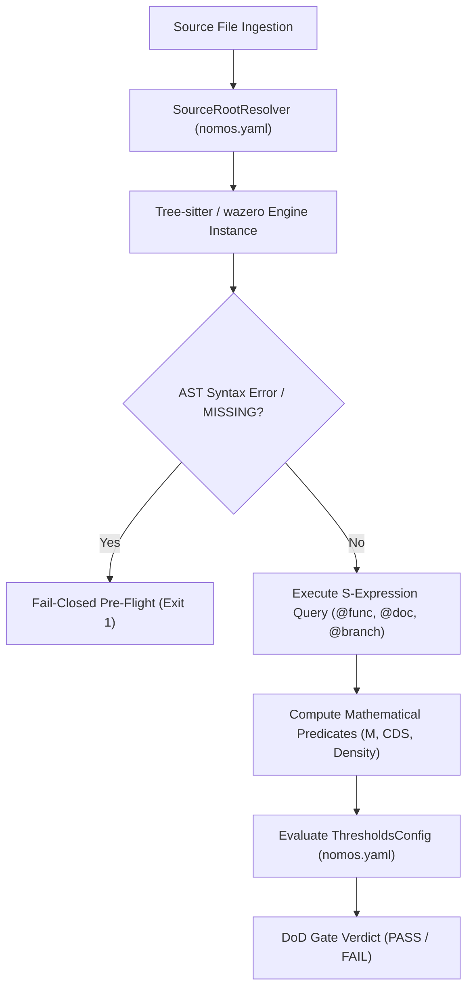

---
authors:
  - Mark Gantlett
  - Nomos Open-Core Substrate
classification: public
date: "2026-10-05"
plane: intent
ssot_repository: nomos
status: active
title: "Tree-sitter AST Gate Engine to Replace Legacy Gen 2 Regex Gates"
type: spec
---

# Tree-sitter AST Gate Engine

---

## 1. Executive Summary & Problem Statement

Gen 2 Nomos quality gates relied on line-scanning regex heuristics for complexity, docstring density, and forbidden literal audits. Regex scanning broke on polyglot workspaces and produced false positives inside comments and multiline strings. Line heuristics also lacked structural awareness of nested syntax trees.

In strict compliance with **Law 2 (The Non-Verbal Proof Law)**, this specification formalizes the **Tree-sitter AST Gate Engine**. The engine integrates Tree-sitter query rules and polyglot structural scanners across Go, TypeScript, Svelte, Python, Rust, C/C++, Java, Kotlin, C#, and Markdown. Under Nomos v4, pure-Go `wazero` (`github.com/tetratelabs/wazero`) executes linear-memory WebAssembly scanning hermetically without CGo or external process spawns. The engine binds directly to `treesitter.WazeroTreeSitterEngine` and `treesitter.GateEvaluationReport` (`substrate/src/nomos/modules/verify/treesitter/types.go`). It evaluates extracted AST metrics against `config.ThresholdsConfig` (`nomos.yaml` and `nomos.schema.json`) across all 42 DoD gates.



---

## 2. Axiomatic Invariants & Governing Laws

| Law # | Law Name | Architectural Invariant Enforced in Tree-sitter Engine |
| :---: | :--- | :--- |
| **Law 2** | **The Non-Verbal Proof Law** | Enforces deterministic AST proof and prohibits regex source matching in gates. |
| **Law 4** | **The Single Source of Truth Law** | Embeds queries via `//go:embed` mapping to `FunctionMetric`, `FileMetric`, and `config.ThresholdsConfig`. |
| **Law 5** | **The Zero-Hardcoded-Path Law** | Resolves roots dynamically via `#SourceRootConfig` with zero hardcoded path literals. |
| **Law 6** | **The Canonical Singularity Law** | Evaluates all supported languages through one canonical `WazeroTreeSitterEngine` runtime. |
| **Law 7** | **The Fail-Closed Pre-Flight Law** | Syntax `ERROR` or `MISSING` nodes trigger immediate pre-flight abort (exit 1). |

---

## 3. Architectural Decisions & Mathematical Predicates

### 3.1 S-Expression Query Specifications Across Languages
The substrate embeds Tree-sitter queries via `//go:embed queries/*` to extract function boundaries, comments, and decision branches:

#### 1. Go Query (`queries/go.scm`)
```scheme
;; Function and Method declarations with preceding comments
((comment)* @func.doc
 .
 [(function_declaration name: (identifier) @func.name body: (block) @func.body)
  (method_declaration name: (field_identifier) @func.name body: (block) @func.body)])

;; Complexity decision branch nodes
[(if_statement)
 (for_statement)
 (expression_case_clause)
 (type_case_clause)
 (communication_case_clause)
 (binary_expression operator: "&&")
 (binary_expression operator: "||")] @branch
```

#### 2. TypeScript / JavaScript Query (`queries/typescript.scm`)
```scheme
;; Function declarations, methods, and arrow functions
((comment)* @func.doc
 .
 [(function_declaration name: (identifier) @func.name body: (statement_block) @func.body)
  (method_definition name: (property_identifier) @func.name body: (statement_block) @func.body)
  (lexical_declaration (variable_declarator name: (identifier) @func.name value: (arrow_function body: (statement_block) @func.body)))])

;; Complexity decision branch nodes
[(if_statement)
 (for_statement)
 (for_in_statement)
 (while_statement)
 (switch_case)
 (catch_clause)
 (ternary_expression)
 (binary_expression operator: "&&")
 (binary_expression operator: "||")
 (binary_expression operator: "??")] @branch
```

#### 3. Python Query (`queries/python.scm`)
```scheme
;; Function and method definitions
((comment)* @func.doc
 .
 (function_definition name: (identifier) @func.name body: (block) @func.body))

;; Complexity decision branch nodes
[(if_statement)
 (for_statement)
 (while_statement)
 (except_clause)
 (boolean_operator)] @branch
```

### 3.2 Concrete Mathematical Predicates

#### 1. Cyclomatic Complexity ($M$)
For any function node $F$, the engine computes cyclomatic complexity as:

$$M(F) = 1 + \sum_{b \in F} \mathbb{I}(b \in \text{Branches})$$

Language-specific `@branch` S-expression queries capture all branch nodes. The function passes `Cell 1.1 (complexity)` when $M(F) \le \text{thresholds.max\_complexity}$ (default: 15).

#### 2. Docstring Adjacency & Density
A function possesses a valid docstring when a comment node precedes the declaration within vertical distance $\Delta \text{line} \le 1$.

$$\text{Docstring Density} = \left( \frac{\text{documented functions}}{\text{total functions}} \right) \times 100$$

The workspace passes `Cell 2.1 (docstrings)` when $\text{Docstring Density} \ge \text{thresholds.min\_docstring\_density}$ (default: 10%).

#### 3. Cognitive Debt Score ($CDS$)
For any source file $S$ containing functions $F_1, \dots, F_k$:

$$CDS(S) = \sum_{i=1}^k \left( \max(0, M(F_i) - 10) \times 2.0 + \max(0, \text{LOC}(F_i) - 30) \times 0.5 \right) + \max(0, 100 - \text{Density}) \times 0.2$$

The file passes `Cell 1.1 (cognitive_debt)` when $CDS(S) \le \text{thresholds.max\_cds}$ (default: 45).

---

## 4. Formal Go Contracts & Canonical 7x3 Sensor Bindings

### 4.1 Thresholds Configuration (`config.ThresholdsConfig` / `nomos.schema.json`)
The engine evaluates extracted AST metrics deterministically against `config.ThresholdsConfig`:

```json
{
  "max_cognitive_debt_score": 45,
  "max_cyclomatic_complexity": 15,
  "max_file_loc": 400,
  "max_func_loc": 60,
  "min_comment_density_pct": 10,
  "min_test_coverage_pct": 55,
  "max_package_files": 40
}
```

### 4.2 Substrate Go Engine Contract (`substrate/src/nomos/modules/verify/treesitter/types.go`)
```go
package treesitter

import "embed"

//go:embed queries/*
var QueryFS embed.FS

// FunctionMetric captures per-function complexity and line count metrics.
type FunctionMetric struct {
	File       string `json:"file"`
	Line       int    `json:"line"`
	Name       string `json:"name"`
	Complexity int    `json:"complexity"`
	LOC        int    `json:"loc"`
	Documented bool   `json:"documented"`
	EmptyBlock bool   `json:"empty_block,omitempty"`
}

// FileMetric captures per-file line count and cognitive debt metrics.
type FileMetric struct {
	Name string `json:"name"`
	LOC  int    `json:"loc"`
	CDS  int    `json:"cds"`
}

// GateEvaluationReport aggregates polyglot AST verification findings.
type GateEvaluationReport struct {
	Functions       []FunctionMetric `json:"functions"`
	Files           []FileMetric     `json:"files"`
	Documented      int              `json:"documented"`
	Total           int              `json:"total"`
	Density         int              `json:"density"`
	EmptyBlocks     []string         `json:"empty_blocks,omitempty"`
	SkippedTests    []string         `json:"skipped_tests,omitempty"`
	HeadingLevels   []int            `json:"heading_levels,omitempty"`
	OutlineVerified bool             `json:"outline_verified,omitempty"`
	Passed          bool             `json:"pass"`
}

// EngineThresholds holds DoD thresholds for polyglot evaluation (#EngineThresholds).
type EngineThresholds struct {
	MaxComplexity       int
	MaxFuncLOC          int
	MaxFileLOC          int
	MaxCDS              int
	MinDocstringDensity int
}

// SCMQuerySpec holds parsed S-expression query rules for a target language (#SCMQuerySpec).
type SCMQuerySpec struct {
	Language    string
	RawSource   string
	Captures    map[string]bool
	BranchNodes []string
}

// WazeroTreeSitterEngine executes pure-Go WebAssembly Tree-sitter AST analysis (#WazeroTreeSitterEngine).
type WazeroTreeSitterEngine struct{}

func CalculateCDS(functions []FunctionMetric, density int) int
func ValidateQueryFS() error
```

### 4.3 Canonical 7x3 Matrix Sensor Bindings
The Tree-sitter AST Gate Engine directly underpins six automated sensor probes in `substrate/src/nomos/modules/verify/matrix.go`:

1. **`Cell 2.1 (anti_shim)`**: Detects empty AST blocks, stub bodies, or no-op returns (`return nil`, `{}`) via query `@empty_block`.
2. **`Cell 2.1 (docstrings)`**: Evaluates docstring adjacency across all exported functions via `@func.doc`.
3. **`Cell 1.1 (complexity)`**: Computes $M(F)$ for every function using compiled `@branch` queries and emits `file:start-end` 1-turn extraction targets on complexity, LOC, or arity breaches.
4. **`Cell 1.1 (max_file_loc)`**: Enforces file line limits and per-directory source fan-out (`max_package_files`, default `40`), monotonically ratcheting pre-existing legacy directories on zero-net-file edits.
5. **`Cell 1.1 (cognitive_debt)`**: Enforces $CDS \le 45$ on strict files, preserves baselines across `git diff --find-renames=50%` moves, and emits `PrescribeRatchetedCDSRecipe`.
6. **`Cell 5.1 (magic_strings)`**: Scans string literal AST nodes across Go, TypeScript, and Svelte for unconfigured localhost ports or URLs.
7. **`FastFileRadar (CWE-22)`**: Flags unconfined dynamic subpath reads under `base_dir`/`baseDir`, ignores constant literal subpaths, and emits language-specific 1-turn confinement recipes.

---

## 5. Table-Driven Verification Vectors

The following table-driven verification vectors validate the Tree-sitter AST Gate Engine:

| Vector ID | Source Language | Input Code Snippet | Expected AST Extraction | Metric Calculations | Gate Verdict | Failure Invariant |
| :---: | :--- | :--- | :--- | :--- | :--- | :--- |
| `TC-TS-01` | `go` | `// Exec runs task\nfunc Exec() error { if err := step(); err != nil { return err }; return nil }` | `func: Exec`, `doc: true`, `branches: 1` | $M = 2$, $\text{LOC} = 2$, $\text{doc} = 100\%$ | `PASS` | Clean Go function with valid docstring |
| `TC-TS-02` | `go` | `func Incomplete() { ERROR_SYNTAX }` | `tree-sitter ERROR node detected` | N/A | `FAIL` | Law 7: Syntax error triggers fail-closed pre-flight abort |
| `TC-TS-03` | `typescript` | `export const handle = (req: Req) => { if (a && b || c) { return d; } };` | `func: handle`, `doc: false`, `branches: 3` | $M = 4$, $\text{LOC} = 1$, $\text{doc} = 0\%$ | `PASS` | TS arrow function with boolean short-circuit branches |
| `TC-TS-04` | `python` | `def dispatch(event):\n    if event:\n        for item in event: pass` | `func: dispatch`, `doc: false`, `branches: 2` | $M = 3$, $\text{LOC} = 3$, $\text{doc} = 0\%$ | `PASS` | Python function with if and for branches |
| `TC-TS-05` | `go` | `func Complex() { /* 16 nested if statements */ }` | `func: Complex`, `branches: 16` | $M = 17 > 15$ | `FAIL` | `Cell 1.1 (complexity)`: Cyclomatic complexity threshold exceeded |
| `TC-TS-06` | `typescript` | `/** Valid JSDoc */\nfunction calc(): void {}` | `func: calc`, `doc: true`, `branches: 0` | $M = 1$, $\text{doc} = 100\%$ | `PASS` | TS JSDoc comment adjacency recognized |
| `TC-TS-07` | `go` | `func Shim() {}` | `empty_block detected` | $\text{LOC} = 1$ | `FAIL` | `Cell 2.1 (anti_shim)`: Anti-Shim AST invariant violation |
| `TC-TS-08` | `markdown` | `# Section\n## Sub\nParagraph` | `heading levels: [1, 2]` | Structural outline verified | `PASS` | Intent plane markdown structural AST parsing |
| `TC-TS-09` | `svelte` | `<script lang="ts">\n  let count = 0;\n  function increment() {\n    if (count < 10) count++;\n  }\n</script>\n\n<button on:click={increment}>{count}</button>` | `<script>` block extracted, `func: increment`, `branches: 1` | $M = 2$, $\text{LOC} = 3$, line offset mapped | `PASS` | Svelte embedded script AST extraction and metric calculation |
| `TC-TS-10` | `wasm` | Pure Go embedded bytecode `TreeSitterWasmBytecode` | `wazero.Runtime` compilation & module instantiation | Zero CGo, execution exit code 0 | `PASS` | Pure-Go hermetic WebAssembly execution verified (`wazero`) |
| `TC-POLY-001` | `rust` | `/// Documented fn\npub fn compute(x: i32) -> i32 { if x > 0 { x } else { 0 } }` | `func: compute`, `doc: true`, `branches: 1` | $M = 2$, $\text{doc} = 100\%$ | `PASS` | Rust `queries/rust.scm` branch and docstring extraction |
| `TC-POLY-002` | `cpp` | `int evaluate(int a) { if (a > 1 && a < 10) return a; return 0; }` | `func: evaluate`, `branches: 2` | $M = 3$, $\text{LOC} = 1$ | `PASS` | C/C++ `queries/cpp.scm` AST branch extraction |
| `TC-POLY-003` | `java` | `/** JavaDoc */\npublic int run(int v) { for (int i=0; i<v; i++) {} return v; }` | `func: run`, `doc: true`, `branches: 1` | $M = 2$, $\text{doc} = 100\%$ | `PASS` | JVM (`java`/`kotlin`) AST metric extraction |
| `TC-POLY-004` | `csharp` | `public int Check(int x) { if (x == 0) return 1; return x; }` | `func: Check`, `branches: 1` | $M = 2$, $\text{LOC} = 1$ | `PASS` | C# `queries/csharp.scm` AST metric extraction |
| `TC-TS-11` | `polyglot` | Function exceeds `V(G)`, `LOC`, `MaxFuncParams`, or brownfield `dCDS` | Span `file:start-end` + delta | Exact excess computed | `FAIL` | 1-turn extraction recipe emitted (`go`, `python`, `typescript`) |
| `TC-TS-12` | `polyglot` | Directory exceeds `MaxPackageFiles` (`40` non-test files) | Directory fan-out counted | Strict or net-new growth | `FAIL` | Sub-package cohesion recipe emitted; legacy brownfield count ratcheted |
| `TC-TS-13` | `polyglot` | Legacy file moved via `git mv` during sub-package split | Rename map `git diff -M50%` resolved | Baseline metrics preserved | `PASS` | Rename-aware baseline lookup prevents false greenfield penalties |
| `TC-TS-14` | `polyglot` | Dynamic `baseDir` subpath read vs constant literal subpath | Untrusted vs constant join classified | Language recipe selected | `PASS` | Dynamic traversal fails with language recipe; constant subpath passes |

---

## 6. Cross-Plane Traceability & DoD Verification

| Intent AST Contract | Compiled Go SSoT Path | Enforcing 7x3 Matrix Cell |
| :--- | :--- | :--- |
| Metric types & CDS formula (`FunctionMetric`, `CalculateCDS`) | `substrate/src/nomos/modules/verify/treesitter/types.go` | `Cell 1.1 (complexity / max_file_loc / cognitive_debt)` |
| Pure-Go `wazero` WASM sandbox (`WazeroTreeSitterEngine`) | `substrate/src/nomos/modules/verify/treesitter/engine.go` | `Cell 4.2 (contract_parity)`, `Cell 2.2 (go_toolchain)` |
| Embedded `.scm` S-expression queries & polyglot scanners | `substrate/src/nomos/modules/verify/treesitter/scm_query.go`, `polyglot_scanner.go` | `Cell 2.1 (anti_shim / docstrings)`, `Cell 5.1 (magic_strings)` |

Run `nomos verify` to execute all 42 Definition of Done quality gates and confirm exit code `0`.
