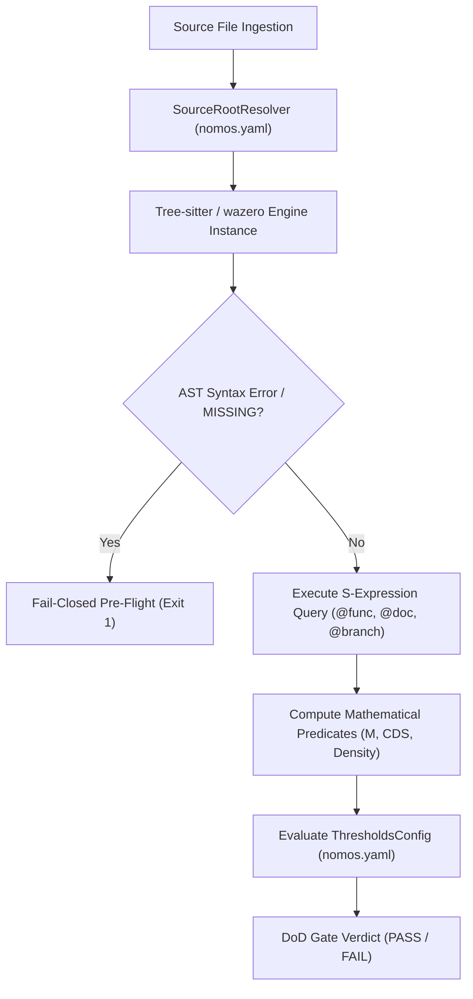

---
authors:
  - Mark Gantlett
  - Nomos Open-Core Substrate
classification: public
date: "2026-10-05"
plane: intent
ssot_repository: nomos
status: active
title: "Tree-sitter AST Gate Engine to Replace Legacy Gen 2 Regex Gates"
type: spec
---

# Tree-sitter AST Gate Engine

---

## 1. Executive Summary & Problem Statement

Gen 2 Nomos quality gates relied on line-scanning regex heuristics for complexity, docstring density, and forbidden literal audits. Regex scanning broke on polyglot workspaces and produced false positives inside comments and multiline strings. Line heuristics also lacked structural awareness of nested syntax trees.

In strict compliance with **Law 2 (The Non-Verbal Proof Law)**, this specification formalizes the **Tree-sitter AST Gate Engine**. It integrates unified structural, wrapper, idiom, exception, and clone scanners across Go, TypeScript, Svelte, Python, Ruby, Rust, C/C++, Java, Kotlin, and C#. It also validates HTML, CSS, YAML, and Markdown files.

Under Nomos v4, pure-Go `wazero` (`github.com/tetratelabs/wazero`) executes linear-memory WebAssembly scanning hermetically without CGo or external process spawns. The engine binds directly to `treesitter.WazeroTreeSitterEngine` and `treesitter.GateEvaluationReport` (`substrate/src/nomos/modules/verify/treesitter/types.go`). It evaluates extracted AST metrics against `config.ThresholdsConfig` (`nomos.yaml` and `nomos.schema.json`) across all 42 DoD gates.



---

## 2. Axiomatic Invariants & Governing Laws

| Law # | Law Name | Architectural Invariant Enforced in Tree-sitter Engine |
| :---: | :--- | :--- |
| **Law 2** | **The Non-Verbal Proof Law** | Enforces deterministic AST proof and prohibits regex source matching in gates. |
| **Law 4** | **The Single Source of Truth Law** | Embeds queries via `//go:embed` mapping to `FunctionMetric`, `FileMetric`, and `config.ThresholdsConfig`. |
| **Law 5** | **The Zero-Hardcoded-Path Law** | Resolves roots dynamically via `#SourceRootConfig` with zero hardcoded path literals. |
| **Law 6** | **The Canonical Singularity Law** | Evaluates all supported languages through one canonical `WazeroTreeSitterEngine` runtime. |
| **Law 7** | **The Fail-Closed Pre-Flight Law** | Syntax `ERROR` or `MISSING` nodes trigger immediate pre-flight abort (exit 1). |

---

## 3. Architectural Decisions & Mathematical Predicates

### 3.1 S-Expression Query Specifications Across Languages
The substrate embeds Tree-sitter queries via `//go:embed queries/*` to extract function boundaries, comments, and decision branches:

#### 1. Go Query (`queries/go.scm`)
```scheme
;; Function and Method declarations with preceding comments
((comment)* @func.doc
 .
 [(function_declaration name: (identifier) @func.name body: (block) @func.body)
  (method_declaration name: (field_identifier) @func.name body: (block) @func.body)])

;; Complexity decision branch nodes
[(if_statement)
 (for_statement)
 (expression_case_clause)
 (type_case_clause)
 (communication_case_clause)
 (binary_expression operator: "&&")
 (binary_expression operator: "||")] @branch
```

#### 2. TypeScript / JavaScript Query (`queries/typescript.scm`)
```scheme
;; Function declarations, methods, and arrow functions
((comment)* @func.doc
 .
 [(function_declaration name: (identifier) @func.name body: (statement_block) @func.body)
  (method_definition name: (property_identifier) @func.name body: (statement_block) @func.body)
  (lexical_declaration (variable_declarator name: (identifier) @func.name value: (arrow_function body: (statement_block) @func.body)))])

;; Complexity decision branch nodes
[(if_statement)
 (for_statement)
 (for_in_statement)
 (while_statement)
 (switch_case)
 (catch_clause)
 (ternary_expression)
 (binary_expression operator: "&&")
 (binary_expression operator: "||")
 (binary_expression operator: "??")] @branch
```

#### 3. Python Query (`queries/python.scm`)
```scheme
;; Function and method definitions
((comment)* @func.doc
 .
 (function_definition name: (identifier) @func.name body: (block) @func.body))

;; Complexity decision branch nodes
[(if_statement)
 (for_statement)
 (while_statement)
 (except_clause)
 (boolean_operator)] @branch
```

#### 4. Java Query (`queries/java.scm`)
```scheme
;; Method and constructor declarations in Java
((block_comment)* @func.doc
 .
 [(method_declaration name: (identifier) @func.name body: (block) @func.body)
  (constructor_declaration name: (identifier) @func.name body: (constructor_body) @func.body)])

;; Complexity decision branch nodes
[(if_statement)
 (for_statement)
 (enhanced_for_statement)
 (while_statement)
 (do_statement)
 (switch_label)
 (catch_clause)
 (ternary_expression)
 (binary_expression operator: "&&")
 (binary_expression operator: "||")] @branch

;; Anti-shim stub patterns (Gate 10)
[(throw_statement (object_creation_expression type: (type_identifier) @shim.stub))]

;; Test skip / reward-hacking annotations
[(marker_annotation name: (identifier) @test.skip)]
```

#### 5. C# Query (`queries/csharp.scm`)
```scheme
;; Method and constructor declarations in C#
((comment)* @func.doc
 .
 [(method_declaration name: (identifier) @func.name body: (block) @func.body)
  (constructor_declaration name: (identifier) @func.name body: (block) @func.body)])

;; Complexity decision branch nodes
[(if_statement)
 (for_statement)
 (foreach_statement)
 (while_statement)
 (do_statement)
 (switch_section)
 (catch_clause)
 (conditional_expression)
 (binary_expression operator: "&&")
 (binary_expression operator: "||")
 (binary_expression operator: "??")] @branch

;; Anti-shim stub patterns (Gate 10)
[(throw_statement (object_creation_expression type: (identifier) @shim.stub))]

;; Test skip / reward-hacking attributes
[(attribute name: (identifier) @test.skip)]
```

### 3.2 Concrete Mathematical Predicates

#### 1. Cyclomatic Complexity ($M$)
For any function node $F$, the engine computes cyclomatic complexity as:

$$M(F) = 1 + \sum_{b \in F} \mathbb{I}(b \in \text{Branches})$$

Language-specific `@branch` S-expression queries capture all branch nodes. Go and brace-language functions pass `Cell 1.1 (complexity)` when $M(F) \le \text{thresholds.max\_complexity}$ (default: `15`). Python and Ruby indent-language functions default to `MaxPolyglotCyclomaticComplexity` (`10`) when `thresholds.max_complexity` remains `15`. Explicit overrides and brownfield baseline ratchets remain honored across all languages.

#### 2. Docstring Adjacency & Density
A function possesses a valid docstring when a comment node precedes the declaration within vertical distance $\Delta \text{line} \le 1$.

$$\text{Docstring Density} = \left( \frac{\text{documented functions}}{\text{total functions}} \right) \times 100$$

The workspace passes `Cell 2.1 (docstrings)` when $\text{Docstring Density} \ge \text{thresholds.min\_docstring\_density}$ (default: 10%).

#### 3. Cognitive Debt Score ($CDS$)
For any source file $S$ containing functions $F_1, \dots, F_k$:

$$CDS(S) = \sum_{i=1}^k \left( \max(0, M(F_i) - 10) \times 2.0 + \max(0, \text{LOC}(F_i) - 30) \times 0.5 \right) + \max(0, 100 - \text{Density}) \times 0.2$$

The file passes `Cell 1.1 (cognitive_debt)` when $CDS(S) \le \text{thresholds.max\_cds}$ (default: 45).

### 3.3 Managed WASM Grammar Drivers & Anti-Shim Contracts
`WazeroTreeSitterEngine` instantiates dedicated Java (`treesitter_java_wasm`) and C# (`treesitter_csharp_wasm`) WebAssembly modules inside `wazero` with `CGO_ENABLED=0`. Each module verifies `{}`/`()`/`[]` block balance and counts statement terminators in linear memory. Anti-shim evaluation rejects empty bodies, placeholder exception throws, and single-statement constant-return stubs on parameterized methods. `ExtractExportedSymbols` and `mtpo.ExtractFileASTSets` index `public` Java and C# types and methods for collision and impact graphs.

---

## 4. Formal Go Contracts & Canonical 7x3 Sensor Bindings

### 4.1 Thresholds Configuration (`config.ThresholdsConfig` / `nomos.schema.json`)
The engine evaluates extracted AST metrics deterministically against `config.ThresholdsConfig`:

```json
{
  "max_cognitive_debt_score": 45,
  "max_cyclomatic_complexity": 15,
  "max_file_loc": 400,
  "max_func_loc": 60,
  "min_comment_density_pct": 10,
  "min_test_coverage_pct": 55,
  "max_package_files": 40
}
```

### 4.2 Substrate Go Engine Contract (`substrate/src/nomos/modules/verify/treesitter/types.go`)
```go
package treesitter

import (
	"context"
	"embed"
)

//go:embed queries/*
var QueryFS embed.FS

// FunctionMetric captures per-function complexity and line count metrics.
type FunctionMetric struct {
	File       string `json:"file"`
	Line       int    `json:"line"`
	Name       string `json:"name"`
	Complexity int    `json:"complexity"`
	LOC        int    `json:"loc"`
	Documented bool   `json:"documented"`
	EmptyBlock bool   `json:"empty_block,omitempty"`
}

// FileMetric captures per-file line count and cognitive debt metrics.
type FileMetric struct {
	Name string `json:"name"`
	LOC  int    `json:"loc"`
	CDS  int    `json:"cds"`
}

// GateEvaluationReport aggregates polyglot AST verification findings.
type GateEvaluationReport struct {
	Functions       []FunctionMetric `json:"functions"`
	Files           []FileMetric     `json:"files"`
	Documented      int              `json:"documented"`
	Total           int              `json:"total"`
	Density         int              `json:"density"`
	EmptyBlocks     []string         `json:"empty_blocks,omitempty"`
	SkippedTests    []string         `json:"skipped_tests,omitempty"`
	HeadingLevels   []int            `json:"heading_levels,omitempty"`
	OutlineVerified bool             `json:"outline_verified,omitempty"`
	Passed          bool             `json:"pass"`
}

// EngineThresholds holds DoD thresholds for polyglot evaluation (#EngineThresholds).
type EngineThresholds struct {
	MaxComplexity       int
	MaxFuncLOC          int
	MaxFileLOC          int
	MaxCDS              int
	MinDocstringDensity int
}

// SCMQuerySpec holds parsed S-expression query rules for a target language (#SCMQuerySpec).
type SCMQuerySpec struct {
	Language    string
	RawSource   string
	Captures    map[string]bool
	BranchNodes []string
}

// WazeroTreeSitterEngine executes pure-Go WebAssembly Tree-sitter AST analysis (#WazeroTreeSitterEngine).
type WazeroTreeSitterEngine struct{}

func CalculateCDS(functions []FunctionMetric, density int) int
func ValidateQueryFS() error
func EvaluateJavaWasm(ctx context.Context, filePath string, content []byte) (*GateEvaluationReport, error)
func EvaluateCSharpWasm(ctx context.Context, filePath string, content []byte) (*GateEvaluationReport, error)
func ExtractExportedSymbols(lang string, content []byte) []string
```

### 4.3 Canonical 7x3 Matrix Sensor Bindings
The Tree-sitter AST Gate Engine directly underpins eight automated sensor probes in `substrate/src/nomos/modules/verify/matrix.go`:

1. **`Cell 2.1 (anti_shim)`**: Detects empty AST blocks, stub bodies, or no-op returns (`return nil`, `{}`) via query `@empty_block`.
2. **`Cell 2.1 (docstrings)`**: Evaluates docstring adjacency across all exported functions via `@func.doc`.
3. **`Cell 1.1 (complexity)`**: Computes $M(F)$ via compiled `@branch` queries and rejects mid-switch `default:` clauses. Emits `file:start-end` extraction targets on complexity, LOC, or arity breaches.
4. **`Cell 1.1 (max_file_loc)`**: Enforces file line limits and `max_package_files` (`40`). Under `ratchet_mode: upstream`, relaxes baseline file LOC/CDS ceilings while blocking collateral function moves and mismatched copyright emails. The gate also blocks net-new micro-files in high-fanout packages whenever receptive sibling files exist.
5. **`Cell 1.1 (cognitive_debt)`**: Enforces $CDS \le 45$ on strict files, preserves baselines across `git diff --find-renames=50%` moves, and emits `PrescribeRatchetedCDSRecipe` under `ratchet_mode: standard`. Diff-scoped clone evaluation indexes live corpus AST skeletons to detect net-new cross-package clones.
6. **`Cell 5.1 (magic_strings)`**: Scans string literal AST nodes across Go, TypeScript, and Svelte for unconfigured localhost ports or URLs.
7. **`FastFileRadar (CWE-22)`**: Flags unconfined dynamic subpath reads under `base_dir`/`baseDir`, ignores constant literal subpaths, and emits language-specific 1-turn confinement recipes.
8. **`Cell 2.2 (go_toolchain)` (`corpus_command`)**: Executes declarative reference-corpus regression checks with `NOMOS_BASELINE_REF` and fails closed on non-zero exit status.

### 4.4 Zero-Init Brownfield X-Ray & Baseline Envelope Contract (`substrate/src/nomos/modules/verify/xray/types.go`)
`nomos xray` and `nomos init --baseline` evaluate uninitialized polyglot repositories using `xray.ScanRepository` without mutating repository files or SQLite state:

```go
package xray

// XrayScanOptions configures read-only brownfield structural scanning (#XrayScanOptions).
type XrayScanOptions struct {
	TopHotspots int    `json:"top_hotspots"`
	DiffBaseRef string `json:"diff_base_ref,omitempty"`
}

// XrayHotspot ranks a single source file by aggregated structural debt (#XrayHotspot).
type XrayHotspot struct {
	File            string   `json:"file"`
	Language        string   `json:"language"`
	LOC             int      `json:"loc"`
	CDS             int      `json:"cds"`
	MaxComplexity   int      `json:"max_complexity"`
	MaxFuncLOC      int      `json:"max_func_loc"`
	MaxParams       int      `json:"max_params,omitempty"`
	MaxNesting      int      `json:"max_nesting,omitempty"`
	Clones          int      `json:"clones,omitempty"`
	Stubs           int      `json:"stubs,omitempty"`
	UncheckedErrors      int      `json:"unchecked_errors,omitempty"`
	SecretLeaks          int      `json:"secret_leaks,omitempty"`
	UntypedBoundaryReads int      `json:"untyped_boundary_reads,omitempty"`
	PhantomWireKeys      int      `json:"phantom_wire_keys,omitempty"`
	Reasons              []string `json:"reasons,omitempty"`
}

// XrayTopologyNode describes a source module on the dependency spine, branch set, or unreached set (#XrayTopologyNode).
type XrayTopologyNode struct {
	File       string `json:"file"`
	Label      string `json:"label"`
	Language   string `json:"language"`
	LOC        int    `json:"loc"`
	CDS        int    `json:"cds,omitempty"`
	Depth      int    `json:"depth"`
	ParentFile string `json:"parent_file,omitempty"`
	InDegree   int    `json:"in_degree,omitempty"`
	OutDegree  int    `json:"out_degree,omitempty"`
}

// XrayTopologyGraph captures the dependency spine, sampled reachable branches, and unreached files (#XrayTopologyGraph).
type XrayTopologyGraph struct {
	Entrypoints []string           `json:"entrypoints,omitempty"`
	Spine       []XrayTopologyNode `json:"spine,omitempty"`
	Branches    []XrayTopologyNode `json:"branches,omitempty"`
	Dust        []XrayTopologyNode `json:"dust,omitempty"`
}

// XrayBaselineEnvelope records observed upper-bound structural metrics for baseline locking (#XrayBaselineEnvelope).
type XrayBaselineEnvelope struct {
	ObservedMaxFileLOC      int `json:"observed_max_file_loc"`
	ObservedMaxFuncLOC      int `json:"observed_max_func_loc"`
	ObservedMaxComplexity   int `json:"observed_max_complexity"`
	ObservedMaxCDS          int `json:"observed_max_cds"`
	ObservedMaxPackageFiles int `json:"observed_max_package_files"`
	ObservedMaxParams       int `json:"observed_max_params"`
	ObservedMaxNesting      int `json:"observed_max_nesting"`
	CloneGroupCount         int `json:"clone_group_count"`
	ObservedUnreachedFiles  int `json:"observed_unreached_files,omitempty"`
}

// XrayReport summarizes zero-init polyglot structural debt and hangover indicators (#XrayReport).
type XrayReport struct {
	ProjectName          string               `json:"project_name"`
	DiffBaseRef          string               `json:"diff_base_ref,omitempty"`
	DiffFiles            int                  `json:"diff_files,omitempty"`
	DurationMillis       int64                `json:"duration_ms"`
	Initialized          bool                 `json:"initialized"`
	FilesScanned         int                  `json:"files_scanned"`
	TotalLOC             int                  `json:"total_loc"`
	Languages            map[string]int       `json:"languages"`
	HangoverScore        int                  `json:"hangover_score"`
	Grade                string               `json:"grade"`
	CloneGroups          int                  `json:"clone_groups"`
	MonolithFiles        int                  `json:"monolith_files"`
	OversizedFuncs       int                  `json:"oversized_funcs"`
	HighArityFuncs       int                  `json:"high_arity_funcs"`
	DeepNestingFuncs     int                  `json:"deep_nesting_funcs"`
	EmptyStubs           int                  `json:"empty_stubs"`
	SkippedTests         int                  `json:"skipped_tests"`
	UncheckedErrors      int                  `json:"unchecked_errors"`
	SecretPathLeaks      int                  `json:"secret_path_leaks"`
	MagicStringGroups    int                  `json:"magic_string_groups"`
	SecuritySinks        int                  `json:"security_sinks"`
	UntypedBoundaryReads int                  `json:"untyped_boundary_reads"`
	PhantomWireKeys      int                  `json:"phantom_wire_keys"`
	InferredBoundaries   int                  `json:"inferred_boundaries"`
	SpineDepth           int                  `json:"spine_depth"`
	ReachableFiles       int                  `json:"reachable_files"`
	UnreachedFiles       int                  `json:"unreached_files"`
	Topology             *XrayTopologyGraph   `json:"topology,omitempty"`
	Hotspots             []XrayHotspot        `json:"hotspots,omitempty"`
	BaselineEnvelope     XrayBaselineEnvelope `json:"baseline_envelope"`
	NextCommand          string               `json:"next_command"`
}

// XrayBaselineManifest persists trunk-pinned Day-0 structural debt bounds in nomos.baseline.json (#XrayBaselineManifest).
type XrayBaselineManifest struct {
	SchemaVersion      string               `json:"schema_version"`
	ProjectName        string               `json:"project_name"`
	RecordedAt         string               `json:"recorded_at"`
	HeadCommit         string               `json:"head_commit,omitempty"`
	HangoverScore      int                  `json:"hangover_score"`
	Grade              string               `json:"grade"`
	FilesScanned       int                  `json:"files_scanned"`
	TotalLOC           int                  `json:"total_loc"`
	InferredBoundaries int                  `json:"inferred_boundaries"`
	BaselineEnvelope   XrayBaselineEnvelope `json:"baseline_envelope"`
}

func ScanRepository(rootDir string, opts XrayScanOptions) (*XrayReport, error)
func EvaluateUnreachedFilesGate(rootDir string, baselineUnreached int) ([]string, error)
```

`ScanRepository` evaluates candidate source files across a `GOMAXPROCS` worker pool and reduces results in sorted path order. Git index candidate queries pass `-- .` so subdirectory scans avoid full-repository untracked directory walks. Parallel clone hashing, directory-partitioned magic-string clustering, and inner-layer boundary inference preserve deterministic `XrayReport` output on multi-million-LOC monorepos.

`ScanRepository` discovers executable, route, manifest, suite, and public library entrypoints before traversing polyglot imports across non-test source files. The graph walker extracts the longest acyclic dependency spine, samples reachable branches, and isolates unreached files in `XrayTopologyGraph`. Pure library repositories without executable `main` packages root reachability at exported non-internal packages to prevent false-positive reports. `ArchitectureBoundariesGate` invokes `EvaluateUnreachedFilesGate` during `nomos verify` and rejects net-new unreached files exceeding the baseline count.

When `FilesScanned >= 1500`, terminal rendering appends a `nomos xray <subdir>` seam affordance. On `>= 1000`-file monorepos, `PostToolUse` emits one-time `Nomos Monorepo Seam` paired-test and 1-hop peer hints on up to five `< 500`-LOC source reads. `Nomos Hotspot Read` appends a bounded Tree-sitter function line-range outline on `>= 500`-LOC files, and `PreToolUse` pauses broad search tools after `22` consecutive zero-edit reads.

### 4.5 Diff-Targeted AST Micro-Mutation & Verifier-Snooping Airlock
`prproof.EvaluateDiffMutations` (`nomos verify --mutate-diff`) extracts modified Go, TypeScript/JS, and Python functions relative to `baseRef`. The mutator applies AST operator inversions (`>` to `>=`, `<` to `<=`, `==` to `!=`, and `true` to `false`) in shadow directories. Each mutant executes targeted language verification runners with zero LLM tokens and rejects execution when behavioral mutants survive. `EvaluateContainerPreToolHook` enforces the `shim-02` airlock across single-file and multi-file payloads. The hook blocks reads targeting `/tests`, `/solution`, `/logs/verifier`, `/verifier`, `/grading`, `/eval`, `/harness`, `/oracle`, and `/proc/1/environ`.

### 4.6 Polyglot Design-Slop, Coverage-Exclusion & Wrapper-Fragmentation Sensors
`CheckPolyglotUncheckedErrors` collapses single-line and multi-line Python `except (...)` tuples, rejecting three-plus types masking logic bugs. The sensor also rejects uncommented broad or multi-boundary catches returning empty values, plus empty JS/TS `catch` returns. `CheckCoverageExclusionDirectives` lexes source comments and attributes, rejecting `pragma: no cover`, `istanbul/v8/c8 ignore`, and `#[coverage(off)]` while ignoring string literals. `CheckManifestImportFallbacks` inspects `pyproject.toml`, `requirements.txt`, and stdlib sets, rejecting multi-statement `except ImportError` fallbacks for declared packages.

`DetectPolyglotDesignSlop` rejects dead private shims, compatibility wrappers, dead one-line methods, single-caller middleman wrappers, and modules with two-plus single-use return helpers. Cross-file caller counting scans up to `512` files while excluding `venv`, `.venv`, and `site-packages` trees. The gate also rejects three-plus per-function or five-plus per-module inline `isinstance`-`raise` guards. The gate also rejects four-plus `if ...: raise` ladders and three-plus consecutive same-variable `if` branches lacking `elif`. `EvaluatePolyglotNestingViolations` enforces `MaxFunctionNesting` (`5`) across Go, Python, JS/TS, and Rust functions inside `nomos verify` and `FastFileRadar`.

`EvaluatePolyglotCognitiveViolations` enforces `10` on Python/Ruby indent languages and `15` on brace languages using nesting-weighted control flow. Scoring adds `1 + depth` for Python `if ... else` ternaries and comprehension `if` filters. Nested indent `elif` and `else` clauses score `1 + stackDepth + 1` matching AST child-nesting depth. In brownfield mode, `nomos verify` enforces net-new clone, arity, nesting, cognitive, and design-slop checks on changed files across any directory layout. Untouched baseline files remain exempted. `DetectPolyglotDesignSlop` also rejects Python `(val, err)` and `(bool, val)` tuple-return functions, three-plus empty `Exception` subclasses, and `if/return` boolean ceremony.

Across Python, Ruby, TypeScript/JS, Rust, Java, and C#, the polyglot two-tier wrapper rule blocks dead zero-caller and single-caller one-line `return` functions. Decorated properties, dunders, visitors, Go interface methods, and constructors remain exempt. Multi-caller non-middleman one-line helpers cap at two per module in Python/Ruby and three in brace languages. Polyglot sibling clone detection flags intra-file duplicated non-Svelte functions starting at five lines (`>= 8` lines cross-file).

Sibling clone normalization maps receiver calls deterministically alongside literals. Cross-language control-flow sensors flag helper-call validation ladders, two-branch jump `if` chains, and generalized boolean returns. The sensors also reject unnecessary `elif` after return and tuple `(val, err)` returns outside Go. Polyglot idiom checks flag redundant mutable defaults `.get(k, [])`/`{}` (`>= 2`), `setdefault` loops, manual copies, and `append` loops.

`DetectPolyglotDesignSlop` also rejects modules repeating four-plus `isinstance` or `typeof` early-return guards instead of table-driven dispatch. `detectCWE89SQLSink` exempts identifier-quoted DDL queries while rejecting interpolated value literals and unquoted table names. `walkExplicitRelativeFiles` skips intermediate `.venv`, `venv`, `node_modules`, and `.tmp` directory segments during worktree scans.

### 4.7 Untyped DTO Boundary Escape & Cross-Language Phantom Wire-Key Sensors (`substrate/src/nomos/modules/verify/astdebt/boundary_wire_drift.go`)
`ScanCorpusBoundaryWireDrift` scans non-test Go, TypeScript, Svelte, and Python files for wire-schema drift (`#BoundaryDriftFinding`).

1. **Untyped DTO Boundary Escapes (`untyped_boundary_read`):** Exported `*Result`, `*Response`, `*Payload`, `*Snapshot`, `*Report`, and `*DTO` contracts reject untyped domain maps. Rejected types include `Record<string, any>`, `Record<string, unknown>`, `dict[str, Any]`, `map[string]any`, and `map[string]interface{}`. Explicit open-schema bags (`inputSchema`, `outputSchema`, `structuredContent`, `schema`, `metadata`, `headers`, `params`, `args`, `arguments`, `extra`) remain exempt.
2. **Phantom Wire Keys (`phantom_wire_key`):** The scanner indexes Go `json:"..."` tags plus TypeScript and Python contract fields. Consumer `snake_case` member reads on untyped variables must match at least one declared wire key. When zero keys match and a stem suffix matches (`r.top_hotspots` vs `hotspots`), `ScanRepository` and `ContractParityGate` reject the mismatch.

---

## 5. Table-Driven Verification Vectors

The following table-driven verification vectors validate the Tree-sitter AST Gate Engine:

| Vector ID | Source Language | Input Code Snippet | Expected AST Extraction | Metric Calculations | Gate Verdict | Failure Invariant |
| :---: | :--- | :--- | :--- | :--- | :--- | :--- |
| `TC-TS-01` | `go` | `// Exec runs task\nfunc Exec() error { if err := step(); err != nil { return err }; return nil }` | `func: Exec`, `doc: true`, `branches: 1` | $M = 2$, $\text{LOC} = 2$, $\text{doc} = 100\%$ | `PASS` | Clean Go function with valid docstring |
| `TC-TS-02` | `go` | `func Incomplete() { ERROR_SYNTAX }` | `tree-sitter ERROR node detected` | N/A | `FAIL` | Law 7: Syntax error triggers fail-closed pre-flight abort |
| `TC-TS-03` | `typescript` | `export const handle = (req: Req) => { if (a && b || c) { return d; } };` | `func: handle`, `doc: false`, `branches: 3` | $M = 4$, $\text{LOC} = 1$, $\text{doc} = 0\%$ | `PASS` | TS arrow function with boolean short-circuit branches |
| `TC-TS-04` | `python` | `def dispatch(event):\n    if event:\n        for item in event: pass` | `func: dispatch`, `doc: false`, `branches: 2` | $M = 3$, $\text{LOC} = 3$, $\text{doc} = 0\%$ | `PASS` | Python function with if and for branches |
| `TC-TS-05` | `go` | `func Complex() { /* 16 nested if statements */ }` | `func: Complex`, `branches: 16` | $M = 17 > 15$ | `FAIL` | `Cell 1.1 (complexity)`: Cyclomatic complexity threshold exceeded |
| `TC-TS-06` | `typescript` | `/** Valid JSDoc */\nfunction calc(): void {}` | `func: calc`, `doc: true`, `branches: 0` | $M = 1$, $\text{doc} = 100\%$ | `PASS` | TS JSDoc comment adjacency recognized |
| `TC-TS-07` | `go` | `func Shim() {}` | `empty_block detected` | $\text{LOC} = 1$ | `FAIL` | `Cell 2.1 (anti_shim)`: Anti-Shim AST invariant violation |
| `TC-TS-08` | `markdown` | `# Section\n## Sub\nParagraph` | `heading levels: [1, 2]` | Structural outline verified | `PASS` | Intent plane markdown structural AST parsing |
| `TC-TS-09` | `svelte` | `<script lang="ts">\n  let count = 0;\n  function increment() {\n    if (count < 10) count++;\n  }\n</script>\n\n<button on:click={increment}>{count}</button>` | `<script>` block extracted, `func: increment`, `branches: 1` | $M = 2$, $\text{LOC} = 3$, line offset mapped | `PASS` | Svelte embedded script AST extraction and metric calculation |
| `TC-TS-10` | `wasm` | Pure Go embedded bytecode `TreeSitterWasmBytecode` | `wazero.Runtime` compilation & module instantiation | Zero CGo, execution exit code 0 | `PASS` | Pure-Go hermetic WebAssembly execution verified (`wazero`) |
| `TC-POLY-001` | `rust` | `/// Documented fn\npub fn compute(x: i32) -> i32 { if x > 0 { x } else { 0 } }` | `func: compute`, `doc: true`, `branches: 1` | $M = 2$, $\text{doc} = 100\%$ | `PASS` | Rust `queries/rust.scm` branch and docstring extraction |
| `TC-POLY-002` | `cpp` | `int evaluate(int a) { if (a > 1 && a < 10) return a; return 0; }` | `func: evaluate`, `branches: 2` | $M = 3$, $\text{LOC} = 1$ | `PASS` | C/C++ `queries/cpp.scm` AST branch extraction |
| `TC-POLY-003` | `java` | `/** JavaDoc */\npublic int run(int v) { for (int i=0; i<v; i++) {} return v; }` | `func: run`, `doc: true`, `branches: 1` | $M = 2$, $\text{doc} = 100\%$ | `PASS` | JVM (`java`/`kotlin`) AST metric extraction |
| `TC-POLY-004` | `csharp` | `public int Check(int x) { if (x == 0) return 1; return x; }` | `func: Check`, `branches: 1` | $M = 2$, $\text{LOC} = 1$ | `PASS` | C# `queries/csharp.scm` AST metric extraction |
| `TC-POLY-005` | `java` / `csharp` | Parameterized `.java` and `.cs` methods returning constant literals (`return null;`, `return 0;`, `return false;`) | `EmptyBlocks: 1`, WASM `grammar_id` verified | $M = 1$, `EmptyBlock = true` | `FAIL` | `wazero` Java/C# WASM driver & constant-return anti-shim rejection (`CGO_ENABLED=0`) |
| `TC-POLY-006` | `java` / `csharp` | Brownfield `.java` and `.cs` fixture with `public` exports, high-complexity hotspot, and stubs | `ExtractExportedSymbols` + `xray.ScanRepository` | Hotspots, stubs, and `public` symbols extracted | `PASS` | Java/C# symbol export & zero-init `xray` hotspot scanning |
| `TC-TS-11` | `polyglot` | Function exceeds `V(G)`, `LOC`, `MaxFuncParams`, or brownfield `dCDS` | Span `file:start-end` + delta | Exact excess computed | `FAIL` | 1-turn extraction recipe emitted (`go`, `python`, `typescript`) |
| `TC-TS-12` | `polyglot` | Directory exceeds `MaxPackageFiles` (`40` non-test files) | Directory fan-out counted | Strict or net-new growth | `FAIL` | Sub-package cohesion recipe emitted; legacy brownfield count ratcheted |
| `TC-TS-13` | `polyglot` | Legacy file moved via `git mv` during sub-package split | Rename map `git diff -M50%` resolved | Baseline metrics preserved | `PASS` | Rename-aware baseline lookup prevents false greenfield penalties |
| `TC-TS-14` | `polyglot` | Dynamic `baseDir` subpath read vs constant literal subpath | Untrusted vs constant join classified | Language recipe selected | `PASS` | Dynamic traversal fails with language recipe; constant subpath passes |
| `TC-TS-15` | `go` | `ratchet_mode: upstream` inline edit on >400-LOC baseline file vs collateral function move | Per-function bounds checked; baseline function removal into new file detected | Inline passes; collateral move fails | `FAIL` | Upstream surgical ratchet blocks collateral hotspot extraction |
| `TC-TS-16` | `go` | `ratchet_mode: upstream` net-new file carrying third-party `Copyright` `<email>` | Header `<email>` compared against Git author email | Mismatched owner email detected | `FAIL` | Foreign copyright attribution on contributor file rejected |
| `TC-TS-17` | `go` | `switch x { default: a(); case 1: b() }` | Non-terminal `default:` clause detected in Go AST | Clause index `< len-1` | `FAIL` | Mid-switch `default:` rejected in `ComplexityGate` and `FastFileRadar` |
| `TC-TS-18` | `polyglot` | `corpus_command` exits non-zero on reference corpus regression | `GoToolchainGate` executes corpus probe with `NOMOS_BASELINE_REF` | Exit code `!= 0` | `FAIL` | Reference corpus regression fails closed |
| `TC-TS-19` | `polyglot` | Multi-type `except (OSError, KeyError, TypeError)` or broad `except Exception: return {}` | Exception tuple and fallback return classified | Logic-bug mask or silent fallback | `FAIL` | Second-generation exception gaming rejected across Python and TS |
| `TC-TS-20` | `polyglot` | Comment `# pragma: no cover` vs string literal, plus `pyproject.toml` `ImportError` shim | Lexical comments and manifest deps resolved | Comment pragma and manifest shim flagged | `FAIL` | Coverage pragmas and declared-package `ImportError` shims fail closed |
| `TC-TS-21` | `python` | Dead shim, 1-caller middleman, `isinstance` guard sprawl, depth `6`, `CC > 10` | Call counts, guard counts, and nesting measured | Wrapper slop, `CC > 10`, and depth `> 5` flagged | `FAIL` | Design-slop fragmentation, guard sprawl, and polyglot complexity rejected |
| `TC-TS-22` | `python` | Cognitive > 10 (including ternaries/filters), `(val, err)` tuple return, empty Exceptions, bool if-return | Nesting-weighted score, tuple returns, empty classes, bool returns | Cog > 10 and idiom breaches flagged | `FAIL` | Universal cognitive and Python anti-slop invariants enforced |
| `TC-TS-23` | `polyglot` | Two-tier wrappers, sibling 5-line clones, helper guards, Go tuples outside Go, idioms | Wrapper counts, sibling hashes, idiom AST scans | Excess wrappers, clones, idioms blocked | `FAIL` | Polyglot wrapper caps, sibling clones, and idiom hygiene enforced |
| `TC-TS-24` | `polyglot` | Four-plus `isinstance`/`typeof` return guards, quoted DDL, and `.venv` symlinks | Return guards, SQL quoting, intermediate paths | Sprawl flagged; quoted DDL and `.venv` pass | `FAIL` | Return-guard sprawl rejected while quoted DDL and `.venv` pass |
| `TC-XRAY-01` | `polyglot` | Uninitialized Go, Python, and TS fixture with clones and stubs | `xray.ScanRepository` aggregates polyglot metrics and hotspots | Non-zero `HangoverScore` and `BaselineEnvelope` | `PASS` | Read-only scan writes zero files or SQLite rows |
| `TC-XRAY-02` | `polyglot` | `XrayReport` serialized via JSON and Markdown formatters | Relative hotspot paths emitted | Zero host home-directory literals | `PASS` | Law 5 path scrubbing holds across `XrayReport` outputs |
| `TC-XRAY-03` | `polyglot` | Exported `*Result` DTO using `Record<string, unknown>` plus `r.top_hotspots` read | `ScanCorpusBoundaryWireDrift` flags untyped DTO escape and phantom wire key | `UntypedBoundaryReads == 1`, `PhantomWireKeys == 1`, tag `hotspots` | `FAIL` | Law 4 rejects untyped DTO escapes and phantom wire keys |
| `TC-XRAY-04` | `polyglot` | Multi-file fixture with entrypoint spine, library exports, and orphaned helper | `ScanRepository` computes `SpineDepth`, `ReachableFiles`, `UnreachedFiles`, and `Topology` | `UnreachedFiles == 1`; library exemplars report `0` unreached files | `FAIL` | Law 6 & Law 7 reject net-new unreached files above baseline |
| `TC-MUT-02` | `go` | Modified Go function tested with boundary assertions | `prproof.EvaluateDiffMutations` flips AST operators | `KillScorePct == 100` | `PASS` | Boundary tests kill every diff AST mutant |

---

## 6. Cross-Plane Traceability & DoD Verification

| Intent AST Contract | Compiled Go SSoT Path | Enforcing 7x3 Matrix Cell |
| :--- | :--- | :--- |
| Metric types & CDS formula (`FunctionMetric`, `CalculateCDS`) | `substrate/src/nomos/modules/verify/treesitter/types.go` | `Cell 1.1 (complexity / max_file_loc / cognitive_debt)` |
| Pure-Go `wazero` WASM sandbox (`WazeroTreeSitterEngine`) | `substrate/src/nomos/modules/verify/treesitter/engine.go` | `Cell 4.2 (contract_parity)`, `Cell 2.2 (go_toolchain)` |
| Embedded `.scm` S-expression queries & polyglot scanners | `substrate/src/nomos/modules/verify/treesitter/scm_query.go`, `polyglot_scanner.go` | `Cell 2.1 (anti_shim / docstrings)`, `Cell 5.1 (magic_strings)` |
| Polyglot design-slop & coverage-exclusion sensors (`DetectPolyglotDesignSlop`, `CheckCoverageExclusionDirectives`) | `substrate/src/nomos/modules/verify/astdebt/gates_design_slop.go`, `gates_coverage_antishim.go` | `Cell 1.1 (complexity)`, `Cell 2.1 (anti_shim)`, `Cell 7.2 (unchecked_errors)` |
| Zero-init brownfield X-Ray & baseline envelope (`XrayReport`, `ScanRepository`) | `substrate/src/nomos/modules/verify/xray/types.go`, `scanner.go` | `Cell 1.1 (cognitive_debt)`, `Cell 4.2 (contract_parity)` |
| Diff AST micro-mutation & PR proof (`EvaluateDiffMutations`, `PRProofReceipt`) | `substrate/src/nomos/modules/verify/prproof/mutator.go`, `receipt.go` | `Cell 2.2 (go_toolchain)`, `Cell 2.3 (gate_integrity_proof)` |

Run `nomos verify` to execute all 42 Definition of Done quality gates and confirm exit code `0`.
