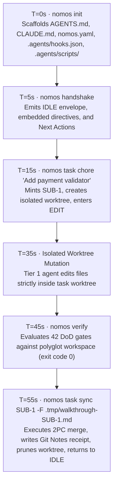

---
authors:
  - Mark Gantlett
  - Nomos Open-Core Substrate
classification: public
date: "2026-10-16"
last_updated: "2026-11-08"
lineage:
  - INT-840
  - INT-841
  - INT-842
  - INT-946
  - INT-1913
plane: intent
ssot_repository: nomos
status: active
title: "Zero-Source Downstream Developer Experience & Agentic HATEOAS Specification"
type: spec
version: "4.8.0"
---

# Zero-Source Downstream Developer Experience & Agentic HATEOAS Specification

---

## 1. Executive Summary & Problem Statement

Downstream developers install only the precompiled `nomos` binary inside external polyglot repositories.
Downstream repositories contain zero Nomos Go source code and zero Nomos internal architecture specifications.
Unconstrained Tier 1 coding agents waste context tokens hunting for missing source files when CLI responses omit next-step affordances.

This specification codifies **Hypermedia as the Engine of Agentic State (Agentic HATEOAS)** for zero-source downstream onboarding.
Every CLI state query and phase transition emits pre-interpolated next-step commands directly in stdout and structured JSON.
Downstream Tier 1 coding agents achieve full phase discipline in under 60 seconds using only embedded operator directives and CLI envelopes.

---

## 2. Axiomatic Invariants & Governing Laws

| Law # | Law Name | Zero-Source Downstream Invariant |
| :---: | :--- | :--- |
| **1** | **Dual-Core Inversion** | The `nomos` binary governs phase transitions via deterministic HATEOAS command affordances. |
| **2** | **Non-Verbal Proof** | Clean-room downstream vector (`CDV`) suites verify zero-source trajectories with exit code 0. |
| **3** | **Hermetic Worktrees** | Protected trunk branches remain read-only; mutations execute strictly in isolated worktrees. |
| **4** | **Single Source of Truth** | Embedded directives match workspace state through parsed `#DirectiveFrontmatter.phases` metadata. |
| **5** | **Zero-Hardcoded-Path** | Envelopes interpolate dynamic repository and worktree paths without host path literals. |
| **6** | **Canonical Singularity** | Affordances emit exact canonical CLI commands with zero aliases or duplicate subcommands. |
| **7** | **Fail-Closed Pre-Flight** | Missing prerequisites terminate execution with deterministic remediation commands. |

---

## 3. Agentic HATEOAS Transition Envelopes (`INT-840`)

Every lifecycle phase transition and orientation command emits valid next-step hypermedia commands (`#ActionAffordance`).

### 3.1 Compiled Go SSoT Contract (`substrate/src/nomos/core/types/affordance.go`)

```go
package types

// ActionAffordance defines a deterministic HATEOAS next-step hypermedia command (#ActionAffordance).
type ActionAffordance struct {
	Command string `json:"command"`
	Summary string `json:"summary"`
	Phase   Phase  `json:"phase"`
}

// BuildPhaseNextActions synthesizes deterministic HATEOAS next-step commands for the active workspace state.
func BuildPhaseNextActions(phase Phase, taskKey, worktreePath string, directives, readyWavefront []string) []ActionAffordance
```

`#HandshakeEvent` and `#PhaseState` expose `next_actions?: [...#ActionAffordance]` for machine-readable `--json` consumers and terminal banners.

### 3.2 Phase-Driven Affordance Matrix

| Active Phase | Emitted `next_actions` Canonical Commands |
| :--- | :--- |
| **`IDLE`** | `nomos task chore "<title>"` · `nomos task start <KEY> --edit` · `nomos directive <active>` |
| **`PLAN`** | `cd <worktree>` · `nomos task edit <KEY>` · `nomos directive <active>` |
| **`EDIT`** | `cd <worktree>` · `nomos task commit <KEY> -m "<summary>"` · `nomos verify` · `nomos task sync <KEY> -F .tmp/walkthrough-<KEY>.md` |
| **`REVIEW`** | `nomos task sync <KEY> -F .tmp/walkthrough-<KEY>.md` · `nomos task edit <KEY>` |
| **`SYNC`** | `nomos handshake` · `nomos status` |

### 3.3 Frontmatter-Driven Directive Resolution

`LoadPhaseDirectives` parses YAML frontmatter (`#DirectiveFrontmatter.phases`) across local overrides and embedded substrate directives.
Every directive name emitted in `HandshakeEvent.directives` resolves with exit code 0 when passed to `nomos directive <name>`.
The substrate prohibits synthetic fallback identifiers that lack corresponding embedded directive payloads.

### 3.4 Downstream-Neutral Protocol Block & Marker-Scoped Parity (`INT-841`)

Foundry self-hosting architecture specifications remain strictly inside `intent/architecture/specs/` and never enter `embed.FS`.
Embedded directives and `templates/AGENTS.md` contain strictly repository-agnostic polyglot guidance (`worktrees/<repo>-<KEY>`) and advertise `nomos directive`, `nomos capabilities`, and `nomos task chore`.
`IntentParityGate` evaluates SHA-256 byte parity strictly over the `<!-- NOMOS_OPEN_CORE_PROTOCOL_START -->` ... `<!-- NOMOS_OPEN_CORE_PROTOCOL_END -->` managed region (`#ProtocolMarkerBounds`).
Downstream repositories append project-specific instructions outside the protocol markers without triggering Law 4 parity errors.
Ambient `worktree-guard.sh` permits `.tmp/` scratch and walkthrough file writes alongside `/worktrees/` mutations.

### 3.5 Downstream-Safe Gate Remedies & Capability Drill-Down (`INT-842`)

Gate failure remedies and defense hook rejections emit contradiction-free, repository-agnostic recovery commands.
Remedies never recommend commands prohibited by ambient guards (such as `git stash`) and never reference internal Foundry milestones.
`nomos capabilities [id]` accepts a capability ID, cell ID (`cell_7_1`), or probe ID (`plane_separation`).
It emits `#CapabilityDetail` with Law, Ring, invariant rules, and canonical remediation steps under Law 6.

### 3.6 Arch Linux & Omarchy AUR Binary Distribution (`nomos-bin`, `INT-946`)

Omarchy and Arch Linux workstations install the precompiled `CGO_ENABLED=0` static `nomos` binary directly via AUR helpers (`yay -S nomos-bin` or `paru -S nomos-bin`).
`.goreleaser.yaml` defines the canonical `aurs` release target (`nomos-bin`) alongside `packaging/aur/PKGBUILD` for `x86_64` and `aarch64` Linux archives.
Both GoReleaser and `packaging/aur/PKGBUILD` verify SHA-256 archive digests against published release checksums before installing `/usr/bin/nomos` (`0755`) and Apache-2.0 attribution files (`LICENSE`, `NOTICE`, `THIRD_PARTY_NOTICES.md`) under `/usr/share/licenses/nomos-bin/`.

### 3.7 Brownfield Workspace Auto-Detection (`INT-1913`)

`nomos init` scans the target workspace for existing polyglot implementation files before writing `nomos.yaml`.
Empty greenfield workspaces receive `strict_mode: true` by default.
Workspaces containing existing implementation source files receive `strict_mode: false` automatically.
When existing implementation files reside exclusively inside top-level source directories, `nomos init` populates `substrate_source_roots` automatically.
Downstream brownfield repositories pass baseline verification with exit code 0 immediately after `nomos init`.

---

## 4. The 60-Second Zero-Source Lifecycle



---

## 5. Table-Driven Verification Vectors

| Vector ID | Clean-Room Step | Evaluated Invariant | Expected Verdict |
| :--- | :--- | :--- | :--- |
| `TC-HAT-01` | `nomos init` in external repo | Scaffolds downstream-clean protocol & hooks | **PASS** |
| `TC-HAT-02` | `nomos handshake` in `IDLE` | Every emitted directive resolves via `nomos directive` | **PASS** |
| `TC-HAT-03` | `nomos task start` / `chore` / `edit` | Emits pre-interpolated `Next:` commands & `next_actions` JSON | **PASS** |
| `TC-HAT-04` | `nomos task commit` / `review` / `sync` | Completes 2PC lifecycle with valid next-step guidance | **PASS** |
| `TC-HAT-05` | `nomos capabilities <id>` on cell or probe | Resolves `#CapabilityDetail` with Law, Ring, and Remedy | **PASS** |
| `TC-HAT-06` | Audit all 42 gate remedies & hook scripts | Zero `git stash` contradictions or internal Foundry leaks | **PASS** |
| `TC-HAT-07` | Inspect `.goreleaser.yaml` `aurs` & `packaging/aur/PKGBUILD` | Static `CGO_ENABLED=0` `nomos-bin` package verifies SHA-256 & installs `LICENSE`/`NOTICE` | **PASS** |
| `TC-HAT-08` | `nomos init` in non-empty brownfield repository | Emits `strict_mode: false` and passes baseline `nomos verify` | **PASS** |

---

## 6. Cross-Plane Traceability & DoD Verification

| Intent HATEOAS Contract | Compiled Go SSoT Path | Enforcing 7x3 Matrix Cell |
| :--- | :--- | :--- |
| Hypermedia transition envelopes (`ActionAffordance`) | `substrate/src/nomos/core/types/affordance.go` | `Cell 1.2 (phase_discipline)`, `Cell 4.1 (intent_traceability)` |
| Frontmatter directive resolution (`SynthesizeDynamicHandshake`) | `substrate/src/nomos/modules/handshake/handshake.go` | `Cell 4.1 (broken_wire)` |
| Marker-scoped byte parity (`IntentParityGate`) | `substrate/src/nomos/modules/verify/` | `Cell 4.3 (intent_parity)` |
| Capability drill-down (`nomos capabilities`) | `substrate/cli/cmd_capabilities.go`, `substrate/cli/cmd_directive.go` | `Cell 6.2 (zero_alias)` |
| Arch/Omarchy AUR binary package (`nomos-bin`) | `.goreleaser.yaml`, `packaging/aur/PKGBUILD`, `substrate/cli/legal_release_contract_test.go` | `Cell 4.2 (contract_parity)`, `Cell 7.3 (release_provenance)` |

Run `nomos verify` to execute all 42 Definition of Done quality gates and confirm exit code `0`.
