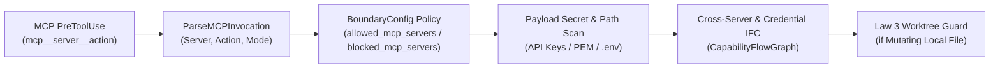

---
authors:
  - Mark Gantlett
  - Nomos Open-Core Substrate
classification: public
date: "2026-11-03"
last_updated: "2026-11-03"
lineage:
  - INT-857
  - SUB-1526
plane: intent
ssot_repository: nomos
status: active
title: "Zero-Trust MCP Boundary Interceptor and Information Flow Control Specification"
type: spec
version: "4.3.0"
---

# Zero-Trust MCP Boundary Interceptor and Information Flow Control Specification

---

## 1. Executive Summary & Problem Statement

Model Context Protocol (`MCP`) tools expand agent capabilities across third-party servers (`mcp__<server>__<action>` and `mcp_<server>_<action>`). Implicitly trusting MCP tool invocations introduces four concrete cross-boundary failure modes (`arXiv:2604.27819`):

1. **Mutating Local File Bypass:** Treating mutating MCP filesystem tools (`mcp__filesystem__write_file`) as read-only bypasses **Law 3** worktree isolation.
2. **Direct Credential Boundary Leak:** Passing raw API keys, private keys, or `.env` paths inside MCP tool parameters leaks secrets to external servers.
3. **Credential-to-MCP Egress Exfiltration:** Reading local credentials (`.env`, `.aws/credentials`) and invoking an external MCP egress action exfiltrates sensitive state.
4. **Cross-Server Untrusted Escalation:** Ingesting untrusted content from MCP server `S1` (`mcp__fetch__fetch`) and invoking privileged remote mutations on server `S2` (`mcp__github__merge_pull_request`) enables prompt-injected lateral escalation.

---

## 2. Axiomatic Invariants & Governing Laws

| Law # | Law Name | Zero-Trust MCP Boundary Invariant | Machine Enforcement Mechanism |
| :---: | :--- | :--- | :--- |
| **1** | **The Dual-Core Inversion Law** | Compiled Go hooks intercept every MCP tool invocation before server dispatch. | `EvaluateMCPBoundary`, `checkPrivilegedMCPEscalation` |
| **2** | **The Non-Verbal Proof Law** | Untrusted ingress taints persist until `nomos verify` completes with exit code 0. | `CapabilityFlowGraph` sanitization |
| **3** | **The Hermetic Worktree Law** | Mutating local-file MCP tools obey isolated worktree path containment. | `evaluateFileMutationGuard` |
| **4** | **The Single Source of Truth Law** | Server allow/block policies compile from `BoundaryConfig` into `nomos.schema.json`. | `MCPBoundaryPolicy`, `Cell 4.2 (contract_parity)` |
| **5** | **The Zero-Hardcoded-Path Law** | Flow-graph state resolves dynamically per workspace directory without static paths. | `LoadWorkspaceFlowGraph` |
| **6** | **The Canonical Singularity Law** | Both `mcp__*` and `mcp_*` namespaces normalize into one `MCPInvocation` struct. | `ParseMCPInvocation` |
| **7** | **The Fail-Closed Pre-Flight Law** | Blocked servers, secret payloads, and tainted egress calls deny execution immediately. | `checkMCPServerPolicy`, `checkMCPPayloadSecrets` |

---

## 3. Zero-Trust MCP IFC Architecture (`core/capbac`)



### 3.1 Canonical MCP Coordinate Parsing (`capbac.MCPInvocation`)
- Normalizes both `mcp__<server>__<action>` (Claude Code) and `mcp_<server>_<action>` (Cursor / Antigravity) into `(Server, Action, AccessMode)`.
- Classifies `AccessMode` into:
  - `MCPModeRead`: Pure inspection actions (`get`, `list`, `read`, `search`, `find`, `inspect`, `describe`, `fetch`, `SELECT`-only `query`).
  - `MCPModeMutate`: State-changing or outbound actions (`write`, `edit`, `create`, `update`, `delete`, `post`, `send`, `push`, `publish`, `merge`, `exec`, `run`, `upload`, mutating SQL).
  - `MCPModePrivileged`: High-impact remote mutations (`merge`, `push`, `publish`, `delete`, `drop`, `alter`, `truncate`, `deploy`, `exec`).

### 3.2 Declarative Server Policy (`config.BoundaryConfig` & `nomos.schema.json`)
`BoundaryConfig` in `core/config/config.go` exposes two optional lists reflected into `nomos.schema.json`:
- `allowed_mcp_servers`: When non-empty, permits only explicitly listed MCP server identifiers.
- `blocked_mcp_servers`: Unconditionally denies listed MCP server identifiers.

### 3.3 Information Flow Control Rules (`EvaluateMCPBoundary`)
1. **Policy Gate:** Rejects invocations targeting `blocked_mcp_servers` or servers absent from a non-empty `allowed_mcp_servers` allowlist.
2. **Credential Payload Gate:** Scans serialized MCP arguments for canonical secret tokens (`sk-proj-`, `sk-ant-`, `AKIA`, `ghp_`, `github_pat_`, `glpat-`, `xoxb-`, `hf_`, `xai-`, and PEM keys). Also rejects sensitive credential paths (`.env`, `.ssh/id_`, `.aws/credentials`).
3. **Credential Taint Egress Gate:** Rejects `MCPModeMutate` and `MCPModePrivileged` MCP calls when `CapabilityFlowGraph` holds `credential_source` taint.
4. **Cross-Server Escalation Gate:** Records untrusted ingress `mcp_untrusted:<S1>` on external fetch or browser MCP servers. Rejects `MCPModePrivileged` calls on any distinct server `S2 != S1` until `nomos verify` sanitizes the session.
5. **Hermetic Worktree Enforcement:** Routes mutating MCP tools with file path targets through `evaluateFileMutationGuard` (**Law 3**).

---

## 4. Compiled Go SSoT Contracts (`substrate/src/nomos/core/capbac/mcp_ifc.go`)

### 4.1 `MCPInvocation` & Boundary Evaluation
`substrate/src/nomos/core/capbac/mcp_ifc.go` defines the compiled MCP boundary interceptor types and functions:

```go
package capbac

// MCPAccessMode classifies the side-effect level of an MCP tool invocation.
type MCPAccessMode string

const (
	MCPModeRead       MCPAccessMode = "read"
	MCPModeMutate     MCPAccessMode = "mutate"
	MCPModePrivileged MCPAccessMode = "privileged"
)

// MCPInvocation captures normalized server, action, and access-mode coordinates for an MCP tool call (#MCPInvocation).
type MCPInvocation struct {
	RawToolName string        `json:"raw_tool_name"`
	Server      string        `json:"server"`
	Action      string        `json:"action"`
	Mode        MCPAccessMode `json:"mode"`
	TargetFile  string        `json:"target_file,omitempty"`
	ArgsDigest  string        `json:"args_digest,omitempty"`
}

// MCPBoundaryPolicy defines optional allowlist and denylist server constraints from nomos.yaml.
type MCPBoundaryPolicy struct {
	AllowedServers []string
	BlockedServers []string
}

func IsMCPToolName(name string) bool
func ParseMCPInvocation(toolName, targetFile, argsDigest string) (MCPInvocation, bool)
func EvaluateMCPBoundary(workspaceDir string, inv MCPInvocation, policy MCPBoundaryPolicy) FlowDecision
```

---

## 5. Table-Driven Verification Vectors

| Vector ID | Invariant | MCP Invocation / Trajectory | Expected Outcome |
| :--- | :--- | :--- | :--- |
| `TC-MCP-01` | Law 3 (Worktree Jail) | `mcp__filesystem__write_file` targeting trunk `main.go` | Denies trunk mutation outside `/worktrees/`. |
| `TC-MCP-02` | Law 7 (Secret Leak) | `mcp__slack__post_message` containing `sk-proj-...` token | Denies secret propagation across MCP boundary. |
| `TC-MCP-03` | Law 7 (Server Policy) | `mcp__untrusted__query` with `blocked_mcp_servers: ["untrusted"]` | Denies blocked MCP server fail-closed. |
| `TC-MCP-04` | Law 7 (Cred Exfil) | `Read(".env")` -> `mcp__github__create_issue` | Denies mutating MCP egress under `credential_source` taint. |
| `TC-MCP-05` | Law 1 (Cross-Server IFC) | `mcp__fetch__fetch` -> `mcp__github__merge_pull_request` | Denies cross-server privileged escalation before `nomos verify`. |
| `TC-MCP-06` | Law 1 (Benign Dev Flow) | `mcp__linear__get_issue` -> `Write` inside `/worktrees/` | Permits normal ticket read and isolated worktree edit. |

---

## 6. Cross-Plane Traceability & DoD Verification

| Intent IFC Contract | Compiled Go SSoT Path | Enforcing 7x3 Matrix Cell |
| :--- | :--- | :--- |
| MCP coordinate parser & boundary gate (`MCPInvocation`) | `substrate/src/nomos/core/capbac/mcp_ifc.go`, `secrets.go` | `Cell 4.1 (intent_traceability)`, `Cell 7.1 (secret)` |
| Compositional taint graph (`CapabilityFlowGraph`) | `substrate/src/nomos/core/capbac/flow.go`, `flow_state.go` | `Cell 1.3 (capbac_lease)`, `Cell 7.2 (unchecked_errors)` |
| Declarative server allow/block schema (`BoundaryConfig`) | `substrate/src/nomos/core/config/config.go` | `Cell 4.2 (contract_parity)` |
| PreToolUse hook dispatch (`nomos hook pre-tool`) | `substrate/cli/cmd_hook.go` | `Cell 3.2 (hermetic_worktree)` |

Run `nomos verify` to execute all 42 Definition of Done quality gates and confirm exit code `0`.
