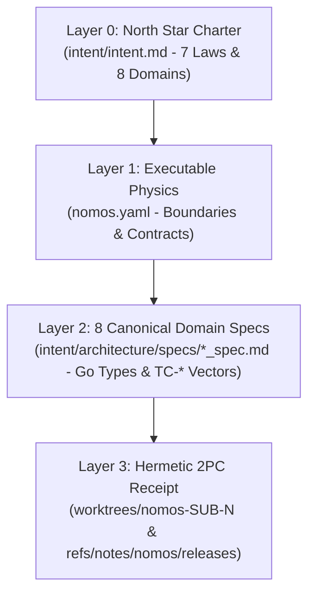

---
authors:
  - Mark Gantlett
  - Nomos Open-Core Substrate
classification: public
date: "2026-10-01"
last_updated: "2026-11-11"
lineage:
  - INT-1941
  - SUB-2134
  - INT-1943
  - SUB-2147
  - INT-1944
  - SUB-2157
  - INT-1951
  - INT-1952
  - INT-1966
  - SUB-2219
  - INT-1973
  - SUB-2239
  - INT-1976
  - SUB-2241
  - INT-1984
  - SUB-2279
  - INT-1985
  - SUB-2280
  - INT-1986
  - SUB-2281
  - INT-1987
  - SUB-2283
plane: intent
ssot_repository: nomos
status: active
title: "The Nomos Layer 0 North Star Charter and 4-Layer Progressive Intent Compiler"
type: spec
version: "4.17.0"
---

# The Nomos Layer 0 North Star Charter and 4-Layer Progressive Intent Compiler

---

## 1. Executive Summary & Problem Statement

Nomos is a deterministic execution substrate and transactional repository layer between coding agents and Git.
Without mechanical boundaries, coding agents mutate protected branches, violate package dependencies, and drift from specifications.
Upfront waterfall specifications also decay when hundreds of speculative pages rot after initial commits.

Nomos resolves both failure modes by self-hosting a **4-Layer Progressive Intent Compiler**:
1. **Layer 0 (`intent/intent.md`)**: Defines the product North Star, the 7 non-negotiable laws, and the 8 core domains.
2. **Layer 1 (`nomos.yaml`)**: Locks package `architecture_boundaries` and enables `strict_types` and `verify_obligations` across `intent/architecture/specs`.
3. **Layer 2 (`intent/architecture/specs/*_spec.md`)**: Maintains 8 canonical domain specifications containing compiled Go contracts and `TC-*` obligation tables.
4. **Layer 3 (`worktrees/<repo>-SUB-<N>` & `refs/notes/nomos/releases`)**: Verifies `@verifies TC-*` tests inside isolated worktrees and seals SHA-256 release receipts.



---

## 2. Axiomatic Invariants & Governing Laws

Every task executes on either the **Intent Plane (`INT-<N>`)** or the **Substrate Plane (`SUB-<N>`)**:
- **Intent Plane (`INT-<N>`)**: Mutates Layer 0 (`intent/intent.md`), Layer 1 (`nomos.yaml`), and Layer 2 (`intent/architecture/specs/*_spec.md`).
- **Substrate Plane (`SUB-<N>`)**: Mutates Layer 3 (`substrate/**`), binds `@verifies TC-*` tests, and seals `2PC` Git Notes receipts.

Ambient lifecycle hooks govern all five Tier 1 providers (Claude Code, Gemini CLI, OpenCode, Cursor, Antigravity) across `nomos init` and `nomos hook install`.

| Law # | Law Name | Core Architectural Invariant | Enforcing Substrate Gate |
| :---: | :--- | :--- | :--- |
| **1** | **Dual-Core Inversion** | Go core governs phase state; coding agents operate under indirect control. | `Cell 1.2 (phase_discipline)` |
| **2** | **Non-Verbal Proof** | Every merge requires `42/42` gate exit `0` and `@verifies TC-*` bindings. | `Cell 2.2 (go_toolchain)` |
| **3** | **Hermetic Worktree** | Trunk `main` remains read-only; mutations occur inside `worktrees/nomos-<KEY>`. | `Cell 3.2 (hermetic_worktree)` |
| **4** | **Single Source of Truth** | Every contract possesses one compiled Go struct and reflected JSON Schema. | `Cell 4.1 (intent_traceability)` |
| **5** | **Zero-Hardcoded-Path** | Paths resolve dynamically from repository root with zero workstation literals. | `Cell 5.2 (forbidden_literals)` |
| **6** | **Canonical Singularity** | Zero CLI aliases, duplicate domain specs, or filesystem symlinks exist. | `Cell 6.2 (zero_alias)` |
| **7** | **Fail-Closed Pre-Flight** | Cross-plane commits, boundary breaches, and stale obligations reject execution. | `Cell 7.1 (plane_separation)` |

---

## 3. The 8 Canonical Domain Specifications (Layer 2 Architecture Map)

Instead of scattered task notes, `intent/architecture/specs/` maintains **8 Canonical Domain Specifications** mapped directly to `substrate/` packages:

| Domain # | Canonical Layer 2 Specification | Target `substrate/` Package | Primary Compiled Go SSoT Contracts |
| :---: | :--- | :--- | :--- |
| **1** | `go_ssot_and_json_schema_spec.md` | `core/config`, `core/types` | `EcosystemConfig`, `QualityGatesConfig`, `ThresholdsConfig`, `JSONSchemaNode`, `NomosError`, `ActionAffordance`, `PhaseState`, `PolyglotWorkspaceManifest` |
| **2** | `nomos_hermetic_worktree_spec.md` | `core/workspace`, `core/capbac`, `modules/verify` | `Manager`, `WorktreeSession`, `EmbeddedAsset`, `ParityAuditReport`, `CapBACLease`, `CapabilityFlowGraph`, `CredentialReadPolicy`, `MCPInvocation`, `CommitSchemaGate` |
| **3** | `task_lifecycle_cli_spec.md` | `modules/task`, `core/storage`, `cli/*` | `TaskRecord`, `TaskCardInput`, `WavefrontCandidate`, `ReleaseNotePayload`, `ReleaseHookTrace`, `RuntimeMaintainReport`, `IssueReport`, `UpdateReport`, `UpdateCheckCache` |
| **4** | `nomos_intent_traceability_spec.md` | `modules/verify/*`, `core/config` | `ContractsConfig`, `ArchitectureBoundaryRule`, `StaleSpecObligation`, `CanonicalMatrixModel`, `InvariantCellSpec`, `GateSpec`, `PipelineReport`, `ProofReport`, `AntiShimDTO` |
| **5** | `tree_sitter_ast_gate_spec.md` | `modules/verify/treesitter` | `FunctionMetric`, `FileMetric`, `GateEvaluationReport`, `EngineThresholds`, `SCMQuerySpec`, `WazeroTreeSitterEngine` |
| **6** | `mneme_memory_spec.md` | `modules/mem` | `Memory`, `MemoryKind`, `MemoryStatus`, `MemoryFilter`, `SearchOptions`, `SearchResult`, `GateTrapEntry`, `PitfallHygieneReport`, `MaintainReport` |
| **7** | `nomos_controlled_technical_english_spec.md` | `modules/ncte`, `modules/handshake` | `NCTEBounds`, `NCTEPolicy`, `VocabularyEntry`, `NCTEDiagnostic`, `NCTESpecReport`, `IntentSteelmanGate`, `HandshakeEvent`, `BrownfieldTopologyBrief` |
| **8** | `software_physics_engine_spec.md` | `cli`, `modules/session`, `modules/telemetry` | `FileMass`, `CollisionVector`, `WorktreeHull`, `AgentSession`, `SessionTrajectory`, `SessionDetail`, `SentinelScorecard`, `SessionDatasetRecord`, `CapabilityMetrics` |

---

## 4. Compiled Go SSoT North Star Contract

The following Go contract in `substrate/src/nomos/core/config/config.go` and `substrate/src/nomos/modules/task/task.go` anchors Layer 0:

```go
package config

// BoundaryConfig declares architectural package and CLI command boundary protections (#BoundaryConfig).
type BoundaryConfig struct {
	Enforce              bool     `yaml:"enforce" json:"enforce"`
	ProhibitedPackages   []string `yaml:"prohibited_packages,omitempty" json:"prohibited_packages,omitempty"`
	ProhibitedCommands   []string `yaml:"prohibited_commands,omitempty" json:"prohibited_commands,omitempty"`
	LockDependencies     bool     `yaml:"lock_dependencies,omitempty" json:"lock_dependencies,omitempty"`
	AllowedMCPServers    []string `yaml:"allowed_mcp_servers,omitempty" json:"allowed_mcp_servers,omitempty"`
	BlockedMCPServers    []string `yaml:"blocked_mcp_servers,omitempty" json:"blocked_mcp_servers,omitempty"`
	EgressMode           string   `yaml:"egress_mode,omitempty" json:"egress_mode,omitempty"`
	AllowedEgressDomains []string `yaml:"allowed_egress_domains,omitempty" json:"allowed_egress_domains,omitempty"`
	BlockedEgressDomains []string `yaml:"blocked_egress_domains,omitempty" json:"blocked_egress_domains,omitempty"`
	CredentialReadMode   string   `yaml:"credential_read_mode,omitempty" json:"credential_read_mode,omitempty"`
	BlockedReadPaths     []string `yaml:"blocked_read_paths,omitempty" json:"blocked_read_paths,omitempty"`
}

// ValidateTaskKey enforces canonical 2-plane task key singularity (INT-<N> or SUB-<N>).
func ValidateTaskKey(key string) error

// ValidateWorktreeBoundary blocks direct file mutations on protected trunk branches.
func ValidateWorktreeBoundary(repoRoot, currentBranch, targetFile string) error
```

---

## 5. Table-Driven Verification Vectors

| Vector ID | Invariant Verified | Input Scenario | Expected Deterministic Verdict |
| :--- | :--- | :--- | :--- |
| `TC-INT-01` | Law 7 (Plane Separation) | Task `INT-101` stages file under `substrate/` | Rejects commit with `ERR_CROSS_PLANE_MUTATION` |
| `TC-INT-02` | Law 6 (Canonical Task Key) | `ValidateTaskKey("CUST-99")` | Rejects non-canonical prefix with `ERR_VALIDATION_FAILED` |
| `TC-INT-03` | Law 3 (Hermetic Trunk Lock) | `ValidateWorktreeBoundary(root, "main", "substrate/main.go")` | Rejects direct trunk mutation outside `worktrees/` |
| `TC-INT-04` | Law 4 (Steel-Man Blueprint) | `IntentSteelmanGate` evaluates `intent/intent.md` | Passes with zero NCTE-100 diagnostics |
| `TC-INT-05` | Law 6 (Zero Symlink Alias) | Symlink created inside `intent/architecture/specs/` | `ZeroFilesystemAliasGate` rejects symlink with exit code `1` |
| `TC-INT-06` | Law 1 (Pre-Tool Redirect Guard) | `nomos hook pre-tool` evaluates shell redirect on `main` | Rejects mutation outside isolated worktree with exit code `2` |

---

## 6. Cross-Plane Traceability & DoD Verification

1. **Bilateral Task Lineage**: `INT-1941`, `SUB-2134`, `INT-1943`, `SUB-2147`, `INT-1951`, and `INT-1952`.
2. **Enforcing 7x3 Matrix Coordinates**: `Cell 4.1 (intent_steelman)`, `Cell 4.1 (intent_traceability)`, `Cell 6.1 (zero_filesystem_alias)`, and `Cell 7.1 (plane_separation)`.
3. **Executable Obligation Suite**: `substrate/cli/intent_manifesto_obligations_test.go` binds `TC-INT-01` through `TC-INT-06` and all 8 canonical domain specifications.
4. **Verification Command**: Execute `nomos verify` across all 42 Definition of Done quality gates and assert exit code `0`.
