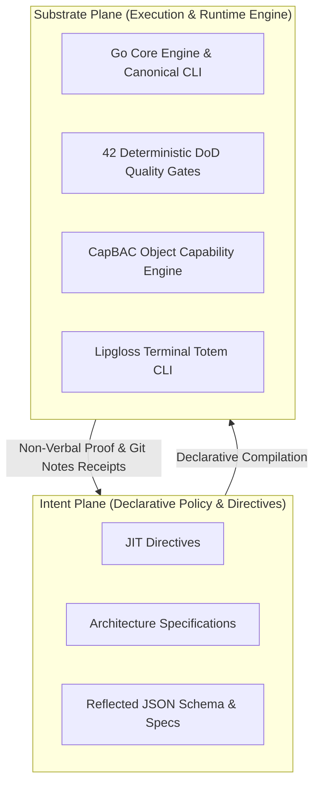

---
authors:
  - Mark Gantlett
  - Nomos Open-Core Substrate
classification: public
date: "2026-10-01"
last_updated: "2026-10-29"
plane: intent
ssot_repository: nomos
status: active
title: "The Nomos Intent Plane Architectural Specification and Master Manifesto"
type: spec
version: "4.0.0"
---

# The Nomos Intent Plane Architectural Specification and Master Manifesto

---

## 1. Executive Summary & Problem Statement

Natural language serves as the declarative compilation source for AI agent execution in the Nomos substrate (`SPEC-INTENT-MANIFESTO`).
Vague syntax and unconstrained prompts generate non-deterministic behaviors, brittle diffs, and architectural drift.
The Nomos Intent plane establishes a machine-verifiable specification and governance substrate across Laws `1` through `7`.
Human engineers declare system invariants, contracts, and lifecycle policies using machine-checkable schemas.
The Substrate Go engine compiles Intent declarations into bounded task envelopes for cognitive co-processors.
Engineering workflows shift from conversational guessing to deterministic, machine-verified compilation.

---

## 2. Axiomatic Invariants & Governing Laws

The Intent plane establishes the seven governing laws of the Nomos dual-core architecture.
The Substrate plane enforces all seven laws deterministically across runtime lifecycles.

| Law # | Law Name | Core Architectural Invariant | Machine Enforcement Mechanism |
| :---: | :--- | :--- | :--- |
| **1** | **The Dual-Core Inversion Law** | Go core governs state; Tier 1 agents operate under indirect control. | `nomos verify`, Phase Discipline state machine (`Cell 1.2`) |
| **2** | **The Non-Verbal Proof Law** | Zero conversational trust; correctness requires exit code `0` and AST proof. | 42 Go-native DoD Quality Gates (`nomos verify`) |
| **3** | **The Hermetic Worktree Law** | Protected trunk branch `main` remains read-only; mutations occur strictly inside transient worktrees. | `ValidateWorktreeBoundary`, Pre-Commit Hooks (`Cell 3.2`) |
| **4** | **The Single Source of Truth Law** | Every contract and schema binds to one compiled Go SSoT. | Static Go AST & JSON Schema validation (`Cell 4.1` - `Cell 4.3`) |
| **5** | **The Zero-Hardcoded-Path Law** | Source code prohibits path literals; directories resolve via dynamic configuration. | Configuration discovery (`config.LoadConfig()`, `Cell 5.1`) |
| **6** | **The Canonical Singularity Law** | CLI engines and contract schemas prohibit aliases, synonyms, and wrappers. | Zero-Alias AST Parser validation (`Cell 6.1` - `Cell 6.3`) |
| **7** | **The Fail-Closed Pre-Flight Law** | Mutations require declarative configuration and pass mandatory DoD gates before sync. | CapBAC Object Capabilities, PlaneSeparationGate (`Cell 7.1` - `Cell 7.3`) |

---

## 3. Pure 2-Plane Topology Architecture

The architecture eliminates intermediate plane taxonomies in favor of Pure 2-Plane Singularity.
The ecosystem permits two canonical planes across all repositories.



### Plane Contract Specifications
- **Intent Plane (`INT-<N>`)**: Governs declarative policy, architectural specifications, and repository configuration manifests.
- **Substrate Plane (`SUB-<N>`)**: Implements the Go compiler, CLI commands, tests, and CLI totem.

The substrate compiler validates task key singularity using regular expression `^(INT|SUB)-[0-9]+(-[a-z0-9-]+)?$`.
Any task identifier referencing deprecated planes fails closed with error code `ERR_CANONICAL_VIOLATION`.

---

## 4. Dual-Core Interface Contracts and DTO Schemas

The Intent plane defines structured data contracts for system manifest validation and state exchange.
Substrate code imports these contracts directly from compiled Go types.

```go
package intent

import "time"

// IntentManifestoDTO defines the authoritative data contract for the Intent plane.
type IntentManifestoDTO struct {
	DocumentKey string            `json:"document_key"`
	Version     string            `json:"version"`
	Laws        []NomosLawDTO     `json:"laws"`
	Topology    PlaneTopologyDTO  `json:"topology"`
	SSoTIndex   []SSoTContractDTO `json:"ssot_index"`
	ExportedAt  time.Time         `json:"exported_at"`
}

// NomosLawDTO defines the schema for an axiomatic Nomos law.
type NomosLawDTO struct {
	LawNumber   int    `json:"law_number"`
	Name        string `json:"name"`
	Invariant   string `json:"invariant"`
	Enforcement string `json:"enforcement"`
}

// PlaneTopologyDTO declares the canonical 2-plane singularity bounds.
type PlaneTopologyDTO struct {
	AllowedPlanes       []string `json:"allowed_planes"`
	IntentKeyPattern    string   `json:"intent_key_pattern"`
	SubstrateKeyPattern string   `json:"substrate_key_pattern"`
}

// SSoTContractDTO maps architectural domains to compiled Substrate Go SSoT targets.
type SSoTContractDTO struct {
	Domain             string `json:"domain"`
	ConfigDiscoveryKey string `json:"config_discovery_key"`
	CompiledGoTarget   string `json:"compiled_go_target"`
	EnforcementGate    string `json:"enforcement_gate"`
}
```

---

## 5. Fail-Closed Verification Predicates and State Transitions

The Substrate engine compiles and validates the Intent plane using deterministic verification predicates.
Verification terminates with exit code 1 whenever any predicate evaluates to false.

### Deterministic Invariant Attestation Predicates
1. **Plane Singularity Predicate ($P_{\text{singularity}}$)**:
   $$\forall k \in \text{Tasks}, \quad \text{Prefix}(k) \in \{\text{"INT"}, \text{"SUB"}\}$$
2. **Schema Parity Predicate ($P_{\text{parity}}$)**:
   $$\forall c \in \text{Schemas}, \quad \text{SHA256}(\text{Schema}(c)) = \text{SHA256}(\text{Reflect}(\text{GoSSoT}(c)))$$
3. **Law 5 Dynamic Path Predicate ($P_{\text{path}}$)**:
   $$\forall p \in \text{Paths}, \quad p \notin \text{LiteralBlacklist} \wedge p = \text{ResolveConfig}(\text{Key})$$

### Pre-Flight Evaluation Rules
- If $P_{\text{singularity}} = \text{false}$, abort task creation with error `ERR_CANONICAL_VIOLATION`.
- If $P_{\text{parity}} = \text{false}$, abort release synchronization with error `ERR_INTENT_PARITY_MISMATCH`.
- If $P_{\text{path}} = \text{false}$, abort gatekeeper verification with error `ERR_FORBIDDEN_LITERAL`.

---

## 6. SSoT Registry and Contract Verification

Every contract domain possesses a single compiled Go SSoT in `substrate/`, reflected into `nomos.schema.json` where external configuration schemas apply.
Every contract adheres to Law 4 (SSoT) and Law 6 (Canonical Singularity):

| Domain | Schema / Spec Anchor | Compiled Go SSoT Target | Enforcement Gate |
| :--- | :--- | :--- | :--- |
| **Workspace Configuration** | `nomos.schema.json` | `substrate/src/nomos/core/config/` | `Cell 4.2 (contract_parity)` |
| **Contract Boundaries** | `go_ssot_and_json_schema_spec.md` | `substrate/src/nomos/modules/verify/gates_contracts_boundary.go` | `Cell 4.2 (contract_parity)` |
| **Object Capabilities** | `capbac.Lease`, `capbac.Token` | `substrate/src/nomos/core/capbac/` | `Cell 1.3 (capbac_lease)` |
| **Task Lifecycle** | `task.TaskRecord`, `task.CardSections` | `substrate/src/nomos/modules/task/` | `Cell 6.3 (canonical_singularity)` |
| **Phase State Machine** | `types.Phase`, `types.PhaseState` | `substrate/src/nomos/core/types/phase.go` | `Cell 1.2 (phase_discipline)` |
| **AST Verification** | `verify.GateResult`, `treesitter` | `substrate/src/nomos/modules/verify/` | `Cell 2.1 (anti_shim)` / `Cell 2.2 (go_toolchain)` |
| **Commit Invariants** | `nomos_commit_schema_invariant_spec.md` | `substrate/src/nomos/modules/verify/commit_schema_gate.go` | `Cell 6.1 (commit_schema)` |

---

## 7. Table-Driven Verification Vectors

The table below defines deterministic verification vectors for the Intent manifesto and parser engine.

| Vector ID | Target Input Scenario | Evaluated Invariant | Expected Error Code | Expected Verdict |
| :--- | :--- | :--- | :--- | :--- |
| **TC-INT-01** | Task key formatted as `INT-592-distillations` | Pure 2-Plane Singularity | `NONE` | **PASS (true)** |
| **TC-INT-02** | Task key formatted with deprecated prefix `MEM-101` | Canonical Singularity (Law 6) | `ERR_CANONICAL_VIOLATION` | **FAIL (false)** |
| **TC-INT-03** | `EcosystemConfig` modified without regenerating `nomos.schema.json` | SSoT Schema Parity (Law 4) | `ERR_INTENT_PARITY_MISMATCH` | **FAIL (false)** |
| **TC-INT-04** | Specification prose contains ambiguous modal `should` | NCTE-100 Invariant (`SPEC-NCTE-100`) | `ERR_NCTE_AMBIGUOUS_MODAL` | **FAIL (false)** |
| **TC-INT-05** | Direct SQL mutation attempted on `nomos_global.db` | Dual-Core Inversion (Law 1) | `ERR_INDIRECT_CONTROL_VIOLATION` | **FAIL (false)** |
| **TC-INT-06** | Staged file mutation outside transient worktree | Hermetic Worktree Boundary (Law 3) | `ERR_WORKTREE_BOUNDARY_VIOLATION` | **FAIL (false)** |

---

## 8. Cross-Plane Traceability & DoD Verification

| Artifact / Gate | Substrate SSoT Path / 7x3 Coordinate | Responsibility |
| :--- | :--- | :--- |
| **7x3 Invariant Matrix** | `substrate/src/nomos/modules/verify/matrix.go` | Declares `CanonicalLaws` and the 21 `InvariantCellSpec` definitions. |
| **Intent Steel-Man Gate** | `substrate/src/nomos/modules/verify/intent_steelman.go` (`Cell 4.1 (intent_steelman)`) | Enforces 10-key frontmatter, balanced fences, and NCTE-100 prose hygiene. |
| **Intent Traceability Gate** | `substrate/src/nomos/modules/verify/gates_intent.go` (`Cell 4.1 (intent_traceability)`) | Verifies `@intent` AST symbol anchors and specification link targets. |
| **Intent Byte Parity Gate** | `substrate/src/nomos/modules/verify/gates_intent.go` (`Cell 4.3 (intent_parity)`) | Enforces SHA-256 byte parity across embedded governance templates. |
| **Plane Separation Gate** | `substrate/src/nomos/modules/verify/gates_security.go` (`Cell 7.1 (plane_separation)`) | Rejects cross-plane commits mixing `intent/` and `substrate/` mutations. |

Deterministic verification executes via the canonical gatekeeper command:

```bash
nomos verify
```

Verification passes all 42 Definition of Done quality gates with exit code `0`.
