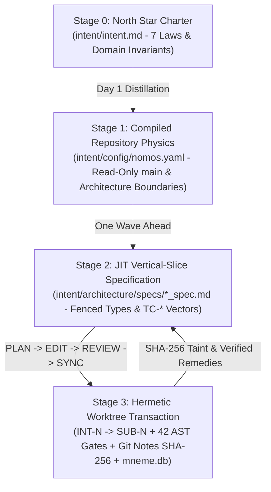

---
authors:
  - Mark Gantlett
  - Nomos Open-Core Substrate
classification: public
date: "2026-10-01"
last_updated: "2026-11-10"
lineage:
  - INT-1941
plane: intent
ssot_repository: nomos
status: active
title: "The Nomos Intent Plane Architectural Specification and Progressive Compiler Charter"
type: spec
version: "4.13.0"
---

# The Nomos Intent Plane Architectural Specification and Progressive Compiler Charter

---

## 1. Executive Summary & Problem Statement

Natural language serves as the declarative compilation source for AI agent execution in the Nomos substrate (`SPEC-INTENT-MANIFESTO`).
Unconstrained prompting erodes module boundaries, whereas monolithic upfront specifications decay when Slice 1 meets runtime execution.
The Nomos Intent plane establishes a progressive four-stage compilation substrate across Laws `1` through `7`:
1. **Stage 0 (`intent/intent.md`)**: Captures global invariants, the seven statutory laws, and domain topology in a compact North Star charter.
2. **Stage 1 (`intent/config/nomos.yaml`)**: Locks trunk-pinned `architecture_boundaries`, schema parity, and DoD thresholds before implementation begins.
3. **Stage 2 (`intent/architecture/specs/*_spec.md`)**: Lowers requirements Just-In-Time one slice ahead using fenced contracts and `TC-*` obligation vectors.
4. **Stage 3 (`worktrees/<repo>-SUB-<N>` & `refs/notes/nomos/releases`)**: Isolates worktree edits, runs 42 AST gates, seals SHA-256 `spec_digests`, and records verified remedies.

---

## 2. Axiomatic Invariants & Governing Laws

The Intent plane establishes the seven governing laws of the Nomos dual-core architecture.
The Substrate plane enforces all seven laws deterministically across runtime lifecycles.

| Law # | Law Name | Core Architectural Invariant | Machine Enforcement Mechanism |
| :---: | :--- | :--- | :--- |
| **1** | **The Dual-Core Inversion Law** | Go core governs state; Tier 1 agents operate under indirect control. | `nomos verify`, Phase Discipline state machine (`Cell 1.2`) |
| **2** | **The Non-Verbal Proof Law** | Zero conversational trust; correctness requires exit code `0` and AST proof. | 42 Go-native DoD Quality Gates (`nomos verify`) |
| **3** | **The Hermetic Worktree Law** | Protected trunk branch `main` remains read-only; mutations occur strictly inside transient worktrees. | `ValidateWorktreeBoundary`, Pre-Commit Hooks (`Cell 3.2`) |
| **4** | **The Single Source of Truth Law** | Every contract and schema binds to one compiled Go SSoT. | Static Go AST, `strict_types`, & `spec_digests` (`Cell 4.1` - `Cell 4.3`) |
| **5** | **The Zero-Hardcoded-Path Law** | Source code prohibits path literals; directories resolve via dynamic configuration. | Configuration discovery (`config.LoadConfig()`, `Cell 5.1`) |
| **6** | **The Canonical Singularity Law** | CLI engines and contract schemas prohibit aliases, synonyms, and wrappers. | Zero-Alias AST Parser validation (`Cell 6.1` - `Cell 6.3`) |
| **7** | **The Fail-Closed Pre-Flight Law** | Mutations require declarative boundaries and pass mandatory DoD gates before sync. | CapBAC Object Capabilities, `architecture_boundaries`, `PlaneSeparationGate` (`Cell 7.1` - `Cell 7.3`) |

---

## 3. Progressive Four-Stage Intent Compiler & Pure 2-Plane Topology

Nomos eliminates intermediate plane taxonomies in favor of Pure 2-Plane Singularity coupled with progressive vertical lowering across four compilation stages.



### Plane & Compilation Stage Specifications
- **Intent Plane (`INT-<N>`)**: Governs Stage 0 (`intent/intent.md`), Stage 1 (`intent/config/nomos.yaml`), and Stage 2 (`intent/architecture/specs/*_spec.md`).
- **Substrate Plane (`SUB-<N>`)**: Implements Stage 3 across the Go compiler, polyglot AST engine, CLI commands, and Git Notes receipts.

The substrate compiler validates task key singularity using regular expression `^(INT|SUB)-[0-9]+(-[a-z0-9-]+)?$`.
Any task identifier referencing deprecated planes fails closed with error code `ERR_CANONICAL_VIOLATION`.

---

## 4. Compiled Go SSoT Contracts

Stage 1 and Stage 2 obligation proofs bind directly to compiled Go SSoT structs in `substrate/src/nomos/core/config` and `substrate/src/nomos/modules/task`:

```go
package config

// ContractsConfig defines contract schema, obligation binding, and backend verification roots (#ContractsConfig).
type ContractsConfig struct {
	Enabled                bool     `yaml:"enabled" json:"enabled"`
	SpecRoots              []string `yaml:"spec_roots,omitempty" json:"spec_roots,omitempty"`
	SchemaFiles            []string `yaml:"schema_files,omitempty" json:"schema_files,omitempty"`
	BackendRoots           []string `yaml:"backend_roots,omitempty" json:"backend_roots,omitempty"`
	StrictTypes            bool     `yaml:"strict_types" json:"strict_types"`
	VerifyObligations      bool     `yaml:"verify_obligations,omitempty" json:"verify_obligations,omitempty"`
	FailOnStaleObligations bool     `yaml:"fail_on_stale_obligations,omitempty" json:"fail_on_stale_obligations,omitempty"`
}

// ArchitectureBoundaryRule declares directional import obligations for source globs (#ArchitectureBoundaryRule).
type ArchitectureBoundaryRule struct {
	Name          string   `yaml:"name,omitempty" json:"name,omitempty"`
	From          string   `yaml:"from" json:"from"`
	ForbidImports []string `yaml:"forbid_imports,omitempty" json:"forbid_imports,omitempty"`
	AllowOnly     []string `yaml:"allow_only,omitempty" json:"allow_only,omitempty"`
}
```

```go
package task

// StaleSpecObligation identifies an Intent specification modified after its latest SUB-* verification receipt (#StaleSpecObligation).
type StaleSpecObligation struct {
	SpecPath       string `json:"spec_path"`
	CurrentSHA256  string `json:"current_sha256"`
	VerifiedSHA256 string `json:"verified_sha256"`
	LastVerifiedBy string `json:"last_verified_by"`
}
```

---

## 5. Fail-Closed Verification Predicates and State Transitions

The Substrate engine compiles and validates the Intent plane using deterministic verification predicates.
Verification terminates with exit code `1` whenever any predicate evaluates to false.

### Deterministic Invariant Attestation Predicates
1. **Plane Singularity Predicate ($P_{\text{singularity}}$)**:
   $$\forall k \in \text{Tasks}, \quad \text{Prefix}(k) \in \{\text{"INT"}, \text{"SUB"}\}$$
2. **Schema & Contract Parity Predicate ($P_{\text{parity}}$)**:
   $$\forall c \in \text{Schemas}, \quad \text{SHA256}(\text{Schema}(c)) = \text{SHA256}(\text{Reflect}(\text{GoSSoT}(c)))$$
3. **Spec Taint Freshness Predicate ($P_{\text{fresh}}$)**:
   $$\forall s \in \text{TrackedSpecs}, \quad \text{SHA256}(s_{\text{HEAD}}) = \text{SpecDigests}_{\text{Notes}}(s)$$
4. **Law 5 Dynamic Path Predicate ($P_{\text{path}}$)**:
   $$\forall p \in \text{Paths}, \quad p \notin \text{LiteralBlacklist} \wedge p = \text{ResolveConfig}(\text{Key})$$

### Pre-Flight Evaluation Rules
- If $P_{\text{singularity}} = \text{false}$, abort task creation with error `ERR_CANONICAL_VIOLATION`.
- If $P_{\text{parity}} = \text{false}$ or $P_{\text{fresh}} = \text{false}$, abort release synchronization with `IntentTraceabilityGate` or `ContractParityGate` failure.
- If $P_{\text{path}} = \text{false}$, abort gatekeeper verification with error `ERR_FORBIDDEN_LITERAL`.

---

## 6. SSoT Registry and Contract Verification

Every contract domain possesses a single compiled Go SSoT in `substrate/`, reflected into `nomos.schema.json` where external configuration schemas apply.
Every contract adheres to Law 4 (SSoT) and Law 6 (Canonical Singularity):

| Domain | Schema / Spec Anchor | Compiled Go SSoT Target | Enforcement Gate |
| :--- | :--- | :--- | :--- |
| **Workspace Configuration** | `nomos.schema.json` | `substrate/src/nomos/core/config/` | `Cell 4.2 (contract_parity)` |
| **Architectural Obligations** | `nomos_intent_traceability_spec.md` | `substrate/src/nomos/modules/verify/intent_obligations.go` | `Cell 4.1 (intent_traceability)` / `Cell 7.1` |
| **Contract Boundaries** | `go_ssot_and_json_schema_spec.md` | `substrate/src/nomos/modules/verify/gates_contracts_boundary.go` | `Cell 4.2 (contract_parity)` |
| **Object Capabilities** | `capbac.Lease`, `capbac.Token` | `substrate/src/nomos/core/capbac/` | `Cell 1.3 (capbac_lease)` |
| **Task Lifecycle & Receipts** | `task.TaskRecord`, `task.ReleaseNotePayload` | `substrate/src/nomos/modules/task/` | `Cell 6.3 (canonical_singularity)` |
| **Phase State Machine** | `types.Phase`, `types.PhaseState` | `substrate/src/nomos/core/types/phase.go` | `Cell 1.2 (phase_discipline)` |
| **AST Verification** | `verify.GateResult`, `treesitter` | `substrate/src/nomos/modules/verify/` | `Cell 2.1 (anti_shim)` / `Cell 2.2 (go_toolchain)` |
| **Commit Invariants** | `nomos_commit_schema_invariant_spec.md` | `substrate/src/nomos/modules/verify/commit_schema_gate.go` | `Cell 6.1 (commit_schema)` |

---

## 7. Table-Driven Verification Vectors

The table below defines deterministic verification vectors for the Intent charter and progressive compiler obligations.

| Vector ID | Target Input Scenario | Evaluated Invariant | Expected Error Code | Expected Verdict |
| :--- | :--- | :--- | :--- | :--- |
| **TC-INT-01** | Task key formatted as `INT-592` or `SUB-2134` | Pure 2-Plane Singularity | `NONE` | **PASS (true)** |
| **TC-INT-02** | Task key formatted with deprecated prefix `MEM-101` | Canonical Singularity (Law 6) | `ERR_CANONICAL_VIOLATION` | **FAIL (false)** |
| **TC-INT-03** | `ContractsConfig` or `ArchitectureBoundaryRule` drifts from `intent/intent.md` | SSoT Contract Parity (Law 4) | `ERR_INTENT_PARITY_MISMATCH` | **FAIL (false)** |
| **TC-INT-04** | Specification prose contains banned ambiguous modal verb | NCTE-100 Invariant (`SPEC-NCTE-100`) | `ERR_NCTE_AMBIGUOUS_MODAL` | **FAIL (false)** |
| **TC-INT-05** | Direct SQL command targets `nomos_global.db` or `mneme.db` | Dual-Core Inversion (Law 1) | `ERR_DIRECT_DB_ACCESS_FORBIDDEN` | **FAIL (false)** |
| **TC-INT-06** | File write targets protected repository trunk outside `worktrees/` | Hermetic Worktree Boundary (Law 3) | `ERR_WORKTREE_BOUNDARY_VIOLATION` | **FAIL (false)** |

---

## 8. Cross-Plane Traceability & DoD Verification

| Artifact / Gate | Substrate SSoT Path / 7x3 Coordinate | Responsibility |
| :--- | :--- | :--- |
| **7x3 Invariant Matrix** | `substrate/src/nomos/modules/verify/matrix.go` | Declares `CanonicalLaws` and the 21 `InvariantCellSpec` definitions. |
| **Intent Steel-Man Gate** | `substrate/src/nomos/modules/verify/intent_steelman.go` (`Cell 4.1 (intent_steelman)`) | Enforces YAML frontmatter, structural spine, balanced fences, and NCTE-100 prose hygiene. |
| **Intent Traceability Gate** | `substrate/src/nomos/modules/verify/gates_intent.go` (`Cell 4.1 (intent_traceability)`) | Verifies `@intent` anchors, obligations, boundaries, and SHA-256 `spec_digests`. |
| **Intent Byte Parity Gate** | `substrate/src/nomos/modules/verify/gates_intent.go` (`Cell 4.3 (intent_parity)`) | Enforces SHA-256 byte parity across embedded governance templates. |
| **Plane Separation Gate** | `substrate/src/nomos/modules/verify/gates_security.go` (`Cell 7.1 (plane_separation)`) | Rejects cross-plane commits mixing `intent/` and `substrate/` mutations. |

Deterministic verification executes via the canonical gatekeeper command:

```bash
nomos verify
```

Verification passes all 42 Definition of Done quality gates with exit code `0`.
