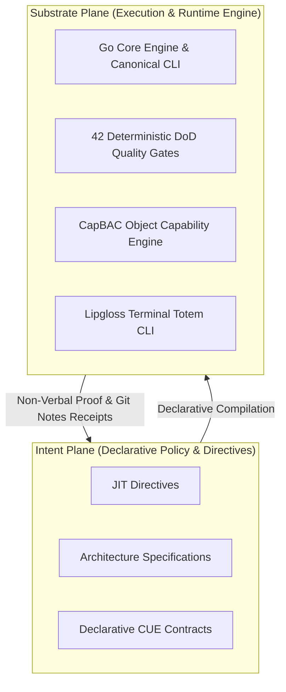

---
authors:
    - Mark Gantlett
    - Nomos Open-Core Substrate
classification: public
date: "2026-10-01"
last_updated: "2026-10-29"
plane: intent
status: active
title: "The Nomos Intent Plane Architectural Specification and Master Manifesto"
type: spec
version: 4.0.0
---

# The Nomos Intent Plane Architectural Specification and Master Manifesto

**Document Key:** `SPEC-INTENT-MANIFESTO`  
**Classification:** Public Open-Core Specification  
**Version:** `4.0.0`  
**Governing Laws:** Law 1 (Dual-Core Inversion), Law 2 (Non-Verbal Proof), Law 3 (Hermetic Worktrees), Law 4 (SSoT), Law 5 (Zero-Hardcoded-Path), Law 6 (Canonical Singularity), Law 7 (Fail-Closed Pre-Flight)  

---

## 1. Executive Summary

Natural language serves as the declarative compilation source for AI agent execution in the Nomos substrate.
Vague syntax and unconstrained prompts generate non-deterministic behaviors, brittle diffs, and architectural drift.
The Nomos Intent plane establishes a machine-verifiable specification and governance substrate for software engineering.
Human engineers declare system invariants, contracts, and lifecycle policies using machine-checkable schemas.
The Substrate Go engine compiles Intent declarations into bounded task envelopes for cognitive co-processors.
Engineering workflows shift from conversational guessing to deterministic, machine-verified compilation.

---

## 2. Axiomatic Invariants (The 7 Laws of Nomos)

The Intent plane establishes the seven governing laws of the Nomos dual-core architecture.
The Substrate plane enforces all seven laws deterministically across runtime lifecycles.

| Law # | Law Name | Core Architectural Invariant | Machine Enforcement Mechanism |
| :---: | :--- | :--- | :--- |
| **1** | **The Dual-Core Inversion Law** | Substrate Go core governs state and execution; Tier 1 agent operates strictly under indirect control. | `nomos verify`, Phase Discipline state machine |
| **2** | **The Non-Verbal Proof Law** | Zero trust in conversational assertions; correctness requires compilation exit code 0 and AST proof. | 42 Go-native Definition of Done Quality Gates (`nomos verify`) |
| **3** | **The Hermetic Worktree Law** | Protected trunk branch `main` remains read-only; mutations occur strictly inside transient worktrees. | `ValidateWorktreeBoundary`, Pre-Commit Hooks |
| **4** | **The Single Source of Truth Law** | Every contract, schema, and configuration possesses exactly one compiled Go SSoT with byte parity. | Cryptographic byte parity audit (`nomos verify`) |
| **5** | **The Zero-Hardcoded-Path Law** | Path literals strictly prohibited in source code; all directories resolve via dynamic configuration. | Configuration discovery (`config.LoadConfig()`) |
| **6** | **The Canonical Singularity Law** | Zero aliases, synonyms, or convenience wrappers tolerated in CLI engines or contract schemas. | Zero-Alias AST Parser validation in CLI entrypoints |
| **7** | **The Fail-Closed Pre-Flight Law** | Mutations require explicit configuration and pass mandatory DoD quality gates prior to release. | CapBAC Object Capabilities, phase budget enforcement |

---

## 3. Pure 2-Plane Topology Architecture (ADR-0061)

The architecture eliminates intermediate plane taxonomies in favor of Pure 2-Plane Singularity under ADR-0061.
The ecosystem permits exactly two canonical planes across all repositories.



### Plane Contract Specifications
- **Intent Plane (`INT-<N>`)**: Governs declarative policy, architectural specifications, and CUE validation schemas.
- **Substrate Plane (`SUB-<N>`)**: Implements the Go compiler, CLI commands, tests, and CLI totem.

The substrate compiler validates task key singularity using regular expression `^(INT|SUB)-[0-9]+(-[a-z0-9-]+)?$`.
Any task identifier referencing deprecated planes fails closed with error code `ERR_CANONICAL_VIOLATION`.

---

## 4. Dual-Core Interface Contracts and DTO Schemas

The Intent plane defines structured data contracts for system manifest validation and state exchange.
Substrate code imports these contracts directly from compiled Go types.

```go
package intent

import "time"

// IntentManifestoDTO defines the authoritative data contract for the Intent plane.
type IntentManifestoDTO struct {
	DocumentKey string             `json:"document_key"`
	Version     string             `json:"version"`
	Laws        []NomosLawDTO      `json:"laws"`
	Topology    PlaneTopologyDTO   `json:"topology"`
	SSoTIndex   []SSoTContractDTO  `json:"ssot_index"`
	ExportedAt  time.Time          `json:"exported_at"`
}

// NomosLawDTO defines the schema for an axiomatic Nomos law.
type NomosLawDTO struct {
	LawNumber   int    `json:"law_number"`
	Name        string `json:"name"`
	Invariant   string `json:"invariant"`
	Enforcement string `json:"enforcement"`
}

// PlaneTopologyDTO declares the canonical 2-plane singularity bounds.
type PlaneTopologyDTO struct {
	AllowedPlanes       []string `json:"allowed_planes"`
	IntentKeyPattern    string   `json:"intent_key_pattern"`
	SubstrateKeyPattern string   `json:"substrate_key_pattern"`
}

// SSoTContractDTO maps declarative CUE contracts to compiled Substrate targets.
type SSoTContractDTO struct {
	Domain             string `json:"domain"`
	ConfigDiscoveryKey string `json:"config_discovery_key"`
	CompiledGoTarget   string `json:"compiled_go_target"`
	EnforcementGate    string `json:"enforcement_gate"`
}
```

---

## 5. Fail-Closed Verification Predicates and State Transitions

The Substrate engine compiles and validates the Intent plane using deterministic verification predicates.
Verification terminates with exit code 1 whenever any predicate evaluates to false.

### Deterministic Invariant Attestation Predicates
1. **Plane Singularity Predicate ($P_{\text{singularity}}$)**:
   $$\forall k \in \text{Tasks}, \quad \text{Prefix}(k) \in \{\text{"INT"}, \text{"SUB"}\}$$
2. **Byte Parity Predicate ($P_{\text{parity}}$)**:
   $$\forall c \in \text{Contracts}, \quad \text{SHA256}(\text{CUE}(c)) = \text{SHA256}(\text{GoSSoT}(c))$$
3. **Law 5 Dynamic Path Predicate ($P_{\text{path}}$)**:
   $$\forall p \in \text{Paths}, \quad p \notin \text{LiteralBlacklist} \land p = \text{ResolveConfig}(\text{Key})$$

### Pre-Flight Evaluation Rules
- If $P_{\text{singularity}} = \text{false}$, abort task creation with error `ERR_CANONICAL_VIOLATION`.
- If $P_{\text{parity}} = \text{false}$, abort release synchronization with error `ERR_INTENT_PARITY_MISMATCH`.
- If $P_{\text{path}} = \text{false}$, abort gatekeeper verification with error `ERR_FORBIDDEN_LITERAL`.

---

## 6. SSoT Registry and Contract Verification

The Intent plane contracts in `intent/contracts/cue/` maintain compile-time byte parity with compiled Go targets in `substrate/`.
Every contract adheres to Law 4 (SSoT) and Law 6 (Canonical Singularity):

| Domain | Declarative CUE Contract | Compiled Go SSoT Target | Enforcement Gate |
| :--- | :--- | :--- | :--- |
| **Workspace Configuration** | `nomos_config.cue` | `substrate/src/nomos/core/config/` | `ParityGate` / `AntiMaskGate` |
| **Contract Boundaries** | `contracts_boundary.cue` | `substrate/src/nomos/modules/verify/gates_contracts_boundary.go` | `ContractVerificationGate` |
| **Object Capabilities** | `capbac_token.cue` | `substrate/src/nomos/core/capbac/` | `CapBACReleaseGate` |
| **Task Lifecycle** | `task.cue` | `substrate/src/nomos/modules/task/` | `TaskContractGate` |
| **Phase State Machine** | `phase_state.cue` | `substrate/src/nomos/core/types/phase.go` | `PhaseDisciplineGate` |
| **AST Verification** | `polyglot.cue`, `ast_anti_shim.cue` | `substrate/src/nomos/modules/verify/` | `AntiShimGate` / `PolyglotGate` |
| **Commit Invariants** | `commit_rules.cue` | `substrate/src/nomos/modules/verify/commit_schema_gate.go` | `CommitSchemaGate` |

---

## 7. Table-Driven Test Vectors

The table below defines the deterministic test vectors for the Intent manifesto and parser engine.

| Vector ID | Target Input Scenario | Evaluated Invariant | Expected Error Code | Expected Verdict |
| :--- | :--- | :--- | :--- | :--- |
| **TV-01** | Task key formatted as `INT-592-distillations` | Pure 2-Plane Singularity (ADR-0061) | `NONE` | **PASS (true)** |
| **TV-02** | Task key formatted with deprecated prefix `MEM-101` | Canonical Singularity (Law 6) | `ERR_CANONICAL_VIOLATION` | **FAIL (false)** |
| **TV-03** | CUE schema modified without compiling Go SSoT | SSoT Byte Parity (Law 4) | `ERR_INTENT_PARITY_MISMATCH` | **FAIL (false)** |
| **TV-04** | Specification prose contains ambiguous modal `should` | NCTE-100 Invariant (SPEC-NCTE-100) | `ERR_NCTE_AMBIGUOUS_MODAL` | **FAIL (false)** |
| **TV-05** | Direct SQL mutation attempted on `nomos_global.db` | Dual-Core Inversion (Law 1) | `ERR_INDIRECT_CONTROL_VIOLATION` | **FAIL (false)** |
| **TV-06** | Staged file mutation outside transient worktree | Hermetic Worktree Boundary (Law 3) | `ERR_WORKTREE_BOUNDARY_VIOLATION` | **FAIL (false)** |
