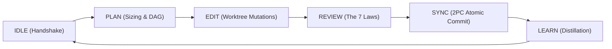

---
authors:
    - Mark Gantlett
    - Nomos Open-Core Substrate
category: taxonomy
classification: public
date: "2026-09-27"
last_updated: "2026-11-03"
phases:
    - IDLE
    - PLAN
    - EDIT
    - REVIEW
    - SYNC
    - LEARN
plane: intent
priority: high
status: active
summary: "Authoritative index, taxonomy specification, and authoring guidelines for Intent lifecycle and JIT directives."
title: "Intent Directives Index & Taxonomy Guide"
type: index
version: 4.0.0
---

# Intent Directives Index & Taxonomy Guide

## 1. Executive Overview & Problem Statement
The Intent Plane maintains the living Single Source of Truth (SSoT) for Tier 1 coding agent behavior, architectural invariants, and terminology. Canonical directives embedded within the Substrate engine are dynamically indexed during session bootup (`nomos handshake`) and injected Just-In-Time (JIT) during phase state transitions.

Historically, early directives relied on fragmented phase enumerations (`triage`, `audit`, `all`) and unanchored prose checklists. In strict compliance with **Law 4 (SSoT)** and **Law 6 (Canonical Singularity)**, this guide formalizes the directive taxonomy, binding all directives to the canonical 6-phase state machine and The Seven Laws & 21 Invariant Cells Suite (42 Definition of Done Quality Gates).



---

## 2. Axiomatic Invariants & Laws Codified

| Law # | Law Name | Architectural Invariant Enforced in Directives |
| :---: | :--- | :--- |
| **Law 2** | **The Non-Verbal Proof Law** | Directives define machine-enforceable invariants verifiable via AST inspection and compiler exit codes. Zero conversational claims tolerated. |
| **Law 4** | **The Single Source of Truth Law** | Directive YAML frontmatter strictly conforms to `handshake.DirectiveFrontmatter`. Exactly one compiled Go schema governs directive metadata. |
| **Law 5** | **The Zero-Hardcoded-Path Law** | Directives reference paths dynamically relative to workspace roots; zero absolute paths or hardcoded developer directory structures. |
| **Law 6** | **The Canonical Singularity Law** | Workspace phases strictly adhere to the canonical 6: `IDLE`, `PLAN`, `EDIT`, `REVIEW`, `SYNC`, `LEARN`. Zero ad-hoc phase aliases (`audit`, `triage`, `all`) permitted. |
| **Law 7** | **The Fail-Closed Pre-Flight Law** | Directives with missing required frontmatter fields, invalid phase enumerations, or broken markdown wires trigger immediate pre-flight rejection (Exit Code 1). |

---

## 3. Taxonomy & Phase Injection Matrix

Directives are mapped deterministically to agent reasoning phases via their frontmatter `phases` array:

| Directive Group | Filename Pattern | Governing Phases | Purpose & Machine Invariants |
| :--- | :--- | :--- | :--- |
| **Orientation** | `00_*.md` | `[IDLE, PLAN]` | System architecture, Tier 1 indirect control harness, taxonomy index. |
| **Handshake** | `handshake_*.md` | `[IDLE, PLAN]` | Workspace topology, dynamic path discovery, worktree boundaries. |
| **Planning** | `plan_*.md` | `[PLAN]` | Task sizing, DAG dependencies, 2-plane singularity (`INT-*` / `SUB-*`). |
| **Mutation** | `edit_*.md` | `[EDIT]` | Hermetic worktree mutations, refactoring disciplines, deprecated terms, Go & JSON Schema synthesis. |
| **Verification** | `review_*.md` | `[REVIEW]` | The Seven Laws & 21 Invariant Cells Suite across 3 Defense Rings (42 Definition of Done Quality Gates), AST anti-shim inspection, non-verbal proof enforcement. |
| **Synchronization** | `sync_*.md` | `[SYNC]` | 2PC atomic release, Living Ledger synchronization, git notes receipts. |
| **Distillation** | `learn_*.md` | `[LEARN]` | Cognitive reflection, Knowledge Item (KI) generation, memory distillation (`nomos mem save`). |

---

## 4. Formal Go Contract & Frontmatter Schema

All directive documents must validate against the compiled `DirectiveFrontmatter` contract:

```go
type DirectiveFrontmatter struct {
	Title          string   `yaml:"title"`
	Description    string   `yaml:"description,omitempty"`
	Authors        []string `yaml:"authors"`
	Classification string   `yaml:"classification"` // "public" | "internal"
	Date           string   `yaml:"date"`
	LastUpdated    string   `yaml:"last_updated"`
	Plane          string   `yaml:"plane"`  // "intent" | "substrate"
	Status         string   `yaml:"status"` // "active" | "archived" | "superseded"
	Type           string   `yaml:"type"`
	Phases         []string `yaml:"phases"` // IDLE | PLAN | EDIT | REVIEW | SYNC | LEARN
	Category       string   `yaml:"category,omitempty"`
	Priority       string   `yaml:"priority,omitempty"`
	Summary        string   `yaml:"summary,omitempty"`
}
```

---

## 5. The Seven Laws & 21 Invariant Cells Suite (DoD Compliance)

Directives are deterministically validated across `nomos verify` Invariant Cells:
1. **Cell (2, 2) - Documentation Link Integrity (Probe 09: `doc_links`):** All cross-directive markdown links must resolve to existing files.
2. **Cell (4, 1) - Intent Steel-Man Parity (Probe 25: `intent_steelman`):** Directive and Intent frontmatter validates against required metadata constraints.
3. **Cell (4, 2) - Contract Schema Integrity (Probe 26: `contract_parity`):** Directives and JSON Schema artifacts match compiled Substrate Go types.
4. **Cell (4, 3) - Intent Immutability (Probe 28: `intent_immutability`):** Operational directives cannot mutate outside active Intent tasks (`INT-*`).

---

## 6. Table-Driven Test Vectors

The following table-driven test vectors validate directive parsing and JIT phase resolution:

| Vector ID | Target Directive File | Declared Phases | Target Phase Context | Expected JIT Action | Failure Invariant |
| :---: | :--- | :--- | :--- | :--- | :--- |
| **VEC-DIR-01** | `00_index_and_taxonomy.md` | `[IDLE, PLAN, EDIT, REVIEW, SYNC, LEARN]` | `PLAN` | `INJECT` | Universal directive injected across all phases |
| **VEC-DIR-02** | `plan_01_sizing_and_dag.md` | `[PLAN]` | `PLAN` | `INJECT` | Phase match triggers JIT envelope inclusion |
| **VEC-DIR-03** | `plan_01_sizing_and_dag.md` | `[PLAN]` | `EDIT` | `SKIP` | Phase mismatch cleanly skips directive |
| **VEC-DIR-04** | `edit_01_deprecated_terms.md` | `[EDIT]` | `EDIT` | `INJECT` | Mutation phase injects deprecated terminology rules |
| **VEC-DIR-05** | `malformed_directive.md` | `["TRIAGE"]` | `PLAN` | `FAIL` | Law 6: Non-canonical phase `TRIAGE` rejected at pre-flight |
| **VEC-DIR-06** | `missing_phase.md` | `[]` | `IDLE` | `FAIL` | Law 7: Empty phases array rejected at pre-flight |
| **VEC-DIR-07** | `broken_link.md` | `[REVIEW]` | `REVIEW` | `FAIL` | Cell (4, 1) (`BrokenWireGate`): Non-existent markdown target fails verification |

