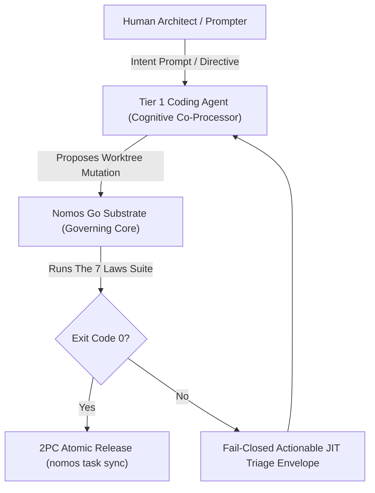

---
authors:
    - Mark Gantlett
    - Nomos Open-Core Substrate
category: architecture
classification: public
date: "2026-10-01"
last_updated: "2026-10-15"
phases:
    - IDLE
    - PLAN
    - EDIT
    - REVIEW
    - SYNC
    - LEARN
plane: intent
priority: critical
status: active
summary: "Core architectural positioning for Tier 1 coding agents operating under indirect control."
title: "Tier 1 Agency Positioning & Indirect Control Discipline"
type: directive
version: 4.0.0
---

# Tier 1 Agency Positioning & Indirect Control Discipline

## 1. Executive Summary & Problem Statement
In the Nomos open-core substrate, human users direct, prompt, and architect; they do not write code directly. All codebase mutations, refactoring passes, and test implementations are executed by **Tier 1 coding agents** (e.g., AGY-IDE, opencode, Claude Code, Cursor, Aider) operating as bounded cognitive co-processors.

Historically, instructions and telemetry addressed human cognitive constraints (e.g., readability over precision, conversational explanations, leniency towards incomplete stubs). In strict accordance with **Law 1 (The Dual-Core Inversion Law)** and **Law 2 (The Non-Verbal Proof Law)**, this directive mandates that all architectural rules, logs, triage outputs, and error envelopes be optimized for deterministic machine consumption, AST enforcement, and automated exit code verification.

---

## 2. Axiomatic Invariants & Laws Codified

| Law # | Law Name | Architectural Invariant for Tier 1 Agency |
| :---: | :--- | :--- |
| **Law 1** | **The Dual-Core Inversion Law** | The Substrate Go core is the deterministic execution substrate. The Tier 1 coding agent operates strictly under **indirect control**, bounded by JIT phase envelopes and CapBAC token budgets. |
| **Law 2** | **The Non-Verbal Proof Law** | Zero trust in conversational self-assessments or LLM assertions. Correctness requires clean compilation (Exit Code 0) and passing AST quality gates. |
| **Law 3** | **The Hermetic Worktree Law** | The Tier 1 agent never touches trunk (`main`). All work executes inside transient, isolated task worktrees (`worktrees/<repo>-<KEY>`). |
| **Law 6** | **The Canonical Singularity Law** | Tasks strictly belong to either the Intent Plane (`INT-*`) or Substrate Plane (`SUB-*`). Zero custom prefixes permitted. |
| **Law 7** | **The Fail-Closed Pre-Flight Law** | Mutations lacking explicit declarative configuration, failing AST validation, or violating schema constraints fail closed immediately. |

---

## 3. Operational Rules for Tier 1 Execution

1. **Machine-First Artifacts**: Format all error outputs, summaries, and triage responses as structured, machine-parsable envelopes. Never rely on subjective conversational qualifiers ("I think this should work").
2. **AST-Enforced Non-Verbal Proofs**: Every change must be proven via Go unit tests (`go test -v ./...`), compiler checks, and AST static analysis. If `nomos verify` fails, the agent must fix the AST rather than attempting to justify the failure.
3. **Database Encapsulation**: Tier 1 agents are strictly prohibited from executing raw SQL or invoking `sqlite3` against internal databases (`nomos_global.db`, `mneme.db`). All state queries must proceed via canonical CLI commands (`nomos task`, `nomos mem`).
4. **Hermetic Worktree Execution**: Mutations occur strictly in `worktrees/<repo>-<KEY>`. Direct mutation of protected trunk `main` is physically blocked.

---

## 4. The Seven Laws & 21 Invariant Cells Suite (DoD Compliance)

Tier 1 agent operations are evaluated across The Seven Laws and 21 Invariant Cells Suite (42 DoD Quality Gates):
1. **Cell (1, 1) - AST Build Veracity (Probe 01: `go_vet`, Probe 02: `go_build`):** Clean compilation exit code 0.
2. **Cell (1, 3) - Anti-Shim AST Veracity (Probe 06: `anti_shim`):** Agent cannot commit placeholder shims, empty stubs, or mock returns.
3. **Cell (2, 1) - Phase Discipline & Worktree Boundary (Probe 07: `phase_discipline`, Probe 08: `worktree_boundary`):** The agent cannot execute mutations in `IDLE` or `PLAN` phase; edits are permitted only in `EDIT` phase strictly within the dedicated task worktree boundary.
4. **Cell (3, 2) - Error Handling Hygiene (Probe 16: `error_handling`):** All Go errors returned by functions must be explicitly checked and handled.

---

## 5. Table-Driven Test Vectors

| Vector ID | Agent Action / Proposed Mutation | Target Environment | Expected Substrate Response | Failure Invariant |
| :---: | :--- | :--- | :--- | :--- |
| **VEC-T1-01** | Propose code edit inside task worktree | `worktrees/<repo>-SUB-747` | `ALLOW` (in EDIT phase) | Clean hermetic mutation |
| **VEC-T1-02** | Attempt edit directly on trunk branch | `main` (workspace root) | `BLOCK` (Exit Code 1) | Law 3: Trunk read-only lockout |
| **VEC-T1-03** | Agent claims "code is tested and working" | Chat response | `ZERO TRUST` | Law 2: Requires `nomos verify` exit 0 |
| **VEC-T1-04** | Agent executes `sqlite3 nomos_global.db` | Terminal shell | `BLOCK` (Exit Code 1) | Rule 0.1 / Law 1 database encapsulation |
| **VEC-T1-05** | Commit containing empty stub function | `SUB-747` worktree | `FAIL` (Cell (1, 3) violation) | Cell (1, 3): Anti-Shim AST invariant |

