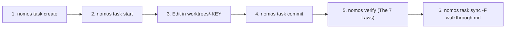

---
authors:
    - Mark Gantlett
    - Nomos Open-Core Substrate
category: architecture
classification: public
date: "2026-10-08"
last_updated: "2026-10-15"
phases:
    - PLAN
    - EDIT
    - REVIEW
    - SYNC
plane: intent
priority: critical
status: active
summary: "Standard operating procedure for Tier 1 agents across worktree mutation, schema commit, and 2PC sync."
title: "Agentic Workflow & Commit Discipline"
type: directive
version: 4.0.0
---

# Agentic Workflow & Commit Discipline

## 1. Executive Summary & Problem Statement
In open-core Nomos, protected trunk branches (`main`) are physically read-only. Tier 1 coding agents operate under strict phase discipline, moving sequentially through `PLAN` $\rightarrow$ `EDIT` $\rightarrow$ `REVIEW` $\rightarrow$ `SYNC` $\rightarrow$ `LEARN`. Bypassing this pipeline via raw `git commit` or `--no-verify` bypasses is strictly forbidden.

This directive codifies the canonical agentic mutation lifecycle, governing hermetic worktree isolation (`worktrees/<repo>-<KEY>`), structured commit schema validation, and 2-phase commit (2PC) atomic releases across The Seven Laws & 21 Invariant Cells Suite (42 DoD Quality Gates).



---

## 2. Axiomatic Invariants & Laws Codified

| Law # | Law Name | Architectural Invariant Enforced in Workflow |
| :---: | :--- | :--- |
| **Law 1** | **The Dual-Core Inversion Law** | Substrate Go core governs state & execution. The Tier 1 agent operates strictly as a bounded cognitive co-processor under indirect control. |
| **Law 2** | **The Non-Verbal Proof Law** | Every task release requires verification exit code 0 across The Seven Laws and 21 Invariant Cells. Bypassing gates via `--no-verify` is physically prohibited. |
| **Law 3** | **The Hermetic Worktree Law** | Protected trunk `main` is read-only. Mutations execute strictly inside isolated task worktrees (`worktrees/<repo>-<KEY>`). |
| **Law 6** | **The Canonical Singularity Law** | Tasks strictly use keys `INT-<N>` or `SUB-<N>`. Zero custom prefixes or filesystem symlinks tolerated (`ZeroFilesystemAliasGate`). |
| **Law 7** | **The Fail-Closed Pre-Flight Law** | Mutations strictly segregated by plane: `SUB-*` cannot mutate `intent/`, `INT-*` cannot mutate `substrate/` (`PlaneSeparationGate`). Commit tokens machine-enforced. |

---

## 3. Standard Operating Procedure (The 5-Step Flow)

### Step 0: Session Bootup & Git Hook Auto-Installation (`nomos handshake`)
On session boot, running `nomos handshake` self-audits `.git/hooks/` and automatically installs the canonical `pre-commit` and `commit-msg` hooks if absent or drifting. Raw `git commit` invocations lacking CapBAC tokens or Golden Commit + `Task:` trailer formatting are rejected fail-closed at the Git level.

### Step 1: Establish State (`nomos task create`)
```bash
nomos task create "<Short description>" -p [intent|substrate]
```

### Step 2: Provision Worktree Boundary (`nomos task start`)
```bash
nomos task start <KEY>
```
*Effect:* Atomically transitions phase from `PLAN` to `EDIT`, checks out branch `feature/<KEY>`, and provisions isolated worktree at `worktrees/<repo>-<KEY>`.

### Step 3: Hermetic Mutation (`EDIT` Phase)
Execute all file edits strictly within the designated worktree `worktrees/<repo>-<KEY>`. Never modify the repository root.

### Step 4: Golden Conventional Commit (`nomos task commit`)
```bash
git add .
nomos task commit <KEY> -m "<type(scope): summary>" --rationale "<Why>" --mechanics "<How>"
```
*Effect:* Generates a machine-verifiable Golden Conventional Commit (`[<KEY>] <type>(<scope>): <summary>`, flowing CommonMark rationale prose, zero redundant file dumps, `___` visual divider, and RFC 822 `Task:`/`Twin:` Git trailers) enforced by `CommitSchemaGate`, injects short-lived CapBAC commit token, and executes git commit.

### Step 5: 2PC Atomic Release (`nomos task sync`)
From the repository root (outside the worktree):
```bash
nomos task sync <KEY> -F .tmp/walkthrough.md
```
*Effect:* Evaluates The Seven Laws & 21 Invariant Cells Suite via `nomos verify`, executes fast-forward merge onto trunk, writes cryptographic git-notes release receipt, transitions Living Ledger task to `DONE`, and cleans up transient worktree directory.

---

## 4. Handling Verification Failures
If `nomos verify` or `nomos task sync` reports gate violations:
1. Re-enter the task worktree: `cd worktrees/<repo>-<KEY>`.
2. Inspect actionable triage output: `nomos verify`.
3. Resolve AST violations directly. Never attempt `--no-verify`.
4. Re-commit via `nomos task commit <KEY>` and re-verify.

---

## 5. Table-Driven Test Vectors

| Vector ID | Agent Action / Command | Execution Context | Expected Outcome | Failure Invariant |
| :---: | :--- | :--- | :--- | :--- |
| **VEC-FLOW-01** | `nomos task start SUB-747` | Repository root | `PASS`: Provisions `worktrees/<repo>-SUB-747` | Clean worktree provisioning |
| **VEC-FLOW-02** | `git commit -m "hack"` without token | Repository root | `FAIL` (Exit Code 1) | Law 3 & 7: Raw commit to trunk rejected |
| **VEC-FLOW-03** | `git commit --no-verify` | Any branch | `FAIL` (Exit Code 1) | Law 7: `--no-verify` explicitly blocked |
| **VEC-FLOW-04** | `nomos task commit SUB-747` with valid flags | Inside worktree | `PASS`: Schema validated and committed | Schema adherence |
| **VEC-FLOW-05** | `nomos task sync SUB-747` with 7/7 Laws passing | Repository root | `PASS`: 2PC atomic release to trunk | Clean release cycle |

