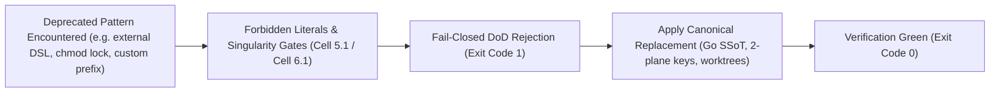

---
authors:
    - Mark Gantlett
    - Nomos Open-Core Substrate
category: taxonomy
classification: public
date: "2026-09-27"
last_updated: "2026-11-03"
phases:
    - EDIT
    - REVIEW
plane: intent
priority: critical
status: active
summary: "Active open-core term deprecations and canonical replacements enforced by substrate gates."
title: "Deprecated Terms & Taxonomy Directives"
type: directive
version: 4.3.0
---

# Deprecated Terms & Taxonomy Directives

## 1. Executive Summary & Problem Statement
To maintain semantic clarity and eliminate split-brain architectural concepts, the Nomos Definition of Done (DoD) verification engine enforces strict lexical and taxonomic invariants across source files, commit messages, and Intent specifications.

This directive establishes the authoritative dictionary of deprecated concepts and their canonical replacements in open-core repositories. Using configured forbidden literals or retired mechanisms triggers fail-closed rejection at **Cell (5, 1) (`ForbiddenLiteralsGate`)** and **Cell (5, 2) (`MagicStringsGate`)**.

---

## 2. Axiomatic Invariants & Laws Codified

| Law # | Law Name | Architectural Invariant Enforced in Terminology |
| :---: | :--- | :--- |
| **Law 2** | **The Non-Verbal Proof Law** | AST and static scanners enforce zero forbidden terminology. Conversational exemptions are rejected. |
| **Law 4** | **The Single Source of Truth Law** | Every contract and concept has exactly one canonical name and compiled Go SSoT (`nomos.schema.json`). |
| **Law 6** | **The Canonical Singularity Law** | Exactly one CLI binary (`nomos`), two planes (`intent`, `substrate`), and pure task keys (`INT-*`, `SUB-*`). |
| **Law 7** | **The Fail-Closed Pre-Flight Law** | Files containing configured `forbidden_literals` or banned synonyms fail closed during `nomos verify`. |

---

## 3. Authoritative Terminology Mappings

| Deprecated Concept / Mechanism | Canonical Replacement | Architectural Rationale & Governing Law |
| :--- | :--- | :--- |
| External policy DSLs (`.rego`, `.cue`) | `Compiled Go SSoT & Draft 2020-12 JSON Schema` | Eliminates split-brain external DSL interpreters in favor of compiled Go structs and `nomos.schema.json` (Law 4 & Law 6). |
| Custom task prefixes (`FEAT-*`, `BUG-*`, `CUST-*`) | `Pure 2-Plane Singularity (INT-* / SUB-*)` | Task keys bind 1:1 to architectural planes (`intent` vs `substrate`) under Law 6 & Law 7. |
| OS permission locks (`chmod -R a-w`) | `Law 3 Hermetic Worktrees & CapBAC Leases` | Replaces brittle filesystem permission toggles with Git defense hooks, CapBAC tokens, and `worktrees/<repo>-<KEY>`. |
| Hidden `.nomos/intent/` directory | Root `intent/` directory | Intent specifications live as a first-class version-controlled peer alongside `substrate/` (Law 4). |
| Filesystem symlinks (`ln -s`) | Physical canonical files | Symlinks create path aliases and escape worktree boundaries; blocked by `ZeroFilesystemAliasGate` (Law 6). |
| Custom `.agents/skills/` or slash workflows | `AGENTS.md`, `CLAUDE.md`, `.agents/hooks.json` | Indirect control operates via compiled sub-5ms ambient hooks without custom prompt wrappers (Law 1). |
| `developer tier` / `tier 3` | `Adoption Profile (Solo / Team / Regulated)` | "Tier" refers strictly to coding agent autonomy (`Tier 1` indirect control vs sovereign `Tier 2`). |

---

## 4. The Seven Laws & 21 Invariant Cells Suite (DoD Compliance)

Terminology and singularity compliance are verified across the following invariant cells:
1. **Cell (5, 1) - Forbidden Literals Invariant (`ForbiddenLiteralsGate`):** Scans source files for repository-configured `forbidden_literals` and machine-specific absolute paths.
2. **Cell (5, 2) - Polyglot Magic Strings Invariant (`MagicStringsGate`):** Rejects hardcoded localhost URLs, ports, and unconfigured environment literals across polyglot ASTs.
3. **Cell (6, 1) & Cell (6, 2) - Canonical Singularity (`CanonicalSingularityGate`, `ZeroAliasGate`, `ZeroFilesystemAliasGate`):** Enforces pure `INT-*`/`SUB-*` keys, zero Cobra command aliases, and zero filesystem symlinks.
4. **NCTE-100 Lexicon (`nomos directive --lexicon`):** Provides 36 canonical engineering verbs and nouns with deterministic banned-synonym lookup (`nomos directive --term <word>`).

---

## 5. Table-Driven Test Vectors

| Vector ID | Scanned Input | Detected Violation | Expected Gate Verdict | Prescribed Remediation |
| :---: | :--- | :--- | :--- | :--- |
| **VEC-TERM-01** | `nomos task create "Fix" --key FEAT-1` | `FEAT-1` | `FAIL` (`Cell (6, 1)` violation) | Use `--plane substrate` (`SUB-*`) or `--plane intent` (`INT-*`) |
| **VEC-TERM-02** | `path := "/Users/alice/repo"` | Hardcoded host path | `FAIL` (`Cell (5, 1)` violation) | Resolve workspace root dynamically via `workspace.FindRepoRoot` |
| **VEC-TERM-03** | `ln -s ../shared/config.yaml` | Filesystem symlink | `FAIL` (`Cell (6, 2)` violation) | Replace symlink with canonical physical file |
| **VEC-TERM-04** | `chmod -R a-w .` in script | Forbidden OS lock pattern | `FAIL` (`Cell (5, 1)` violation) | Provision isolated task worktree via `nomos task chore` or `start` |
| **VEC-TERM-05** | `Nomos is a deterministic governance harness` | None | `PASS` | Clean canonical terminology |
