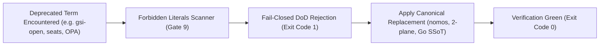

---
authors:
    - Mark Gantlett
    - Sophia
category: taxonomy
classification: public
date: "2026-09-27"
last_updated: "2026-10-15"
phases:
    - EDIT
    - REVIEW
plane: intent
priority: critical
status: active
summary: "Active ecosystem term deprecations and canonical replacements enforced by substrate gates."
title: "Deprecated Terms & Taxonomy Directives"
type: directive
version: 3.0.0
---

# Deprecated Terms & Taxonomy Directives

## 1. Executive Summary & Problem Statement
To maintain semantic clarity and eliminate split-brain architectural concepts, the Nomos Definition of Done (DoD) verification engine enforces strict lexical and taxonomic invariants across all source files, commit messages, and Intent specifications.

This directive establishes the authoritative dictionary of deprecated terms and their canonical replacements. Using deprecated terms in active code or specifications triggers fail-closed rejection at Gate 9 (Forbidden Literals) and Gate 21 (Magic Strings Polyglot).

---

## 2. Axiomatic Invariants & Laws Codified

| Law # | Law Name | Architectural Invariant Enforced in Terminology |
| :---: | :--- | :--- |
| **Law 2** | **The Non-Verbal Proof Law** | AST and static scanners enforce zero deprecated terminology. Conversational exemptions are rejected. |
| **Law 4** | **The Single Source of Truth Law** | Every concept has exactly one canonical name. Zero synonyms, aliases, or dual-source terms permitted. |
| **Law 6** | **The Canonical Singularity Law** | Exactly one CLI binary (`nomos`), exactly two planes (`intent`, `substrate`), and pure task keys (`INT-*`, `SUB-*`). |
| **Law 7** | **The Fail-Closed Pre-Flight Law** | Files containing deprecated or blacklisted terminology fail closed immediately during `nomos verify`. |

---

## 3. Authoritative Terminology Mappings

| Deprecated Concept / Term | Canonical Replacement | Architectural Rationale & Governing Statute |
| :--- | :--- | :--- |
| `gsi-open` | `nomos` | Ecosystem foundation rename; single open-core public repository (ADR-0055). |
| `Sophia vs Nomos seats` / `seats` | `Pure 2-Plane Singularity (INT-* / SUB-*)` | Eliminates persona/seat taxonomy; identity derives purely from planes (ADR-0061). |
| `OPA / Rego` / `.rego` | `Compiled Go SSoT & JSON Schema` | Eliminates external DSL engines in favor of compiled Go validation and `nomos.schema.json`. |
| `nomos intent stream` | `nomos session` | Eliminates bespoke matrix streaming daemon in favor of canonical session engine. |
| `NAML chmod` | `Law 3 Hermetic Worktrees & Trunk Lockout` | Replaces brittle OS `chmod` with CapBAC capability tokens and git worktrees (INT-588). |
| `devops kit` / `operating system` | `Deterministic Engineering Substrate` | Nomos is an execution & verification substrate, analogous to Cargo or Terraform. |
| `runtime framework` | `Deterministic Execution Substrate` | Eliminates framework terminology; substrate enforces execution physics. |
| `master` / `develop` branch | `main` (trunk) / `intent`, `substrate` | Trunk branches aligned 1:1 to architectural planes. |
| `quad-cli (horos, kratos, sophia)` | `nomos` (Single Unified CLI) | All CLI functionality consolidated into canonical `nomos` binary (ADR-0024). |
| `four planes` | `Dual-Core Architecture (Intent & Substrate)` | Exactly 2 planes exist (Intent and Substrate). Commercial UI (Membrane) resides in gsi-sov (ADR-0031). |
| `developer tier / tier 3` | `Adoption Profile (Solo / Team / Regulated)` | "Tier" is reserved strictly for coding agents (ADR-0031). |
| `systemone` / `JEV` / `KEV` | *(removed)* | Cancelled spike; strictly forbidden in code, config, or documentation. |
| `.nomos/intent/` | root `intent/` | Downstream intent plane is a first-class visible peer of the codebase. |

---

## 4. The Seven Laws & 21 Invariant Cells Suite (DoD Compliance)

Terminology compliance is verified across the following automated invariant cells:
1. **Cell (3, 1) - Forbidden Literals Invariant (Probe 14: `forbidden_literals`):** Scans all staged source files for deprecated terms and forbidden tokens.
2. **Cell (3, 2) - Magic Strings Polyglot Invariant (Probe 17: `magic_strings`):** Scans polyglot strings for legacy repo names or outdated topology markers.
3. **Cell (3, 3) - String Literal Duplication Invariant (Probe 19: `string_dup`):** Prevents ad-hoc duplication of string literals across packages.

---

## 5. Table-Driven Test Vectors

| Vector ID | Scanned File Content | Matched Forbidden Term | Expected Gate Verdict | Prescribed Remediation |
| :---: | :--- | :--- | :--- | :--- |
| **VEC-TERM-01** | `repo = "gsi-open"` | `gsi-open` | `FAIL` (Cell (3, 1) violation) | Replace with `nomos` (ADR-0055) |
| **VEC-TERM-02** | `[Seat: sophia]` | `[Seat:` | `FAIL` (Cell (3, 1) violation) | Remove seat tag; use Pure 2-Plane (ADR-0061) |
| **VEC-TERM-03** | `policy.rego` | `rego` | `FAIL` (Cell (3, 1) violation) | Implement compiled Go gate (`verify.Gate`) |
| **VEC-TERM-04** | `chmod -R a-w .` | `chmod -R a-w` | `FAIL` (Cell (3, 1) violation) | Use `nomos task start` worktree isolation |
| **VEC-TERM-05** | `Nomos is a deterministic engineering substrate` | None | `PASS` | Clean canonical terminology |

