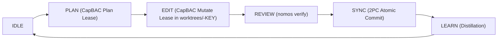

---
authors:
    - Mark Gantlett
    - Nomos Open-Core Substrate
category: runtime
classification: public
date: "2026-09-27"
last_updated: "2026-10-15"
phases:
    - EDIT
plane: intent
priority: high
status: active
summary: "Active runtime protocols governing transient task worktrees, CapBAC capability budgets, and zero-touch phase transitions."
title: "Active Transient Protocols & Multi-Agent Concurrency"
type: directive
version: 4.0.0
---

# Active Transient Protocols & Multi-Agent Concurrency

## 1. Executive Summary & Problem Statement
To ensure deterministic execution across autonomous agent runs and prevent concurrent session collisions, the Nomos substrate isolates all task mutations inside transient worktrees governed by capability-based access control (CapBAC) and phase state transitions.

Historically, protocols referenced non-canonical 9-phase models (`TRIAGE`, `SPEC`, `AUDIT`) and uncontrolled multi-agent mesh ideas. This directive codifies the canonical 6-phase runtime discipline (`IDLE` $\rightarrow$ `PLAN` $\rightarrow$ `EDIT` $\rightarrow$ `REVIEW` $\rightarrow$ `SYNC` $\rightarrow$ `LEARN`), CapBAC token leases, and fail-closed isolation mechanics.

---

## 2. Axiomatic Invariants & Laws Codified

| Law # | Law Name | Architectural Invariant Enforced in Transient Runtime |
| :---: | :--- | :--- |
| **Law 1** | **The Dual-Core Inversion Law** | The Substrate Go core is the authoritative state manager. Phase transitions proceed deterministically via CLI commands (`nomos task`). |
| **Law 3** | **The Hermetic Worktree Law** | All mutations are transient and isolated to `worktrees/<repo>-<KEY>`. Main branch files remain physically immutable. |
| **Law 6** | **The Canonical Singularity Law** | Exactly 6 workspace phases exist: `IDLE`, `PLAN`, `EDIT`, `REVIEW`, `SYNC`, `LEARN`. Zero ad-hoc intermediate phases. |
| **Law 7** | **The Fail-Closed Pre-Flight Law** | Mutations attempted without an active `EDIT` phase CapBAC lease fail closed immediately with Exit Code 1. |

---

## 3. Operational Protocols

1. **CapBAC Ephemeral Leases**: Mutations and file writes require a valid CapBAC capability token scoped to `(task_key, phase)`. Token budgets and allowed file paths are enforced by Substrate pre-flight hooks.
2. **Zero-Touch Autonomy**: When running in automated modes, phase transitions execute deterministically without conversational pauses once pre-conditions are satisfied.
3. **Database Encapsulation**: Direct mutation or querying of internal SQLite databases (`nomos_global.db`, `mneme.db`) is strictly forbidden (Rule 0.1 / Law 1). All interactions proceed through canonical CLI commands (`nomos task`, `nomos mem`).

---

## 4. The Seven Laws & 21 Invariant Cells Suite (DoD Compliance)

1. **Cell (2, 1) - Phase Discipline & Worktree Boundary (Probe 07: `phase_discipline`, Probe 08: `worktree_boundary`):** Enforces that the workspace phase matches the requested operation and modified files reside strictly within the task worktree.
2. **Cell (4, 3) - Intent Immutability Invariant (Probe 28: `intent_immutability`):** Prevents modification of `nomos.yaml` during substrate tasks.

---

## 5. Table-Driven Test Vectors

| Vector ID | Operation Attempted | Active Phase | Target Path | Expected Result | Governing Law |
| :---: | :--- | :--- | :--- | :--- | :--- |
| **VEC-TRAN-01** | Write source file | `EDIT` | `worktrees/<repo>-SUB-747/main.go` | `ALLOW` | Law 3: Valid worktree mutation |
| **VEC-TRAN-02** | Write source file | `PLAN` | `worktrees/<repo>-SUB-747/main.go` | `BLOCK` (Exit Code 1) | Law 7: Phase must be `EDIT` |
| **VEC-TRAN-03** | Write to trunk | `EDIT` | `<repo>/src/main.go` | `BLOCK` (Exit Code 1) | Law 3: Trunk read-only lockout |
| **VEC-TRAN-04** | Direct `sqlite3` call | Any | `nomos_global.db` | `BLOCK` (Exit Code 1) | Law 1 database encapsulation |
| **VEC-TRAN-05** | Transition to `AUDIT` | `EDIT` | N/A | `FAIL` (Exit Code 1) | Law 6: Non-canonical phase rejected |

