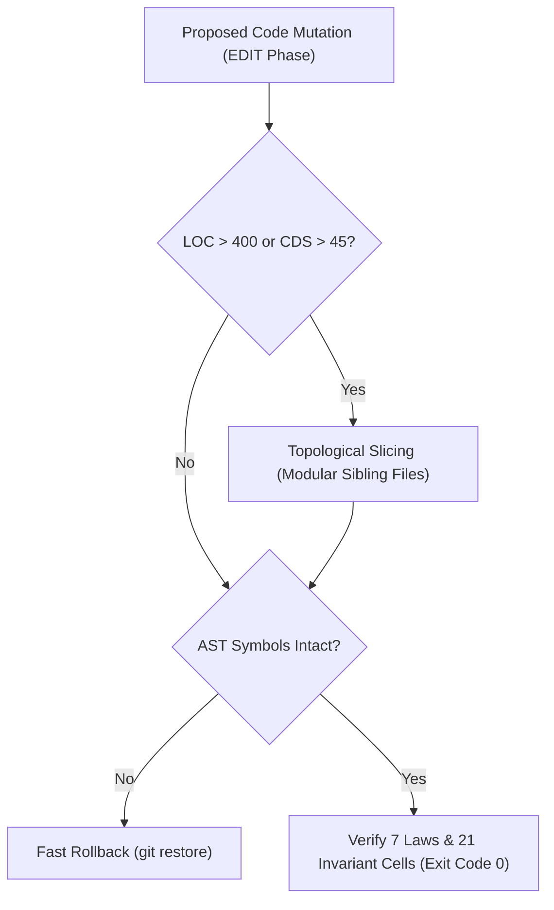

---
authors:
    - Mark Gantlett
    - Sophia
category: architecture
classification: public
date: "2026-09-27"
last_updated: "2026-10-15"
phases:
    - EDIT
plane: intent
priority: critical
status: active
summary: "Authoritative mutation guardrails, refactoring disciplines, and AST preservation invariants for code mutations."
title: "Mutation Guardrails & Refactoring Disciplines"
type: directive
version: 4.0.0
---

# Mutation Guardrails & Refactoring Disciplines

## 1. Executive Summary & Problem Statement
Uncontrolled refactoring by autonomous coding agents introduces silent symbol regressions, broken call sites, cognitive complexity inflation, and dead-code debt. When agents attempt broad regex replacements or truncate code to fit token windows, systems rapidly degrade.

In strict compliance with **Law 2 (The Non-Verbal Proof Law)** and **Law 7 (The Fail-Closed Pre-Flight Law)**, this directive mandates deterministic refactoring disciplines for Tier 1 coding agents operating in the `EDIT` phase. All modifications must preserve AST symbol parity, respect file length and cognitive debt bounds (Cell (1, 2): $\text{LOC} \le 400$; $\text{CDS} \le 45$), and verify compilation exit code 0.

---

## 2. Axiomatic Invariants & Laws Codified

| Law # | Law Name | Architectural Invariant Enforced in Refactoring |
| :---: | :--- | :--- |
| **Law 2** | **The Non-Verbal Proof Law** | Zero conversational claims. Refactoring correctness requires Go compilation (`go test ./...`) exit code 0 and AST proof. |
| **Law 3** | **The Hermetic Worktree Law** | Refactoring executes strictly inside isolated task worktrees (`worktrees/<repo>-<KEY>`). Protected trunk `main` is read-only. |
| **Law 4** | **The Single Source of Truth Law** | When refactoring contract schemas, update the single compiled Go/CUE SSoT. Zero split-brain or duplicate definitions. |
| **Law 5** | **The Zero-Hardcoded-Path Law** | Zero hardcoded filesystem paths or literal string ports introduced during refactoring. Use dynamic config discovery (`config.LoadConfig()`). |
| **Law 7** | **The Fail-Closed Pre-Flight Law** | Mutations that break compilation or drop exported symbols without atomic caller updates fail closed immediately. |

---

## 3. Core Operational Mutation Guardrails

### 3.1 Zero Blind Find-and-Replace Invariant
Never execute indiscriminate blanket regex replacements across directories. Blind replacements corrupt string constants, comments, and external library symbols. Every refactor must be AST-aware and compiler-verified.

### 3.2 AST Symbol Parity Invariant
Exported functions, types, constants, and interface methods must never silently disappear during refactoring. Renaming or signature changes require an atomic migration across all callers within the same task commit.

### 3.3 Topological Slicing & Anti-Truncation Discipline
When Go source files approach length or complexity limits:
- **Maximum File LOC:** $\le 400$ lines (Gate 16).
- **Maximum Cognitive Debt Score (CDS):** $\le 45$ (Gate 17).
- **Maximum Function LOC:** $\le 60$ lines; **Maximum Cyclomatic Complexity ($M$):** $\le 15$ (Gate 13).
- **Decomposition:** Slice monolithic files into modular sibling packages or files (e.g., `*_helpers.go`, `*_handlers.go`, `*_types.go`). **Never** truncate, elide, or stub logic (`// ... rest of implementation`) to save context tokens.

### 3.4 Fast Rollback on Regression
If a refactoring pass produces cascading compilation failures or circular package dependencies, immediately restore the clean baseline via `git restore .`. Do not enter multi-turn patching loops over a broken diff.

### 3.5 Absolute Zero-Symlink & Zero-Filesystem-Alias Invariant (Law 6)
Filesystem symlinks are strictly prohibited across the entire repository. Symlinks create deceptive path aliases, break hermetic worktree boundaries, and violate Law 6 (Canonical Singularity) and Law 4 (Single Source of Truth). Every file must exist as a canonical physical file on disk. Any introduction of a symlink fails closed with exit code 1 (`ZeroFilesystemAliasGate`).

### 3.6 Bidirectional Universal Plane Separation Invariant (Law 7)
Tasks belonging to the `substrate` plane (`SUB-*`) are strictly prohibited from mutating any file within `intent/`. Tasks belonging to the `intent` plane (`INT-*`) are strictly prohibited from mutating any file within `substrate/`. Cross-plane mutations must be split into twinned `INT-*` and `SUB-*` tasks executed in their respective planes. Violations fail closed with exit code 1 (`PlaneSeparationGate`).

---

## 4. The Seven Laws & 21 Invariant Cells Suite (DoD Compliance)

Refactoring operations must satisfy The Seven Laws and 21 Invariant Cells Suite (42 DoD Quality Gates):
1. **Cell (1, 1) - AST Build Veracity (Probe 01: `go_vet`, Probe 02: `go_build`):** Compilation exit code 0.
2. **Cell (1, 2) - Cognitive Complexity Budget (Probe 03: `complexity`, Probe 04: `cognitive_debt`, Probe 05: `file_loc`):** Cyclomatic complexity $\le 15$, function length $\le 60$ LOC, file length $\le 400$ LOC, CDS $\le 45$.
3. **Cell (1, 3) - Anti-Shim AST Veracity (Probe 06: `anti_shim`):** Zero placeholder functions, empty blocks, or stub implementations.
4. **Cell (2, 3) - Dead-Code Reachability (Probe 12: `dead_code`):** All exported command symbols must be reachable with zero dead code.

---

## 5. Table-Driven Test Vectors

| Vector ID | Refactoring Scenario | Target File State | Expected Gate Verdict | Governing Invariant |
| :---: | :--- | :--- | :--- | :--- |
| **VEC-REF-01** | Function decomposed into helper | `LOC = 280`, `CDS = 22`, `M = 6` | `PASS` | Cell (1, 2) met |
| **VEC-REF-02** | File exceeds length bounds | `LOC = 450` | `FAIL` (Cell (1, 2) violation) | Cell (1, 2): Max File LOC $\le 400$ |
| **VEC-REF-03** | Function exceeds cyclomatic complexity | `complexity = 18` | `FAIL` (Cell (1, 2) violation) | Cell (1, 2): Max Complexity $\le 15$ |
| **VEC-REF-04** | Exported function removed without caller update | Compilation error in caller | `FAIL` (Cell (1, 1) violation) | Law 2: Compiler exit code 0 |
| **VEC-REF-05** | Stub function committed (`return nil`) | Empty function body | `FAIL` (Cell (1, 3) violation) | Cell (1, 3): Anti-Shim AST invariant |

