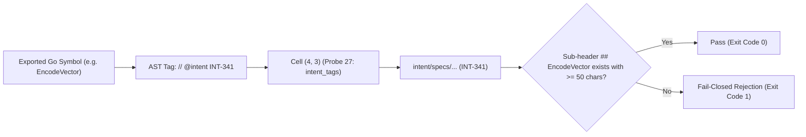

---
authors:
    - Mark Gantlett
    - Sophia
category: architecture
classification: public
date: "2026-10-02"
last_updated: "2026-10-15"
phases:
    - EDIT
    - REVIEW
plane: intent
priority: high
status: active
summary: "Authoritative rules for AST Intent tagging (// @intent INT-XXX), Living Intent anchors, and Law 4 Cell (4, 3) verification."
title: "Intent Traceability Anchors & AST Tagging Discipline"
type: directive
version: 3.0.0
---

# Intent Traceability Anchors & AST Tagging Discipline

## 1. Executive Summary & Problem Statement
In the Nomos Two-Plane Substrate, physical code changes in the Substrate Plane must possess verifiable, cryptographic bidirectional traceability to architectural specifications in the Intent Plane.

This directive establishes the AST annotation rules and markdown anchor requirements enforced by **Law 4 Cell (4, 3) (Probe 27: `intent_tags`)** in `nomos verify`. Exported Substrate functions tagged with `// @intent <KEY>` must bind to existing, active Intent specifications with exact symbol headers and substantive behavioral descriptions.



---

## 2. Axiomatic Invariants & Laws Codified

| Law # | Law Name | Architectural Invariant Enforced in Traceability |
| :---: | :--- | :--- |
| **Law 1** | **The Dual-Core Inversion Law** | Intent specifications govern Substrate behavior. Traceability links bind physical implementation to architectural intent. |
| **Law 2** | **The Non-Verbal Proof Law** | AST parsing verifies presence of `// @intent` annotations and corresponding Markdown section headers. |
| **Law 4** | **The Single Source of Truth Law** | Every tagged symbol points to exactly one compiled Intent specification with byte parity. |
| **Law 6** | **The Canonical Singularity Law** | Trace keys strictly follow the canonical format `INT-<N>`. Zero ad-hoc keys or unkeyed tags tolerated. |
| **Law 7** | **The Fail-Closed Pre-Flight Law** | Broken traceability wires (missing target file, missing sub-header, or density < 50 chars) fail closed immediately during `nomos verify`. |

---

## 3. AST Tagging & Markdown Anchor Standards

### 3.1 Go AST Annotation
Exported Go functions, methods, and major interface contracts must be annotated directly preceding the declaration:
```go
// @intent INT-341
// EncodeVector serializes high-dimensional float32 arrays into optimized byte blobs.
func EncodeVector(vec []float32) ([]byte, error) {
    // implementation
}
```

### 3.2 Target Intent Markdown SSoT Structure
The corresponding Intent specification must contain:
1. **Frontmatter Identification:** The specification YAML frontmatter must reference the key in `tags:` or `title:`.
2. **Case-Sensitive Sub-Header:** A level-2 markdown header (`## <SymbolName>`) matching the exact Go symbol name:
   ```markdown
   ## EncodeVector
   EncodeVector handles the binary serialization of high-dimensional float32 arrays into optimized byte blobs for SQLite persistence. It guarantees deterministic byte layout to prevent angular distance skew.
   ```
3. **Content Density Invariant:** The section beneath the symbol header must contain at least 50 non-boilerplate characters explaining architectural rationale, algorithmic complexity, or failure modes. Generic placeholders ("TODO", "implement without cognitive debt") are rejected.

---

## 4. The Seven Laws & 21 Invariant Cells Suite (DoD Compliance)

1. **Cell (4, 1) - Intent Steel-Man Parity (Probe 25: `intent_steelman`):** Validates all Intent Markdown YAML frontmatter and balanced code fences.
2. **Cell (4, 2) - Contract Schema Integrity (Probe 26: `contract_parity`):** Enforces deterministic byte parity between `nomos.schema.json` and compiled Substrate Go structs.
3. **Cell (4, 3) - Intent Traceability Anchors (Probe 27: `intent_tags`):** Audits all exported Go symbols for valid `// @intent` tags, ensuring 100% resolution against Intent documents.

---

## 5. Table-Driven Test Vectors

| Vector ID | Source Tag / Header | Markdown Target File | Content Density | Expected Gate Verdict | Governing Invariant |
| :---: | :--- | :--- | :--- | :--- | :--- |
| **VEC-TRC-01** | `// @intent INT-341` / `## EncodeVector` | Exists with valid header | 142 chars | `PASS` | Cell (4, 3): Valid traceability anchor |
| **VEC-TRC-02** | `// @intent INT-999` | File does not exist | 0 chars | `FAIL` (Exit Code 1) | Cell (4, 3): Orphan tag / missing spec |
| **VEC-TRC-03** | `// @intent INT-341` | Exists, missing `## EncodeVector` | 0 chars | `FAIL` (Exit Code 1) | Cell (4, 3): Missing symbol sub-header |
| **VEC-TRC-04** | `// @intent INT-341` / `## EncodeVector` | Exists | 24 chars ("TODO implement vector") | `FAIL` (Exit Code 1) | Cell (4, 3): Density < 50 chars |
| **VEC-TRC-05** | `// @intent INVALID-1` | Non-canonical key | N/A | `FAIL` (Exit Code 1) | Law 6: Canonical 2-plane singularity |

