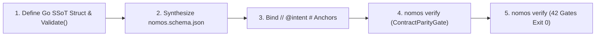

---
authors:
    - Mark Gantlett
    - Nomos Open-Core Substrate
category: architecture
classification: public
date: "2026-09-28"
last_updated: "2026-11-03"
phases:
    - PLAN
    - EDIT
plane: intent
priority: high
status: active
summary: "Compiled Go SSoT contract authoring, structural validation, and Draft 2020-12 JSON Schema parity."
title: "Compiled Go Contracts & JSON Schema Synthesis"
type: directive
version: 4.3.0
---

# Compiled Go Contracts & JSON Schema Synthesis

## 1. Executive Summary & Problem Statement
Earlier iterations split contracts across external policy engines and passive domain-specific schema files. Maintaining parallel schema files alongside Go structs created duplication and drift against **Law 4 (The Single Source of Truth Law)** and **Law 6 (The Canonical Singularity Law)**.

Nomos consolidates every runtime configuration, task record, CapBAC capability, and quality gate threshold directly into compiled Go structs with deterministic `Validate()` methods. Public configuration contracts (`config.EcosystemConfig`) reflect directly into Draft 2020-12 JSON Schema (`nomos.schema.json`), enforced in byte parity by `ContractParityGate`.



---

## 2. Axiomatic Invariants & Laws Codified

| Law # | Law Name | Architectural Invariant Enforced in Schema Synthesis |
| :---: | :--- | :--- |
| **Law 2** | **The Non-Verbal Proof Law** | Contracts require deterministic compilation (`go test ./...`) and explicit `Validate()` unit test vectors. |
| **Law 4** | **The Single Source of Truth Law** | Compiled Go structs serve as the sole runtime SSoT; `nomos.schema.json` is generated from Go reflection with byte parity. |
| **Law 6** | **The Canonical Singularity Law** | Zero parallel DSLs, external Rego files, or duplicate handwritten schema manifests permitted. |
| **Law 7** | **The Fail-Closed Pre-Flight Law** | Payloads failing `Validate()` or drifting from `nomos.schema.json` trigger immediate pre-flight rejection (Exit Code 1). |

---

## 3. Operational Synthesis Workflow

1. **Compiled Go Contract & Validator Definition:**
   Define strongly typed structs with explicit `json`/`yaml` tags and deterministic `Validate()` invariants:
   ```go
   type ExampleContract struct {
       ID       string `json:"id" yaml:"id"`
       Count    int    `json:"count" yaml:"count"`
       IsActive bool   `json:"is_active" yaml:"is_active"`
   }

   func (c *ExampleContract) Validate() error {
       if strings.TrimSpace(c.ID) == "" || c.Count < 0 {
           return types.NewNomosError(types.ErrCodeValidationFailed, "invalid ExampleContract")
       }
       return nil
   }
   ```

2. **Configuration JSON Schema Reflection (`nomos.yaml` Changes Only):**
   When mutating `config.EcosystemConfig`, regenerate root `nomos.schema.json` via `config.GenerateConfigJSONSchema()` so IDE `yaml-language-server` validation and `ContractParityGate` stay in byte parity.

3. **Contract Schema Verification:**
   Run the Law 4 verification suite to confirm AST traceability and JSON Schema byte parity:
   ```bash
   nomos verify
   ```

---

## 4. The Seven Laws & 21 Invariant Cells Suite (DoD Compliance)

1. **Cell (4, 1) - Intent Steel-Man Parity (`intent_steelman`):** Validates all Intent Markdown YAML frontmatter (`title`, `plane`, `status`) and balanced code fences.
2. **Cell (4, 2) - Contract Schema Integrity (`contract_parity`):** Verifies byte parity between `config.EcosystemConfig` and `nomos.schema.json` plus grounded engine charters.
3. **Cell (4, 3) - Intent Traceability (`intent_traceability`):** Resolves `// @intent #<TypeName>` and `<spec>.md` annotations against compiled Go AST types and Intent documents.

---

## 5. Table-Driven Test Vectors

| Vector ID | Schema Action | Target Path | Substrate Check | Gate Outcome | Governing Law |
| :---: | :--- | :--- | :--- | :--- | :--- |
| **VEC-SCH-01** | Define `HandshakeEvent` + `Validate()` | `pkg/contracts/handshake.go` | `go test` & AST scan | `PASS` | Law 4: Compiled Go SSoT |
| **VEC-SCH-02** | Mutate `EcosystemConfig` without schema regen | `nomos.schema.json` | `VerifyConfigJSONSchemaParity` | `FAIL` (Exit Code 1) | Cell (4, 2): Schema drift |
| **VEC-SCH-03** | Tag `// @intent #GhostSchema` | `pkg/service/handler.go` | `IntentTraceabilityGate` | `FAIL` (Exit Code 1) | Cell (4, 3): Missing Go AST type |
| **VEC-SCH-04** | Malformed YAML frontmatter in spec | `intent/specs/sample_spec.md` | `IntentSteelmanGate` | `FAIL` (Exit Code 1) | Cell (4, 1): Invalid frontmatter |
