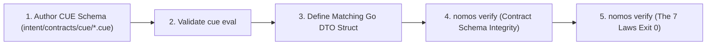

---
authors:
    - Mark Gantlett
    - Sophia
category: architecture
classification: public
date: "2026-09-28"
last_updated: "2026-10-15"
phases:
    - PLAN
    - EDIT
plane: intent
priority: high
status: active
summary: "Schema contract synthesis, Living Intent SSoT authoring, and CUE Singularity type alignment."
title: "Schema Contracts & CUE Type Synthesis"
type: directive
version: 3.0.0
---

# Schema Contracts & CUE Type Synthesis

## 1. Executive Summary & Problem Statement
In earlier iterations, schema definitions were fractured across JSON Draft-07 models, external OPA/Rego policies, and loose YAML files. This multi-engine sprawl violated **Law 4 (The Single Source of Truth Law)** and **Law 6 (The Canonical Singularity Law)**.

Under ADR-0054 and the CUE Singularity, all runtime configurations, task records, CapBAC capabilities, and gate thresholds are unified into strongly typed CUE schemas in `intent/contracts/cue/`. This directive establishes the authoring discipline for synthesizing CUE contracts and corresponding Go DTO structs with compile-time byte parity.



---

## 2. Axiomatic Invariants & Laws Codified

| Law # | Law Name | Architectural Invariant Enforced in Schema Synthesis |
| :---: | :--- | :--- |
| **Law 2** | **The Non-Verbal Proof Law** | Schema contracts require deterministic machine proof via `cue vet` or `cue eval`. Untyped dictionaries or loose maps are rejected. |
| **Law 4** | **The Single Source of Truth Law** | Every contract possesses exactly one compiled Go SSoT mirrored in CUE with cryptographic byte parity. |
| **Law 6** | **The Canonical Singularity Law** | CUE is the single constraint language. Zero redundant JSON schemas or external Rego files tolerated. |
| **Law 7** | **The Fail-Closed Pre-Flight Law** | Data payloads failing CUE schema unification trigger immediate pre-flight rejection (Exit Code 1). |

---

## 3. Operational Synthesis Workflow

1. **CUE Contract Definition:**
   Define strongly typed closed schemas in `intent/contracts/cue/<name>.cue`:
   ```cue
   package schemas

   #ExampleContract: close({
       id:        string & strings.MinRunes(1)
       count:     int & >= 0
       is_active: bool
   })
   ```

2. **Go DTO Implementation:**
   Mirror the CUE schema in the Substrate Go codebase with identical field names and json/yaml struct tags:
   ```go
   type ExampleContract struct {
       ID       string `json:"id" yaml:"id"`
       Count    int    `json:"count" yaml:"count"`
       IsActive bool   `json:"is_active" yaml:"is_active"`
   }
   ```

3. **Contract Schema Verification:**
   Run the Law 4 contract schema auditor to assert zero drift:
   ```bash
   nomos verify
   ```

---

## 4. The Seven Laws & 21 Invariant Cells Suite (DoD Compliance)

1. **Cell (4, 1) - Schema Invariant Verification (Probe 25: `intent_cue_eval`):** Validates all Intent schemas and documents via CUE unification.
2. **Cell (4, 2) - Contract Schema Integrity (Probe 26: `contract_parity`):** Enforces typed AST field mapping between CUE schemas and compiled Substrate Go structs.
3. **Cell (4, 3) - Intent Immutability & Traceability (Probe 27: `intent_tags`, Probe 28: `intent_immutability`):** Core configuration schemas remain immutable outside explicit schema tasks.

---

## 5. Table-Driven Test Vectors

| Vector ID | Schema Action | Target Schema Path | CUE Evaluation | Gate Outcome | Governing Law |
| :---: | :--- | :--- | :--- | :--- | :--- |
| **VEC-SCH-01** | Define `#HandshakeEvent` | `schemas/handshake.cue` | `cue eval` clean | `PASS` | Law 4: SSoT verified |
| **VEC-SCH-02** | Add untyped open field | `schemas/task.cue` | Open schema detected | `FAIL` (Exit Code 1) | Law 4: All schemas must be `close()` |
| **VEC-SCH-03** | Field type mismatch with Go struct | `schemas/gates.cue` | Byte parity mismatch | `FAIL` (Exit Code 1) | Cell (4, 2): Parity violation |
| **VEC-SCH-04** | Introduce `.rego` policy file | `substrate/policy.rego` | Rego engine detected | `FAIL` (Exit Code 1) | Law 6: CUE Singularity |

