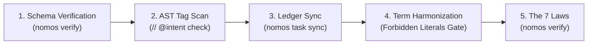

---
authors:
    - Mark Gantlett
    - Sophia
category: architecture
classification: public
date: "2026-09-29"
last_updated: "2026-10-15"
phases:
    - EDIT
    - REVIEW
    - SYNC
plane: intent
priority: high
status: active
summary: "Intent SSoT alignment, AST reflection reconciliation, and The Seven Laws DoD harmonization."
title: "Intent SSoT Alignment & Reconciliation"
type: directive
version: 3.0.0
---

# Intent SSoT Alignment & Reconciliation

## 1. Executive Summary & Problem Statement
Over successive development waves, the Intent Plane and Substrate Plane risk architectural drift: exported symbols change without Intent updates, deprecated terms linger in comments, or ADR task linkages become orphaned.

This directive codifies the **SSoT Reconciliation Protocol**, which deterministically restores cross-plane parity between living Markdown specifications and the compiled Go Substrate. Governed by **Law 4 (The Single Source of Truth Law)**, this protocol ensures zero drift across schemas, AST symbols, and The Seven Laws & 21 Invariant Cells Suite (37 Sensor Probes).

---

## 2. Axiomatic Invariants & Laws Codified

| Law # | Law Name | Architectural Invariant Enforced in Reconciliation |
| :---: | :--- | :--- |
| **Law 2** | **The Non-Verbal Proof Law** | Parity requires AST-level proof and compiler exit code 0. Zero tolerance for unverified conversational claims. |
| **Law 4** | **The Single Source of Truth Law** | Every contract, schema, and specification possesses exactly one compiled SSoT with cryptographic byte parity. |
| **Law 6** | **The Canonical Singularity Law** | Single CLI engine (`nomos`), pure 2-plane keys (`INT-*`, `SUB-*`), and unified Go AST & JSON Schema contracts. |
| **Law 7** | **The Fail-Closed Pre-Flight Law** | Reconciliation detects and blocks untracked schema mutations or broken markdown wires before exit from `EDIT`. |

---

## 3. Operational Reconciliation Stages

| Stage | Command | Intent Plane Action | Substrate Plane Action | Gate Enforcement |
| :--- | :--- | :--- | :--- | :--- |
| **1. Schema Verification** | `nomos verify` | Validate frontmatter, dates, and balanced code fences. | Assert zero `nomos.schema.json` drift against Go SSoT. | Cell (4, 1) & Cell (4, 2) |
| **2. AST Tag Scan** | `nomos verify` | Ensure every `INT-<N>` spec contains required symbol headers. | Verify all `// @intent` AST annotations resolve. | Cell (4, 3) (Traceability) |
| **3. Ledger Sync** | `nomos task list` | Ensure active tasks link to Living Ledger wavefront. | Verify branch states and task DAG dependencies. | Cell (6, 1) (Singularity) |
| **4. Term Alignment**| `nomos verify` | Replace deprecated terms per `edit_01_deprecated_terms.md`. | Scan AST literals for blacklisted strings. | Cell (3, 1) (Forbidden Literals) |
| **5. Full Verification**| `nomos verify` | Assert all documentation links resolve. | Execute all unit tests and 21 Invariant Cells. | The Seven Laws (Exit 0) |

---

## 4. The Seven Laws & 21 Invariant Cells Suite (DoD Compliance)

1. **Cell (4, 1) - Intent Steel-Man Parity (Probe 25: `intent_steelman`):** Validates Intent Markdown YAML frontmatter and balanced code fences.
2. **Cell (4, 2) - Contract Schema Integrity (Probe 26: `contract_parity`):** Verifies byte parity between `nomos.schema.json` and compiled `config.EcosystemConfig`.
3. **Cell (4, 3) - Intent Traceability Anchors (Probe 27: `intent_traceability`):** Exported symbol docstrings resolve cleanly against Go AST types and Intent specs.

---

## 5. Table-Driven Test Vectors

| Vector ID | Reconciliation Target | Detected State | Expected Substrate Action | Gate Invariant |
| :---: | :--- | :--- | :--- | :--- |
| **VEC-REC-01** | `nomos.schema.json` | In byte parity with `EcosystemConfig` | `PASS` (0 violations) | Law 4: Byte parity verified |
| **VEC-REC-02** | Go function tagged with missing INT | `// @intent INT-999` | `FAIL` (Cell (4, 3) violation) | Cell (4, 3): Unanchored AST tag |
| **VEC-REC-03** | Broken markdown link | `target: nonexistent.md` | `FAIL` (Cell (2, 2) violation) | Cell (2, 2): Broken wire detected |
| **VEC-REC-04** | Deprecated term in comment | `// gsi-open foundation` | `FAIL` (Cell (3, 1) violation) | Cell (3, 1): Deprecated term rejected |
| **VEC-REC-05** | Workspace fully harmonized | All specs and code aligned | `PASS` (Exit 0) | Full 7 Laws verification green |

