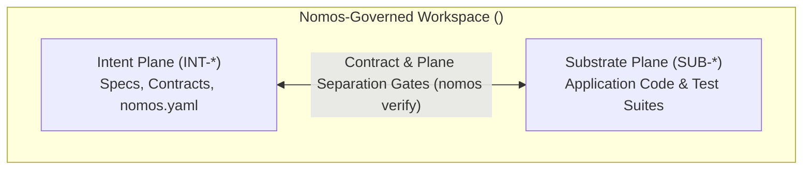

---
authors:
    - Mark Gantlett
    - Sophia
category: architecture
classification: public
date: "2026-09-27"
last_updated: "2026-10-31"
phases:
    - IDLE
    - PLAN
plane: intent
priority: high
status: active
summary: "Canonical Dual-Plane workspace topology (Intent & Substrate), polyglot root discovery, single Nomos CLI, and hermetic worktree isolation."
title: "Dual-Plane Workspace Topology & Hermetic Isolation"
type: directive
version: 4.0.0
---

# Dual-Plane Workspace Topology & Hermetic Isolation

## 1. Executive Summary & Problem Statement
Every Nomos-governed repository separates changes into two architectural planes: the **Intent Plane** (governing contracts, specifications, schemas, and `nomos.yaml` policy) and the **Substrate Plane** (governing application source code, polyglot toolchains, and automated tests).

All task mutations execute through the canonical `nomos` CLI inside transient, isolated task worktrees (`worktrees/<repo>-<KEY>`).

---

## 2. Axiomatic Invariants & Laws Codified

| Law # | Law Name | Architectural Invariant Enforced in Topology |
| :---: | :--- | :--- |
| **Law 1** | **The Dual-Core Inversion Law** | The `nomos` engine governs state and gates; Tier 1 coding agents operate under indirect control bounded by phase envelopes. |
| **Law 3** | **The Hermetic Worktree Law** | Protected trunk (`main` / `master`) is read-only. All work occurs in transient worktrees (`worktrees/<repo>-<KEY>`). |
| **Law 4** | **The Single Source of Truth Law** | Every contract and configuration possesses a single authoritative source with deterministic verification parity. |
| **Law 5** | **The Zero-Hardcoded-Path Law** | Zero hardcoded workstation filesystem paths or host literals. Paths resolve dynamically from workspace configuration (`nomos.yaml`). |
| **Law 6** | **The Canonical Singularity Law** | Single CLI engine (`nomos`) and pure 2-plane task keys (`INT-*`, `SUB-*`). |

---

## 3. Structural Workspace Topology

1. **Intent Plane (`INT-*`):**
   - Specifications, declarative contracts, and repository governance (`nomos.yaml`, `intent/`).
2. **Substrate Plane (`SUB-*`):**
   - Polyglot implementation packages and automated test suites (Go, TypeScript/Node, Python, Rust, C/C++) configured in `nomos.yaml`.
3. **Hermetic Worktrees & Scratch Boundary:**
   - Isolated task worktrees reside at `worktrees/<repo>-<KEY>`.
   - Ephemeral walkthroughs and scratch artifacts reside in `.tmp/`. Host `/tmp` source mutations are prohibited.

---

## 4. The Seven Laws & 21 Invariant Cells Suite (DoD Compliance)

1. **Cell (3, 1) / (3, 2) - Worktree Boundary (`staged_boundaries`, `hermetic_worktree`):** Asserts strict worktree isolation.
2. **Cell (6, 3) - Key Singularity Invariant (`canonical_singularity`):** Asserts task keys conform to `^(INT|SUB)-[0-9]+$`.
3. **Cell (5, 1) - Forbidden Literals Invariant (`forbidden_literals`):** Rejects configured forbidden path literals and deprecated tokens.
4. **Cell (7, 1) - Plane Separation Invariant (`plane_separation`):** Rejects single-task cross-plane edits across `intent` and `substrate` roots.

---

## 5. Table-Driven Test Vectors

| Vector ID | Target Topology Context | Scanned Expression | Expected Gate Action | Governing Invariant |
| :---: | :--- | :--- | :--- | :--- |
| **VEC-TOPO-01** | Downstream workspace config | `nomos.yaml` present | `PASS` | Canonical workspace configuration |
| **VEC-TOPO-02** | Cross-plane mutation | `SUB-1` editing `nomos.yaml` | `FAIL` (Exit Code 1) | Law 7: Plane separation invariant |
| **VEC-TOPO-03** | Task worktree provision | `worktrees/<repo>-INT-12` | `PASS` | Law 3: Canonical worktree path |
| **VEC-TOPO-04** | Task key assignment | `task: "CUST-12"` | `FAIL` (Exit Code 1) | Law 6: Pure 2-plane keys only |
| **VEC-TOPO-05** | Direct trunk file edit | `<repo>/src/service.py` | `FAIL` (Exit Code 1) | Law 3: Trunk read-only lockout |
