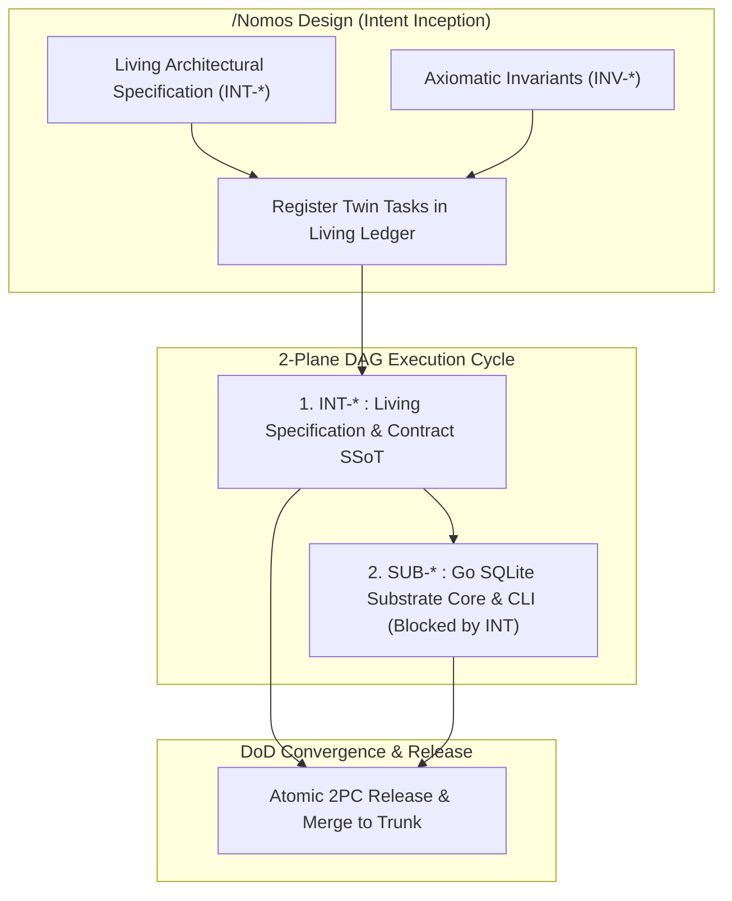

---
authors:
    - Mark Gantlett
    - Sophia
category: planning
classification: public
date: "2026-09-24"
description: "Generative architectural and interface synthesis across Intent SSoT and Substrate modules"
last_updated: "2026-10-15"
phases:
    - PLAN
plane: intent
priority: high
status: active
summary: "Generative architectural synthesis, capability design, and DAG execution cycle scaffolding across Nomos."
title: "Nomos Design & Architectural Synthesis Directives"
type: directive
version: "4.0.0"
---

# Nomos Architectural Synthesis

Generative architectural synthesis, capability design, and DAG execution cycle scaffolding across the Nomos ecosystem under pure **2-Plane Singularity (Law 6)**: **Intent** (`INT-*`) and **Substrate** (`SUB-*`).

---

## 1. The Dual-Plane Transduction Protocol

When designing new architectural capabilities at the Intent plane, `/Nomos Design` deterministically transduces intent into interconnected **Twin DAG Tasks** registered directly in the Living Ledger (via `nomos task pair` or `nomos task create --twin-of <KEY>`):



### Deterministic Ledger Scaffolding Workflow

Whenever `/Nomos Design` is invoked for a cross-domain system capability, it executes the following canonical Living Ledger scaffolding sequence:

```console
# 1. Scaffold Intent SSoT Task (Contracts, Schemas & Invariants)
nomos task create "Contracts: Telemetry Schemas & Invariant Bounds" \
  --plane intent

# 2. Scaffold Substrate Engine Task (Go SQLite Core, CLI & Invariant Gates)
nomos task create "Substrate: Telemetry Kernel & CLI Surface" \
  --plane substrate
```

---

## 2. Pre-Check Validation Rules

- [ ] Run `nomos handshake` or query core memory (`nomos mem recall "[query]"`) for existing architectural patterns.
- [ ] Determine the target architectural plane (`intent` or `substrate`) or initiate a twin task pair.
- [ ] Ensure workspace is clean (`git status`) or active task is scaffolded in `PLAN` or `SPEC` phase.

---

## 3. Plane-Specific Synthesis Guidelines

### 1. Intent Plane (`--plane=intent`, `INT-*`)
- **Domain**: Cognitive co-processor protocols, living specifications, schemas, ADRs, and JIT directives.
- **Artifacts**:
  - Authoritative Markdown specs in the configured `intent/` specification root.
  - Reflected Draft 2020-12 JSON Schema (`nomos.schema.json`) bound to `config.EcosystemConfig`.
  - Schema and contract parity verified via `nomos verify`.

### 2. Substrate Hemisphere (`--plane=substrate`, `SUB-*`)
- **Domain**: Compiled Go engine, AST verification gates, transactional SQLite schemas, and deterministic state machines.
- **Sub-Domains**:
  - **Core Substrate**: Strongly-typed Go structs, CLI commands, and table-driven tests.
  - **Verification Engine**: Deterministic AST quality gates enforcing the 7 Laws across polyglot trees.
- **Machine Invariants**:
  - The 7x3 Canonical Invariant Suite (7 Laws, 21 Invariant Cells) passing via `nomos verify`.
  - Cyclomatic complexity <= 15, docstring density >= 10%.

---

## 4. Sequential Execution Instructions

1. **Topological Classification & DAG Cycle Evaluation**:
   - Determine whether the capability spans both planes (Intent contract + Substrate implementation) or is a single-plane task.
   - For 2-plane capabilities, register both twin tasks with proper dependency linkage (`nomos task pair "<Title>"` or `nomos task create --twin-of <INT-KEY>`).
2. **Draft Conceptual Specification**:
   - Synthesize state machine, interfaces, and visual/data models.
   - Define exact failure modes, invariant rules, and non-verbal proofs.
3. **Draft Implementation Plan**:
   - Draft `implementation_plan.md` in the Brain artifact directory without writing flat files to the source tree.
4. **PO Alignment**:
   - Obtain Product Owner (PO) consent before transitioning to active code mutations.
5. **Persist Contract to Nomos Mneme**:
   - Save the finalized architecture into persistent memory:
     ```bash
     nomos mem save "Design: [Topic] ([Plane]). Architecture: [Summary]"
     ```

---

## 5. Definition of Done Verify Checks

- [ ] 2-Plane Singularity strictly respected (all keys are `INT-*` or `SUB-*`).
- [ ] For 2-plane capabilities, twin tasks and DAG blocker dependencies are registered in the Living Ledger.
- [ ] For Intent, schemas and living specifications are fully specified.
- [ ] For Substrate, AST invariants and table tests are planned.
- [ ] Design specification is persisted to Nomos Mneme via `nomos mem save`.
